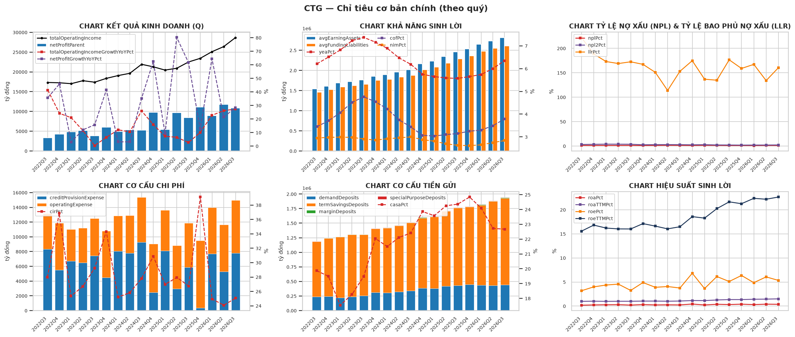
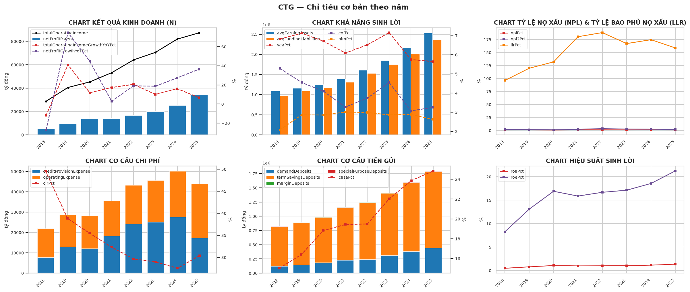
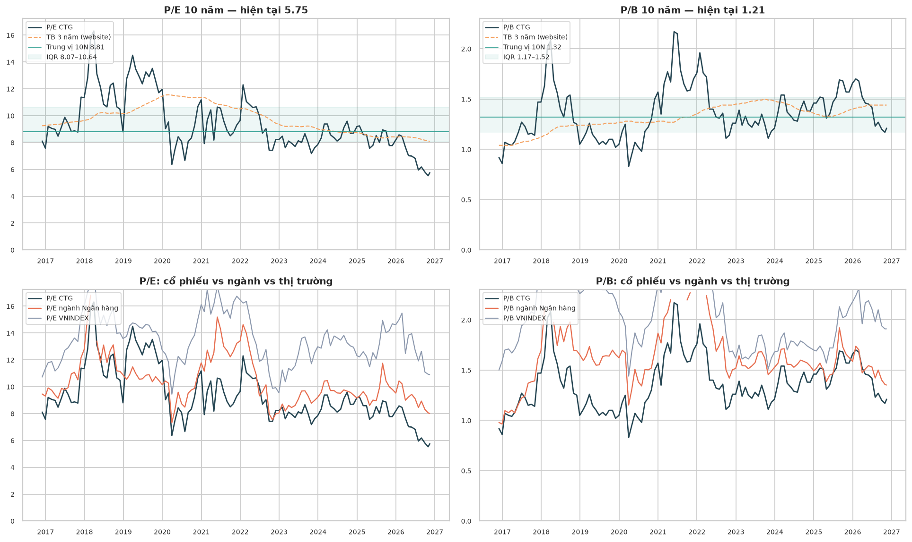
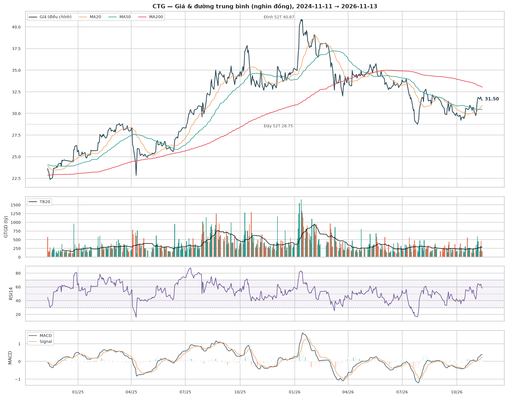
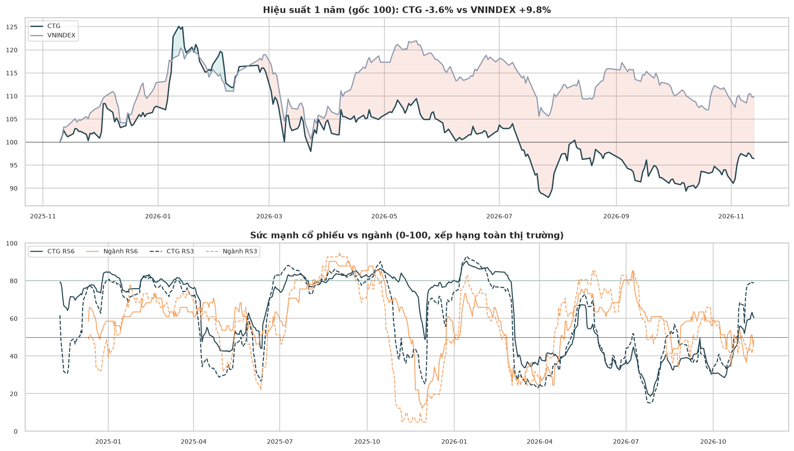
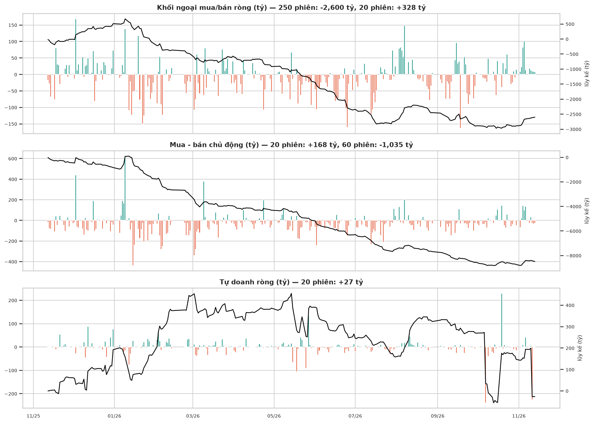
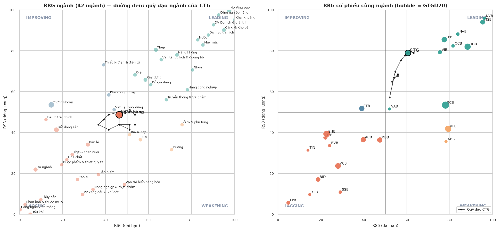

# CTG — Ngân hàng TMCP Công Thương Việt Nam (VietinBank) | Phân tích cổ phiếu

> Dữ liệu sstock tới **2026-11-13** · Ngành Ngân hàng (sectorId 24) · Cấu trúc BCTC: ngân hàng (bank) · Gói S1: BCTC 17 quý (2022Q3–2026Q3), BCTC năm từ 2018, giá từ 2023-11-16, định giá thị trường từ 2016-11-17.
> Báo cáo được tạo từ dữ liệu định lượng, **không phải khuyến nghị đầu tư**.

## 1. Tóm tắt

**Kết luận:** Cơ bản & định giá **mạnh** (+6/6), kỹ thuật & dòng tiền **khá** (+5/8), nên theo ma trận CTG thuộc ô *ứng viên mạnh*. Tuy nhiên ngành Ngân hàng đang *lagging* và thị trường ở trạng thái *pressure*, giá vẫn **dưới MA200 (33,03) đang dốc xuống**, nên tôi hạ một bậc xuống **Watchlist có trigger rõ ràng**: chưa đuổi giá, chờ giá vượt MA200 và CTG đủ 5/5 trụ Elite. Scorecard **+10/±16 → Tích cực** (Kỹ thuật & dòng tiền +5/8 · Cơ bản & định giá +6/6 · Bối cảnh −1/2).

| Luận điểm | Số liệu |
|---|---|
| Lợi nhuận lõi tăng tốc (không còn nhờ dự phòng như năm 2025) | 9T/2026: LN trước dự phòng 60.338 tỷ (**+29,8%**), chi phí dự phòng +22,6%, LNST cty mẹ 31.492 tỷ (+33,8%); TOI Q3/26 28.654 tỷ (+27,4% YoY) |
| Chất lượng tài sản ổn, bộ đệm dày | NPL 1,2%, nợ nhóm 2 2,3%, LLR 160% (Q3/26); ROE TTM 22,6%, CIR 25,1% |
| Định giá rẻ nhất 10 năm theo P/E | P/E 5,75x (percentile ~1% của 10 năm, trung vị 8,81x); P/B 1,21x (percentile 31%) dù ROE đang cao kỷ lục; P/B thấp nhất nhóm VCB/BID/MBB/TCB |
| Giá chưa xác nhận xu hướng | 31,50: trên MA50 (30,46) nhưng dưới MA200 (33,03); cách đỉnh 52 tuần −22,9%; 1 năm −5,6% so với VNINDEX +8,5% |
| Sức mạnh và dòng tiền cải thiện nhanh | RS3 78,9 / RS6 60,4 (từ 35,8 / 33,7 cách đây 20 phiên), RRG *leading*, VCR 1,11, khối ngoại mua ròng 11 phiên liên tiếp (+328 tỷ/20 phiên) |

**Điều kiện hành động:** tín hiệu xác nhận là đóng cửa **trên 33,0 (MA200)**, GTGD khớp lệnh vượt TB20 (~254 tỷ), **và** RS3 ≥ 80 trong khi RS6 giữ ≥ 60 liên tục 3 phiên (khi đó đủ 5/5 trụ Elite). Kịch bản bị vô hiệu nếu đóng cửa **dưới 29,2** (đáy nền 2026-10-08), và tiêu cực hơn nếu mất **28,75** (đáy 52 tuần).

## 2. Bối cảnh thị trường & ngành

- **Thị trường:** *pressure* đã 73 phiên (độ tin cậy 63,7 – Medium), 6 phiên phân phối trong 25 phiên, FTD gần nhất 2026-11-04; độ rộng VN100 53%. Tâm lý ngắn hạn 29 / trung hạn 33 (*Bi quan*; trung hạn +8 điểm trong tháng). P/E VNINDEX 10,9 so với TB 3 năm 13,3, tức thị trường đang rẻ so với lịch sử của chính nó.
- **Lan tỏa:** nhóm dẫn dắt là **vốn hóa vừa (51)**, còn **vốn hóa lớn yếu nhất (21, −6 điểm/tháng)**. CTG có vốn hóa 244.659 tỷ, thuộc nhóm lớn, nên đây là lực cản trực tiếp.
- **Ngành Ngân hàng:** RRG *lagging*, RS3 48,8 (hạng 22/42), RS6 46,3 (hạng 23), VCR 0,96, chỉ 44,8% số mã trên MA50, không có cảnh báo. Trên [08_rrg](charts/08_rrg.png), quỹ đạo ngành **xoay vòng quanh tâm (RS 37–55)** suốt 13 tuần và chưa có hướng rõ. Ngành phân hóa mạnh: nhóm quốc doanh VCB/BID *lagging* sâu, còn CTG đi cùng nhóm tư nhân đang *leading* (HDB, MSB, TCB).
- **Vị thế:** CTG chiếm 9,4% vốn hóa và 13,1% LNST TTM của 29 ngân hàng niêm yết. LNST TTM của CTG +27,7% YoY, nhanh hơn mức +20,7% của ngành.

*Quan sát biểu đồ:* VNINDEX ở trạng thái *pressure* gần như suốt 12 tháng, chỉ có hai nhịp *downtrend* ngắn (03–04/2026 và cuối 07/2026). Đường lan tỏa vốn hóa lớn liên tục dao động mạnh 10–90 và vừa rơi từ ~65 (cuối 10/2026) xuống 21, nên nhóm cổ phiếu lớn chưa có dòng tiền bền.

## 3. Kết quả kinh doanh & sức khỏe tài chính

| Chỉ tiêu (tỷ đồng, %) | Q3/25 | Q4/25 | Q1/26 | Q2/26 | Q3/26 | YoY |
|---|---|---|---|---|---|---|
| Tổng TN hoạt động | 22.500 | 23.425 | 25.102 | 26.385 | 28.654 | +27,4% |
| Thu nhập lãi thuần | 17.176 | 17.960 | 19.385 | 20.730 | 21.816 | +27,0% |
| Thu nhập dịch vụ | 1.587 | 1.697 | 1.847 | 2.269 | 2.487 | +56,7% |
| LN trước dự phòng | 16.478 | 14.260 | 18.840 | 20.029 | 21.469 | +30,3% |
| Chi phí dự phòng | 5.863 | **351** | 7.701 | 5.300 | 7.780 | +32,7% |
| LNST cty mẹ | 8.449 | 11.067 | 8.917 | 11.740 | 10.835 | +28,2% |
| NIM / YEA / COF | 2,6 / 5,6 / 3,1 | 2,6 / 5,7 / 3,2 | 2,6 / 5,7 / 3,3 | 2,8 / 6,0 / 3,5 | 2,8 / 6,3 / 3,8 | +0,2 / +0,8 / +0,6pp |
| CIR | 26,8 | 39,1 | 24,9 | 24,1 | 25,1 | −1,7pp |
| NPL / nhóm 2 | 1,1 / 2,2 | 1,1 / 2,0 | 1,0 / 2,1 | 1,2 / 2,1 | 1,2 / 2,3 | +0,1 / +0,1pp |
| LLR | 176,5 | 158,8 | 167,2 | 133,9 | 160,4 | −16,1pp |
| CASA | 24,4 | 24,8 | 24,1 | 22,7 | 22,7 | −1,7pp |
| LDR | 84,3 | 83,7 | 84,5 | 84,8 | 87,0 | +2,7pp |

**Tăng trưởng (lấy lũy kế năm làm thước đo).** 9T/2026 TOI +25,5%, LN trước dự phòng +29,8%, chi phí dự phòng +22,6%, LNST +33,8%. Tăng trưởng TTM (+27,7%) thấp hơn lũy kế năm vì TTM chứa Q4/25. Năm nay **LN trước dự phòng tăng gần ngang LNST (+29,8% so với +33,8%) dù chi phí dự phòng vẫn tăng 22,6%**, tức lợi nhuận đến từ năng lực lõi chứ không nhờ cắt dự phòng. Năm 2025 thì ngược lại (bảng năm): LN trước dự phòng chỉ +2,3% (59.363 → 60.744 tỷ), còn chi phí dự phòng giảm 37% (27.599 → 17.298 tỷ). Phần tiết kiệm dự phòng ≈ 10.301 × 0,8 ≈ 8.240 tỷ sau thuế, tương đương **~89% mức tăng LNST 2025** (+9.243 tỷ).

**Cơ cấu TOI Q3/26:** lãi thuần 76%, dịch vụ 8,7% (+56,7% YoY, điểm sáng), FX/vàng 1.170 tỷ, chứng khoán đầu tư chỉ 16 tỷ, thu nhập khác 3.167 tỷ (11%; có thể gồm thu hồi nợ đã xử lý, cần tin DN). Hai mảng FX/vàng và chứng khoán đầu tư đổi chiều theo quý nên không bền.

**Giải thích các dòng "Sự kiện ngân hàng":**
- **Q4/25, LNST +2.618 tỷ QoQ; dự phòng 5.863 → 351 tỷ đóng góp ~168%; LN trước dự phòng −13,5%:** đây là quý lợi nhuận được làm cao bằng dự phòng. So với cùng kỳ, (2.464 − 351) × 0,8 ≈ **1.690 tỷ LNST nhờ dự phòng thấp**. Loại phần này thì LNST Q4/25 ≈ 9.377 tỷ, **−4,3% YoY** (thay vì +13%). Cùng quý CIR tăng vọt lên 39,1% (chi phí hoạt động 9.165 tỷ), mẫu chi phí cuối năm giống Q4/24 (CIR 30,9%). Hệ quả: **Q4/26 sẽ so với một nền dự phòng gần bằng 0**. Giả định Q4/26 có LN trước dự phòng bằng Q3/26 và dự phòng bằng trung bình 3 quý 2026 (6.927 tỷ), LNST Q4/26 ước khoảng 11.600 tỷ, tức chỉ ~+5% YoY. Đây là độ nhạy, không phải dự báo.
- **Q4/25, nợ nhóm 5 11.813 → 19.847 tỷ (+68%):** cùng quý nhóm 3+4 giảm từ 9.910 xuống 2.069 tỷ, còn tổng nhóm 3–5 gần như đi ngang (21.723 → 21.916). Nhiều khả năng là **nợ trượt nhóm từ 3–4 xuống 5**, không phải nợ xấu mới. Số dư dự phòng giảm 38.336 → 34.810 tỷ dù chi phí chỉ 351 tỷ, ngụ ý đã dùng ~3.877 tỷ dự phòng (nghi xử lý nợ, cần thuyết minh). LLR −17,6pp về 158,8%.
- **Q1/26, nhóm 3 1.491 → 5.960 (+300%) và nhóm 4 578 → 2.724 tỷ (+371%):** cùng quý nhóm 5 giảm 7.934 tỷ, còn số dư dự phòng gần đi ngang (34.810 → 34.436) dù chi phí 7.701 tỷ. Ngụ ý ~8.075 tỷ dự phòng đã được dùng, **nghi xử lý nợ nhóm 5 bằng dự phòng (cần thuyết minh)**. Song song đó có nợ xấu mới hình thành ở nhóm 3–4. Đây là mẫu "Q1 nhóm 3 tăng vọt" lặp lại ở **2 cặp Q4→Q1 quan sát được** (Q1/25: nhóm 3 2.817 → 6.431). Mới có hai lần nên chưa đủ kết luận là mùa vụ.
- **Q2/26, LLR 167,2 → 133,9%; LNST +2.823 tỷ QoQ, dự phòng giảm 7.701 → 5.300 tỷ đóng góp ~68%, ⚠️ cùng quý NPL tăng 1,0 → 1,2%; nhóm 5 +31% (11.913 → 15.611):** tăng trưởng QoQ của quý này không phải tín hiệu cải thiện. Mặt khác, so với cùng kỳ thì dự phòng Q2/26 vẫn **cao hơn** Q2/25 (5.300 so với 2.973), và LN trước dự phòng vẫn +6,3% QoQ. Ngụ ý ~6.142 tỷ dự phòng được sử dụng trong quý.
- **Q3/26, nhóm 3 5.005 → 7.523 tỷ (+50%):** nhóm 2 cũng tăng 19.564 → 23.063 (+18%), là **tín hiệu sớm cần theo dõi**. Bù lại, nhóm 4 giảm 34%, nhóm 5 giảm 2%, và số dư dự phòng tăng 7.759 tỷ, gần bằng toàn bộ chi phí quý (7.780). Nghĩa là quý này hầu như không dùng dự phòng xử lý nợ mà **tích lũy bộ đệm**, đưa LLR lên lại 160,4%. Tính lại: 41.353 / (7.523 + 2.957 + 15.301) = 160,4%, khớp số nguồn.
- **Kiểm tra độ nhạy LLR:** LLR hiện 160% (>100%) nên không cần kịch bản trích bổ sung. Tổng dự phòng ngụ ý đã dùng trong 4 quý (Q4/25–Q3/26) ≈ 18.100 tỷ, khoảng 0,85% dư nợ. Chi phí dự phòng 9T/2026 (20.781 tỷ) đã vượt cả năm 2025, nên chi phí tín dụng đang ở mức thận trọng.

**Nguồn vốn & NIM (4 quý).** YEA từ 5,7% lên 6,3% và COF từ 3,2% lên 3,8% cùng tăng 0,6pp từ Q4/25 đến Q3/26; NIM nhích 2,6 → 2,8%. COF đã tăng liên tục 5 quý (3,0% ở Q1/25 lên 3,8%) trong khi CASA giảm từ 24,8% xuống 22,7%, nên **NIM chỉ giữ được khi YEA tiếp tục tăng theo**. Tín dụng +7,3% lũy kế năm (cùng kỳ +15,8%), huy động +8,4% (cùng kỳ +10,5%). Tiền gửi KH +9,5% YoY lên 1.944.301 tỷ. Giấy tờ có giá giảm liên tục, 227.954 tỷ (Q2/25) → 123.087 tỷ (Q3/26), và vay Chính phủ/NHNN tăng lên 173.263 tỷ. LDR lên 87,0% (+2,2pp QoQ). Vốn liên ngân hàng Q3/26 giảm 39.073 tỷ, tiền gửi tại TCTD khác giảm 21.582 tỷ, nên CTG vẫn là **bên cho vay ròng** trên thị trường liên ngân hàng (−98.162 tỷ; tỷ trọng vốn liên NH 14,7% tổng nguồn, −0,24pp/4 quý). Cơ cấu cho vay đang dài hạn hóa: vay dài hạn 542.704 → 693.874 tỷ (+28% trong 5 quý) so với vay ngắn hạn +5%. Hạn mức tín dụng NHNN giao không có trong sstock.

**Bảng cân đối khác.** Tài sản khác 70.519 tỷ (+34,5% YoY, 2,4% tổng tài sản); chưa rõ cơ cấu, cần thuyết minh. `otherCapital` 70.283 tỷ không được coi là vốn chủ. Đối chiếu gần đúng: vốn hóa / P/B = 244.659 / 1,212 ≈ 201.900 tỷ vốn sổ sách hàm ý, tương đương vốn điều lệ + quỹ & LNGPP (77.669 + 128.502 = 206.171 tỷ; lệch do khác ngày).

**Pha loãng / sự kiện quyền.** Vốn điều lệ tăng 53.700 → 77.669 tỷ (+44,6%) ở Q4/25, khớp quỹ & LNGPP giảm 14.236 tỷ và sự kiện quyền 2025-12-17 (hệ số 1,447). Đây là **cổ tức cổ phiếu/thưởng ~45%, không có tiền mới** (cần tin DN về nguồn). Số CP lưu hành 7.766,9 triệu khớp vốn điều lệ BCTC. Sự kiện 2023Q4 (+11,7%, hệ số 1,117) cũng là cổ tức CP ~12%.

*Quan sát biểu đồ:*
- **04_fa_key:** cột chi phí dự phòng Q4/25 gần như biến mất, còn cột chi phí hoạt động cùng quý cao nhất 17 quý, tức hai biến số cuối năm bù trừ nhau. Đường COF tạo đáy ở Q1/25 rồi dốc lên đều, còn YEA chỉ đổi chiều từ Q3/25.
- **06_fa_annual:** ROE đi lên gần như liên tục từ 8,3% (2018) lên 21,2% (2025), CASA từ ~15% lên ~25%, CIR giảm từ 50% xuống ~28–30%: chuyển dịch cấu trúc rõ ràng. Riêng năm 2025, cột dự phòng thấp hẳn so với năm 2024 còn NIM rơi xuống 2,6%, đúng là năm "lợi nhuận nhờ dự phòng".
- **05_fa_dashboard** ([link](charts/05_fa_dashboard.png)): trong cơ cấu nguồn vốn, phần giấy tờ có giá co lại còn phần Chính phủ/NHNN và liên ngân hàng phình ra từ 2026Q1. Cơ cấu cho vay theo thời gian cho thấy phần dài hạn (xanh lá) mở rộng rõ. Tỷ lệ nợ chuẩn ~97,7–98%.

## 4. Định giá

| | Hiện tại | TB 3 năm | Trung vị 10N | Min–Max 10N | Percentile 10N | Ngành | VNINDEX |
|---|---|---|---|---|---|---|---|
| P/E | 5,75 | 8,09 | 8,81 | 5,5–16,3 | ~1% | 8,02 | 10,90 |
| P/B | 1,21 | 1,44 | 1,32 | 0,83–2,17 | 31% | 1,35 | 1,91 |

**P/B đặt cạnh ROE theo năm** (P/B cuối năm, ROE `roePct`):

| Năm | 2019 | 2020 | 2021 | 2022 | 2023 | 2024 | 2025 | Hiện tại |
|---|---|---|---|---|---|---|---|---|
| ROE % | 13,1 | 16,9 | 15,9 | 16,7 | 17,1 | 18,6 | 21,2 | 22,6 (TTM) |
| P/B | 1,05 | 1,57 | 1,76 | 1,26 | 1,21 | 1,46 | 1,66 | 1,21 |

- ROE hiện tại **cao hơn mọi năm** trong giai đoạn hình thành trung vị P/B 10 năm (1,32), nên mức P/B về trung vị **không phải kịch bản lạc quan**. P/B giảm từ 1,66 (cuối 2025) xuống 1,21 trong khi ROE TTM tăng từ 21,2% lên 22,6%: thị trường **đang chiết khấu rủi ro chứ không chiết khấu lợi nhuận**. Các rủi ro được chiết khấu gồm: COF tăng và CASA giảm, pha loãng 45% sau đợt thưởng 12/2025, nợ nhóm 2–3 tăng lại, nền Q4/25 cao, và dòng tiền rút khỏi nhóm vốn hóa lớn/quốc doanh.
- **So với nhóm cùng loại** (P/B tháng 2026-11-15 qua `get_stock_valuation`; ROE snapshot): VCB 1,83x (ROE 17,5%), BID 1,29x (18,9%), TCB 1,28x (15,9%), MBB 1,24x (22,4%), **CTG 1,21x (22,6%)**. CTG có P/B thấp nhất nhóm dù ROE cao nhất. Mức chiết khấu −10% so với P/B ngành là hợp lý, không bị phóng đại.
- P/E 5,75x thấp hơn ngành 28% (hạng chiết khấu 30/42 ngành theo P/E ngành), percentile ~1% của 10 năm. Cờ `avg3Y_distorted` = False, nên P/E/P/B TB 3 năm không bị méo.
- **Giá tham chiếu** (giả định LNST/BVPS giữ nguyên): P/B về trung vị 10N → **34,3**; P/B về TB 3 năm → 37,4. P/E về trung vị 10N → 48,3 và về TB 3 năm → 44,3, nhưng EPS hiện ở đỉnh ROE và chịu nền Q4/25 nên tôi chỉ dùng P/B làm tham chiếu chính. Đây là vùng tham chiếu, không phải giá mục tiêu.
- P/E SSTOCK dự phóng 5,29 và P/B SSTOCK 1,12 **bị giữ nguyên từ 2026-07-24** (chờ BCTC +2 quý), nên không phản ánh giá hôm nay.

*Quan sát biểu đồ:* P/E của CTG rơi từ ~8,5–9 (đầu 2026) xuống 5,6–5,8, **thủng đáy 10 năm (6,4 năm 2020)**, trong khi P/E ngành chỉ giảm về ~8. Khoảng cách với ngành giãn rộng nhất từ 2017. P/B của CTG nằm dưới P/B ngành gần như liên tục từ 2022.

## 5. Kỹ thuật & xu hướng giá

- **Cấu trúc:** giá 31,50 > MA20 30,92 > MA50 30,46 (MA50 dốc −1,16%/20 phiên) và trên MA100 31,14, nhưng **dưới MA200 33,03**, MA200 đang dốc xuống từ đỉnh ~35 (05/2026). Xu hướng trung hạn vẫn giảm, ngắn hạn đã hồi.
- **Vùng nền:** sau cú rơi về đáy 52 tuần **28,75 (2026-07-27)**, giá tích lũy trong **29,2–32,15** từ giữa 08/2026 (đáy nền 29,2 ngày 2026-10-08, đỉnh nền 32,15 ngày 2026-08-21). Đỉnh 20 phiên 31,90.
- **Động lượng:** RSI14 58,2 (khỏe, chưa quá mua). MACD 0,37 > signal 0,27 và trên 0, nhưng histogram co lại (0,107 so với 0,140 phiên trước). ATR14 1,7% (~0,55 nghìn/phiên), biến động năm 25,6%, beta 0,86, max drawdown 1 năm −29,7%.
- **Thanh khoản:** GTGD TB20 281 tỷ / TB60 248 tỷ; khớp lệnh TB20 254 tỷ (thỏa thuận 7,8% GTGD 60 phiên). Phiên bứt phá 2026-11-05 khớp 560 tỷ, nhưng hai phiên gần nhất chỉ ~143–145 tỷ, **thấp hơn TB20**: nhịp hồi đang thiếu lực.
- **Hiệu suất so với VNINDEX:** 1T +5,7% (+3,6pp), 3T −2,0% (−0,3pp), 6T −11,9% (−1,9pp), YTD −10,5% (−7,8pp), 1N −5,6% (−14,1pp).
- Mọi mức giá trước 2025-12-17 và 2026-07-23 (GDKHQ) trong báo cáo đều là **giá điều chỉnh (adjClose)**.

*Quan sát biểu đồ 01:* đỉnh 40,87 (2026-01-12) là một cú **blow-off** với GTGD vượt 1.500 tỷ/phiên và RSI > 80, ngay sau đợt thưởng 45%. Từ đó giá tạo chuỗi đỉnh thấp dần và cắt xuống MA200 vào 05/2026. Đáy 07/2026 đi kèm RSI < 20 (quá bán sâu nhất 2 năm) và MACD −1,2, sau đó nền 29–32 hình thành với thanh khoản thấp dần, mẫu hình cạn cung.

*Quan sát biểu đồ 02:* RS3 của CTG bật từ ~35 lên 79 chỉ trong ~4 tuần (cuối 10 – giữa 11/2026), vượt hẳn RS3 ngành (~45). Một cú tăng RS tương tự hồi 01/2026 (RS3 lên ~92) đã sụp chỉ 2 tháng sau, đúng episode Elite thua −11,9%. Hiệu suất 1 năm của CTG nằm dưới VNINDEX gần như liên tục từ 03/2026.

## 6. Dòng tiền & smart-money

| Cửa sổ (tỷ) | Khối ngoại | Tự doanh | Chủ động ròng | Tỷ lệ chủ động |
|---|---|---|---|---|
| 5 phiên | +58,9 | **−220,9** | −80,8 | −0,104 |
| 20 phiên | **+328,2** | +27,5 | **+168,3** | +0,037 |
| 60 phiên | −372,2 | −367,8 | −1.035,3 | −0,085 |
| 250 phiên | −2.599,7 | — | **−8.484,1** | −0,105 |

- **Khối ngoại:** mua ròng 11 phiên liên tiếp, +328 tỷ/20 phiên, nhưng −2.600 tỷ trong 250 phiên. Đường lũy kế đi từ +700 tỷ (01/2026) xuống đáy ~−2.950 tỷ (10/2026), và mới chớm ngóc lên.
- **Chủ động:** 20 phiên dương (+168 tỷ) nhưng 250 phiên −8.484 tỷ. Bên bán chủ động áp đảo trong cả chu kỳ giảm, và đường lũy kế mới chỉ đi ngang trong tháng 11.
- **Tự doanh:** −221 tỷ trong 5 phiên, phần lớn do một phiên bán lớn (~−225 tỷ, 2026-11-13) ngay khi giá chạm vùng 31,5–32. Đây là phân kỳ cần theo dõi.
- **RRG cổ phiếu:** *leading*, RS3 78,9 / RS6 60,4 (Δ5 phiên +1,3/+1,3), VCR 1,11 (*cải thiện*), AMFI 0,033 (*cân bằng*). Không có bear20 đang hoạt động (gần nhất 2025-09-16), bull10 gần nhất 2026-07-27, trùng đáy giá.
- **Elite v23 (`raw/elite_diag.json`):** đạt **4/5 trụ**, chỉ thiếu **RS (rs3 ≥ 80 ∧ rs6 ≥ 60)**: rs3 78,94 thiếu ~1 điểm, rs6 60,44 chỉ vừa đủ. Không guard nào bị kích hoạt, không trong cooldown, 0/3 phiên đạt điều kiện liên tiếp. Lịch sử: 7 episode, thắng 43%, TB +1,4%. Gần nhất 2026-01-13 → 2026-03-04 lỗ −11,9% (momentum collapse); trước đó 2025-07-08 → 2025-09-24 lãi +13,7%. Tín hiệu Elite ở CTG **không ổn định**, nên coi là điều kiện cần chứ không đủ.

*Quan sát biểu đồ 03:* các đợt mua ròng của khối ngoại (08/2026, 09–10/2026) trước đây chỉ kéo dài 1–2 tuần rồi đảo chiều. Chuỗi 11 phiên hiện tại có giá trị mỗi phiên nhỏ dần (~100 tỷ xuống <10 tỷ), nên **lực mua đang yếu đi**.

## 7. So sánh cùng ngành

| Mã | Vốn hóa (tỷ) | RS3 | RS6 | RRG | VCR | AMFI | GTGD20 | P/B | ROE % |
|---|---|---|---|---|---|---|---|---|---|
| VCB | 449.535 | 24 | 28 | lagging | 1,05 | −0,101 | 258 | 1,83 | 17,5 |
| BID | 247.737 | 17 | 19 | lagging | 1,05 | −0,270 | 130 | 1,29 | 18,9 |
| **CTG** | **244.659** | **79** | **60** | **leading** | **1,11** | **0,033** | **254** | **1,21** | **22,6** |
| TCB | 232.252 | 53 | 78 | leading | 0,89 | −0,046 | 451 | 1,28 | 15,9 |
| VPB | 221.000 | 42 | 79 | weakening | 0,73 | −0,163 | 332 | — | — |
| MBB | 192.817 | 36 | 47 | lagging | 0,93 | −0,149 | 211 | 1,24 | 22,4 |
| HDB | 147.055 | 82 | 88 | leading | 0,96 | 0,123 | 327 | — | — |
| MSB | 61.402 | 94 | 95 | leading | 1,14 | −0,119 | 149 | — | — |

CTG **tách khỏi nhóm quốc doanh** (VCB, BID đều *lagging* với RS < 30) và đứng thứ 8/24 về RS3 trong ngành, thuộc nhóm *leading* cùng HDB, MSB, TCB. Trong 4 ngân hàng lớn nhất, CTG là mã duy nhất có VCR > 1 **và** AMFI > 0. Đây là trường hợp mã **dẫn dắt khi ngành chưa chạy**, được hỗ trợ bởi tăng trưởng lõi và P/B thấp nhất nhóm. Đổi lại, sức mạnh của CTG chưa được ngành xác nhận, nên dễ bị kéo theo nếu nhóm quốc doanh tiếp tục yếu.

*Quan sát biểu đồ 08:* đuôi RRG của CTG đi thẳng từ (RS6 52, RS3 57) lên (60, 79) trong ~10 tuần, xuyên từ vùng giữa vào góc *leading* và tiến sát cụm tư nhân mạnh (VIB, OCB, TPB, HDB). Ngành Ngân hàng lại chạy vòng tròn quanh tâm, ngay dưới đường RS3 = 50.

## 8. Scorecard

| Nhóm | Điểm | Ghi chú |
|---|---|---|
| Xu hướng giá | −1 | Trên MA50 (+1), dưới MA200 (−1), MA50 dốc −1,16% (−1) |
| Động lượng | +2 | RSI 58,2 (+1); MACD > signal và > 0 (+1); 3T vs VNINDEX −0,3pp (0) |
| Sức mạnh tương đối | +2 | RRG leading (+2); RS6 60,4 (0); ΔRS3 5 phiên +1,3 (0) |
| Dòng tiền | +2 | VCR 1,11 (+1); khối ngoại 20p +328 tỷ (+1); chủ động 20p +168 tỷ (+1); AMFI 0,03 (0); không bear20 (0) |
| Tăng trưởng | +2 | LNST TTM +27,7% (+1); TOI TTM +21,6% (+1); lũy kế 9T xác nhận (+33,8%) |
| Chất lượng | +2 | ROE 22,6% (+1); NPL 1,2% (+1); LLR 160% (+1) |
| Định giá | +2 | P/E bằng 0,65 lần trung vị (+1); P/E thấp hơn ngành 28% (+1); P/B percentile 31 (0) |
| Bối cảnh | −1 | Thị trường pressure (0); ngành lagging (−1); tâm lý trung hạn 33 (0) |
| **Tổng** | **+10/±16** | Kỹ thuật & dòng tiền +5/8 · Cơ bản & định giá +6/6 · Bối cảnh −1/2 |

- **Không override điểm gốc.** Nhóm Chất lượng chỉ chấm mức hiện tại. Có tín hiệu xu hướng cần ghi thành rủi ro (nhóm 2 +18%, nhóm 3 +50% ở Q3/26), nhưng ba điều kiện override (nợ trượt nhóm, NPL tăng khi dự phòng giảm, LLR mỏng đi) **không cùng xuất hiện** trong 2 quý gần nhất: Q3/26 dự phòng tăng và LLR tăng lại 26pp.
- **Ma trận:** Cơ bản +6 (≥3) × Kỹ thuật +5 (≥3) → *Ứng viên mạnh*. **Hạ một bậc theo bối cảnh** (ngành lagging, nhóm vốn hóa lớn yếu, giá dưới MA200) → **Watchlist, chờ trigger**.

## 9. Rủi ro & catalyst

**Rủi ro**
- **Nền so sánh Q4/26:** Q4/25 chỉ trích 351 tỷ dự phòng (+~1.690 tỷ LNST so với cùng kỳ). Tăng trưởng LNST Q4/26 và cả năm 2026 TTM có thể chậm lại rõ rệt dù năng lực lõi vẫn tốt (độ nhạy ~+5% YoY cho Q4/26).
- **Biên lãi:** COF tăng 5 quý liên tiếp (3,0% → 3,8%), CASA giảm 2,1pp từ Q4/25, LDR 87%, giấy tờ có giá thu hẹp. NIM 2,8% phụ thuộc vào việc YEA tăng tiếp.
- **Chất lượng tài sản:** nhóm 2 lên 23.063 tỷ (+18% QoQ), nhóm 3 +50%. Mẫu "Q1 nợ nhóm 3 tăng vọt sau quý 4" đã xảy ra 2 lần. Dự phòng ngụ ý được dùng ~18.100 tỷ/4 quý (nghi xử lý nợ, cần thuyết minh).
- **Dòng tiền:** chủ động −8.484 tỷ và khối ngoại −2.600 tỷ trong 250 phiên; tự doanh bán −221 tỷ/5 phiên; nhóm vốn hóa lớn có lan tỏa yếu nhất (21); nhóm quốc doanh VCB/BID lagging.
- **Tín hiệu Elite kém tin cậy ở CTG** (thắng 43%, lần gần nhất −11,9%).

**Catalyst**
- BCTC Q4/26 (khoảng cuối 01/2027): xác nhận LN trước dự phòng giữ ~21.000 tỷ/quý, NIM ≥ 2,8%, nợ nhóm 2–3 không tăng tiếp.
- CTG đạt 5/5 trụ Elite (RS3 ≥ 80) cùng lúc giá vượt MA200; thị trường chuyển *uptrend* và dòng tiền quay lại nhóm vốn hóa lớn; ngành Ngân hàng vượt RS3/RS6 > 50.
- Định giá P/B 1,21x với ROE 22,6% tạo biên an toàn nếu rủi ro nợ xấu không xấu đi.

**Giới hạn dữ liệu**
- Gói S1: BCTC 17 quý, BCTC năm từ 2018, giá từ 2023-11-16. Không có hạn mức tín dụng NHNN, bảng chuyển nhóm nợ, thuyết minh xử lý nợ/thu hồi nợ ngoại bảng; giá trị "dự phòng ngụ ý đã dùng" là suy ra từ cầu nối số dư.
- `roeTTMPct`/`roaTTMPct` theo năm của nguồn bị lỗi (≈3,5× `roePct`), báo cáo dùng `roePct`. Cơ cấu cho vay theo ngành năm 2025 chưa công bố chi tiết.
- Tỷ lệ và nguồn của các sự kiện quyền (thưởng 45% ngày 2025-12-17; cổ tức tiền ~400 đ và ~450 đ) là ước tính từ hệ số giá, cần đối chiếu công bố DN.

## 10. Kịch bản & mức giá theo dõi

| Kịch bản | Điều kiện | Ý nghĩa |
|---|---|---|
| Tích cực | Đóng cửa > **33,0 (MA200)** với GTGD khớp lệnh > TB20 (~254 tỷ); RS3 ≥ 80 và RS6 ≥ 60 trong 3 phiên (đủ Elite 5/5); khối ngoại tiếp tục mua ròng | Xu hướng trung hạn đảo chiều; vùng tham chiếu P/B **34,3** (trung vị 10N) đến 37,4 (TB 3N); kháng cự kế tiếp ~35 (đỉnh tháng 4–5/2026) |
| Cơ sở | Dao động **29,2–33,0**; RS6 giữ quanh 60, GTGD quanh TB20 | Tiếp tục tích lũy dưới MA200; chờ BCTC Q4/26 và trạng thái thị trường. Có thể mua thăm dò ở nửa dưới nền với dừng lỗ ~2–3×ATR (≈1,1–1,6 nghìn) |
| Tiêu cực | Đóng cửa < **29,2** (đáy nền), đặc biệt < **28,75** (đáy 52 tuần); RS6 < 50 hoặc bear20 kích hoạt; khối ngoại quay lại bán ròng | Nền tích lũy thất bại, mẫu "RS bùng rồi sụp" giống 01–03/2026 lặp lại; rủi ro tiếp diễn xu hướng giảm cùng nhóm quốc doanh |

---
*Phụ lục:* dữ liệu thô ở `raw/`, chỉ số ở `metrics.json`, bảng đầy đủ ở `tables.md`, biểu đồ ở `charts/` (gồm cả [05_fa_dashboard](charts/05_fa_dashboard.png)). Script phân tích bổ sung: `dig.py`, `fy.py`, `px.py`, `pb.py`. P/B các mã cùng nhóm lấy qua `get_stock_valuation` (1M, điểm 2026-11-15).

*Báo cáo này là phân tích định lượng dựa trên dữ liệu sstock, không phải khuyến nghị đầu tư.*
