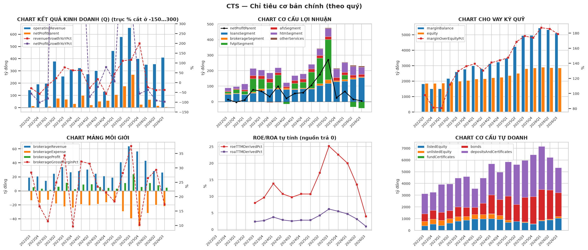
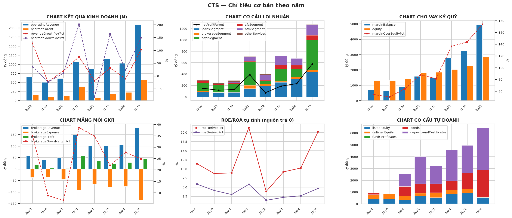
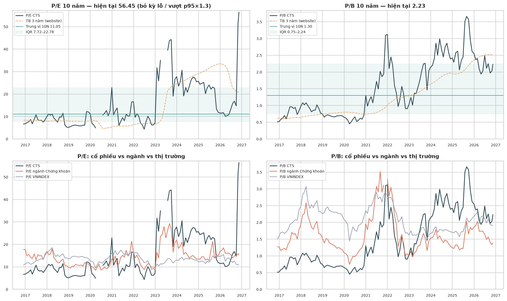
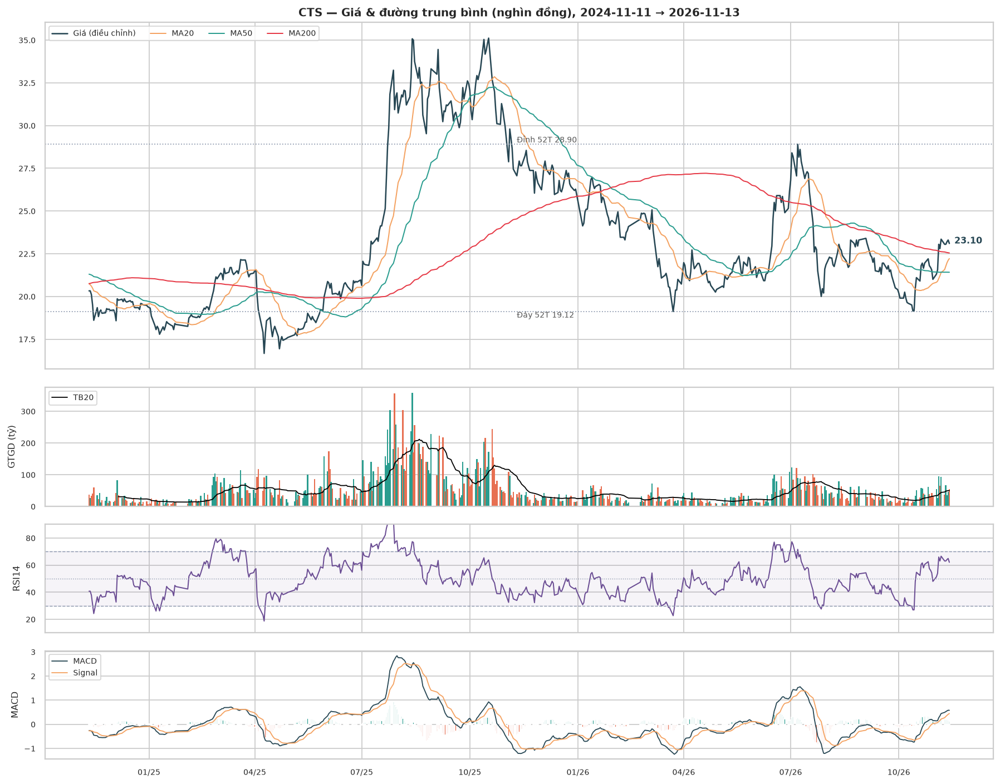
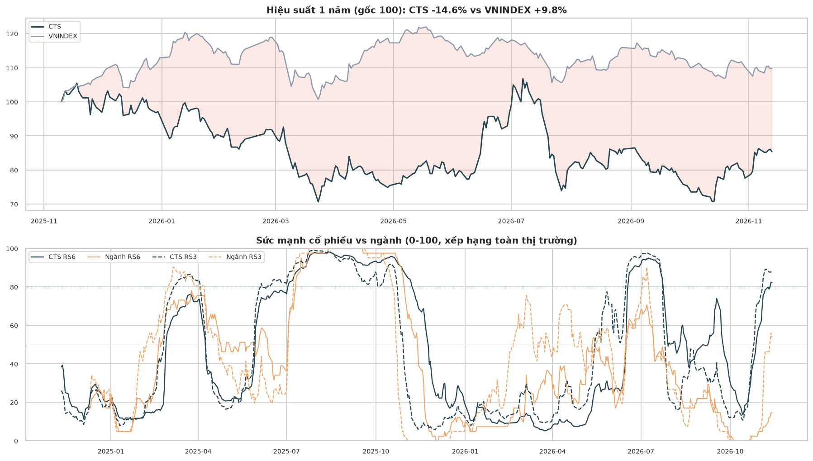
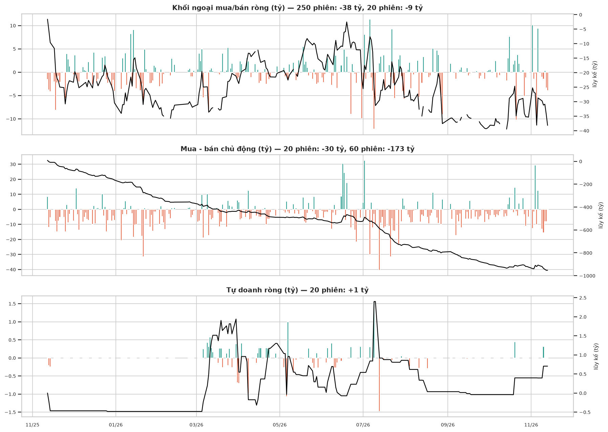
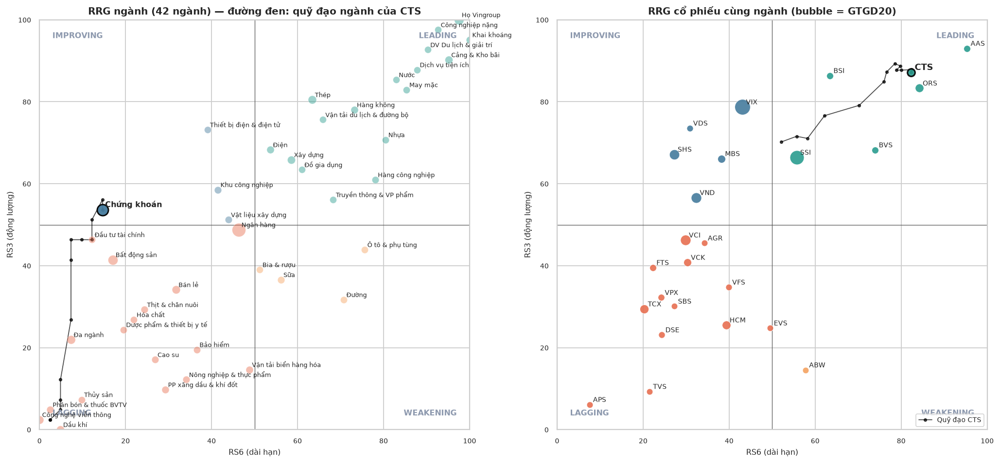

# CTS — CTCP Chứng khoán VietinBank | Phân tích cổ phiếu

> Dữ liệu sstock tới **2026-11-13** · Ngành Chứng khoán (sectorId 9) · Cấu trúc BCTC: securities · Giới hạn gói: BCTC quý 17 quý gần nhất, BCTC năm từ 2018, giá/VNINDEX từ 2023-11-16, định giá thị trường từ 2016-11-17.
> Báo cáo được tạo từ dữ liệu định lượng, **không phải khuyến nghị đầu tư**.

## 1. Tóm tắt

**Kết luận:** CTS nằm ở ô **"chỉ phù hợp giao dịch theo đà, dừng lỗ chặt"** của ma trận: kỹ thuật và sức mạnh tương đối đã bật mạnh (RRG leading, RS3/RS6 87/82, giá vượt MA200) nhưng nền cơ bản rất yếu. LNST TTM giảm 82% YoY, ROE TTM chỉ 3,9% mà P/B vẫn 2,23x (cao hơn ngành 62%). Bối cảnh trung tính: thị trường **pressure**, ngành **improving**, nên không cần hạ thêm bậc. Scorecard **+1/±16 → Trung tính** (Kỹ thuật & dòng tiền +5/8 · Cơ bản & định giá −5/6 · Bối cảnh +1/2).

| Luận điểm | Số liệu |
|---|---|
| Lợi nhuận đã qua đỉnh chu kỳ | LNST 2026Q3 đạt 5 tỷ (−98% YoY); 9T/2026 đạt 86 tỷ so với 552 tỷ (−84,4%); TTM 111 tỷ (YoY −81,8%, QoQ −70,4%) |
| Mảng tự doanh FVTPL lỗ, NIM margin bị ép | LN mảng FVTPL: +259 tỷ (Q3/25) → −41 tỷ (Q3/26). COF 4,5% → 6,8%, NIM 5,3% → 4,0% |
| Định giá đắt so với ROE | P/B 2,23x (percentile 74, trung vị 10N 1,30x, ngành 1,38x), ROE tự tính 3,9%. P/E 56,5x (percentile 97) |
| Kỹ thuật hồi phục | Giá 23,10 > MA200 22,54 > MA50 21,41; RSI 62; 1 tháng +13,0% so với VNINDEX +2,2% |
| Sức mạnh mạnh, dòng tiền chưa xác nhận | RS3/RS6 87,1/82,3 (hạng 2/25 trong ngành); VCR 1,44; nhưng AMFI −0,03, chủ động ròng 20 phiên −30 tỷ, khối ngoại 20 phiên −9,3 tỷ |

**Điều kiện hành động:** đóng cửa trên **23,4** (đỉnh 2026-09-03 và 2026-11-06), GTGD vượt TB20 khoảng 50 tỷ, AMFI chuyển dương liên tục 3 phiên (đủ 5/5 trụ Elite) · **Vô hiệu hóa** khi đóng cửa dưới **21,1–21,4** (MA50, tương đương 2,5×ATR dưới giá hiện tại).

## 2. Bối cảnh thị trường & ngành

- **Thị trường:** trạng thái **pressure** đã kéo dài 73 phiên (độ tin cậy 63,7, mức Medium). Lần chuyển gần nhất là downtrend → pressure ngày 2026-07-30 (FTD fast-track). Trong 25 phiên có **6 phiên phân phối**, vượt ngưỡng 5 phiên, tức áp lực bán đáng kể. FTD gần nhất là **2026-11-04**. Độ rộng VN100 là 53%.
- **Tâm lý:** ngắn hạn 29, trung hạn 33 (đều "Bi quan"). Trung hạn cải thiện +8 điểm trong một tháng.
- **Lan tỏa:** nhóm vốn hóa vừa dẫn dắt (51, +27 điểm/tháng), vốn hóa lớn yếu (21). CTS có vốn hóa 6.289 tỷ, thuộc nhóm vừa/nhỏ, nên đang ở phía có dòng tiền.
- **P/E VNINDEX** 10,9x, thấp hơn TB 3 năm 13,26x: thị trường chung không đắt.
- **Ngành Chứng khoán:** RRG **improving**, RS3 53,7 (hạng 20/42), RS6 14,6 (hạng 36), VCR 1,10, chỉ 32,5% số mã trên MA50. Sức mạnh đang tập trung ở vài mã. LNST TTM toàn ngành tăng +1,9% YoY, trong khi CTS giảm −81,8%: **sự suy giảm của CTS là vấn đề riêng của mã, không phải của ngành**. CTS chiếm 1,3% vốn hóa ngành và 0,4% LNST ngành.

*Quan sát từ biểu đồ:* VNINDEX dao động trong biên 1.650–1.930 suốt một năm, tô màu pressure gần như toàn bộ, xen hai đợt downtrend ngắn (tháng 3 và cuối tháng 7/2026). Phiên FTD 2026-11-04 cũng là phiên CTS tăng +7% (21,55 → 23,05) với GTGD 95,7 tỷ, gần gấp đôi TB20. Nhịp hồi của CTS bắt đầu đồng pha với tín hiệu của thị trường chung.

## 3. Kết quả kinh doanh & sức khỏe tài chính

| Chỉ tiêu (tỷ đồng) | 2025Q3 | 2025Q4 | 2026Q1 | 2026Q2 | 2026Q3 | YoY |
|---|---|---|---|---|---|---|
| Doanh thu hoạt động | 653 | 400 | 352 | 357 | 410 | −37,2% |
| LNST cty mẹ | 271 | 25 | 66 | 15 | 5 | −98,2% |
| LN mảng cho vay | 118 | 129 | 132 | 145 | 156 | +31,6% |
| LN mảng FVTPL | 259 | −2 | 29 | −33 | −41 | −115,8% |
| LN mảng HTM | 51 | 55 | 62 | 55 | 47 | −7,7% |
| LN mảng môi giới | 24 | 6 | 11 | 8 | 5 | −80,8% |
| YEA / COF / NIM margin (%) | 9,8 / 4,5 / 5,3 | 9,9 / 4,8 / 5,1 | 9,9 / 5,2 / 4,7 | 10,2 / 6,0 / 4,2 | 10,8 / 6,8 / 4,0 | NIM −1,3pp |
| Dư nợ margin | 4.946 | 4.964 | 5.440 | 5.322 | 5.112 | +3,4% |
| Margin/VCSH (%) | 176,1 | 173,8 | 187,1 | 185,7 | 178,8 | +2,7pp |
| VCSH | 2.809 | 2.855 | 2.907 | 2.866 | 2.859 | +1,8% |
| Vốn góp | 2.127 | 2.127 | 2.127 | 2.127 | 2.722 | +28,0% |

**Mảng đóng góp chính và mảng gây ra thay đổi YoY:**
- **Cho vay margin** là trụ lớn nhất và ổn định nhất: 156 tỷ trong Q3/26, tăng đều 8 quý liên tiếp từ 84 tỷ (Q4/24).
- **FVTPL** gây ra gần như toàn bộ cú sụt. Mảng này giảm 300 tỷ YoY (+259 → −41 tỷ), lớn hơn cả mức giảm LNST (−266 tỷ). Lợi nhuận đỉnh 2025Q2–Q3 (176 và 271 tỷ) là **lợi nhuận theo thị trường, không bền**: FVTPL đóng góp 165 và 259 tỷ trong hai quý đó.
- Tổng LN các mảng trong Q3/26 khoảng 189 tỷ, nhưng LNST chỉ 5 tỷ. Phần chênh lệch khoảng 184 tỷ là chi phí không phân bổ theo mảng (lãi vay trên dư nợ vay 7.679 tỷ khi COF 6,8%, chi phí quản lý, thuế). Đây là suy luận từ số liệu; chi tiết cần đối chiếu BCTC.

**YEA/COF/NIM (4 quý):** COF tăng liên tục 4,8% → 5,2% → 6,0% → 6,8%. YEA chỉ tăng 9,9% → 10,8%, nên NIM giảm từ 5,1% xuống 4,0%. Dư nợ margin vẫn trên 5.100 tỷ nhưng biên lãi bị ép. Margin/VCSH 178,8% sát ngưỡng 180%, dư địa đến trần 200% chỉ còn **605 tỷ** (`marginHeadroomBil`).

**Cơ cấu tự doanh:** cổ phiếu niêm yết trong danh mục FVTPL tăng từ 450 tỷ (Q4/25) lên **1.042 tỷ** (Q3/26, +83,5% YoY) đúng lúc mảng này lỗ 2 quý liên tiếp. Như vậy rủi ro beta thị trường của CTS đang **tăng chứ không giảm**. Trái phiếu FVTPL 1.567 tỷ. Tiền gửi/CD nắm giữ đến đáo hạn (HTM) giảm mạnh từ 3.663 tỷ xuống 2.030 tỷ trong hai quý, cùng chiều với nợ vay giảm từ 9.395 tỷ xuống 7.679 tỷ: công ty đang **giảm đòn bẩy** bằng cách rút tiền gửi để trả nợ. Tổng tài sản giảm từ 13.354 tỷ xuống 11.314 tỷ. Phải thu tăng vọt từ 164 tỷ lên 555 tỷ trong Q3/26: chưa rõ nguyên nhân (có thể là khoản phải thu bán chứng khoán/trái phiếu chưa tất toán), cần tin doanh nghiệp.

**NAV khách hàng** đi ngang khoảng 28.800 tỷ (−3,7% YoY), tiền gửi của nhà đầu tư giảm từ 1.845 tỷ xuống 563 tỷ. Thị phần không mở rộng. Doanh thu môi giới Q3/26 là 26,6 tỷ (−58% YoY), biên gộp 17,3%.

**Phân loại thay đổi Vốn góp trong 8 quý** (khớp với "Sự kiện quyền" ở mục 5):
| Quý | Vốn góp | LNGPP (`surplusRetainedFunds`) | VCSH | Diễn giải |
|---|---|---|---|---|
| 2025Q2 | 1.487 → 2.127 (+640) | 871,5 → 383,1 (−488, sau khi cộng LNST 176) | +151 ≈ LNST | **Cổ phiếu thưởng/cổ tức CP** từ LNGPP, không có tiền mới. Khớp sự kiện quyền 2025-06-05 với hệ số 1,431 (2.127/1.487 = 1,430) |
| 2026Q3 | 2.127 → 2.722 (+595) | 726,8 → 136,2 (−591) | −7 (đi ngang) | **Cổ phiếu thưởng/cổ tức CP**, không có tiền mới. Khớp sự kiện quyền 2026-06-12 với hệ số 1,279 (2.722/2.127 = 1,280) |

Cả hai lần đều là pha loãng thuần túy (cần tin doanh nghiệp để xác nhận hình thức). Room margin không tăng, và LNGPP chỉ còn 136 tỷ. Muốn mở rộng margin quá 200% VCSH, CTS sẽ phải phát hành thu tiền hoặc tích lũy lợi nhuận.

**So với chu kỳ (bảng năm, ROE tự tính):** 2018 11,4% · 2019 8,7% · 2020 8,9% · **2021 21,3%** · 2022 3,8% · 2023 9,2% · 2024 10,3% · **2025 20,2%** · TTM Q3/26 3,9%. Kịch bản 2021 → 2022 đang lặp lại gần như nguyên mẫu: năm thanh khoản bùng nổ với FVTPL lớn, rồi lợi nhuận sụp về mức ROE khoảng 4%. ROE "bình thường" giữa chu kỳ của CTS là khoảng 9–11%.

*Quan sát biểu đồ 04 (FA chính):* ở panel "Cơ cấu lợi nhuận", phần xanh lá (FVTPL) chuyển từ cột cao nhất (Q3/25) sang âm hai quý liền, trong khi phần xanh dương (cho vay) cao dần đều. Đường LNST bám gần như hoàn toàn theo FVTPL. Panel ROE tự tính đã rơi từ 25% (Q3/25) xuống 3,9%.
*Quan sát biểu đồ 06 (theo năm):* doanh thu 2025 đạt 2.096 tỷ, gấp đôi 2024, nhưng 527/1.271 tỷ LN mảng đến từ FVTPL. Đường ROE theo năm có hình răng cưa đỉnh 2021/2025, đáy 2022, cho thấy tính chu kỳ cao.

## 4. Định giá

| | Hiện tại | Trung vị 10N | Percentile 10N | Ngành | VNINDEX |
|---|---|---|---|---|---|
| P/E | 56,45x | 11,05x | 97 | 15,84x | 10,90x |
| P/B | 2,23x | 1,30x | 74 | 1,38x | 1,91x |

- **P/B là thước đo chính** (ngành chứng khoán), luôn đi kèm ROE. P/B 2,23x tương ứng ROE TTM tự tính 3,9% (`roeTTMDerivedPct`, khớp ROE snapshot 3,93%; ROE TTM của nguồn trả 0 ở mọi kỳ). Giai đoạn P/B quanh trung vị 1,30x (2018–2020, 2023) tương ứng ROE 9–11%. Vì vậy ngay cả **vùng tham chiếu `at_pb_median10y` = 13,44 nghìn đồng** cũng là kịch bản lạc quan nếu ROE không quay lại khoảng 9–10% (giả định VCSH giữ nguyên).
- P/B của CTS cao hơn ngành **61,5%**. P/E cao hơn ngành 256%. Ngành có hạng chiết khấu P/E 38/42.
- P/E 56,5x bị đẩy lên vì EPS 4 quý chỉ còn 409 đ, không dùng để định giá được (`at_pe_median10y` = 4,52 là phi thực tế). P/E SSTOCK (dự phóng) 52,54x **đóng băng từ 2026-07-24**.
- ⚠️ P/E và P/B TB 3 năm (21,32x và 2,52x) **bị méo**: giai đoạn 2023 có lợi nhuận đáy (P/E bị loại khỏi tháng 3–9/2023 vì ngoại lai), cộng thêm giai đoạn định giá bong bóng 2024–2025. Không dùng các mốc này.

*Quan sát biểu đồ 07:* đến năm 2022, P/B của CTS luôn thấp hơn ngành. Từ 2024 nó vượt hẳn lên, đạt đỉnh 3,66x khoảng tháng 8–9/2025, rồi về 2,0–2,3x. Mức premium so với ngành đã thu hẹp từ khoảng 2,2 lần xuống khoảng 1,6 lần nhưng vẫn rất lớn. Thị trường vẫn trả giá cho kỳ vọng phục hồi chứ chưa phản ánh ROE hiện tại.

## 5. Kỹ thuật & xu hướng giá

- **Cấu trúc MA:** giá 23,10 > MA200 22,54 > MA20 22,21 > MA50 21,41. Giá vừa vượt MA200, nhưng **MA200 vẫn dốc xuống** (khoảng 27,2 vào tháng 4/2026, nay 22,54) và MA50 dốc −0,75% trong 20 phiên. Đây chưa phải uptrend chuẩn mà là nhịp hồi trong downtrend trung hạn đang yếu đi.
- **Vùng nền:** hai đáy **19,1–19,2** (đáy 52 tuần 19,12 vào tháng 4/2026 và 19,15 ngày 2026-10-13), kháng cự **23,35–23,4** (2026-09-03 và 2026-11-06). Giá đang test kháng cự này. Đỉnh 52 tuần 28,90 (tháng 7/2026), giá hiện cách đỉnh −20,1%.
- **Động lượng:** RSI14 62 (vùng khỏe, chưa quá mua). MACD 0,58 cắt lên signal phía trên 0 (hist +0,134).
- **Biến động:** ATR14 3,5% (khoảng 0,81 nghìn đồng/phiên), biến động năm 39,9%, beta 1Y 1,01, max drawdown 1Y −33,7%.
- **Thanh khoản:** GTGD TB20 49,8 tỷ so với TB60 34,7 tỷ (+43%). Giao dịch thỏa thuận chiếm 0% nên TB20 phản ánh khớp lệnh thật.
- **Hiệu suất tương đối:** 1T +10,8pp, 3T +3,5pp, 6T +13,3pp, nhưng YTD −8,1pp và 1N −24,3pp so với VNINDEX.
- **Sự kiện quyền:** 2025-06-05 (hệ số 1,431, giá 37,50 → 26,55) và 2026-06-12 (hệ số 1,279, giá 27,30 → 21,45) đều là cổ phiếu thưởng/cổ tức CP. Mọi mức giá lịch sử trong báo cáo dùng `adjClose`.

*Quan sát biểu đồ 01:* nhịp tăng mạnh nhất (tháng 7–10/2025, lên khoảng 35 sau điều chỉnh) đi kèm GTGD 200–350 tỷ/phiên. Nhịp hồi hiện tại chỉ có GTGD 50–95 tỷ, tương tự sóng tháng 6–7/2026: sóng đó lên 28,9 rồi rơi về dưới 20 chỉ trong khoảng 3 tháng. Hình mẫu hai đáy 19,1 với neckline 23,4 đã hình thành, nhưng chưa có phiên phá vỡ.
*Quan sát biểu đồ 02:* RS của CTS bật theo từng "cú": lên trên 90 vào tháng 6–7/2026 rồi sụp dưới 30 trong vòng một tháng. Lần này RS6 tăng từ 18 lên 82 chỉ trong 20 phiên. Sức mạnh tăng nhanh nhưng lịch sử cho thấy cũng mất rất nhanh. Đường hiệu suất 1 năm của CTS (−14,6%) cách VNINDEX (+9,8%) một khoảng rộng, chưa thu hẹp đáng kể.

## 6. Dòng tiền & smart-money

| Cửa sổ | Khối ngoại ròng | Tự doanh ròng | Chủ động ròng | Tỷ lệ chủ động |
|---|---|---|---|---|
| 5 phiên | −9,5 | +0,3 | −45,4 | −0,201 |
| 20 phiên | −9,3 | +0,7 | −30,0 | −0,031 |
| 60 phiên | −5,4 | +0,7 | −173,2 | −0,087 |
| 250 phiên | −38,2 | — | −952,8 | −0,116 |

- **Phân kỳ:** giá tăng +13% trong một tháng, nhưng mua−bán chủ động âm ở mọi cửa sổ. Riêng 5 phiên gần nhất có −45 tỷ, tỷ lệ −0,20. Khối ngoại bán ròng 2 phiên liên tiếp. Tự doanh không đáng kể.
- **VCR 1,44** ("bùng nổ"): dòng tiền vào nhanh. **AMFI −0,03** (cân bằng, hơi nghiêng bán). Không có bear20; bull10 kích hoạt ngày 2026-10-30.
- **Elite v23:** **4/5 trụ**, chỉ thiếu **AMFI > 0**. Không guard nào bị kích hoạt. CTS là mã HOSE 3 ký tự nên đủ điều kiện Elite. Chuỗi persistence 0/3 phiên. Lịch sử 2 episode, thắng 50%, lãi TB +11,3%: 2025-07-11 → 2025-08-20 lãi +40,2% (thoát do bear_div), 2025-03-11 → 2025-04-08 lỗ −17,5% (momentum collapse). Mẫu quá nhỏ để tin cậy.
- RRG cổ phiếu: **leading**, RS3 hạng 2/25 mã trong ngành.

*Quan sát biểu đồ 03:* đường lũy kế mua−bán chủ động **đi xuống gần như tuyến tính suốt 250 phiên**, kể cả trong sóng tăng tháng 6–7/2026. Chỉ có vài cụm cột mua chủ động lớn (khoảng 30 tỷ vào giữa tháng 6 và đầu tháng 7, khoảng 29 tỷ đầu tháng 11). Khối ngoại lũy kế dao động trong biên −20 đến −40 tỷ, không có xu hướng tích lũy. Dòng tiền hiện tại là dòng tiền đầu cơ ngắn hạn, chưa có dấu hiệu tích lũy bền.

## 7. So sánh cùng ngành

| Mã | Vốn hóa (tỷ) | RS3 | RS6 | Góc | VCR | AMFI | GTGD20 (tỷ) |
|---|---|---|---|---|---|---|---|
| **CTS** | **6.289** | **87** | **82** | **leading** | **1,44** | **−0,030** | **49,8** |
| ORS | 8.953 | 83 | 84 | leading | 1,68 | +0,125 | 86,4 |
| SSI | 60.626 | 66 | 56 | leading | 1,01 | −0,024 | 418,7 |
| VIX | 33.575 | 79 | 43 | improving | 1,12 | −0,011 | 522,9 |
| SHS | 11.873 | 67 | 27 | improving | 1,16 | −0,012 | 161,8 |
| MBS | 16.115 | 66 | 38 | improving | 1,11 | −0,036 | 57,9 |
| VND | 22.073 | 57 | 32 | improving | 1,12 | +0,058 | 175,8 |
| VCI | 22.641 | 46 | 30 | lagging | 0,97 | −0,062 | 176,5 |
| HCM | 31.486 | 26 | 39 | lagging | 1,07 | −0,078 | 90,3 |
| TCX | 94.387 | 29 | 20 | lagging | 1,21 | −0,105 | 103,8 |

CTS đang **dẫn dắt về giá** trong ngành: cùng ORS và AAS ở góc leading phía trên. Phần lớn các mã lớn (TCX, VCK, HCM, VCI) vẫn ở lagging. Nhưng so với ORS (cùng nhóm vốn hóa nhỏ), CTS kém hơn ở dòng tiền: AMFI của ORS dương (+0,125), VCR cao hơn và GTGD lớn hơn. Sức mạnh của CTS là sức mạnh giá, **không đi cùng cải thiện cơ bản** (LNST TTM −81,8% so với ngành +1,9%). Đây là trường hợp "mã đi trước ngành khi ngành mới improving", mang tính đầu cơ theo beta chứ không phải cơ hội đuổi theo dựa trên cơ bản.

*Quan sát biểu đồ 08:* quỹ đạo CTS đi một đường chéo từ (RS6 52, RS3 70) lên (82, 87), rồi **chững lại thành cụm** ở góc trên phải trong vài phiên gần nhất. Động lượng ngắn hạn đã ngừng tăng (RS3 Δ5 phiên −2,2). Ngành Chứng khoán leo gần như thẳng đứng từ lagging (RS3 khoảng 3) lên improving (khoảng 54), nhưng RS6 vẫn chỉ khoảng 15: nhịp hồi ngành còn quá mới để xác nhận.

## 8. Scorecard

| Nhóm | Điểm | Ghi chú |
|---|---|---|
| Xu hướng giá | +2 | Giá > MA50 và > MA200; MA50 dốc −0,75%/20 phiên (0 điểm) |
| Động lượng | +2 | RSI 62, MACD trên signal và trên 0; 3T so với VNINDEX +3,5pp (0) |
| Sức mạnh tương đối | +2 | RRG leading, RS6 82,3; RS3 Δ5 phiên −2,2 |
| Dòng tiền | −1 | VCR 1,44 (+1); khối ngoại 20 phiên −9,3 tỷ (−1); chủ động 20 phiên −30 tỷ (−1); AMFI ≈ 0 |
| Tăng trưởng | −2 | LNST TTM −81,8%, doanh thu TTM −17,0% |
| Chất lượng | −1 | ROE 3,9% (−1); Margin/VCSH 178,8% (0, sát ngưỡng 180%) |
| Định giá | −2 | P/E gấp 5,1 lần trung vị 10N; P/E cao hơn ngành 256%; P/B percentile 74 (0) |
| Bối cảnh | +1 | Thị trường pressure (0); ngành improving (+1); tâm lý trung hạn 33 (0) |
| **Tổng** | **+1 → Trung tính** | Kỹ thuật +5 · Cơ bản −5 · Bối cảnh +1 |

**Không override tổng điểm.** Tăng trưởng TTM âm cả YoY (−81,8%) lẫn QoQ (−70,4%), nên không có trường hợp "YoY dương che giấu đỉnh". Tuy vậy cần lưu ý hai điểm khi đọc tổng phụ kỹ thuật +5:
1. MA200 và MA50 đều dốc xuống, giá mới chỉ vượt MA200 khoảng 2,5%.
2. Dòng tiền chủ động âm kéo dài (−953 tỷ trong 250 phiên) mâu thuẫn với sức mạnh giá.

Vì vậy tín hiệu kỹ thuật dễ gãy hơn con số +5 gợi ý.

## 9. Rủi ro & catalyst

**Rủi ro**
- **Beta tự doanh tăng:** cổ phiếu niêm yết trong FVTPL đã lên 1.042 tỷ, khoảng 36% VCSH. Thị trường đang pressure với 6 phiên phân phối. Nếu VNINDEX quay lại downtrend, mảng FVTPL có thể lỗ quý thứ 3 liên tiếp.
- **Chi phí vốn:** COF tăng 2,3pp YoY lên 6,8% và chưa có dấu hiệu dừng. Nếu YEA không theo kịp, NIM sẽ còn bị ép.
- **Trần margin:** Margin/VCSH 178,8%, chỉ còn 605 tỷ dư địa. LNGPP còn 136 tỷ sau đợt cổ phiếu thưởng. Tăng trưởng margin bị giới hạn nếu không phát hành thu tiền, và nếu phát hành thì sẽ pha loãng thêm.
- **Pha loãng:** vốn góp tăng 28% YoY, 83% trong 6 quý (1.487 → 2.722 tỷ) mà không có tiền mới, nên EPS bị kéo xuống mạnh.
- **Định giá:** P/B 2,23x với ROE 3,9%. Nếu thị trường định giá CTS về P/B ngành (1,38x), giá tương ứng khoảng 14,3 nghìn đồng (giả định VCSH giữ nguyên).
- **Dòng tiền:** bán chủ động áp đảo kéo dài, khối ngoại bán ròng.
- **Chưa rõ:** phải thu tăng từ 164 lên 555 tỷ trong Q3/26, cần tin doanh nghiệp.

**Catalyst**
- **BCTC Q4/2026** (cuối tháng 1/2027). Nền so sánh **rất thấp**: LNST Q4/25 chỉ 25 tỷ, FVTPL −2 tỷ. Nếu thị trường giữ được, YoY quý có thể chuyển dương, nhưng TTM vẫn chỉ quanh 100–150 tỷ, tức ROE khoảng 4–5%.
- Thanh khoản thị trường phục hồi (FTD 2026-11-04, nhóm vốn hóa vừa dẫn dắt) sẽ hỗ trợ cả môi giới lẫn FVTPL.
- Diễn biến lãi suất huy động/liên ngân hàng: COF hạ nhiệt sẽ giúp NIM margin hồi phục.

**Giới hạn dữ liệu:** gói chỉ có 17 quý BCTC, BCTC năm từ 2018, giá từ 2023-11-16. ROE/ROA TTM của nguồn = 0 ở mọi kỳ, nên báo cáo dùng ROE tự tính. P/E SSTOCK đóng băng từ 2026-07-24. P/E/P/B TB 3 năm bị méo. Cơ cấu chi phí lãi vay/quản lý không có sẵn theo mảng, nên phần chênh giữa LN mảng và LNST là suy luận.

## 10. Kịch bản & mức giá theo dõi

| Kịch bản | Điều kiện | Ý nghĩa |
|---|---|---|
| Tích cực | Đóng cửa > **23,4** với GTGD > TB20 (khoảng 50 tỷ); AMFI > 0 trong 3 phiên liên tiếp (đủ 5/5 trụ Elite); RS3 ≥ 80, RS6 ≥ 60; thị trường giữ pressure hoặc lên uptrend | Phá vỡ mô hình hai đáy 19,1/23,4. Vùng tham chiếu theo biên độ mô hình là 26–28,9 (đỉnh tháng 7/2026). Chỉ là giao dịch theo đà vì cơ bản chưa ủng hộ; dừng lỗ ở khoảng 2,5×ATR (khoảng 2 nghìn đồng) |
| Cơ sở | Giá đi ngang trong biên **21,4 (MA50) – 23,4**, giữ quanh MA200 22,54; AMFI dao động quanh 0 | Tích lũy chờ BCTC Q4/2026. Đứng ngoài hoặc theo dõi; chưa có lý do cơ bản để giải ngân |
| Tiêu cực | Đóng cửa < **21,1–21,4** (MA50/2,5×ATR) hoặc RS3 < 60; thị trường quay lại downtrend | Nhịp hồi thất bại giống sóng tháng 7/2026, khả năng về lại nền **19,1–19,2**. Thủng **19,12** (đáy 52 tuần) là phá nền, mở ra xu hướng giảm mới, phù hợp với định giá P/B quá cao so với ROE |

---
*Phụ lục:* dữ liệu thô ở `raw/`, chỉ số ở `metrics.json`, bảng đầy đủ ở `tables.md`, biểu đồ ở `charts/` (gồm cả [05_fa_dashboard](charts/05_fa_dashboard.png)). *Quan sát biểu đồ 05:* panel "Biên lãi từ cho vay ký quỹ" cho thấy đường COF cắt lên và đường NIM cắt xuống từ 2025Q1, ngược hẳn với giai đoạn 2024Q2–Q4 khi NIM lên tới khoảng 6,4%. Panel "Cơ cấu HTM" cho thấy tiền gửi/CD giảm từ khoảng 3.650 tỷ xuống khoảng 2.030 tỷ trong 2 quý, khớp với việc giảm nợ vay ở panel "Nguồn vốn".

*Báo cáo dựa trên dữ liệu định lượng tới 2026-11-13, không phải khuyến nghị đầu tư.*
