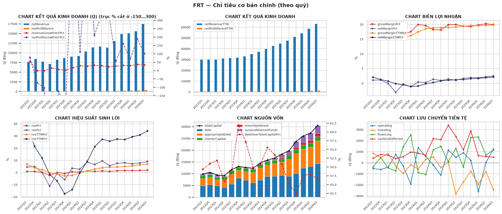
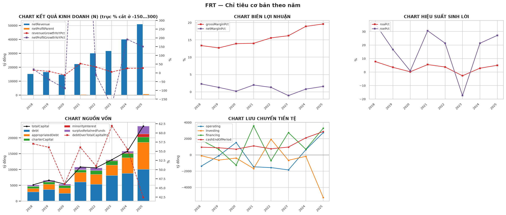
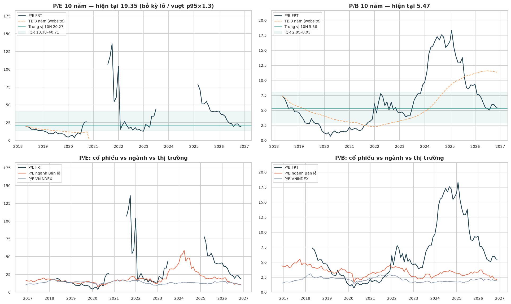
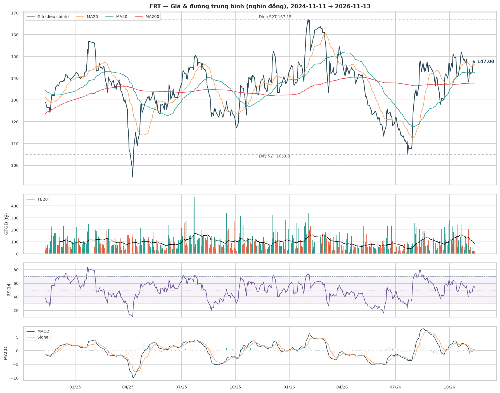
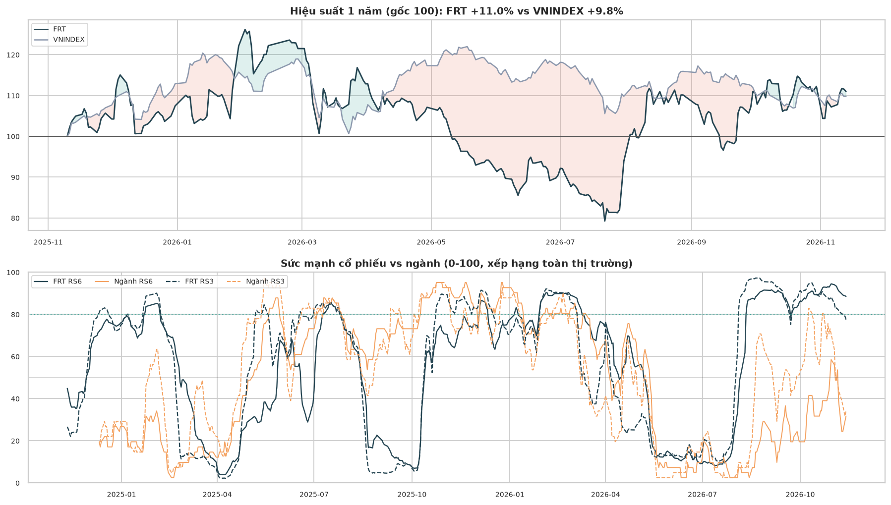
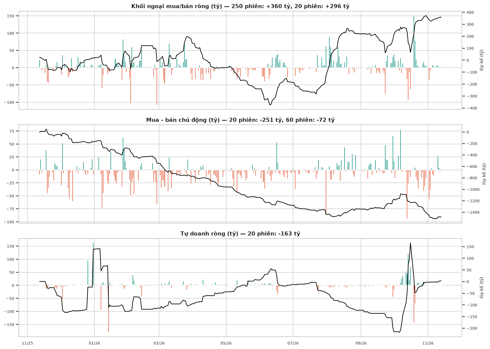
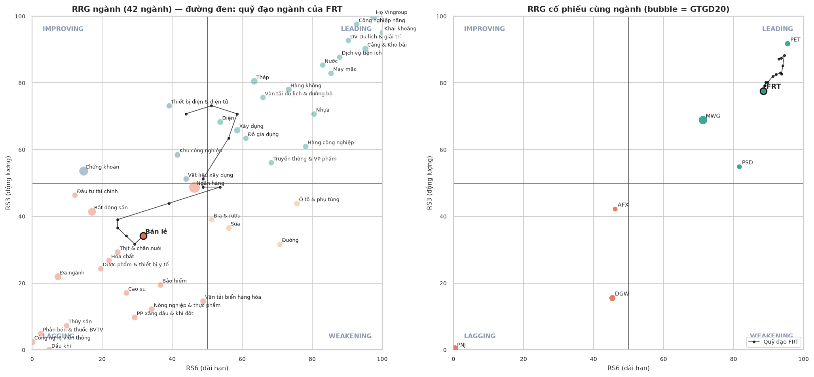

# FRT — Công ty Cổ phần Bán lẻ Kỹ thuật số FPT | Phân tích cổ phiếu

> Dữ liệu sstock tới **2026-11-13** · Ngành Bán lẻ (sectorId 1) · Cấu trúc BCTC: phi tài chính · Gói S1 (BCTC 17 quý, BCTC năm từ 2018, giá từ 2023-11-16, định giá thị trường từ 2016-11-17).
> Báo cáo được tạo từ dữ liệu định lượng, **không phải khuyến nghị đầu tư**.

## 1. Tóm tắt

**Kết luận:** Kỹ thuật và dòng tiền **khá** (+4/8): giá trên cả 3 đường MA, RRG *leading*. Cơ bản và định giá chỉ **+1/6**: lợi nhuận tăng rất mạnh nhưng dòng tiền HĐKD TTM âm và P/E cao hơn ngành. Theo ma trận, FRT rơi vào ô *"chỉ phù hợp giao dịch theo đà, đặt dừng lỗ chặt"*. Ngành Bán lẻ đang *lagging* nên kết luận hạ một bậc, thành **watchlist chờ breakout có xác nhận dòng tiền**. Scorecard **+4/±16 → Khá tích cực** (Kỹ thuật & dòng tiền +4/8 · Cơ bản & định giá +1/6 · Bối cảnh -1/2).

| Luận điểm | Số liệu |
|---|---|
| Tăng trưởng lợi nhuận rất mạnh | LNST cty mẹ 9T/2026 1.069 tỷ (+111,6%); doanh thu 9T 48.273 tỷ (+33,5%); ROE TTM 34,1% (từ 27,3% một năm trước) |
| Chất lượng dòng tiền yếu | CFO TTM -1.153 tỷ (-0,85x LNST); tồn kho +48,2% YoY so với doanh thu +33,7%; nợ vay +59,5% YoY |
| Định giá ở mức trung vị lịch sử, đắt hơn ngành | P/E 19,35 (trung vị 10N 20,27, percentile 45); P/B 5,47 (trung vị 5,36); P/E ngành 10,57 |
| Xu hướng giá tích cực nhưng đang đi ngang | 147,0 > MA20 146,3 > MA50 142,7 > MA200 137,7; nền 138–152 từ giữa tháng 10; cách đỉnh 52T -12,1% |
| Dòng tiền phân kỳ | Khối ngoại mua ròng +296 tỷ/20 phiên, nhưng mua-bán chủ động -251 tỷ/20 phiên, AMFI -0,20, VCR 0,89; RS3 giảm từ 97 xuống 77,5 sau 60 phiên |

**Điều kiện hành động:** tín hiệu xác nhận là đóng cửa **trên 152 (đỉnh 2026-10-21)** với GTGD *khớp lệnh* vượt TB20 khớp lệnh (~63 tỷ), **đồng thời** RS3 ≥ 80 và AMFI > 0. Kịch bản bị vô hiệu nếu đóng cửa **dưới 137,7 (MA200)**, cũng là đáy nền 138,3 ngày 2026-11-02.

## 2. Bối cảnh thị trường & ngành

- **Thị trường:** ở trạng thái *pressure* đã 73 phiên, kể từ khi chuyển lên từ downtrend ngày 2026-07-30 (FTD fast-track), độ tin cậy 63,7 (Medium). Có 6 phiên phân phối trong 25 phiên, FTD gần nhất 2026-11-04, độ rộng VN100 53%. Tâm lý ngắn hạn 29 / trung hạn 33 (*Bi quan*; trung hạn +8 điểm trong tháng). Dòng tiền lan tỏa nghiêng về **vốn hóa vừa (51, +27 trong tháng)**, còn vốn hóa lớn yếu (21). FRT (vốn hóa 26.286 tỷ) không bị kéo bởi nhóm large-cap đang yếu. P/E VNINDEX 10,90 so với TB 3 năm 13,26, tức thị trường đang rẻ so với lịch sử.
- **Ngành Bán lẻ:** RRG *lagging*, RS3 34,1 (hạng 28/42), RS6 31,7 (hạng 29), VCR 0,86, độ rộng >MA50 42,1%, không có cảnh báo. Quỹ đạo RRG ngành ([08_rrg](charts/08_rrg.png)) rơi từ vùng giáp *leading* (RS6 ~58, RS3 ~70) xuống sâu trong *lagging*, và vài phiên gần nhất chỉ móc lên nhẹ (RS3 ~31 lên 34). Trên biểu đồ sức mạnh, RS3 ngành bật lên ~80 vào tháng 10 rồi gãy nhanh, tức dòng tiền vào ngành chỉ mang tính ngắn hạn.
- **Vị thế:** FRT chiếm 16,1% vốn hóa, 16,3% doanh thu TTM và 8,8% LNST TTM của 19 doanh nghiệp trong ngành. Biên gộp 20,0% cao hơn ngành (16,9%), nhưng biên ròng 2,5% thấp hơn ngành (3,6%), do chi phí bán hàng và lãi vay của mô hình chuỗi lớn. Tăng trưởng doanh thu TTM (+32,7%) và LNST TTM (+120,4%) đều vượt ngành (+23,2% / +60,1%).
- *Quan sát biểu đồ 09:* trong 12 tháng VNINDEX dao động 1.590–1.930 và hầu như luôn ở trạng thái *pressure*, chỉ có 2 lần ngắn rơi vào downtrend (03/2026, 07/2026). FRT tạo đáy 105 cùng thời điểm với lần downtrend thứ hai (cuối tháng 7/2026), sau đó tăng mạnh hơn thị trường.

## 3. Kết quả kinh doanh & sức khỏe tài chính

| Chỉ tiêu (tỷ) | Q3/25 | Q4/25 | Q1/26 | Q2/26 | Q3/26 | YoY |
|---|---|---|---|---|---|---|
| Doanh thu thuần | 13.110 | 14.913 | 15.117 | 15.626 | 17.530 | +33,7% |
| LNST cty mẹ | 219 | 290 | 287 | 341 | 440 | +101,3% |
| Biên gộp % | 19,4 | 19,3 | 19,8 | 20,2 | 20,0 | +0,6pp |
| Chi phí bán hàng | 1.790 | 1.980 | 1.998 | 2.115 | 2.276 | +27,2% |
| ROE TTM % | 27,3 | 27,1 | 29,2 | 30,8 | 34,1 | +6,8pp |
| LCTT HĐKD | 905 | 203 | -2.611 | 9 | 1.246 | +37,7% |
| Hàng tồn kho | 10.509 | 11.927 | 14.448 | 14.908 | 15.577 | +48,2% |
| Nợ vay | 8.919 | 10.052 | 12.381 | 13.075 | 14.229 | +59,5% |

- **Tăng trưởng đến từ đòn bẩy hoạt động, không đến từ lợi nhuận một lần.** Doanh thu tăng 8 quý liên tiếp (11.448 → 17.530 tỷ). Biên gộp gần như đi ngang quanh 19–20%, nhưng chi phí bán hàng/doanh thu giảm từ 13,7% (Q3/25) xuống 13,0% (Q3/26), làm lợi nhuận HĐKD tăng từ 339 lên 706 tỷ (biên 2,6% lên 4,0%). Lợi nhuận tài chính luôn âm nhẹ (-27 tỷ Q3/26) và lợi nhuận khác không đáng kể (7 tỷ), nên **không có khoản một lần** làm méo kết quả. EBITDA Q3/26 1.074 tỷ (+102,9% YoY).
- **So với chu kỳ (bảng năm):** biên gộp 2025 là 19,6%, cao nhất 8 năm (2018: 13,4%), phản ánh cơ cấu doanh thu dịch chuyển sang mảng biên cao hơn. ROE TTM 34,1% đã ngang đỉnh 2018 (35,6%) và vượt xa 2023 (-17,5%, năm lỗ 346 tỷ). Biên ròng TTM 2,1% vẫn mỏng, nên lợi nhuận rất nhạy với chi phí và lãi vay.
- **Bảng cân đối:** nợ vay 14.229 tỷ, tiền & tiền gửi 11.784 tỷ, nợ vay ròng 2.445 tỷ ≈ 46,7% VCSH cty mẹ (5.241 tỷ; khoảng 37% nếu cộng 1.283 tỷ lợi ích thiểu số). EBIT/chi phí tài chính TTM 3,95x, tạm ổn, nhưng chi phí tài chính quý đã tăng từ 100 lên 257 tỷ (+157% YoY) theo nợ vay. Nợ chiếm dụng (phải trả, người mua trả trước) tăng từ 7.140 lên 9.781 tỷ, nên nhà cung cấp đang tài trợ một phần vốn lưu động.
- **Tồn kho tăng nhanh hơn doanh thu:** +48,2% so với +33,7% YoY. Bước nhảy lớn nhất là Q1/26 (11.927 → 14.448 tỷ), cùng quý CFO -2.611 tỷ và nợ vay +2.329 tỷ. Kết luận: công ty vay nợ để tích trữ hàng cho việc mở rộng. Tồn kho/Tổng TS đã giảm lại từ 55,5% xuống 51,0%, nhưng vẫn là rủi ro chính nếu sức mua chậm lại.
- **Dòng tiền:** CFO TTM -1.153 tỷ (riêng Q1/26 -2.611 tỷ); CFO cả năm 2025 vẫn dương +2.747 tỷ. LCTT đầu tư TTM -5.958 tỷ, nhưng TSCĐ+XDCB chỉ tăng +100 tỷ trong 4 quý. Khoản chi này **không phải capex**: `cashBank` 11.784 tỷ trong khi tiền cuối kỳ trên LCTT chỉ 511 tỷ, tức ~11.273 tỷ là **tiền gửi có kỳ hạn** nằm trong cashBank. LCTT đầu tư âm phần lớn là gửi tiền, nên FCF TTM (-7.111 tỷ) bị đánh giá thấp tương ứng. Tiền gửi vẫn là tài sản thanh khoản và đã được trừ vào nợ vay ròng.
- **Lợi ích cổ đông thiểu số tăng mạnh:** từ 208 lên 1.283 tỷ trong 8 quý, các bước nhảy lớn ở Q2/25 (+258) và Q4/25 (+410). Như vậy một phần lợi nhuận/vốn của công ty con thuộc về cổ đông khác. Nhiều khả năng liên quan đến cổ đông thiểu số tại chuỗi nhà thuốc Long Châu (*cần tin DN*). Cần theo dõi tỷ lệ LNST cty mẹ/LNST hợp nhất.
- **Pha loãng / sự kiện quyền:**
  - 2025-07-16, hệ số 1,25 (188,9 → 152,0): khớp với vốn điều lệ Q3/25 tăng từ 1.362 lên 1.703 tỷ (+25%) và LNGPP giảm, nên đây là **cổ tức cổ phiếu/thưởng 25%**, không có tiền mới.
  - 2026-06-29, hệ số 1,05: vốn điều lệ Q3/26 tăng đúng 5% (1.703 → 1.788 tỷ) và quỹ & LNGPP chỉ tăng 355 tỷ so với LNST 440 tỷ (thiếu đúng ~85 tỷ). Vì vậy đây là **cổ tức cổ phiếu 5%** (khớp sự kiện quyền), không có tiền mới. Mọi mức giá trước các ngày này trong báo cáo đều lấy theo `adjClose`.
- *Quan sát biểu đồ 04:* trong cơ cấu nguồn vốn, phần nợ chiếm dụng (cam) và lợi ích thiểu số (đỏ) phình nhanh từ Q4/25. Tổng nguồn vốn tăng từ 19.702 lên 30.533 tỷ trong 4 quý, trong khi VCSH cty mẹ chỉ chiếm khoảng 17%. Bảng cân đối đang mở rộng chủ yếu bằng tiền của người khác.
- *Quan sát biểu đồ 06 (năm):* LCTT HĐKD âm 5/8 năm (2018–2023), chỉ chuyển dương ổn định từ 2024. Năm 2025 lần đầu có LCTT đầu tư âm rất sâu (~-5.300 tỷ), lệch hẳn khỏi lịch sử.
- *Quan sát biểu đồ 05 (dashboard):* tiền/tổng tài sản tăng từ ~10% (2023) lên ~38% (Q3/26), dù nợ vay cũng tăng. Doanh nghiệp vừa vay ngắn hạn (14.229 tỷ) vừa gửi có kỳ hạn ~11.300 tỷ. Mục đích (dự trữ mở rộng, tài sản đảm bảo cho khoản vay, hay chênh lệch lãi suất) chưa rõ, cần tin DN.

## 4. Định giá

| | Hiện tại | Trung vị 10N | Percentile 10N | Ngành Bán lẻ | VNINDEX |
|---|---|---|---|---|---|
| P/E | 19,35 | 20,27 | 45 | 10,57 | 10,90 |
| P/B | 5,47 | 5,36 | 55 | 2,12 | 1,91 |

- So với lịch sử, FRT **ở vùng giữa**. So với ngành, P/E **cao hơn 83%** và P/B cao hơn ~158%. Mức premium này đi kèm ROE 34,1% (gấp nhiều lần ngành) và LNST TTM +120% YoY. Với tốc độ tăng trưởng hiện tại, P/E 19 không đắt. Nhưng tăng trưởng ba chữ số khó duy trì, và nếu lợi nhuận chậm lại thì premium sẽ bị nén.
- *Quan sát biểu đồ 07:* P/E giảm liên tục từ ~78 (đầu 2025) xuống 19,35, và P/B từ đỉnh 18,3 xuống 5,47, trong khi giá gần như đi ngang. Đây là quá trình **"de-rating nhờ lợi nhuận đuổi kịp giá"**, không phải giá sụp.
- **Caveat:** P/E TB 3 năm (-8,88) vô nghĩa vì năm 2023 lỗ (24 tháng P/E âm). P/B TB 3 năm (11,34) bị méo nên đã bỏ. Có 7 tháng P/B > 3× trung vị (2024-05 … 2025-01). Các tháng này ngay sau năm lỗ 2023, khi VCSH cty mẹ rất nhỏ (~1.900 tỷ ở Q4/24), nên mức P/B 15–18 nhiều khả năng là thật chứ không phải lỗi nguồn. Dù vậy, min–max và percentile P/B có chứa các tháng này.
- **Vùng tham chiếu:** P/E về trung vị 10N cho **~154**, P/B về trung vị 10N cho **~144**. Giả định là LNST 4 quý (EPS 7.598 đ) và VCSH giữ nguyên. Đây là vùng tham chiếu, không phải giá mục tiêu. Giá 147 nằm ngay trong vùng này.
- P/E SSTOCK dự phóng 14,19 (P/B 4,01) bị **giữ nguyên từ 2026-07-24**, nên không phản ánh giá hiện tại.

## 5. Kỹ thuật & xu hướng giá

- **Cấu trúc:** giá 147,0 > MA20 146,3 > MA50 142,7 > MA200 137,7. MA50 dốc +1,0%/20 phiên, MA200 gần như phẳng. Đây là uptrend ngắn hạn nằm trên một MA200 trung tính, chưa phải uptrend chuẩn với MA200 dốc lên.
- *Quan sát biểu đồ 01:* sau đáy 105 (cuối 7/2026), giá có nhịp V tăng ~40% lên vùng 145–150 chỉ trong khoảng 3 tuần, sau đó **đi ngang tạo nền 128–152** từ tháng 9. Biên trên **152 (2026-10-21)** đã hai lần bị từ chối, biên dưới gần nhất **138,3 (2026-11-02)** trùng MA200. Đỉnh 52 tuần 167,15 (02/2026) là kháng cự tiếp theo. GTGD gần đây giảm dần trong nền (TB20/TB60 = 0,81), một dấu hiệu tích lũy cạn cung nhưng cũng cho thấy chưa có lực cầu mới.
- **Động lượng:** RSI 53,8 (trung tính). MACD 0,58 vừa cắt lên signal (0,50) phía trên 0, hist chuyển từ 0,006 lên 0,081, tức động lượng ngắn hạn chớm cải thiện.
- **Biến động:** ATR14 3,3%/phiên, biến động năm 36,9%, beta 0,81, max drawdown 1Y -37,2%. Dừng lỗ 2–3×ATR tương đương khoảng **133–137**, trùng vùng MA200.
- **Thanh khoản:** TB20 86,6 tỷ, TB60 106,7 tỷ, nhưng **thỏa thuận chiếm 33,2% GTGD 60 phiên** (lớn nhất 182,1 tỷ ngày 2026-10-14). Ngưỡng xác nhận breakout là **khớp lệnh TB20 ~63 tỷ**.
- **Hiệu suất tương đối:** 1W +3,5% (VNI +0,6%), 1M +4,3% (+2,2%), 3M +0,1% (-1,7%), 6M **+15,2% (VNI -10,0%)**, YTD +3,2% (-2,8%), 1Y +10,6% (+8,5%).
- *Quan sát biểu đồ 02:* hiệu suất 1 năm có một giai đoạn dài kém VNINDEX (5–7/2026, FRT xuống ~80 so với VNI ~120), rồi đảo chiều mạnh từ 8/2026. Về sức mạnh, RS6 giữ 88–94, nhưng **RS3 trượt dần từ ~97 (8/2026) xuống 77,5**, nên động lượng ngắn hạn đang nguội đi dù xu hướng trung hạn vẫn khỏe.

## 6. Dòng tiền & smart-money

| Cửa sổ | Khối ngoại ròng | Tự doanh ròng | Chủ động ròng | Tỷ lệ chủ động |
|---|---|---|---|---|
| 5 phiên | +19,9 | +5,1 | +30,3 | +0,264 |
| 20 phiên | +295,9 | -162,5 | -250,6 | -0,242 |
| 60 phiên | +129,6 | +99,1 | -72,1 | -0,020 |
| 250 phiên | +360,3 | — | -1.481,6 | -0,099 |

- **Khối ngoại** mua ròng 7 phiên liên tiếp, +296 tỷ/20 phiên. *Quan sát biểu đồ 03:* lũy kế khối ngoại đảo chiều từ khoảng -380 tỷ (6/2026) lên +360 tỷ, gần như song song với nhịp tăng từ đáy 105. Một phần giao dịch này có thể đi qua kênh thỏa thuận (thỏa thuận chiếm 33% GTGD), cần đối chiếu tin.
- **Mua-bán chủ động** thì ngược lại: lũy kế giảm gần như liên tục cả năm xuống -1.482 tỷ, riêng 20 phiên là -251 tỷ. Phe bán chủ động áp đảo trên khớp lệnh, tạo **phân kỳ giữa khối ngoại (mua) và dòng tiền chủ động (bán)**. Riêng 5 phiên gần nhất đã chuyển dương (+30 tỷ).
- **Tự doanh:** có cú mua dồn khoảng +160 tỷ vào 10/2026 rồi bán ra nhanh, nên 20 phiên là -162,5 tỷ. Đây là giao dịch ngắn hạn, không phải tích lũy.
- **Smart-money:** RRG cổ phiếu *leading*. RS3 77,5 / RS6 88,5 (Δ5 phiên -4,4 / -2,7). VCR 0,89 (*trầm lắng*), AMFI -0,199 (*phe bán chiếm ưu thế*). Không có phân kỳ bear20 hay bull10 (lần gần nhất là bear 2025-12-05).
- **Elite v23:** đang có một episode **mở từ 2026-09-03** (super, giá vào điều chỉnh ~142,9, đã 52 phiên, +2,9%). Phiên hiện tại chỉ đạt **2/5 trụ**: thiếu RS (rs3 77,5 < 80), VCR (0,89 < 1,0) và AMFI (-0,199 ≤ 0), đồng thời bị **guard 9** chặn (cooldown 20 phiên sau guard-5). 3 phiên gần nhất đều bị chặn (`raw/elite_diag.json`). Lịch sử có 5 episode, thắng 100%, trung bình +13,8%, nên tín hiệu này khá đáng tin với FRT.

## 7. So sánh cùng ngành

| Mã | Vốn hóa (tỷ) | RS3 | RS6 | Góc | VCR | AMFI | GTGD20 (tỷ) |
|---|---|---|---|---|---|---|---|
| MWG | 107.726 | 69 | 71 | leading | 0,98 | -0,109 | 195,8 |
| **FRT** | 26.286 | 78 | 89 | leading | 0,89 | -0,199 | 63,0 |
| DGW | 8.823 | 16 | 45 | lagging | 0,82 | -0,210 | 61,9 |
| PET | 7.753 | 92 | 95 | leading | 1,02 | +0,015 | 28,9 |
| PNJ | 7.650 | 0 | 0 | lagging | 0,73 | -0,155 | 165,0 |
| PSD | 934 | 55 | 82 | leading | 1,52 | -0,175 | 3,6 |
| AFX | 346 | 42 | 46 | lagging | 1,06 | +0,533 | 1,4 |

- FRT đứng **hạng 2/7 về RS3** (sau PET) và mạnh hơn hẳn MWG về RS6. Ngành *lagging* nhưng FRT *leading*: sức mạnh của FRT **đến từ câu chuyện lợi nhuận riêng** (LNST +120%), không đến từ dòng tiền xoay vòng vào ngành. Đây là "mã dẫn dắt trong ngành yếu", tốt về chất lượng nhưng thiếu lực đẩy từ ngành.
- *Quan sát biểu đồ 08:* quỹ đạo FRT trong RRG cổ phiếu đi từ góc trên phải (RS6 ~94, RS3 ~88) **trượt dần xuống-trái** về (89, 77,5), vẫn trong *leading* nhưng đang hướng về *weakening*. PET là mã duy nhất có đủ RS cao, VCR ≥ 1 và AMFI dương.

## 8. Scorecard

| Nhóm | Điểm | Ghi chú |
|---|---|---|
| Xu hướng giá | +2 | Giá trên MA50 và MA200; MA50 dốc +1,0% (chưa đủ ngưỡng cộng điểm) |
| Động lượng | +1 | MACD cắt lên signal trên 0; RSI 53,8 trung tính; 3T chỉ hơn VNI 1,8pp |
| Sức mạnh tương đối | +2 | RRG leading, RS6 88,5; RS3 giảm 4,4 trong 5 phiên |
| Dòng tiền | -1 | Khối ngoại +296 tỷ (+1) bị triệt tiêu bởi AMFI -0,20 (-1) và chủ động -251 tỷ (-1) |
| Tăng trưởng | +2 | LNST TTM +120,4%, doanh thu TTM +32,7% |
| Chất lượng | 0 | ROE 34,1% (+1) bị trừ bởi CFO/LNST -0,85 (-1); nợ vay ròng/VCSH 46,7% (0) |
| Định giá | -1 | P/E ≈ trung vị 10N (0), P/B percentile 55 (0), P/E cao hơn ngành 83% (-1) |
| Bối cảnh | -1 | Thị trường pressure (0), ngành lagging (-1), tâm lý trung hạn 33 (0) |
| **Tổng** | **+4** | **Khá tích cực** (Kỹ thuật +4 · Cơ bản +1 · Bối cảnh -1) |

**Không override điểm số**, nhưng có hai lưu ý khi đọc:
1. Điểm Cơ bản +1 có phần *thấp hơn thực chất*. P/E ngành 10,57 bị kéo xuống bởi các mã tăng trưởng thấp (PNJ, DGW), còn CFO âm chủ yếu do một quý tích trữ hàng (Q1/26) trong khi CFO 2025 dương. Ngược lại, tồn kho và nợ vay tăng nhanh hơn doanh thu là rủi ro có thật. Vì vậy chưa đủ cơ sở nâng nhóm này lên ≥ +3.
2. Điểm Kỹ thuật +4 cũng có phần *cao hơn thực chất*, vì dòng tiền chủ động âm kéo dài và RS3 đang giảm. Do đó báo cáo chọn vị thế **watchlist chờ xác nhận**, không giải ngân theo đà.

## 9. Rủi ro & catalyst

**Catalyst**
- BCTC Q4/2026 (dự kiến cuối 01/2027): nền so sánh Q4/25 là 290 tỷ. Giữ được tốc độ +50–100% sẽ củng cố P/E hiện tại.
- Đòn bẩy hoạt động tiếp tục: chi phí bán hàng/doanh thu giảm thêm sẽ mở rộng biên ròng (hiện chỉ 2,1% TTM).
- Episode Elite đang mở. Nếu RS3 về lại ≥ 80 và VCR/AMFI cải thiện khi hết cooldown guard 9, FRT có thể đạt lại 5/5 trụ.
- Thị trường: FTD 2026-11-04 và dòng tiền lan tỏa nghiêng về vốn hóa vừa.

**Rủi ro**
- **Vốn lưu động:** tồn kho +48% YoY so với doanh thu +34%, CFO TTM âm, nợ vay +59,5% YoY, chi phí tài chính +157% YoY. Nếu sức mua chậm lại, áp lực giảm giá hàng tồn và lãi vay sẽ đè lên biên ròng vốn rất mỏng.
- **Lợi ích thiểu số tăng** (1.283 tỷ, ~20% tổng VCSH): phần lợi nhuận thuộc về cổ đông công ty mẹ có thể bị chia sẻ nhiều hơn.
- **Định giá premium so với ngành** (P/E +83%): dễ bị nén nếu tăng trưởng giảm tốc từ mức ba chữ số.
- **Dòng tiền:** bán chủ động kéo dài (-1.482 tỷ/250 phiên); GTGD bị thỏa thuận thổi phồng.
- **Bối cảnh:** ngành *lagging*, thị trường *pressure* với 6 phiên phân phối.

**Giới hạn dữ liệu**
- Gói S1: BCTC 17 quý, năm từ 2018, giá từ 2023-11-16.
- sstock không có doanh thu/lợi nhuận theo mảng (ICT vs dược phẩm), nên không tách được động lực tăng trưởng theo chuỗi.
- `cashBank` đã gồm tiền gửi có kỳ hạn (~11.273 tỷ). sstock không tách được khoản này thành chỉ tiêu riêng.
- P/E SSTOCK dự phóng giữ nguyên từ 2026-07-24. P/E TB 3 năm vô nghĩa (âm), P/B TB 3 năm bị méo. 7 tháng P/B bị gắn cờ ngoại lai nằm trong min–max/percentile.
- Sự kiện 2026-06-29 được kết luận là cổ tức cổ phiếu 5% dựa trên mức tăng vốn điều lệ, cần xác nhận bằng tin DN.

## 10. Kịch bản & mức giá theo dõi

| Kịch bản | Điều kiện | Ý nghĩa |
|---|---|---|
| Tích cực | Đóng cửa > **152** với GTGD khớp lệnh > ~63 tỷ (TB20 khớp); RS3 ≥ 80, AMFI > 0, VCR ≥ 1; thị trường giữ pressure/uptrend | Thoát nền 128–152, mục tiêu kiểm định **167,15** (đỉnh 52T). Có thể giải ngân theo breakout, dừng lỗ dưới 142,7 (MA50) |
| Cơ sở | Giá dao động **138–152**, giữ trên MA200 137,7; RS6 ≥ 60; chờ BCTC Q4/26 | Tích lũy tiếp, theo dõi; mua thăm dò gần biên dưới chỉ khi dòng tiền chủ động chuyển dương bền vững |
| Tiêu cực | Đóng cửa < **137,7** (MA200 / đáy nền 138,3), RS3 < 60, khối ngoại quay đầu bán ròng | Nền thất bại, rủi ro về **128** (đáy 2026-09-16), xa hơn là vùng 105–118. Đứng ngoài |

---
*Phụ lục:* dữ liệu thô ở `raw/`, chỉ số ở `metrics.json`, bảng đầy đủ ở `tables.md`, biểu đồ ở `charts/` (gồm cả [05_fa_dashboard](charts/05_fa_dashboard.png)). Script khám phá ad-hoc: `explore.py`, `explore2.py`, `explore3.py`.

*Báo cáo dựa trên dữ liệu định lượng tới 2026-11-13, không phải khuyến nghị đầu tư.*
