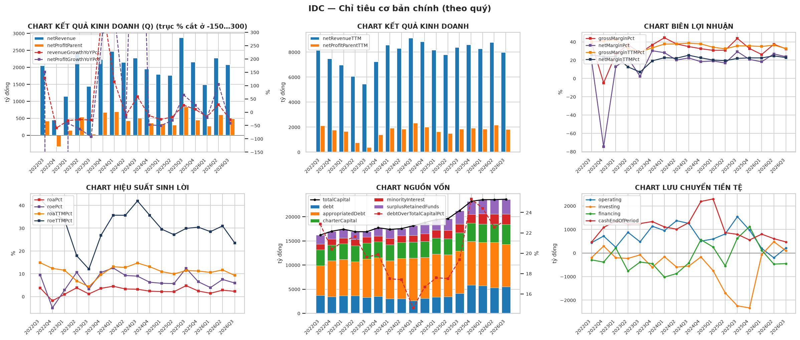
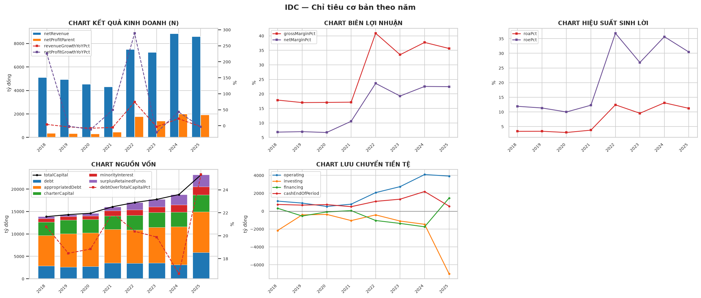
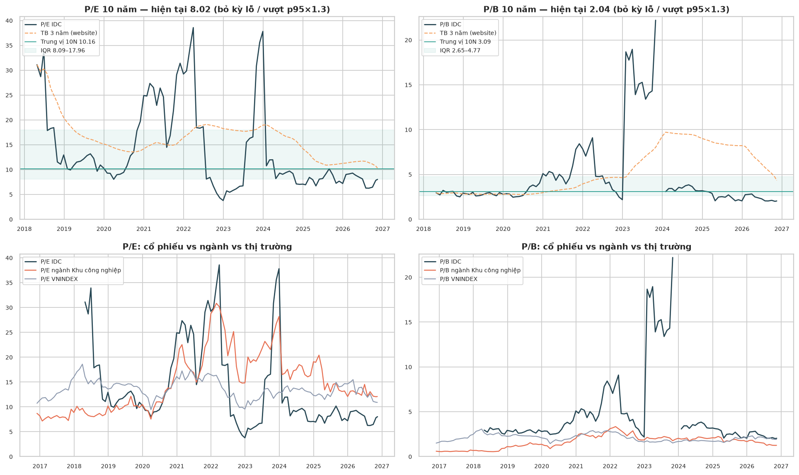
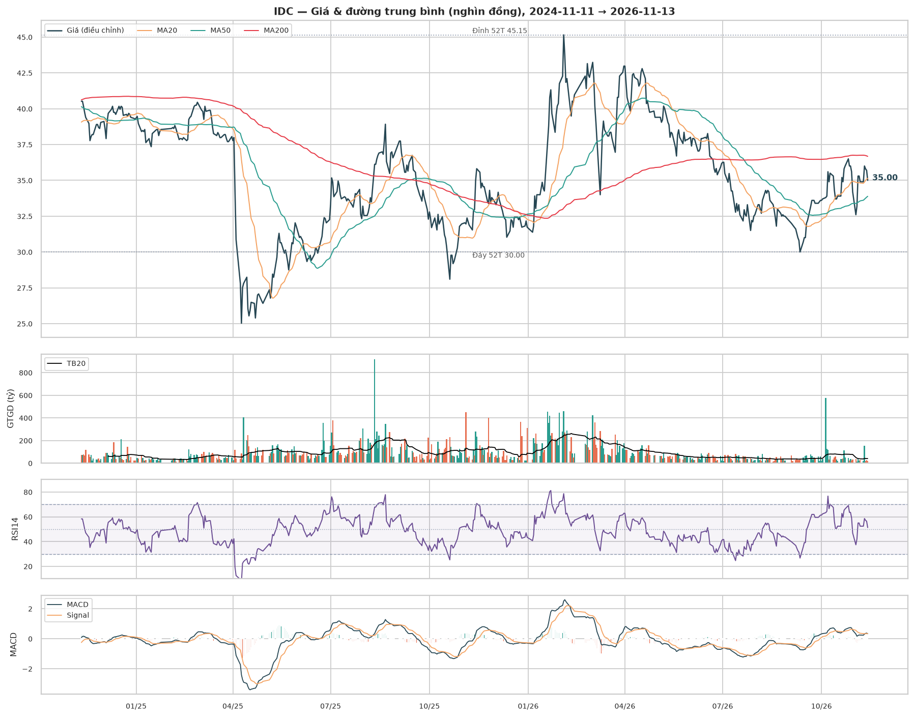
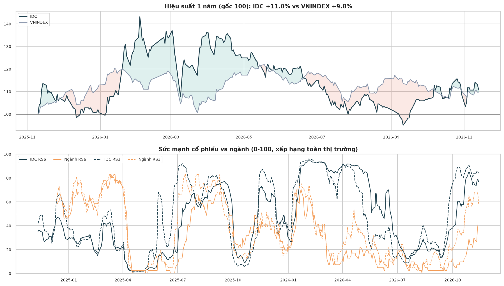
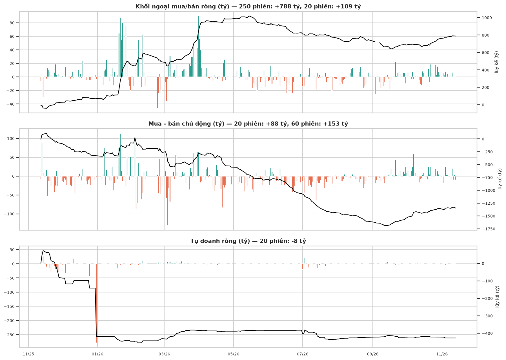
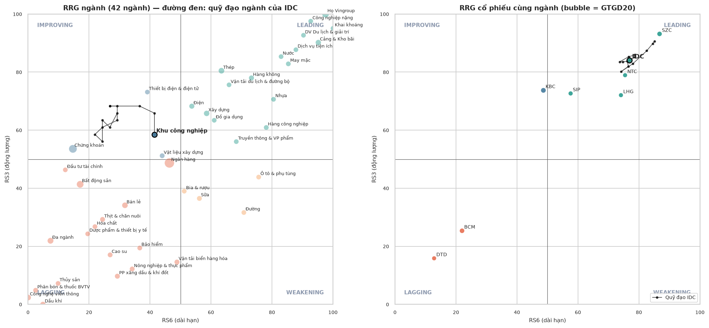

# IDC — Tổng Công ty IDICO - CTCP | Phân tích cổ phiếu

> Dữ liệu sstock tới **2026-11-13** · Ngành Khu công nghiệp (sectorId 4) · Cấu trúc BCTC: phi tài chính · Sàn HNX · Giới hạn gói: BCTC quý 17 kỳ (2022Q3–2026Q3), BCTC năm từ 2018, giá từ 2023-11-16, định giá thị trường từ 2016-11-17.
> Báo cáo được tạo từ dữ liệu định lượng, **không phải khuyến nghị đầu tư**.

## 1. Tóm tắt

**Kết luận:** Kỹ thuật & dòng tiền **khá tốt** (+5/8: RRG *leading*, RS3 84 / RS6 77, khối ngoại quay lại mua), nhưng cơ bản & định giá chỉ đạt **+2/6**: định giá rẻ và bảng cân đối khỏe, song lợi nhuận **đi ngang/giảm nhẹ** (LNST TTM -1,0% YoY, Q3/26 -41,5% YoY). Trên ma trận, IDC rơi vào ô **"giao dịch theo đà, dừng lỗ chặt"**. Giá vẫn nằm **dưới MA200**, ngay sát cạnh trên của vùng nền 32,6–36,8, còn thị trường đang *pressure*. Scorecard **+8/±16 → Tích cực** (Kỹ thuật & dòng tiền +5/8 · Cơ bản & định giá +2/6 · Bối cảnh +1/2). Mức +8 vừa chạm ngưỡng "Tích cực".

| Luận điểm | Số liệu |
|---|---|
| Sinh lời cao, biên vượt trội ngành | ROE TTM 23,5% (giảm từ 31,0% ở Q2/26); biên gộp Q 32,4% so với ngành 21,3%; biên ròng 23,7% so với ngành 13,4% |
| Tăng trưởng chững lại | LNST TTM 1.822 tỷ (-1,0% YoY); doanh thu TTM 7.992 tỷ (-4,7%); 9T/26 LNST 1.373 tỷ so với 1.483 tỷ của 9T/25 (-7,4%) |
| Định giá rẻ theo lịch sử và ngành | P/E 8,02 (trung vị 10N 10,16, percentile 22%; ngành 12,08); P/B 2,04, thấp nhất 10 năm (min 2,00) |
| Bảng cân đối tiền mặt ròng | Tiền 7.044 tỷ > nợ vay 5.497 tỷ, tức nợ ròng/VCSH -21%; EBIT/chi phí tài chính 13,3x |
| Sức mạnh giá dẫn đầu ngành | RRG *leading*, RS3 84,1 / RS6 76,9 (RS6 chỉ 22,6 cách đây 60 phiên); YTD +10,3% so với VNINDEX -2,8% |
| Dòng tiền chưa tăng tốc | VCR 0,81 (*trầm lắng*); khối ngoại +108,9 tỷ trong 20 phiên; chủ động ròng +87,7 tỷ trong 20 phiên |

**Điều kiện hành động:** tín hiệu xác nhận là đóng cửa **trên ~36,8** (MA200 36,67 trùng đỉnh nền 26/10) với GTGD khớp lệnh vượt TB20 (~32 tỷ) và VCR ≥ 1. Kịch bản bị vô hiệu khi đóng cửa **dưới 32,5** (đáy nền 02/11, dưới MA50 33,9).

## 2. Bối cảnh thị trường & ngành

- **Thị trường:** ở trạng thái *pressure* đã 73 phiên (chuyển từ downtrend qua FTD ngày 2026-07-30), độ tin cậy 63,7 (Medium), độ rộng VN100 53%, có **6 phiên phân phối trong 25 phiên**, tức áp lực bán đáng kể. FTD gần nhất là 2026-11-04. Hôm đó IDC tăng +6,33%, đóng cửa 35,3. Tâm lý ngắn hạn 29 / trung hạn 33 (*Bi quan*, trung hạn +8 điểm trong một tháng). Dòng tiền lan tỏa đang do **vốn hóa vừa dẫn dắt (51, +27 trong tháng)**. Vốn hóa IDC là 14.611 tỷ, thuộc nhóm này nên được hưởng lợi. Vốn hóa lớn yếu (21). P/E VNINDEX 10,90 so với TB 3 năm 13,26: thị trường đang rẻ.
- **Biểu đồ thị trường:** trong 12 tháng, VNINDEX liên tục dao động 1.600–1.930 dưới trạng thái *pressure*, xen kẽ hai lần rơi vào *downtrend* ngắn (3/2026 và 7/2026). Chỉ số đang đi ngang ở ~1.735, thấp hơn đỉnh 5/2026 (~1.925), nên chưa có môi trường uptrend để mở rộng vị thế.
- **Ngành Khu công nghiệp:** RRG *improving*, RS3 58,5 (hạng 18/42), RS6 41,5 (hạng 25), VCR 1,04, độ rộng >MA50 là 48%, không có cảnh báo. Trên [08_rrg](charts/08_rrg.png), quỹ đạo ngành đi ngang sang phải (RS6 từ ~22 lên 41,5) nhưng RS3 lùi từ ~68 về 58,5 trong vài phiên gần nhất. Ngành đang tiến sát vùng *leading* nhưng động lượng ngắn hạn hụt dần.
- **Vị thế của IDC:** chiếm 11,4% vốn hóa (127.917 tỷ, 25 DN), 9,8% doanh thu TTM và **17,2% LNST TTM** của ngành. LNST ngành TTM giảm -19,5% YoY, còn IDC chỉ giảm -1,0%, nên IDC đang chống chịu tốt hơn mặt bằng ngành.

## 3. Kết quả kinh doanh & sức khỏe tài chính

| Chỉ tiêu (tỷ đồng) | Q3/25 | Q4/25 | Q1/26 | Q2/26 | Q3/26 | YoY |
|---|---|---|---|---|---|---|
| Doanh thu thuần | 2.871 | 2.160 | 1.486 | 2.270 | 2.076 | -27,7% |
| LNST cty mẹ | 842 | 449 | 271 | 610 | 493 | -41,5% |
| Biên gộp Q % | 43,8 | 32,7 | 26,2 | 37,4 | 32,4 | -11,4pp |
| ROE TTM % | 29,9 | 30,4 | 28,5 | 31,0 | 23,5 | -6,4pp |
| Nợ vay | 4.119 | 5.877 | 5.744 | 5.310 | 5.497 | +33,4% |
| Tiền & tương đương | 6.588 | 7.460 | 7.742 | 7.322 | 7.044 | +6,9% |
| Hàng tồn kho | 1.312 | 1.299 | 1.337 | 7.737 | 8.161 | +522% |
| XDCB dở dang | 5.374 | 7.094 | 7.215 | 947 | 981 | -81,7% |
| LCTT HĐKD | 1.542 | 970 | 198 | -203 | 217 | -85,9% |

- **Mức giảm YoY của Q3/26 chủ yếu do nền so sánh cao:** Q3/25 là quý ghi nhận đột biến (doanh thu 2.871 tỷ, biên gộp 43,8%, LNST 842 tỷ, EBITDA 1.623 tỷ). Doanh thu KCN thường ghi nhận theo đợt bàn giao đất. Xét cả năm, 9T/26 LNST giảm -7,4% và doanh thu giảm -9,3% so với 9T/25. Vậy tăng trưởng âm nhẹ là **có thật**, chỉ là không sâu như con số quý cho thấy. Lợi nhuận tài chính tăng đều (22 lên 101 tỷ/quý, nhờ lượng tiền gửi lớn), lợi nhuận khác không đáng kể (-15 đến +45 tỷ/quý). Lợi nhuận cốt lõi vẫn đến từ hoạt động kinh doanh chính (566 tỷ ở Q3/26).
- **Chuyển XDCB sang hàng tồn kho (Q2/26):** XDCB dở dang giảm 6.268 tỷ (7.215 xuống 947), đúng lúc tồn kho tăng 6.400 tỷ (1.337 lên 7.737). Đây là **phân loại lại** một dự án (khả năng là quỹ đất/hạ tầng KCN dành để cho thuê hoặc bán, ghi nhận dần vào giá vốn), không phải hàng tồn mua thêm. Số vốn này khớp với dòng tiền đầu tư rất lớn năm 2025 (Q1–Q4/25 cộng lại khoảng -7.009 tỷ). Dự án cụ thể **chưa rõ, cần tin doanh nghiệp**. Tồn kho/Tổng TS hiện là 34,5%. Đây sẽ là nguồn doanh thu của các quý tới, nhưng cũng là rủi ro nếu tiến độ cho thuê chậm.
- **Khấu hao giảm mạnh:** từ ~270–370 tỷ/quý (Q3–Q4/25) xuống 87–101 tỷ (Q2–Q3/26), cùng lúc với đợt phân loại lại. Có thể liên quan đến việc thay đổi cách ghi nhận chi phí hạ tầng. **Chưa rõ, cần tin doanh nghiệp.**
- **Chu kỳ dài hạn** ([06_fa_annual](charts/06_fa_annual.png)): IDC đổi trạng thái từ 2022. Biên gộp tăng từ ~17% (2018–2021) lên 33–41% (2022–2025), ROE từ 10–12% lên 27–37%, LNST từ 300–450 tỷ lên 1.400–2.000 tỷ/năm. LNST 2025 (1.932 tỷ) và TTM (1.822 tỷ) **đi ngang quanh đỉnh 2024 (1.996 tỷ)**. Đây là nền lợi nhuận cao, nhưng chưa có động lực tăng trưởng mới hiện ra trong số liệu.
- **Bảng cân đối:** nợ vay tăng từ 3.136 lên 5.497 tỷ trong 4 quý (nợ vay/tổng nguồn vốn 23,3%), dùng để tài trợ capex 2025. Tiền 7.044 tỷ vẫn lớn hơn nợ vay, **nợ ròng -1.547 tỷ**, EBIT/chi phí tài chính 13,3x, rất an toàn. Nợ chiếm dụng (người mua trả trước, doanh thu chưa thực hiện…) là 8.776 tỷ, đặc thù ngành KCN do thu tiền thuê đất trước. Lợi ích cổ đông thiểu số 2.103 tỷ.
- **Pha loãng:** vốn điều lệ tăng từ 3.300 lên 3.795 tỷ (Q3/25, +15%), rồi lên 4.174 tỷ (Q3/26, +10%), cộng dồn +26,5% trong 5 quý (khả năng do cổ tức bằng cổ phiếu). EPS 4 quý chỉ còn 4.365 đ (~417 triệu cp). Phần giảm của ROE TTM (31,0% xuống 23,5%) đến từ cả LNST TTM giảm lẫn VCSH tăng (~7.255 tỷ, không gồm cổ đông thiểu số).
- **Dòng tiền:** CFO TTM 1.182 tỷ, chỉ bằng **0,65x LNST** (Q2/26 âm -203 tỷ). Đầu tư TTM -1.823 tỷ, nên **FCF TTM -642 tỷ**. Cả năm 2025 CFO đạt 3.914 tỷ, vậy sự suy yếu này mới diễn ra trong 2026, cần theo dõi khi lượng tồn kho mới được chuyển thành tiền.
- Từ [05_fa_dashboard](charts/05_fa_dashboard.png): tiền/tổng tài sản tăng từ ~13% (2023) lên ~30–33% (2025–2026) và đứng ở mức cao, đúng là một "kho tiền" đang chờ giải ngân. Đồng thời, dòng tài trợ đổi từ âm (trả nợ, cổ tức) sang dương mạnh ở Q4/25 (+1.100 tỷ vay mới).

## 4. Định giá

| | Hiện tại | Trung vị 10N | Percentile 10N | Ngành KCN | VNINDEX |
|---|---|---|---|---|---|
| P/E | 8,02 | 10,16 | 22% | 12,08 (TB3N 15,64) | 10,90 |
| P/B | 2,04 | 3,10 | 3% | 1,25 (TB3N 1,82) | 1,91 |

- **P/E** thấp hơn trung vị lịch sử 21% và thấp hơn ngành 34%. Từ 2024, P/E IDC dao động 6–10 trong khi P/E ngành ở 12–20, tức thị trường liên tục định giá IDC thấp hơn ngành. Một phần lý do có thể là thanh khoản HNX và tính lumpy của lợi nhuận.
- **P/B** 2,04 là **mức thấp nhất 10 năm**. Tuy vậy, IDC vẫn đắt hơn ngành (1,25) theo P/B, và mức chênh này được biện minh bằng ROE 23,5%, gần gấp đôi biên ròng của ngành.
- **Caveat dữ liệu:** chuỗi P/B có một **đoạn bất thường năm 2023** (P/B vọt lên 14–22 rồi mất dữ liệu đến 2024), nhiều khả năng do lỗi VCSH trong dữ liệu nguồn. Vì vậy **P/B TB 3 năm (4,33) và giá tham chiếu theo P/B (74,1 / 53,0) không dùng được**. P/E TB 3 năm (10,30) gần trung vị 10N nên không méo đáng kể.
- **Vùng tham chiếu:** nếu P/E quay về trung vị 10N hoặc TB 3 năm, giá tương ứng là **~44,4–45,0 nghìn đ**, gần đỉnh 52 tuần 45,15. Giả định là LNST TTM giữ quanh 1.822 tỷ và không pha loãng thêm. Đây là *vùng định giá tham chiếu*, không phải giá mục tiêu.
- P/E SSTOCK dự phóng 7,63 / P/B 1,95, nhưng P/E dự phóng **giữ nguyên từ 2026-07-24**, nên không phản ánh giá hiện tại.

## 5. Kỹ thuật & xu hướng giá

| Chỉ tiêu | Giá trị |
|---|---|
| Giá (13/11) | 35,00 (-1,96%) |
| MA20 / MA50 / MA200 | 35,14 / 33,88 (dốc lên +2,6%/20 phiên) / 36,67 (đi ngang) |
| Đỉnh / đáy 52 tuần | 45,15 (2/2026) / 30,00 (9/2026); cách đỉnh -22,5% |
| RSI14 · MACD hist | 51,3 · -0,01 (MACD > 0 nhưng hội tụ về signal) |
| ATR14 · Biến động năm · Beta | 3,4% (~1,2 nghìn đ) · 37% · 0,88 |
| GTGD TB20 / TB60 (tổng, tỷ) | 40,4 / 52,7 (khớp lệnh TB20: 31,7) |

- **Cấu trúc:** sau nhịp giảm từ đỉnh 45,15 (2/2026) về đáy 30,0 (giữa 9/2026), giá hồi lên trên MA50 và đã **tạo nền 32,6–36,8 từ đầu tháng 10**. Đỉnh nền là 36,5 (đóng cửa 26/10, intraday 36,8), **trùng MA200 36,67**. Giá đã ba lần chạm vùng 36–36,5 (23/10, 26/10, 10/11) mà chưa đóng cửa được phía trên. Đáy nền là 32,6 (02/11). Biểu đồ cho thấy MA200 đã ngừng tăng và đi ngang ở ~36,7 từ tháng 7, nên vượt được ngưỡng này sẽ là tín hiệu đảo chiều xu hướng trung hạn có ý nghĩa.
- **Thanh khoản:** các phiên gần đây chỉ đạt 17–26 tỷ, thấp hơn TB20 khớp lệnh (~32 tỷ): giá đi ngang sát kháng cự trong khi thanh khoản cạn. **TB60 (52,7 tỷ) bị thổi phồng** bởi phiên thỏa thuận 551 tỷ (15,74 triệu cp) ngày 2026-10-05. Phiên 10/11 cũng có 99,8 tỷ thỏa thuận.
- **Hiệu suất tương đối:** 1T +3,9% (VNINDEX +2,2%), 3T +2,3% (-1,7%), 6T -6,2% (-10,0%), YTD +10,3% (-2,8%), 1N +9,8% (+8,5%). IDC vượt chỉ số ở mọi khung từ 1 tháng trở lên.

- Biểu đồ sức mạnh: RS3/RS6 của IDC đã đi qua 3 chu kỳ lớn trong 2 năm (đỉnh 7–9/2025, 1–4/2026, hiện tại). Mỗi chu kỳ RS trên 80 kéo dài 2–4 tháng. Đợt hiện tại bắt đầu đầu tháng 10/2026 và **RS ngành (cam) cũng tăng theo**, khác với đợt 2–4/2026 khi IDC tăng một mình còn ngành ở dưới 20.

## 6. Dòng tiền & smart-money

| Cửa sổ | Khối ngoại ròng | Tự doanh ròng | Chủ động ròng | Tỷ lệ chủ động |
|---|---|---|---|---|
| 5 phiên | +9,0 | 0,0 | -4,9 | -0,035 |
| 20 phiên | +108,9 | -7,9 | +87,7 | +0,138 |
| 60 phiên | +32,1 | -0,7 | +153,4 | +0,065 |
| 250 phiên | +788,0 | — | -1.346,8 | -0,065 |

- **Khối ngoại:** lũy kế đạt đỉnh ~1.000 tỷ vào 4–5/2026, bán ra về ~620 tỷ vào cuối 9/2026, rồi **mua lại đều từ tháng 10** (+109 tỷ trong 20 phiên), cùng nhịp với đợt hồi giá. Ba phiên gần nhất bán ròng nhẹ (chuỗi -3).
- **Mua/bán chủ động:** lũy kế giảm liên tục từ 3/2026 xuống đáy ~-1.700 tỷ giữa 9/2026, sau đó **đảo chiều đi lên** (+153 tỷ trong 60 phiên). Phe mua đang lấy lại ưu thế, xác nhận đáy 30,0. Tự doanh gần như đứng ngoài, trừ một phiên bán lớn ~-280 tỷ cuối 12/2025.
- **Smart-money:** RRG *leading*, RS3 84,1 / RS6 76,9 (Δ5 phiên +0,5 / +2,2), AMFI +0,138 (*phe mua chiếm ưu thế*), không có phân kỳ giảm đang hiệu lực. Tuy nhiên **VCR 0,81 (*trầm lắng*)**: dòng tiền không tăng tốc ở nhịp đi ngang này. Phân kỳ giảm gần nhất xuất hiện **2026-10-26**, đúng tại đỉnh nền 36,5, và giá giảm về 32,6 ngay sau đó, nên tín hiệu này đã đúng với IDC.
- **Elite** (theo `raw/elite_diag.json`): đạt **4/5 trục**, chỉ thiếu **VCR ≥ 1,0**. Bị chặn bởi **guard-2 (không phải cổ phiếu HOSE)**, một guard cố định vì IDC niêm yết trên HNX, nên **IDC sẽ không bao giờ có tín hiệu Elite**. Ngoài ra còn guard-9 (cooldown 20 phiên sau guard-5). Không có episode mở, persistence 0/3. VCR vẫn là chỉ báo hữu ích để xác nhận breakout.

## 7. So sánh cùng ngành

| Mã | Sàn | Vốn hóa (tỷ) | RS3 | RS6 | Góc | VCR | AMFI | GTGD20 (tỷ) |
|---|---|---|---|---|---|---|---|---|
| BCM | HOSE | 38.450 | 25 | 22 | lagging | 1,00 | -0,174 | 24,1 |
| KBC | HOSE | 25.239 | 74 | 49 | improving | 1,04 | 0,072 | 34,2 |
| **IDC** | HNX | 14.611 | 84 | 77 | leading | 0,81 | 0,138 | 31,7 |
| SIP | HOSE | 12.081 | 73 | 58 | leading | 1,34 | -0,192 | 5,7 |
| SZC | HOSE | 3.753 | 93 | 87 | leading | 1,90 | -0,045 | 20,6 |
| NTC | HOSE | 3.077 | 79 | 75 | leading | 1,07 | 0,271 | 1,1 |
| LHG | HOSE | 1.345 | 72 | 74 | leading | 1,01 | -0,017 | 1,5 |
| DTD | HNX | 704 | 16 | 13 | lagging | 1,21 | -0,116 | 1,8 |

- IDC **dẫn dắt ngành**: xếp hạng RS3 2/8 (sau SZC), có AMFI cao thứ hai (sau NTC) và thanh khoản hàng đầu cùng KBC. Trong số các mã *leading*, IDC có **VCR thấp nhất (0,81)**, trong khi SZC (1,90) và SIP (1,34) đang hút tiền mạnh hơn.
- Ngành phân hóa rõ: nhóm KCN phía Nam/cảng (SZC, SIP, NTC, LHG) và IDC ở *leading*; hai "ông lớn" BCM và DTD ở *lagging*. KBC đang *improving*, có thể là ứng viên đuổi theo.
- Quỹ đạo RRG của IDC ([08_rrg](charts/08_rrg.png), bên phải) đi từ ~(85, 90) lùi dần về (77, 84) rồi quanh quẩn trong vùng 75–80 / 80–85. Mã đang **tích lũy trong vùng leading**, chưa trượt sang *weakening*.

## 8. Scorecard

| Nhóm | Điểm | Ghi chú |
|---|---|---|
| Xu hướng giá | +1 | Trên MA50 (+1), MA50 dốc lên 2,6% (+1), nhưng dưới MA200 (-1) |
| Động lượng | 0 | RSI 51,3 trung tính; MACD hội tụ; 3T vượt VNINDEX +4,1pp (chưa đủ +5pp) |
| Sức mạnh tương đối | +2 | RRG leading (+2), RS6 76,9 (+1) |
| Dòng tiền | +2 | AMFI +0,14, khối ngoại +108,9 tỷ, chủ động +87,7 tỷ (20 phiên); VCR 0,81 trung tính |
| Tăng trưởng | -2 | LNST TTM -1,0%, doanh thu TTM -4,7% (một phần do nền Q3/25 đột biến) |
| Chất lượng | +2 | ROE 23,5%, nợ ròng/VCSH -21%; CFO/LNST 0,65 trung tính |
| Định giá | +2 | P/E/trung vị 0,79, P/B percentile 3%, P/E thấp hơn ngành 34% |
| Bối cảnh | +1 | Ngành improving (+1); thị trường pressure và tâm lý 33 trung tính |
| **Tổng** | **+8/±16** | **Tích cực**, sát ngưỡng |

**Không override.** Theo ma trận, Kỹ thuật +5 (≥3) kết hợp Cơ bản +2 (≤2) cho kết quả *"chỉ phù hợp giao dịch theo đà"*. Bối cảnh (pressure, ngành improving) không đủ để hạ bậc. Có cân nhắc nâng lên "ứng viên mạnh" với lý do tăng trưởng -2 bị méo bởi nền Q3/25, nhưng đã bác bỏ vì 9T/26 vẫn giảm thật (-7,4%), CFO/LNST chỉ 0,65 và giá chưa vượt MA200. Hai điều kiện nâng hạng: (1) LNST Q4/26 > 449 tỷ (TTM tăng trở lại), (2) giá đóng cửa vượt MA200.

## 9. Rủi ro & catalyst

**Catalyst**
- **BCTC Q4/26:** Q4 thường là quý ghi nhận lớn của KCN. Nền Q4/25 là 2.160 tỷ doanh thu / 449 tỷ LNST, vượt mức này thì LNST TTM sẽ tăng trở lại.
- Ghi nhận doanh thu từ **8.161 tỷ tồn kho** vừa chuyển từ XDCB (dự án KCN mới).
- Ngành KCN đang chuyển từ *improving* sang gần *leading* (RS6 ngành 41,5, tăng từ 9,8 cách đây 20 phiên).
- Thu nhập tài chính từ 7.044 tỷ tiền gửi (lợi nhuận tài chính 101 tỷ/quý và đang tăng).

**Rủi ro**
- **Lợi nhuận lumpy:** ghi nhận theo đợt bàn giao đất nên lợi nhuận một quý có thể dao động ±50% YoY (Q2/26 +105%, Q3/26 -41%).
- **Dòng tiền hoạt động yếu trong 2026** (CFO/LNST 0,65, FCF TTM -642 tỷ), trong khi nợ vay tăng +33% YoY.
- **Pha loãng:** vốn điều lệ +26,5% trong 5 quý, nên EPS tăng chậm hơn LNST.
- **Tồn kho chiếm 34,5% tổng tài sản:** chậm cho thuê thì vốn bị đọng.
- **Rủi ro giá:** kháng cự MA200 đã thất bại ba lần, thanh khoản cạn dần, thị trường *pressure* với 6 phiên phân phối. Phân kỳ giảm 26/10 đã từng gây nhịp -10%.
- Rủi ro ngành: FDI, thuế quan và chính sách thu hút đầu tư (chưa kiểm chứng được bằng dữ liệu vì `search_data_series` chỉ dành cho admin).

**Giới hạn dữ liệu**
- Gói hiện tại: BCTC 17 quý, BCTC năm từ 2018, giá từ 2023-11-16.
- Chuỗi P/B năm 2023 bất thường (P/B 14–22), nên P/B TB 3 năm và giá tham chiếu theo P/B không dùng được.
- P/E SSTOCK dự phóng giữ nguyên từ 2026-07-24.
- Trường "Vốn hóa" trong bảng giá trống, báo cáo dùng vốn hóa 14.611 tỷ từ dữ liệu peers.
- Lý do của đợt phân loại XDCB → tồn kho và đợt giảm khấu hao chưa xác định, cần tin doanh nghiệp.

## 10. Kịch bản & mức giá theo dõi

| Kịch bản | Điều kiện | Ý nghĩa |
|---|---|---|
| Tích cực | Đóng cửa **> 36,8** (MA200 36,67 + đỉnh nền) với GTGD khớp > ~32 tỷ (TB20), **VCR ≥ 1**, RS3 ≥ 80 / RS6 ≥ 60 giữ vững | Thoát nền và đảo chiều xu hướng trung hạn. Vùng cản kế tiếp là 39–40, sau đó **42,5–45,15** (đỉnh 52T, trùng vùng tham chiếu P/E trung vị 44,4–45,0). Phù hợp giao dịch theo đà, dừng lỗ ~2×ATR (~2,4 nghìn đ) |
| Cơ sở | Giá dao động **32,6–36,8**, giữ trên MA50 (33,9); chờ BCTC Q4/26 | Tích lũy tiếp. Watchlist, chưa mua đuổi trong nền khi VCR < 1 và thanh khoản thấp. Nếu Q4/26 LNST > 449 tỷ thì cơ bản được nâng hạng |
| Tiêu cực | Đóng cửa **< 32,5** (thủng đáy nền và MA50), RS6 < 60, hoặc khối ngoại đảo chiều bán ròng 20 phiên | Nền thất bại, nguy cơ về lại **30,0** (đáy 52T). Thị trường chuyển *downtrend* thì càng tăng xác suất |

---
*Phụ lục:* dữ liệu thô ở `raw/`, chỉ số ở `metrics.json`, bảng đầy đủ ở `tables.md`, biểu đồ ở `charts/` (gồm cả [05_fa_dashboard](charts/05_fa_dashboard.png)). Script ad-hoc: `adhoc_price.py`.

*Báo cáo dựa trên dữ liệu định lượng tới 2026-11-13, không phải khuyến nghị đầu tư.*
