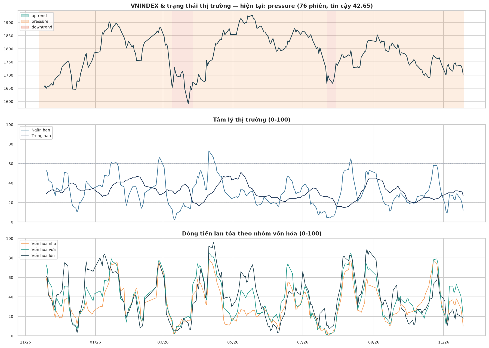
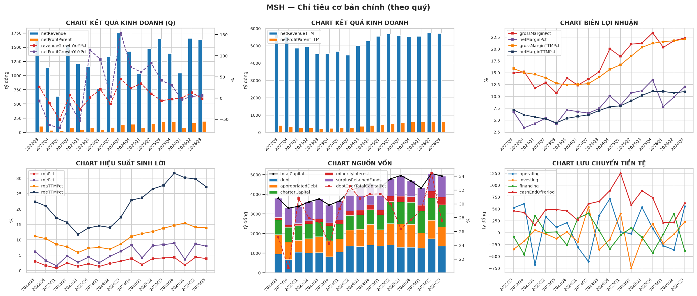
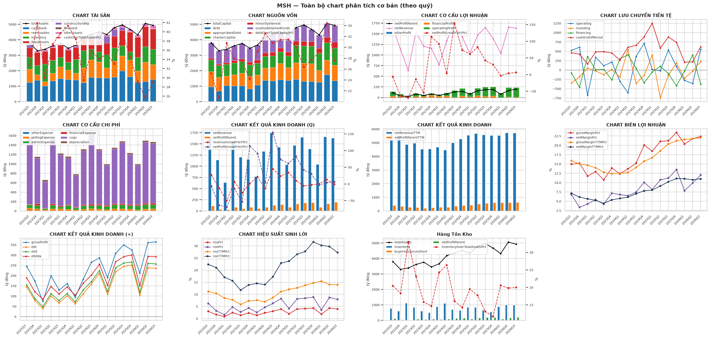
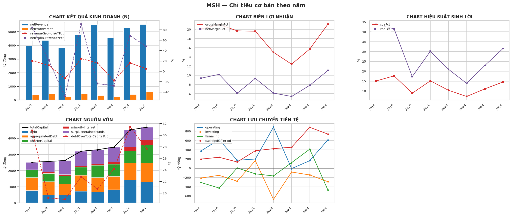
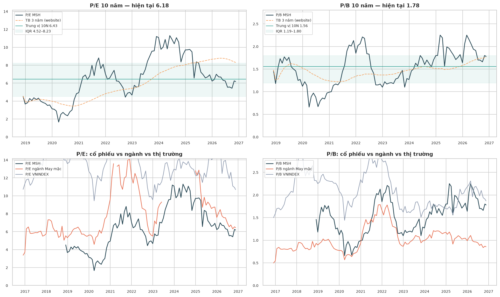
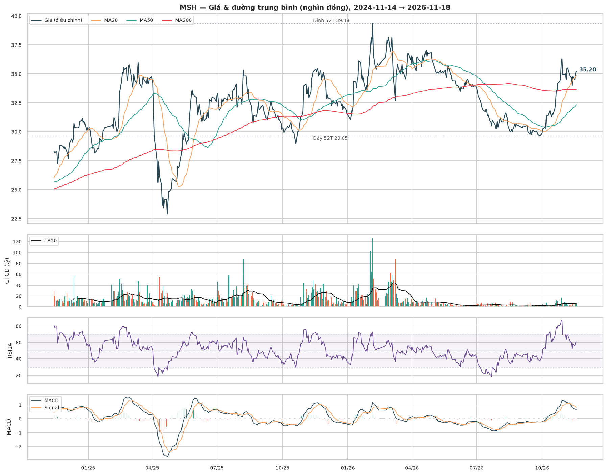
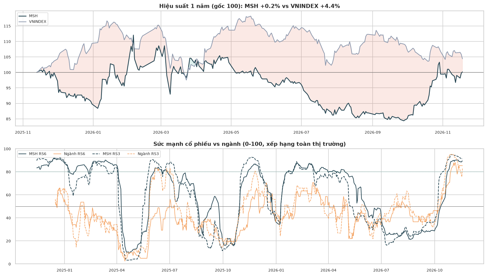
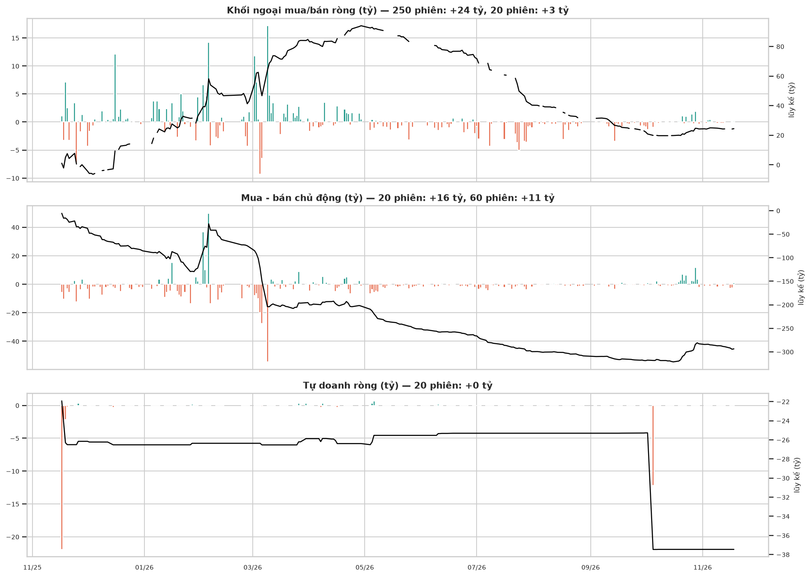
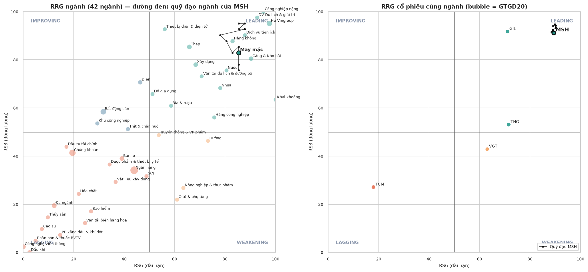

# MSH — Công ty Cổ phần May Sông Hồng | Phân tích cổ phiếu

> Dữ liệu sstock chốt phiên **18/11/2026** · HOSE · May mặc (ngành 23) · BCTC phi tài chính, kỳ mới nhất Q3/2026. Tiền: tỷ đồng; giá cổ phiếu: nghìn đồng. Nguồn: [bảng số liệu](tables.md), [chỉ số](metrics.json) và dữ liệu sstock trong `raw/`.

## 1. Tóm tắt

**MSH mạnh về giá và dòng tiền, nhưng chưa thuyết phục cho luận điểm mua vì rẻ.** Scorecard **+10/±16 → Tích cực**, chủ yếu nhờ kỹ thuật và dòng tiền **+8/8**; cơ bản và định giá chỉ **+1/6**, bối cảnh **+1/2**. Theo ma trận hai trục, đây là mã **theo dõi theo đà**, không phải trường hợp cả cơ bản lẫn giá cùng xác nhận. Ngành đang dẫn dắt, nhưng thị trường chung vẫn chịu áp lực.

| Luận điểm | Số liệu đến 18/11/2026 |
|---|---|
| Biên tốt, lợi nhuận tăng vừa phải | Q3: LNST công ty mẹ 196 tỷ (+6,3% YoY), doanh thu 1.630 tỷ (−1,0%); ROE 4 quý 27,2% |
| Tiền chưa theo kịp lợi nhuận | CFO 4 quý 7 tỷ so với LNST công ty mẹ 629 tỷ; tồn kho 986 tỷ (+51,4% YoY) |
| P/E không đắt nhưng không ở vùng rẻ lịch sử | 6,29x so với trung vị 6,43x; P/B 1,81x so với trung vị 1,56x |
| Giá và sức mạnh tương đối tốt | Đóng cửa 35,20, trên MA200 33,65; RS3/RS6 91,2/89,4, nhưng mua–bán chủ động 5 phiên âm 6,4 tỷ |

**Mốc kiểm chứng:** Vượt 39,38 với GTGD khớp lệnh cao hơn TB20 hiện tại 5,8 tỷ và RS3/RS6 giữ ≥80/60 sẽ củng cố xu hướng. Mất 33,65 làm suy yếu luận điểm theo đà.

## 2. Bối cảnh thị trường & ngành

VNINDEX ở trạng thái **pressure** 76 phiên (độ tin cậy 42,6, thấp), với **8 phiên phân phối trong 25 phiên**, độ rộng VN100 36%; phiên bùng nổ theo đà gần nhất 04/11/2026. Biểu đồ 09 cho thấy nhịp hồi cuối tháng 10 không giữ được: tâm lý ngắn hạn rơi từ gần 60 về 12 (−11 điểm/tuần), trung hạn 27 (−5 điểm/tuần). Lan tỏa nhóm vừa cao nhất nhưng chỉ 20, so với nhóm lớn 18 và nhỏ 10. P/E VNINDEX 10,69x so với TB3N 13,25x; chiết khấu này chưa đi kèm độ rộng khỏe.

May mặc ở góc **leading**, RS3 **82,9** (hạng 8/42), RS6 **85,4** (hạng 7/42), VCR 1,18. Tuy nhiên chỉ 32,4% số mã ngành trên MA50. Trong rổ FA 34 doanh nghiệp, MSH chiếm 12,7% vốn hóa, 6,1% doanh thu và 13,0% LNST công ty mẹ 4 quý. Theo cùng bảng đối chiếu ngành, biên gộp/ròng quý của MSH là 22,4%/12,0%, trên ngành 14,9%/4,9%, nhưng doanh thu và LNST 4 quý tăng 2,5%/10,3%, dưới 7,4%/21,9% của ngành.

## 3. Kết quả kinh doanh & sức khỏe tài chính

| Chỉ tiêu | Q3/25 | Q4/25 | Q1/26 | Q2/26 | Q3/26 |
|---|---:|---:|---:|---:|---:|
| Doanh thu thuần | 1.647 | 1.388 | 1.041 | 1.657 | 1.630 |
| LNST công ty mẹ | 185 | 187 | 82 | 164 | 196 |
| Biên gộp quý | 21,2% | 23,4% | 20,4% | 21,8% | 22,4% |
| ROE 4 quý | 27,7% | 31,7% | 30,2% | 29,8% | 27,2% |
| CFO quý | 535 | 92 | −276 | −362 | 553 |
| Tồn kho cuối quý | 651 | 546 | 889 | 1.002 | 986 |

- **Biên cải thiện, nhưng tăng trưởng chưa tăng tốc.** Q3/2026 lãi gộp 364 tỷ so với 350 tỷ cùng kỳ; lợi nhuận hoạt động trước tài chính tăng từ 220,5 lên 233,0 tỷ. Lãi tài chính ròng giảm từ 27,0 còn 5,7 tỷ, khiến lợi nhuận trước thuế giảm từ 244,7 xuống 235,4 tỷ, dù LNST công ty mẹ tăng. Chênh lệch giữa lợi nhuận trước thuế và LNST công ty mẹ thu hẹp từ 60 xuống 39 tỷ; chưa tách được đóng góp của thuế và lợi ích cổ đông thiểu số từ các chuỗi đang dùng. So với Q2/26, LNST tăng 19,8% nhưng EBITDA giảm 0,4%, nên không nên ngoại suy mức tăng LNST quý. Lũy kế 9T/2026, doanh thu 4.329 tỷ (+4,3%) và LNST 442 tỷ (+3,6%); 4 quý lần lượt 5.717 tỷ (+2,5%) và 629 tỷ (+10,3%). Biểu đồ 04 cho thấy biên gộp 4 quý tiếp tục đi lên tới 22,1%, nhưng ROE đã đi xuống ba quý từ đỉnh Q4/2025.
- **Tồn kho là điểm cần kiểm chứng.** Q1/26, tồn kho tăng 343 tỷ trong khi phải thu giảm 336 tỷ và tiền & tiền gửi giảm 360 tỷ; đây là các biến động đồng thời, không đủ chứng minh phân loại lại tài sản. Sang Q2, phải thu tăng lên 1.264 tỷ và tồn kho lên 1.002 tỷ, đi cùng CFO âm 362 tỷ. Q3, phải thu giảm 303 tỷ và tồn kho giảm 16 tỷ so với Q2, phù hợp với chiều hồi phục CFO lên 553 tỷ, nhưng chưa xác định được đóng góp từng khoản. Biểu đồ 05 cho thấy tồn kho/TTS bật từ 11,7% cuối 2025 lên quanh 20% suốt ba quý 2026, không chỉ là một điểm bất thường. CFO 4 quý chỉ 7,1 tỷ, bằng 0,01 lần LNST công ty mẹ.
- **Đòn bẩy giảm trong Q3.** Nợ vay giảm 384 tỷ QoQ còn 1.360 tỷ; tỷ lệ nợ vay/tổng nguồn vốn từ 34,4% về 27,6%. `cashBank` 1.437 tỷ, cao hơn tiền và tương đương tiền 620 tỷ khoảng 816 tỷ, phù hợp với tiền gửi có kỳ hạn/đầu tư ngắn hạn gộp vào chỉ tiêu; khi tính cả nhóm này, nợ vay ròng âm 77 tỷ (−3,5% VCSH). EBIT/chi phí tài chính 4 quý 8,56x. Dòng tiền đầu tư 4 quý +161 tỷ trong khi TSCĐ + XDCB tăng 129 tỷ; không xem dòng đầu tư ròng là capex hoặc bằng chứng tiền tự do từ hoạt động. Lợi ích CĐ thiểu số từ 294 tỷ Q1 lên 358 tỷ Q2 rồi 384 tỷ Q3/26; chưa rõ do giao dịch sở hữu hay tích lũy kết quả ở công ty con, cần thuyết minh.
- **Dịch chuyển tài sản và pha loãng.** Năm 2022, TSCĐ tăng 342 tỷ đồng thời phải thu giảm 324 tỷ, tồn kho giảm 335 tỷ và XDCB giảm 137 tỷ: có dấu hiệu tài sản dở dang chuyển sang vận hành, nhưng không quy cả phải thu và tồn kho sang TSCĐ nếu chưa có thuyết minh. Nửa cuối 2025, TSCĐ từ 740 lên 994 rồi 1.276 tỷ, XDCB từ 436 xuống 203 rồi 13 tỷ, phù hợp với tài sản mới đi vào vận hành; tiền & tiền gửi giảm 368 tỷ riêng Q4, không đồng nghĩa toàn bộ đã chi cho TSCĐ. Q2/2025, vốn điều lệ tăng 750 lên 1.125 tỷ, khớp hệ số quyền 1,500 ngày 02/06/2025 và biến động quỹ/LNST chưa phân phối; phù hợp thưởng/cổ tức CP khoảng 50%, không có tiền mới. Vì vậy không đồng nhất tăng trưởng LNST với EPS qua đợt phát hành.

| Chu kỳ (chuỗi năm sstock) | 2022 | 2023 | 2024 | 2025 |
|---|---:|---:|---:|---:|
| Doanh thu | 5.521 | 4.542 | 5.280 | 5.538 |
| LNST công ty mẹ | 338 | 245 | 413 | 612 |
| Biên gộp | 15,0% | 12,4% | 15,7% | 21,1% |
| CFO | 890 | −8 | 164 | 614 |

Biểu đồ 06 cho thấy doanh thu 2025 chỉ trở lại vùng 2022, nhưng lợi nhuận cao hơn nhiều nhờ biên gộp. Biên 4 quý hiện tại 22,1% cao hơn toàn bộ mẫu năm 2018–2025; rủi ro là P/E thấp một phần vì mẫu số đang hưởng biên cao. Số năm 2025 (612 tỷ LNST) và chuỗi quý cộng 4 quý tại Q4/25 (614 tỷ) có chênh lệch nhỏ; không trộn hai chuỗi, chưa xác minh lý do từ BCTC gốc.

## 4. Định giá

| Bội số | Phiên 18/11 | TB3N | Trung vị lịch sử | Percentile | May mặc | VNINDEX |
|---|---:|---:|---:|---:|---:|---:|
| P/E | 6,29x | 8,30x | 6,43x | 46 | 6,46x | 10,69x |
| P/B | 1,81x | 1,77x | 1,56x | 76 | 0,86x | 1,87x |

P/E thấp hơn ngành khoảng 2,5% nhưng sát trung vị của chính MSH; P/B cao hơn ngành khoảng 112%. ROE 27,2% hỗ trợ mức P/B cao, nhưng CFO yếu làm giảm sức thuyết phục của lợi nhuận hiện tại. Biểu đồ 07 cho thấy P/E đã lùi về gần trung vị sau khi nhiều tháng quanh 10–11x năm 2024, trong khi P/B vẫn gần mép trên của vùng giữa lịch sử (1,19–1,80x).

Với EPS 4 quý khoảng **5,59 nghìn đồng/cp** và BVPS **19,41 nghìn đồng/cp** giữ nguyên, áp trung vị lịch sử cho giá tham chiếu **35,95** theo P/E và **30,29** theo P/B; áp TB3N lần lượt **46,41** và **34,36**. Đây là phép quy đổi độ nhạy, không phải giá mục tiêu. Không lấy 46,41 làm kịch bản mặc định: TB P/E 3 năm còn phản ánh giai đoạn bội số cao 2024. Pipeline không gắn cờ méo TB3N riêng MSH, không có tháng P/E âm hoặc P/B ngoại lai; TB P/E ngành 12,20x so với 6,46x hiện tại nên chỉ dùng làm bối cảnh, chưa xác định nguyên nhân chênh lệch.

Dùng snapshot đồng bộ giá chốt 18/11. Tiêu đề chart lấy điểm cuối chuỗi tháng gắn nhãn 19/11 trong raw (6,18x/1,78x), không cùng mốc với bảng. P/E/P/B dự phóng SSTOCK 5,53x/1,59x đứng từ **24/07/2026** và không dùng định giá hiện tại.

## 5. Kỹ thuật & xu hướng giá

Giá **35,20** cao hơn MA20 **34,87**, MA50 **32,35** và MA200 **33,65**; MA50 tăng 5,58% trong 20 phiên nhưng còn dưới MA200, chưa xếp chồng theo xu hướng tăng chuẩn. Đồ thị 01 cho thấy nền tháng 8–9 quanh **29,65–31**, rồi bật trong tháng 10 qua MA200 và chững gần **36,3**. RSI 60,8; MACD dương nhưng histogram −0,152 nên đà ngắn hạn đã dịu. ATR14 2,9%; GTGD TB20/TB60 **5,8/3,8 tỷ**; thỏa thuận 0,0% làm tròn trong 60 phiên. Đỉnh/đáy 52 tuần theo đóng cửa điều chỉnh **39,38/29,65**.

MSH hơn VNINDEX **7,5 điểm % trong 1 tháng** và **19,0 điểm % trong 3 tháng**, nhưng dưới **3,3 điểm % trong 1 năm** theo bảng (+1,0% so với +4,4%). Đồ thị 02 cho thấy cú bứt RS tập trung trong tháng 10, sau khi khoảng cách hiệu suất với chỉ số mở rộng mạnh trong tháng 7–9. Đã đối chiếu raw: bảng dùng độ trễ 252 phiên, gốc 12/11/2025, còn đồ thị dùng 252 điểm giao nhau, gốc 13/11/2025 (MSH +0,2%, VNINDEX +4,4%); cùng kết thúc 18/11/2026.

Các mức giá lịch sử dùng `adjClose`. Trong 12 tháng: **01/12/2025**, hệ số 1,111 khiến bộ dò phân loại sơ bộ là quyền dạng CP thưởng/cổ tức CP/chia tách, nhưng vốn điều lệ vẫn 1.125 tỷ ở Q4/25 và các quý 2026, nên chưa xác nhận pha loãng thực tế; cần thông báo GDKHQ để phân loại. **18/05/2026**, hệ số 1,028 gợi ý cổ tức tiền khoảng 1 nghìn đồng/cp; cần xác nhận thông báo doanh nghiệp.

## 6. Dòng tiền & smart-money

| Cửa sổ | Khối ngoại ròng | Tự doanh ròng | Chủ động ròng | Tỷ lệ chủ động |
|---|---|---|---|---|
| 5 phiên | -0.0 | +0.0 | -6.4 | -0.307 |
| 20 phiên | +3.5 | +0.0 | +16.1 | +0.159 |
| 60 phiên | -8.6 | -12.2 | +11.2 | +0.054 |
| 250 phiên | +24.4 | — | -293.7 | -0.114 |

Biểu đồ 03 cho thấy ngoại đảo từ tích lũy đầu năm sang giảm kéo dài từ khoảng tháng 5, chỉ nhích lên cuối tháng 10. Mua chủ động hồi tập trung cuối tháng 10 nhưng đã suy yếu trở lại: **+16,1 tỷ trong 20 phiên**, **−6,4 tỷ trong 5 phiên**. Tự doanh có một phiên bán lớn gần cuối tháng 9; 20 phiên gần nhất xấp xỉ 0, cửa sổ 250 phiên không có số tổng trong bảng và không suy thành 0.

RS3/RS6 **91,2/89,4** (giảm 2,0/0,7 điểm trong 5 phiên, từ 23,8/21,4 cách 60 phiên); VCR **1,53**, AMFI **+0,138**, không có phân kỳ giảm bear20 đang hiệu lực. Theo `raw/elite_diag.json`, Elite mở **17/11/2026**, **đủ 5/5 trụ**, không có guard chặn hoặc trụ thiếu. Lịch sử nguồn ghi 8 episode, gồm lần đang mở, tỷ lệ thắng 50%, lãi/lỗ TB +0,75%; mẫu nhỏ, không xem là bảo đảm cho nhịp hiện tại.

## 7. So sánh cùng ngành

| Mã | Sàn | Vốn hóa (tỷ) | RS3 | RS6 | Góc | VCR | AMFI | GTGD20 (tỷ) |
|---|---|---|---|---|---|---|---|---|
| VGT | UPCOM | 5,500 | 43 | 63 | weakening | 1.10 | -0.167 | 5.8 |
| **MSH** | HOSE | 3,961 | 91 | 89 | leading | 1.53 | 0.138 | 5.8 |
| TNG | HNX | 2,163 | 53 | 71 | leading | 1.32 | -0.215 | 17.6 |
| TCM | HOSE | 1,729 | 27 | 18 | lagging | 0.94 | -0.030 | 12.2 |
| GIL | HOSE | 889 | 92 | 71 | leading | 1.39 | -0.056 | 2.0 |

MSH đứng thứ **2/5 về RS3** sau GIL, nhưng có RS6, VCR cao nhất và là mã duy nhất AMFI dương trong nhóm này. TNG và TCM có GTGD20 cao hơn đáng kể nên không đánh đồng dẫn dắt về RS với dẫn dắt về thanh khoản. Trên đồ thị 08, đuôi RRG MSH co cụm ở góc leading nhưng RS3 lùi khỏi đỉnh gần nhất; đuôi ngành dao động theo chiều RS3 khi RS6 quanh giữa vùng 80. Đây là rổ engine theo dõi, không phải đủ 34 mã ngành.

## 8. Scorecard

| Nhóm | Điểm | Chi tiết |
|---|---|---|
| Xu hướng giá | +2 | Giá vs MA50=True (+1); Giá vs MA200=True (+1); MA50 dốc 20 phiên %=5.58 (+1) |
| Động lượng | +2 | RSI14=60.81 (+1); MACD vs signal & 0=0.67 (+0); Hiệu suất 3T vs VNINDEX (pp)=19.01 (+1) |
| Sức mạnh tương đối | +2 | Góc phần tư RRG=leading (+2); RS6 (Sức mạnh trung hạn)=89.4 (+1); RS3 thay đổi 5 phiên=-1.99 (+0) |
| Dòng tiền | +2 | VCR=1.53 (+1); AMFI=0.14 (+1); Khối ngoại ròng 20 phiên (tỷ)=3.48 (+1); Mua-bán chủ động 20 phiên (tỷ)=16.12 (+1); Phân kỳ giảm AMFI (bear20)=False (+0) |
| Tăng trưởng | +0 | LNST TTM YoY %=10.33 (+0); Doanh thu TTM YoY %=2.49 (+0) |
| Chất lượng | +1 | ROE TTM %=27.25 (+1); Nợ vay ròng/VCSH %=-3.5 (+1); CFO TTM / LNST TTM=0.01 (-1) |
| Định giá | +0 | P/E / trung vị 10N (P/E>0)=0.98 (+0); P/B percentile 10 năm=76.29 (+0); P/E vs ngành %=-2.47 (+0) |
| Bối cảnh thị trường & ngành | +1 | Trạng thái thị trường=pressure (+0); Góc phần tư RRG ngành=leading (+1); Tâm lý trung hạn=27 (+0) |

Không override điểm. Kỹ thuật +8, cơ bản +1, bối cảnh +1: điểm tổng tích cực không xóa được điểm trừ chất lượng tiền mặt. Thị trường `pressure` và sức mua chủ động 5 phiên âm làm cho tín hiệu vượt cản cần thêm xác nhận.

## 9. Rủi ro & catalyst

- **Rủi ro:** tồn kho tăng 51,4% YoY khi doanh thu quý giảm 1,0%; tiền người mua trả trước giảm 71,0% còn khoảng 7 tỷ, không đủ để suy ra đơn hàng nhưng không bổ trợ cho luận điểm cầu mạnh. Nếu tiêu thụ chậm hoặc giá đầu vào/tỷ giá bất lợi, cần kiểm tra tác động lên biên 22,4% quý; nguồn hiện tại không định lượng được độ nhạy. Về thị trường, có 8 phiên phân phối/25 phiên và chỉ 32,4% mã ngành trên MA50.
- **Catalyst cần kiểm chứng:** BCTC Q4/2026 cho thấy tồn kho giảm từ 986 tỷ và CFO 4 quý hồi rõ từ 7 tỷ mà biên gộp không suy giảm mạnh; công bố cơ cấu đơn hàng/công suất giúp xác minh tác động của TSCĐ tăng. Về giá, theo dõi thanh khoản khi kiểm định đỉnh 39,38.
- **Giới hạn:** fetch đủ 23 job, BCTC quý giới hạn 17 quý, năm từ 2018, giá MSH/VNINDEX từ 20/11/2023, định giá thị trường từ 21/11/2016. Không có cờ chuỗi FA toàn số 0 từ pipeline; số 0 tròn của dòng tiền và ô tự doanh 250 phiên không được suy diễn. Bộ số liệu không thay thế BCTC thuyết minh, thông báo quyền hoặc dữ liệu đơn hàng; không dùng dữ liệu vĩ mô/hàng hóa admin-only. Sai khác cửa sổ/định giá giữa chart và bảng đã ghi ở mục 4–5.

## 10. Kịch bản & mức giá theo dõi

| Kịch bản | Điều kiện kiểm chứng | Ý nghĩa |
|---|---|---|
| Tích cực | Đóng cửa vượt **39,38**, GTGD khớp lệnh vượt TB20 (mốc hiện tại **5,8 tỷ**), RS3 ≥80 và RS6 ≥60; tốt hơn nếu mua chủ động 5 phiên trở lại dương | Vượt đỉnh 52 tuần có cầu xác nhận; vẫn cần kiểm tra CFO trong BCTC kế tiếp |
| Cơ sở | Giữ **33,65** (MA200 hiện tại), chưa vượt **39,38**, GTGD chưa vượt TB20 khi thử cản quanh 36,3 | Chủ yếu là nhịp hồi/tích lũy; giá hiện gần tham chiếu P/E trung vị, chưa có luận cứ tái định giá |
| Tiêu cực | Đóng cửa dưới **33,65** với GTGD vượt TB20 hoặc RS tụt dưới ngưỡng 80/60; theo dõi tiếp **32,35** (MA50), rồi **29,65** (đáy 52 tuần) nếu mất MA50 | Luận điểm theo đà suy yếu; P/E thấp không thay thế xác nhận từ giá và tiền |

---
*Phụ lục:* `raw/`, [metrics.json](metrics.json), [tables.md](tables.md) và [9 biểu đồ](charts/). Báo cáo này không phải khuyến nghị đầu tư.
