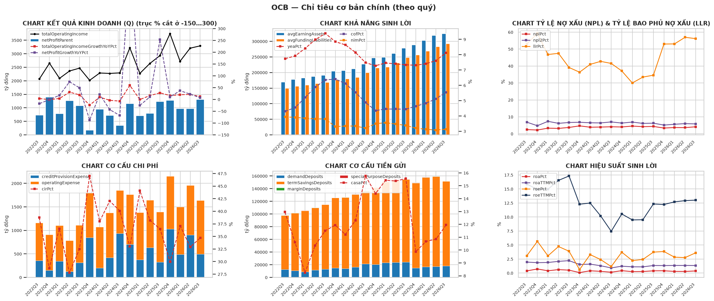
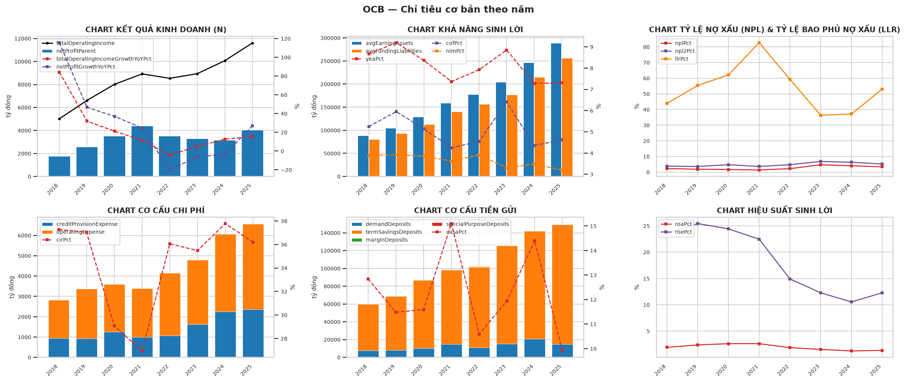
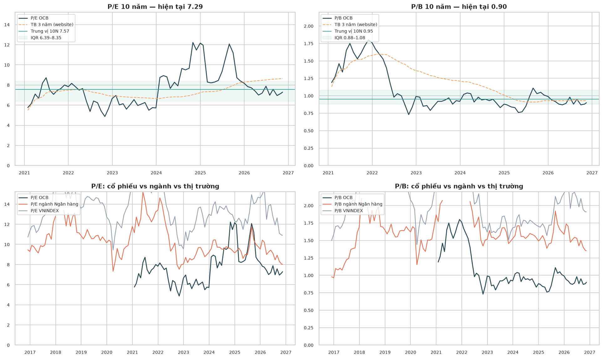
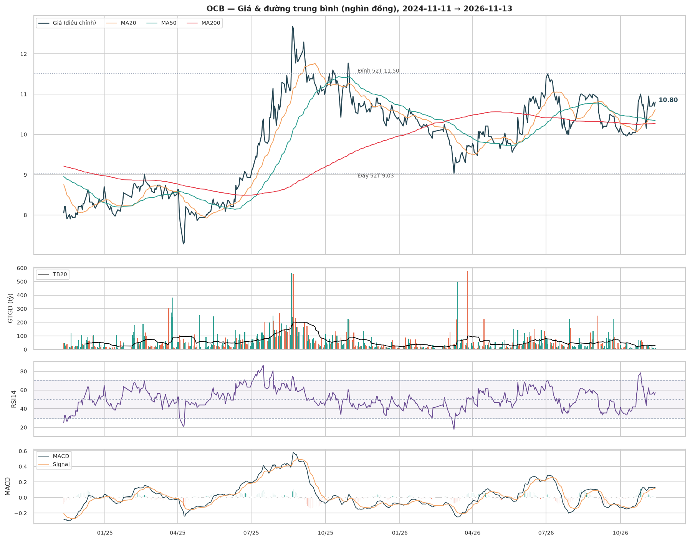
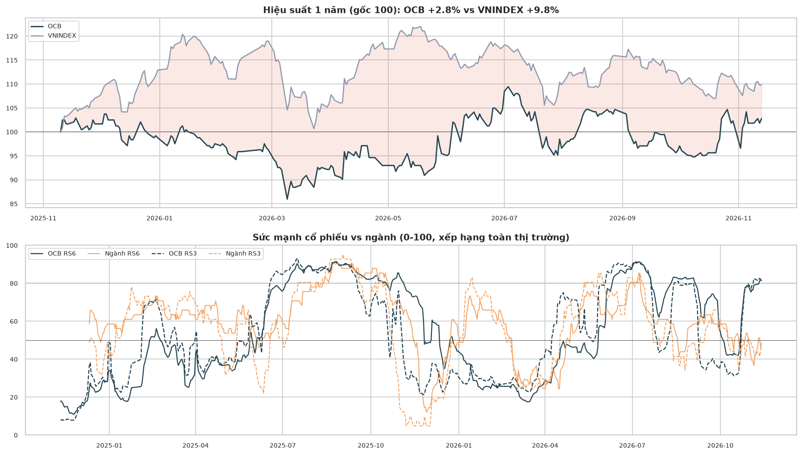
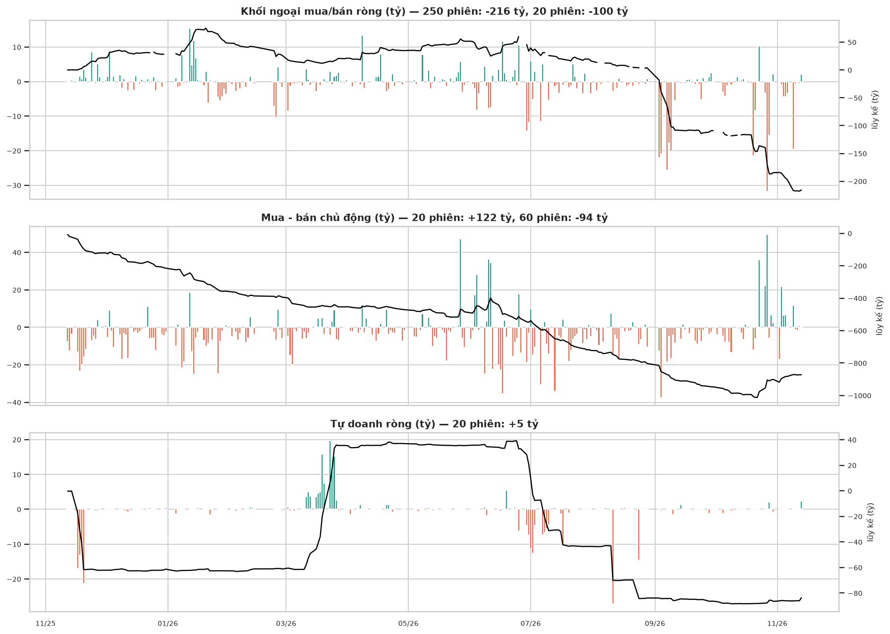
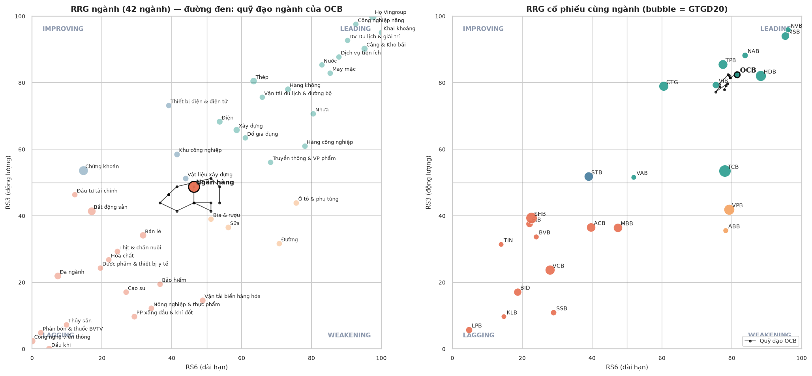

# OCB — Ngân hàng TMCP Phương Đông | Phân tích cổ phiếu

> Dữ liệu sstock tới **2026-11-13** · Ngành Ngân hàng (sectorId 24) · Cấu trúc BCTC: bank · Giới hạn gói: BCTC quý 17 quý gần nhất, BCTC năm từ 2018, giá/VNINDEX từ 2023-11-16, định giá thị trường từ 2016-11-17.
> Báo cáo được tạo từ dữ liệu định lượng, **không phải khuyến nghị đầu tư**.

## 1. Tóm tắt

**Kết luận:** OCB rơi vào ô **"chỉ phù hợp giao dịch theo đà, đặt dừng lỗ chặt"** của ma trận. Kỹ thuật và dòng tiền rất mạnh (+8/8, Elite vừa mở ngày 2026-11-12), còn cơ bản và định giá chỉ ở mức trung tính (0/6) vì NPL 4.1%, LLR 56% và COF tăng nhanh. Ngành Ngân hàng đang lagging và thị trường ở trạng thái pressure, nên tôi hạ thêm một bậc: chỉ nên giao dịch tỷ trọng nhỏ theo trigger giá, chưa phải vị thế tích lũy trung hạn. Scorecard **+7/±16 → Khá tích cực** (Kỹ thuật & dòng tiền +8/8 · Cơ bản & định giá 0/6 · Bối cảnh -1/2).

| Luận điểm | Số liệu |
|---|---|
| Tăng trưởng lõi tốt | LNST 9T/2026 3,262 tỷ (+19.3% YoY); LN trước dự phòng 9T 6,011 tỷ (+26.1%); TOI TTM +17.2% |
| Chất lượng tài sản yếu, COF ép biên | NPL 4.1% (2026Q3), nợ nhóm 5 tăng từ 3,389 lên 5,852 tỷ trong 5 quý; LLR 56%; COF 4.4% → 5.5% YoY, NIM 3.4% → 3.1% |
| Định giá rẻ vừa phải, không ở vùng cực rẻ | P/B 0.90 (percentile 10N là 34, trung vị 0.95, ngành 1.35); P/E 7.29 (trung vị 7.57) với ROE 13.0% |
| Xu hướng giá vừa xác nhận | Giá 10.80 > MA20 10.61 > MA50 10.35 > MA200 10.27; cách đỉnh 52T 11.50 khoảng -6.1%; 6T +10.5% trong khi VNINDEX -10.0% |
| Smart-money mạnh nhưng khối ngoại bán | RS3/RS6 82/82, RRG leading, VCR 1.32, AMFI +0.215, Elite 5/5; khối ngoại bán ròng -223 tỷ trong 60 phiên |

**Điều kiện hành động:** giá đóng cửa trên 11.0 (đỉnh 2026-10-26) với GTGD khớp lệnh > 28.4 tỷ (TB20 khớp lệnh), RS3 giữ ≥ 80 · vô hiệu khi đóng cửa dưới 10.25 (MA200 10.27) hoặc RS3 < 80 làm Elite đóng.

## 2. Bối cảnh thị trường & ngành

- **Thị trường:** **pressure** đã 73 phiên (chuyển từ downtrend ngày 2026-07-30 nhờ FTD), độ tin cậy 63.7 (Medium). Có 6 phiên phân phối trong 25 phiên, tức áp lực bán đáng kể. FTD gần nhất 2026-11-04. Độ rộng VN100 53%.
- **Tâm lý:** ngắn hạn 29, trung hạn 33 (Bi quan). Trung hạn cải thiện +8 điểm trong tháng.
- **Lan tỏa:** nhóm vốn hóa vừa dẫn dắt (51, +27 trong tháng); vốn hóa lớn yếu (21). OCB có vốn hóa 33,075 tỷ, thuộc nhóm ngân hàng tầm trung, nên đi cùng nhóm đang được dòng tiền chọn.
- **Định giá thị trường:** P/E VNINDEX 10.90 so với TB 3 năm 13.26, rẻ so với chính lịch sử.
- **Ngành Ngân hàng:** RRG **lagging**, RS3 48.8 (hạng 22/42), RS6 46.3 (hạng 23), VCR 0.96, chỉ 44.8% số mã trên MA50. Sức mạnh dồn vào vài mã: 4 mã đang mở Elite là HDB, NAB, OCB, TPB. OCB chiếm 1.3% vốn hóa ngành (2,611,282 tỷ, 29 DN) và 1.4% LNST TTM ngành. LNST TTM của OCB tăng +16.7%, thấp hơn mức +20.7% của ngành.

**Quan sát biểu đồ:** VNINDEX đi ngang trong biên khoảng 1,650–1,930 gần trọn năm và hiện ở khoảng 1,735 (đọc từ biểu đồ). Hai nhịp downtrend ngắn (03/2026, 07/2026) đều được FTD kéo về pressure. Đường lan tỏa vốn hóa lớn liên tục thấp hơn vốn hóa vừa từ cuối 10/2026, khớp với việc các ngân hàng lớn (VCB, BID, MBB) đang lagging.

## 3. Kết quả kinh doanh & sức khỏe tài chính

| Chỉ tiêu (tỷ đồng, %) | 2025Q3 | 2025Q4 | 2026Q1 | 2026Q2 | 2026Q3 | YoY |
|---|---|---|---|---|---|---|
| Tổng TN hoạt động | 2,931 | 3,743 | 2,722 | 3,205 | 3,291 | +12.3% |
| Thu nhập lãi thuần | 2,424 | 2,482 | 2,383 | 2,525 | 2,768 | +14.2% |
| Thu nhập khác | 260 | **894** | 112 | 255 | 146 | |
| LN trước dự phòng | 1,862 | 2,621 | 1,713 | 2,151 | 2,147 | +15.3% |
| Chi phí dự phòng | 324 | 1,029 | 489 | 905 | 495 | +52.8% |
| LNST cty mẹ | 1,228 | 1,277 | 975 | 973 | 1,314 | +7.0% |
| NIM / YEA / COF | 3.4 / 7.3 / 4.4 | 3.2 / 7.3 / 4.6 | 3.1 / 7.4 / 4.8 | 3.1 / 7.6 / 5.1 | 3.1 / 8.1 / 5.5 | -0.2 / +0.8 / +1.1pp |
| CIR | 36.5 | 30.0 | 37.1 | 32.9 | 34.7 | -1.7pp |
| NPL / nhóm 2 / LLR | 4.3 / 6.3 / 34.6 | 3.4 / 5.1 / 53.0 | 3.7 / 5.6 / 53.0 | 3.6 / 6.0 / 56.9 | 4.1 / 5.8 / 56.2 | |
| CASA | 15.6 | 9.9 | 10.7 | 10.8 | 11.9 | -3.6pp |

**(1) Tăng trưởng theo lũy kế năm.** LNST 9T/2026 đạt 3,262 tỷ (+19.3%), TOI 9T đạt 9,218 tỷ (+17.5%), cùng chiều với TTM (+16.7% / +17.2%), nên không có quý nào làm méo TTM. Lưu ý quý 2025Q4 có thu nhập khác 894 tỷ (bình thường 110–260 tỷ), là khoản một lần, nhiều khả năng là thu hồi nợ đã xử lý (chưa rõ, cần tin DN). Khoản này làm nền so sánh 2026Q4 cao.

**(2) LN trước dự phòng so với LNST.** LN trước dự phòng 9T tăng +26.1% (6,011 so với 4,766 tỷ), nhanh hơn LNST (+19.3%). Nguyên nhân là chi phí dự phòng 9T tăng +41% (1,889 so với 1,336 tỷ). Như vậy năng lực lõi tốt, và lợi nhuận **không** được làm đẹp nhờ dự phòng theo YoY. Riêng theo QoQ: LNST 2026Q3 tăng +35% (từ 973 lên 1,314 tỷ) trong khi LN trước dự phòng đi ngang (2,151 → 2,147). Toàn bộ phần tăng đến từ dự phòng giảm từ 905 xuống 495 tỷ: (905 − 495) × 0.8 ≈ 328 tỷ, khoảng 96% mức tăng 341 tỷ. Điều này xảy ra đúng quý NPL tăng từ 3.6% lên 4.1%.

**(3) Sự kiện ngân hàng:**
- *2025Q4: cho vay +2,460 tỷ, tiền gửi KH -5,209 tỷ*, được bù bằng giấy tờ có giá (+6,002), liên ngân hàng (+1,212) và vay CP/NHNN (+3,194). CASA cũng giảm từ 15.6% xuống 9.9% cùng quý. Ngân hàng phải chuyển sang nguồn vốn đắt hơn, và COF bắt đầu tăng liên tục từ quý này.
- *2026Q2: cho vay +15,280 tỷ, tiền gửi chỉ +1,012 tỷ*. Tín dụng tăng nóng được tài trợ bằng GTCG và vay NHNN. 2026Q3 tiếp tục kém: tiền gửi KH giảm 7,689 tỷ (-4.8% QoQ), vốn liên ngân hàng tăng từ 65,373 lên 87,863 tỷ (+22,490). Đổi lại, tiền gửi tại TCTD khác cũng tăng +17,881 tỷ và chứng khoán đầu tư giảm 12,597 tỷ. Bảng cân đối phình bằng vốn liên ngân hàng, còn cho vay đi ngang (-0.5% QoQ). COF lên 5.5%.
- *2026Q2: nợ nhóm 2 tăng từ 3,942 lên 5,209 tỷ (+32%)*, rồi 2026Q3 *nhóm 3 tăng từ 1,287 lên 1,713 tỷ (+33%)*: nợ đang dịch chuyển xuống nhóm thấp hơn đúng như tín hiệu sớm. Nhóm 2 giảm về 3,738 tỷ trong 2026Q3, một phần do chuyển xuống nhóm 3. Đáng lo nhất là **nợ nhóm 5 tăng đều** từ 3,389 (2025Q2) lên 5,852 tỷ (2026Q3, +73%). Bộ đệm dự phòng tăng từ 2,616 lên 5,097 tỷ, đưa LLR từ 30% lên 56%, nhưng vẫn dưới 60%, tức vẫn mỏng.
- Đợt NPL giảm từ 4.3% xuống 3.4% ở 2025Q4 trùng thời điểm xuất hiện **trái phiếu VAMC 1,313 tỷ** và nợ nhóm 3 giảm từ 2,736 xuống 1,198 tỷ. Phần lớn mức cải thiện đến từ bán nợ cho VAMC chứ không phải thu hồi nợ (cần tin DN để xác nhận).

**(4) Nguồn vốn & NIM.** Trong 4 quý, YEA tăng từ 7.3% lên 8.1% (+0.8pp), còn COF tăng từ 4.4% lên 5.5% (+1.1pp). COF tăng nhanh hơn, nên NIM rơi từ 3.4% xuống 3.1% và mới đi ngang 3 quý gần nhất nhờ YEA bắt kịp trong 2026Q3. Tăng trưởng tín dụng lũy kế 9T đạt 10.0% (cùng kỳ 14.5%), huy động lũy kế chỉ 1.3% (cùng kỳ 9.0%). LDR 71.9%, còn dư địa. CIR 34.7%, hiệu quả. Thu nhập dịch vụ 2026Q3 đạt 301 tỷ (+62% YoY) nhưng chỉ chiếm khoảng 9% TOI. Chứng khoán đầu tư và FX/vàng nhỏ, có lúc đổi dấu.

**(5) Vốn & pha loãng.** Vốn điều lệ tăng từ 20,548 lên 30,625 tỷ (+49%) trong 2 năm, qua 3 lần: 2024Q4 +20% và 2026Q3 +15% đều khớp với phần LNGPP chuyển sang vốn (cổ phiếu thưởng/cổ tức CP, không có tiền mới); 2025Q3 +8% (xem mục Sự kiện quyền ở phần 5). EPS 4 quý là 1,482 đ, đã tính theo 3,062.5 triệu CP.

**So với chu kỳ (bảng năm):** ROE giảm từ 25.4% (2019) xuống đáy 10.5% (2024), hồi lên 12.3% năm 2025 và 13.0% TTM. NPL tăng từ 1.3% (2021) lên đỉnh 4.7% (2023) và chưa về lại dưới 3%. LLR từng đạt 83% năm 2021. Tóm lại OCB đang hồi phục từ đáy, nhưng còn xa giai đoạn ROE 22–25% của 2018–2021.

**Quan sát biểu đồ 04:** đường COF dốc lên liên tục từ 2025Q1, trong khi NIM chạm đáy 3.1% ở 2026Q1–Q3. LLR nhảy bậc ở 2025Q4 (từ 34.6% lên 53%), đúng quý chi phí dự phòng cao nhất (1,029 tỷ). **Biểu đồ 05 (dashboard):** trong "Cơ cấu nguồn vốn", lớp liên ngân hàng phình rõ ở 2026Q3; trong "Cơ cấu lợi nhuận", cột otherIncome 2025Q4 nổi bật. **Biểu đồ 06:** cột LNST năm đi ngang khoảng 3,200–3,500 tỷ trong 2022–2024 dù TOI vẫn tăng, do dự phòng năm tăng từ khoảng 1,000 tỷ (2021) lên 2,200–2,350 tỷ (2024–2025).

## 4. Định giá

| | Hiện tại | TB 3 năm | Trung vị 10N | Min–Max 10N | Percentile 10N | Ngành | VNINDEX |
|---|---|---|---|---|---|---|---|
| P/E | 7.29 | 8.65 | 7.57 | 4.9–12.2 | 42 | 8.02 | 10.90 |
| P/B | 0.90 | 0.93 | 0.95 | 0.73–1.80 | 34 | 1.35 | 1.91 |

- **P/B đi cùng ROE:** P/B 1.2–1.8 trong 2021 tương ứng ROE 22–24%. Từ giữa 2022, khi ROE rơi xuống 10–15%, P/B nằm trong vùng 0.73–1.1. Trung vị 0.95 phần lớn hình thành trong giai đoạn ROE thấp này, nên là tham chiếu hợp lý cho ROE 13% hiện tại, không quá lạc quan. ROE TTM tăng từ 9.5% (2025Q2) lên 13.0% nhưng P/B gần như đi ngang quanh 0.9. Thị trường đang chiết khấu **rủi ro** (NPL 4.1%, nợ nhóm 5 tăng, COF) chứ không chiết khấu lợi nhuận.
- So với ngành, P/B thấp hơn 33% và P/E thấp hơn 9%. P/B ngành gồm cả ngân hàng quốc doanh vốn được định giá cao, nên mức chiết khấu thực so với nhóm tư nhân tầm trung nhỏ hơn con số này.
- **Caveat:** P/E SSTOCK dự phóng 6.88 bị **đóng băng từ 2026-07-24**, nên báo cáo dùng P/E tính lại 7.29. P/E TB 3 năm (8.65) bị đẩy lên bởi giai đoạn lợi nhuận đáy 2024–2025 (P/E vọt lên 12), nên không dùng làm mốc.
- **Vùng tham chiếu** (giả định LNST/giá trị sổ sách giữ nguyên): P/B về trung vị 10N tương ứng **11.40**; P/E về trung vị tương ứng **11.22**; P/B TB 3 năm tương ứng 11.16. Giá trị sổ sách/CP khoảng 12.0 (10.80 / 0.90), nên P/B 1.0 tương ứng khoảng 12.0. Đây là vùng tham chiếu, không phải giá mục tiêu.

**Quan sát biểu đồ 07:** P/B bị định giá lại hẳn xuống một mặt bằng thấp từ giữa 2022 và chưa lần nào vượt 1.11 (đỉnh 08/2025) kể từ đó. Khoảng cách P/B giữa OCB và ngành gần như không đổi suốt 3 năm.

## 5. Kỹ thuật & xu hướng giá

| Chỉ tiêu | Giá trị |
|---|---|
| Giá (2026-11-13) | 10.80 (+0.93%) |
| MA20 / MA50 / MA200 | 10.61 / 10.35 / 10.27 (MA50 dốc -0.8% trong 20 phiên; MA200 gần như phẳng) |
| Đỉnh / đáy 52T | 11.50 / 9.03 |
| RSI14 · MACD hist | 57.1 · +0.009 (MACD trên signal và trên 0) |
| ATR14 · biến động năm · beta | 2.4% · 24.5% · 0.62 |
| GTGD TB20 / TB60 | 30.0 / 42.4 tỷ; **khớp lệnh TB20 28.4 tỷ** (thỏa thuận chiếm 49.2% GTGD 60 phiên, lớn nhất 213 tỷ ngày 2026-09-03) |

Hiệu suất so với VNINDEX: 1T +8.0% (+5.8pp), 3T -1.8% (≈ ngang), 6T +10.5% (+20.5pp), YTD +4.1% (+6.8pp), 1N +2.3% (-6.2pp).

**Sự kiện quyền** (mọi mức giá lịch sử trong báo cáo dùng `adjClose`):
- **2026-06-30, hệ số 1.151** (trong 12 tháng): cổ phiếu thưởng/cổ tức CP khoảng 15%, khớp với vốn điều lệ +15.0% ở 2026Q3 (từ 26,631 lên 30,625 tỷ) và LNGPP giảm tương ứng. Đây là pha loãng, không có tiền mới.
- 2025-08-08, hệ số 1.079: khớp với vốn điều lệ +8.0% ở 2025Q3, nhiều khả năng là CP thưởng khoảng 8% (cần tin DN; công cụ đánh dấu Δ LNGPP "không khớp").
- 2025-07-17, hệ số 1.054: cổ tức tiền hoặc CP thưởng nhỏ (chưa rõ, cần tin DN).
- 2024-08-29, hệ số 1.201: CP thưởng/cổ tức CP 20%, khớp với vốn điều lệ +20% ở 2024Q4.

**Quan sát biểu đồ 01:** giá tích lũy trong nền rộng 9.5–11.5 từ 04/2026 quanh MA200 phẳng (10.2–10.5). Phiên 2026-10-23 bứt lên 10.80 với 69 tỷ khớp lệnh (gấp khoảng 2.4 lần TB20 khớp lệnh), sau đó đi ngang chặt 10.6–11.0 trong khi GTGD khớp lệnh co lại còn 6.8–10.6 tỷ trong 3 phiên cuối. Đây là kiểu nền phẳng "cạn cung", nhưng cũng cho thấy chưa có lực cầu mới. Kháng cự gần là 11.0 (2026-10-26), xa hơn là 11.50 (đỉnh 07/2026).

**Quan sát biểu đồ 02:** RS3 vọt từ 31.5 lên 82.4 trong 20 phiên. Hai lần trước RS lên khoảng 90 (07/2025 và 07/2026) đều sụp nhanh trong 1–2 tháng. Sức mạnh của OCB có tính "bùng nổ ngắn" chứ không bền, khớp với lịch sử Elite thắng 50% và lãi/lỗ trung bình -1.2%.

## 6. Dòng tiền & smart-money

| Cửa sổ | Khối ngoại ròng | Tự doanh ròng | Chủ động ròng | Tỷ lệ chủ động |
|---|---|---|---|---|
| 5 phiên | -18.5 | +2.4 | +10.3 | +0.175 |
| 20 phiên | -99.6 | +4.6 | +122.0 | +0.225 |
| 60 phiên | -222.7 | -13.9 | -93.9 | -0.077 |
| 250 phiên | -215.8 | — | -872.3 | -0.133 |

- RRG **leading**, RS3 82.4 / RS6 81.5 (Δ5 phiên +0.2/+2.3), xếp thứ 5/24 mã ngân hàng theo RS3.
- VCR 1.32 (bùng nổ), AMFI +0.215 (phe mua áp đảo), không có phân kỳ bear20 (lần gần nhất 2026-02-25).
- **Elite: ĐANG MỞ** từ 2026-11-12 (isSuper), đủ 5/5 trụ trong 3/3 phiên liên tiếp, không bị guard nào chặn, không bị cooldown (`raw/elite_diag.json`). GTGD20 dùng cho trụ là 28.43 tỷ. Lịch sử 4 lần: thắng 50%, trung bình -1.2% (07/2025 +7.1%; 06/2026 -3.8% do momentum_collapse; 09/2023 -8.9%).
- **Phân kỳ:** dòng tiền chủ động trong nước xác nhận đà tăng, nhưng khối ngoại bán ròng ngược chiều.

**Quan sát biểu đồ 03:** khối ngoại bán theo hai đợt tập trung: đầu 09/2026 (lũy kế giảm khoảng 120 tỷ trong vài phiên) và cuối 10 sang đầu 11/2026 (khoảng 70 tỷ). Hai đợt này kéo lũy kế 250 phiên từ dương sang -216 tỷ. Đường lũy kế mua bán chủ động giảm dốc suốt năm rồi tạo đáy khoảng 2026-10-20, sau đó đảo chiều bằng các cột dương lớn (35–49 tỷ). Đây là lần đầu từ 06/2026 phe mua chủ động chiếm ưu thế rõ rệt.

## 7. So sánh cùng ngành

| Mã | Vốn hóa (tỷ) | RS3 | RS6 | Góc | VCR | AMFI | GTGD20 (tỷ) |
|---|---|---|---|---|---|---|---|
| **OCB** | 33,075 | 82 | 82 | leading | 1.32 | 0.215 | 30.0 |
| MSB | 61,402 | 94 | 95 | leading | 1.14 | -0.119 | 148.6 |
| HDB | 147,055 | 82 | 88 | leading | 0.96 | 0.123 | 326.7 |
| CTG | 244,659 | 79 | 60 | leading | 1.11 | 0.033 | 254.1 |
| TCB | 232,252 | 53 | 78 | leading | 0.89 | -0.046 | 450.6 |
| VPB | 221,000 | 42 | 79 | weakening | 0.73 | -0.163 | 332.2 |
| STB | 134,227 | 52 | 39 | improving | 0.92 | 0.138 | 213.3 |
| ACB / MBB | 118,120 / 192,817 | 37 / 36 | 40 / 47 | lagging | 1.19 / 0.93 | 0.019 / -0.149 | 208 / 211 |
| VCB / BID | 449,535 / 247,737 | 24 / 17 | 28 / 19 | lagging | 1.05 | -0.101 / -0.270 | 258 / 130 |

Ngành bị phân hóa rõ. Các ngân hàng tư nhân tầm trung (MSB, HDB, TPB, VIB, NAB, OCB) nằm trong góc leading, còn nhóm quốc doanh/vốn hóa lớn (VCB, BID, MBB, ACB, LPB) ở lagging, kéo RRG cả ngành xuống. OCB **dẫn dắt cùng nhóm tư nhân tầm trung**, không phải đi sau ngành. Hai điểm yếu riêng của OCB: VCR và AMFI cao nhất nhóm, nhưng thanh khoản (30 tỷ/phiên) thấp nhất trong bảng, nên giá dễ biến động khi dòng tiền rút.

**Quan sát biểu đồ 08:** quỹ đạo OCB đi lên phải trong góc leading, sát HDB và TPB, cho thấy đà vẫn đang mạnh lên. Quỹ đạo ngành Ngân hàng vòng quanh tâm (RS khoảng 40–55) suốt 10 phiên, chưa có hướng rõ.

## 8. Scorecard

| Nhóm | Điểm | Ghi chú |
|---|---|---|
| Xu hướng giá | +2 | Giá trên MA50 và MA200; MA50 vẫn dốc nhẹ xuống (-0.8%) |
| Động lượng | +2 | RSI 57, MACD trên signal và 0; hiệu suất 3T ngang VNINDEX |
| Sức mạnh tương đối | +2 | RRG leading, RS6 81.5 |
| Dòng tiền | +2 | VCR 1.32, AMFI +0.21, chủ động +122 tỷ; khối ngoại -100 tỷ (-1) |
| Tăng trưởng | +2 | LNST TTM +16.7%, TOI TTM +17.2% (9T: +19.3% / +17.5%) |
| Chất lượng | -2 | ROE 13.0% (0), NPL 4.13% (-1), LLR 56% (-1) |
| Định giá | 0 | P/E bằng 0.96 lần trung vị, P/B percentile 34, P/E thấp hơn ngành 9% |
| Bối cảnh | -1 | Thị trường pressure (0), ngành lagging (-1), tâm lý trung hạn 33 (0) |
| **Tổng** | **+7 → Khá tích cực** | Kỹ thuật +8 · Cơ bản 0 · Bối cảnh -1 |

**Override kết luận (không đổi điểm):** nhóm Chất lượng chỉ chấm mức hiện tại, chưa phản ánh *xu hướng* xấu đi trong 2 quý gần nhất: nhóm 2 +32% (Q2), nhóm 3 +33% (Q3), nhóm 5 tăng 5 quý liên tiếp, NPL từ 3.6% lên 4.1%, và LNST Q3 tăng QoQ hoàn toàn nhờ dự phòng giảm. Thêm vào đó, tăng trưởng huy động chỉ 1.3% YTD, COF +1.1pp. Vì vậy trục Cơ bản & định giá thực chất nghiêng âm. Kết luận theo ma trận là "giao dịch theo đà", và sau khi hạ một bậc vì ngành lagging thì **chỉ dành cho tỷ trọng nhỏ, dừng lỗ chặt**, không xếp OCB vào nhóm "ứng viên mạnh".

## 9. Rủi ro & catalyst

**Rủi ro**
- *Chất lượng tài sản:* nợ nhóm 5 lên 5,852 tỷ (+73% trong 5 quý), NPL 4.1%, LLR 56% (dưới ngưỡng mỏng 60%). Chi phí dự phòng sẽ phải duy trì cao. Nếu 2026Q4 lặp lại mức 1,029 tỷ như 2025Q4, LNST quý sẽ bị ép.
- *Nền so sánh 2026Q4 cao:* 2025Q4 có thu nhập khác 894 tỷ (một lần), nên LNST TTM có thể chững lại khi cuốn qua quý này.
- *Nguồn vốn:* tiền gửi KH giảm 4.8% QoQ, CASA 11.9% (giảm 3.6pp YoY), dựa nhiều vào liên ngân hàng (87,863 tỷ) và GTCG (66,832 tỷ). COF 5.5% còn có thể tăng tiếp và ép NIM.
- *Pha loãng:* vốn điều lệ +49% trong 2 năm qua 3 đợt cổ phiếu thưởng/cổ tức CP.
- *Dòng tiền:* khối ngoại bán ròng kéo dài; thanh khoản khớp lệnh chỉ khoảng 28 tỷ/phiên; tín hiệu Elite của OCB lịch sử chỉ thắng 50%.
- *Bối cảnh:* thị trường pressure với 6 phiên phân phối/25 phiên; ngành Ngân hàng lagging; vốn hóa lớn yếu.

**Catalyst**
- BCTC 2026Q4 (cuối 01/2027): theo dõi nợ nhóm 3–5, chi phí dự phòng và tăng trưởng tín dụng cả năm so với 14–16% của 2025.
- Room tín dụng NHNN cấp thêm cuối năm (không có trong sstock).
- Thị trường chuyển sang uptrend, hoặc dòng tiền lan tỏa sang nhóm vốn hóa vừa tiếp tục mạnh.

**Giới hạn dữ liệu**
- Gói: BCTC quý chỉ có 17 quý, giá từ 2023-11-16. Không có hạn mức tín dụng NHNN giao, không có thuyết minh khoản thu nhập khác 2025Q4, giao dịch VAMC hay chi tiết đợt tăng vốn 2025Q3. Dữ liệu vĩ mô qua `search_data_series` chỉ dành cho admin.
- Chuỗi `roeTTMPct`/`roaTTMPct` theo năm bị lỗi nguồn (khoảng 4 lần `roePct`), nên báo cáo dùng `roePct`.
- P/E SSTOCK đóng băng từ 2026-07-24. GTGD TB20/TB60 bị giao dịch thỏa thuận thổi phồng (49.2%), nên dùng TB20 khớp lệnh 28.4 tỷ.

## 10. Kịch bản & mức giá theo dõi

| Kịch bản | Điều kiện | Ý nghĩa |
|---|---|---|
| Tích cực | Đóng cửa > **11.0** với GTGD khớp lệnh > **28.4 tỷ**, RS3 ≥ 80, rồi vượt đỉnh 52T **11.50** | Thoát nền 6 tháng; vùng tham chiếu 11.2–11.4 (P/E/P/B về trung vị 10N), xa hơn khoảng 12.0 (P/B 1.0). Cần BCTC Q4 không xấu thêm về nợ xấu để giữ được |
| Cơ sở | Giá đi ngang **10.25–11.0**, giữ trên MA200, Elite còn mở (RS3 ≥ 80, RS6 ≥ 60, VCR ≥ 1, AMFI > 0) | Tích lũy tiếp; chỉ giữ vị thế nhỏ đã có, chưa tăng tỷ trọng khi khối ngoại còn bán ròng |
| Tiêu cực | Đóng cửa < **10.25** (MA200 10.27), hoặc RS3 < 80 làm Elite đóng, hoặc thị trường về downtrend | Bứt phá 2026-10-23 thất bại (lặp lại kịch bản 06–07/2026), quay về đáy nền khoảng 10.0, rủi ro sâu hơn về đáy 52T 9.03. Dừng lỗ theo 2–3 ATR (khoảng 0.5–0.8 nghìn) quanh 10.0–10.3 |

---
*Phụ lục:* dữ liệu thô ở `raw/`, chỉ số ở `metrics.json`, bảng đầy đủ ở `tables.md`, biểu đồ ở `charts/` (gồm cả [05_fa_dashboard](charts/05_fa_dashboard.png)). Script ad-hoc: `explore.py`.

*Báo cáo tạo tự động từ dữ liệu sstock, không phải khuyến nghị đầu tư.*
