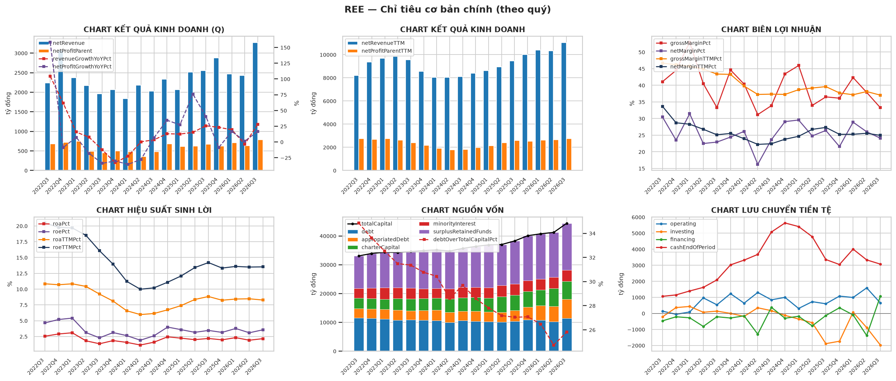
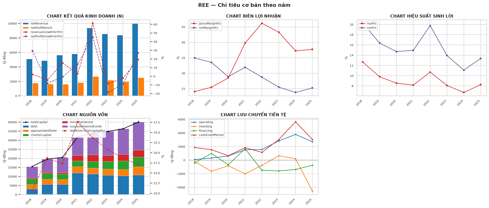
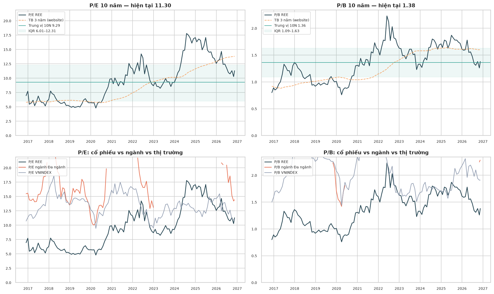
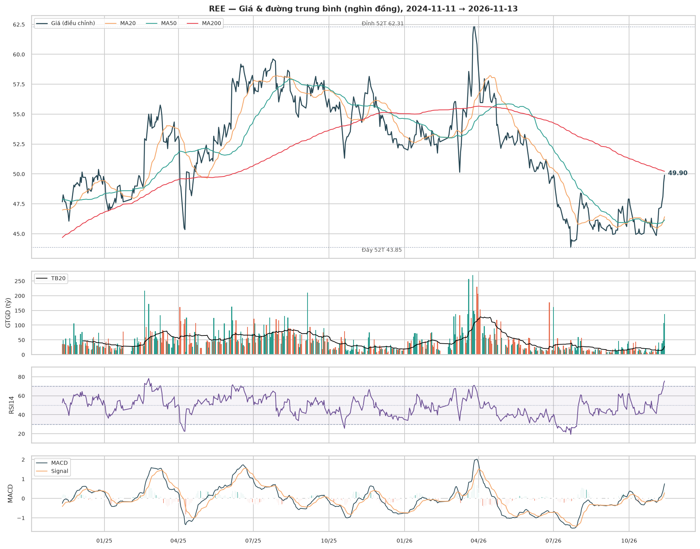
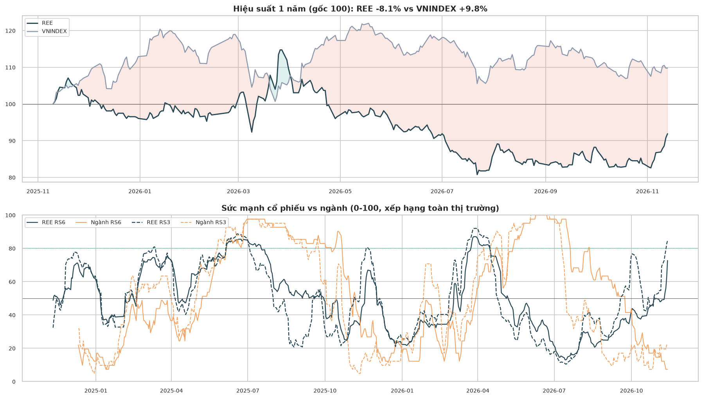
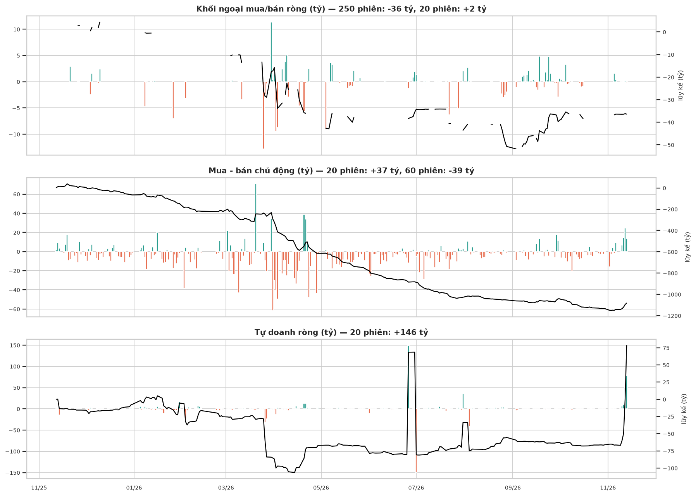
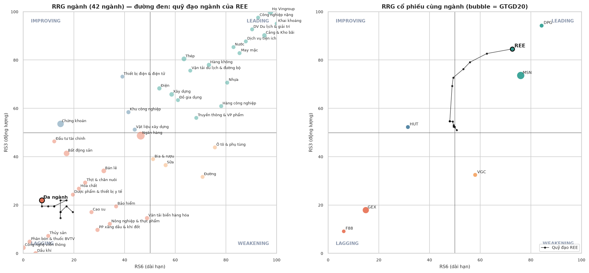

# REE — Công ty Cổ phần Cơ Điện Lạnh | Phân tích cổ phiếu

> Dữ liệu sstock tới **2026-11-13** · Ngành Đa ngành (sectorId 5555) · Cấu trúc BCTC: phi tài chính · Gói giới hạn: BCTC 17 quý, BCTC năm từ 2018, giá/VNINDEX từ 2023-11-16, định giá thị trường từ 2016-11-17.
> Báo cáo được tạo từ dữ liệu định lượng, **không phải khuyến nghị đầu tư**.

## 1. Tóm tắt

**Kết luận:** Cả hai trục đều dương: Kỹ thuật & dòng tiền **+6/8**, Cơ bản & định giá **+3/6**. Trên ma trận, REE thuộc ô "ứng viên mạnh". Tuy vậy ngành Đa ngành đang *lagging* và thị trường ở trạng thái *pressure*, nên hạ một bậc: **ứng viên giao dịch theo đà, chờ xác nhận**. Giá vừa bứt khỏi nền 3 tháng nhưng còn nằm ngay dưới MA200 (50,22), RSI đã 75,5 và tín hiệu Elite mới xác nhận 2/3 phiên. Scorecard **+8/±16 → Tích cực** (Kỹ thuật & dòng tiền +6/8 · Cơ bản & định giá +3/6 · Bối cảnh -1/2).

| Luận điểm | Số liệu |
|---|---|
| Tăng trưởng đều, chưa bứt tốc | LNST TTM 2.754 tỷ (+6,4% YoY); 9T/2026 2.134 tỷ (+11,8%); doanh thu Q3/26 3.270 tỷ, cao nhất trong 17 quý (+28,1% YoY) |
| Chất lượng tài chính tốt | ROE TTM 13,5%, biên ròng TTM 24,9% (ngành 7,8%); nợ vay ròng/VCSH 18,5%; CFO/LNST 1,56 |
| Định giá ở mức trung bình | P/E 11,3 (trung vị 10 năm 9,3, percentile 69); P/B 1,39 (trung vị 1,36, percentile 52); P/E thấp hơn ngành 22% |
| Giá vừa bứt phá khỏi nền | Đóng cửa 49,90 vượt nền 44,9–47,9 với GTGD 137 tỷ (gấp 5 lần TB20 khớp lệnh 27,3); vẫn dưới MA200 50,22 đang dốc xuống |
| Sức mạnh tăng nhanh | RS3 84,6 / RS6 72,7 (60 phiên trước 34,8 / 20,6); RRG *leading*; Elite đủ 5/5 trụ, mới qua 2/3 phiên xác nhận |

**Điều kiện hành động:** xác nhận khi **đóng cửa trên 50,2 (MA200)** với GTGD khớp lệnh trên TB20 (~27 tỷ), RS3 ≥ 80 / RS6 ≥ 60 còn giữ để đủ phiên Elite thứ 3. Kịch bản tích cực **bị vô hiệu** nếu giá đóng cửa lại dưới **46,2** (MA20/MA50, đáy của phiên bứt phá), tức breakout thất bại và giá quay về nền.

## 2. Bối cảnh thị trường & ngành

- **Thị trường:** ở trạng thái *pressure* 73 phiên (độ tin cậy 63,7 – Medium), có 6 phiên phân phối trong 25 phiên, FTD gần nhất 2026-11-04. Tâm lý ngắn hạn 29, trung hạn 33 (*Bi quan*; trung hạn tăng 8 điểm trong tháng). Dòng tiền lan tỏa nghiêng về **vốn hóa vừa (51)**, nhóm có REE (31.108 tỷ). Vốn hóa lớn yếu (21). P/E VNINDEX 10,9, thấp hơn TB 3 năm 13,3.
- Quan sát trên [09_market](charts/09_market.png): cả năm qua VNINDEX gần như chỉ ở *pressure*, đi ngang trong biên 1.590–1.930 và chỉ ngắn hạn rơi vào downtrend (03/2026, 08/2026). Hiện chỉ số ở 1.735, giữa biên. Dòng tiền nhóm vốn hóa vừa bật từ ~12 lên ~51 trong 2 tuần đầu tháng 11, trùng thời điểm REE bứt phá.
- **Ngành Đa ngành:** RRG *lagging*, RS3 22,0 (hạng 33/42), RS6 7,3 (hạng 39), VCR 1,04, 55,6% số mã trên MA50, không có cảnh báo. Quỹ đạo ngành quanh quẩn ở góc dưới bên trái trong cả cửa sổ tail ([08_rrg](charts/08_rrg.png)).
- **Cần lưu ý:** "Đa ngành" là một rổ không đồng nhất (MSN, GEX, VGC, HUT, F88, DPG…). Mảng chính của REE (điện, nước, BĐS cho thuê, M&E) gần với các ngành *Điện* (RS3 ~68), *Nước*, *Dịch vụ tiện ích*, mà các ngành này đều đang ở hoặc sát *leading* trên RRG ngành. Do đó lực cản "ngành lagging" với REE nhẹ hơn mức chấm điểm.
- Vị thế trong ngành: REE chiếm 12,7% vốn hóa, 4,5% doanh thu TTM nhưng 16,2% LNST TTM của 9 doanh nghiệp. Biên gộp 33,3% (ngành 24,6%), biên ròng 24,1% (ngành 7,8%). Tăng trưởng LNST TTM chậm hơn ngành (+6,4% so với +62,5%).

## 3. Kết quả kinh doanh & sức khỏe tài chính

| Chỉ tiêu | Q3/25 | Q4/25 | Q1/26 | Q2/26 | Q3/26 | YoY |
|---|---|---|---|---|---|---|
| Doanh thu (tỷ) | 2.552 | 2.878 | 2.471 | 2.426 | 3.270 | +28,1% |
| LNST cty mẹ (tỷ) | 674 | 621 | 714 | 631 | 788 | +16,9% |
| Biên gộp Q % | 36,5 | 36,1 | 42,3 | 37,9 | 33,3 | -3,2pp |
| EBITDA (tỷ) | 1.470 | 1.372 | 1.581 | 1.462 | 1.656 | +12,6% |
| ROE TTM % | 14,2 | 13,3 | 13,6 | 13,5 | 13,5 | -0,7pp |
| Nợ vay (tỷ) | 10.346 | 10.852 | 10.789 | 10.195 | 11.465 | +10,8% |
| XDCB dở dang (tỷ) | 1.826 | 2.433 | 1.297 | 2.040 | 4.857 | +166% |

- **Tăng trưởng:** doanh thu TTM 11.044 tỷ (+16,6%), nhanh hơn LNST TTM (+6,4%), vì biên gộp TTM giảm từ 39,6% (Q3/25) xuống 37,0%. Q3/26 doanh thu tăng 34,8% QoQ nhưng giá vốn tăng 45% (1.508 → 2.182 tỷ), nên biên gộp quý xuống 33,3%. Nhìn theo lũy kế thì đà vẫn ổn: 9T/2026 doanh thu +14,5%, LNST +11,8%.
- **Cơ cấu lợi nhuận:** lợi nhuận tài chính Q3/26 là 232 tỷ (cùng kỳ 160 tỷ, trung bình 7 quý trước ~147 tỷ). Như vậy khoảng 70–80 tỷ của LNST Q3 đến từ phần tài chính cao hơn bình thường. Mức này không đột biến nhưng làm đẹp tăng trưởng quý. Lợi nhuận khác gần 0 (-2 tỷ), không có khoản một lần lớn. Chi phí quản lý tăng theo mùa vào Q4 (302 tỷ Q4/25, 197 tỷ Q4/24), nên LNST Q4/26 thường bị kéo xuống.
- **Thay đổi vốn lưu động ở Q3/26:** tồn kho 2.090 tỷ (+61,9% YoY, 4,7% tổng tài sản, cao nhất 17 quý), người mua trả trước 2.006 tỷ (+96% YoY), nợ chiếm dụng 6.554 tỷ (+74,5%). Doanh thu, tồn kho và tiền ứng trước cùng tăng khớp với hình ảnh mảng thi công/M&E hoặc bán hàng có backlog lớn hơn. *Chưa rõ mảng nào, cần tin doanh nghiệp (BCTC bộ phận).*
- **Chu kỳ (bảng năm):** đỉnh lợi nhuận gần nhất là 2022 (LNST 2.693 tỷ, biên gộp 46,2%, ROE 19,8%), năm thủy văn thuận lợi cho thủy điện. Năm 2025 đạt biên gộp 37,7% và ROE 13,3%, mới hồi một phần sau đáy 2024 (ROE 11,1%). Như vậy lợi nhuận hiện tại *không* ở đỉnh chu kỳ. Chuỗi dữ liệu thủy văn/giá điện không có trong gói nên chưa định lượng được chu kỳ thủy điện.
- **Sự kiện bảng cân đối:**
  - **Q3/26: XDCB dở dang +2.817 tỷ (2.040 → 4.857) trong khi TSCĐ đi ngang (15.493 → 15.230).** Cùng quý, LCTT đầu tư -1.973 tỷ, nợ vay +1.270 tỷ, LCTT tài chính +1.061 tỷ. REE đang vào một chu kỳ capex mới, tài trợ bằng nợ vay và tiền gửi. Tính 4 quý, Δ(TSCĐ+XDCB) là +3.875 tỷ. *Dự án cụ thể chưa rõ, cần tin doanh nghiệp.* Doanh thu từ dự án chỉ bắt đầu ghi nhận khi XDCB chuyển sang TSCĐ, giống Q1/26 (XDCB giảm 1.136 tỷ, TSCĐ tăng 1.662 tỷ: một hạng mục đã vào vận hành).
  - **cashBank 7.302 tỷ so với tiền cuối kỳ LCTT 3.070 tỷ:** khoảng 4.232 tỷ là tiền gửi có kỳ hạn/đầu tư ngắn hạn. Tiền cuối kỳ LCTT giảm từ 5.636 (Q4/24) xuống 3.070 tỷ chủ yếu do tiền chuyển sang tiền gửi có kỳ hạn và capex, không phải vì tiền mất đi (cashBank +25% YoY).
  - **Vốn điều lệ tăng 15% mỗi năm:** 4.097 → 4.710 (Q2/24), → 5.417 (Q2/25), → 6.229 tỷ (Q2/26), lần lượt khớp các sự kiện quyền 2024-05-21, 2025-06-11, 2026-05-18 (hệ số ~1,15). Đây là cổ tức bằng cổ phiếu/thưởng: **pha loãng, không có tiền mới**. Riêng Q2/25, LNGPP chỉ giảm 561 tỷ, không khớp hoàn toàn với phần tăng vốn 707 tỷ. Theo quy tắc, ưu tiên kết luận cổ tức CP vì đã khớp sự kiện quyền; phần chênh có thể do thặng dư/quỹ khác, *cần tin doanh nghiệp*. Q2/23 (+15%) cũng là cổ tức CP.
  - **2020 (năm):** Tiền -1.159 ↔ Phải thu +956 tỷ là phân loại lại tài sản, nằm ngoài cửa sổ 17 quý, không ảnh hưởng đến phân tích hiện tại.
  - Lợi ích CĐ thiểu số ổn định ở 3.830–3.940 tỷ, không thấy thay đổi sở hữu lớn ở công ty con.
- **Bảng cân đối:** nợ vay 11.465 tỷ, chiếm 25,8% tổng nguồn vốn (giảm từ ~34% năm 2022). Nợ vay ròng 4.163 tỷ, bằng 18,5% VCSH. EBIT/chi phí tài chính TTM 6,2x. Đòn bẩy thấp, còn dư địa cho chu kỳ capex.
- **Dòng tiền:** CFO TTM 4.304 tỷ, gấp 1,56 lần LNST, nên lợi nhuận là tiền thật (khấu hao ~380 tỷ/quý). Đầu tư TTM -4.530 tỷ làm **FCF TTM ≈ -226 tỷ**. Năm 2025 LCTT đầu tư là -4.500 tỷ, mức âm lớn nhất từ 2018 ([06_fa_annual](charts/06_fa_annual.png)).
- **Pha loãng:** vốn điều lệ +32% trong 8 quý (4.710 → 6.234 tỷ), nên tăng trưởng EPS thấp hơn tăng trưởng LNST. EPS 4 quý là 4.418 đ.
- Quan sát trên [05_fa_dashboard](charts/05_fa_dashboard.png): phần XDCB (tím) trong cơ cấu tài sản phình rõ ở Q3/26. Tỷ lệ tồn kho/tổng tài sản dựng đứng từ 3,4% (Q1/26) lên 4,7%, cùng lúc giá vốn trong cơ cấu chi phí tăng vọt. Biên gộp thấp đi là do cơ cấu doanh thu nghiêng về mảng biên thấp hơn, không phải chi phí bán hàng/quản lý.

Quan sát trên biểu đồ năm: nợ vay đi ngang 10,4–12,0 nghìn tỷ từ 2021 đến nay trong khi tổng nguồn vốn tăng từ ~32 lên ~40 nghìn tỷ, nghĩa là tăng trưởng tài sản 4 năm qua được tài trợ chủ yếu bằng lợi nhuận giữ lại. Năm 2025 là lần đầu LCTT đầu tư âm mạnh trở lại kể từ 2021.

## 4. Định giá

| | Hiện tại | Trung vị 10N | Percentile 10N | TB 3 năm | Ngành | VNINDEX |
|---|---|---|---|---|---|---|
| P/E | 11,29 | 9,29 | 69% | 13,82 | 14,44 | 10,90 |
| P/B | 1,39 | 1,36 | 52% | 1,60 | 2,28 | 1,91 |

- P/E đã **tái định giá cấu trúc**: thấp quanh 5–7x giai đoạn 2017–2020, sau đó lên 9–18x từ 2021, khi mảng điện chiếm tỷ trọng lớn hơn. Vì vậy trung vị 10 năm (9,3) bị kéo thấp bởi giai đoạn cũ, và percentile 69% *không* có nghĩa là đắt. So với giai đoạn từ 2021, P/E hiện tại ở nửa dưới (đỉnh 17,8 cuối 2024, đáy ~8,5 năm 2023).
- **P/E TB 3 năm (13,8) bị méo lên** bởi giai đoạn LNST đáy 2024 (1.993 tỷ), khi P/E vượt 17. P/E TB 3 năm ngành (30,8) méo nặng hơn, không dùng được.
- **P/B 1,39 ngang trung vị 10 năm** và thấp hơn TB 3 năm (1,60), trong khi ROE TTM 13,5% ổn định. REE luôn có P/B thấp hơn VNINDEX (1,91) từ 2023.
- Giá tham chiếu (giả định EPS và giá trị sổ sách giữ nguyên): **~49,0** khi P/B quay về trung vị 10 năm, đúng bằng giá hiện tại; **57,7–61,1** khi P/B/P/E quay về TB 3 năm; **41,0** khi P/E về trung vị 10 năm (thấp vì giai đoạn trước 2021). Đây là vùng tham chiếu, không phải giá mục tiêu. Định giá hiện tại *hợp lý*, không có biên an toàn rõ rệt.
- P/E SSTOCK dự phóng là 10,05, nhưng **giữ nguyên từ 2026-07-24**, không phản ánh giá hôm nay. P/B SSTOCK 1,23 tính trên mẫu số khác so với P/B 1,39 của pipeline.

## 5. Kỹ thuật & xu hướng giá

- **Cấu trúc:** giá 49,90 nằm trên MA20 (46,42), MA50 (46,16), MA100 (46,42), nhưng **ngay dưới MA200 50,22**. MA200 dốc xuống liên tục từ đỉnh ~55,7 (04/2026). MA50 dốc gần như phẳng (+0,18% trong 20 phiên). Sau cú giảm từ đỉnh 52 tuần 62,31 (giá điều chỉnh, 03/2026) xuống đáy 43,85 (cuối 07/2026, drawdown 1 năm -29,6%), giá tích lũy trong **nền 44,9–47,9 suốt khoảng 3 tháng** (08–11/2026).
- **Bứt phá:** 2 phiên 12–13/11 vượt đỉnh nền 47,9 với GTGD khớp lệnh 103,6 và 129,5 tỷ, gấp 4–5 lần TB20 (27,3 tỷ). Thỏa thuận nhỏ (3,2 và 7,9 tỷ), không làm méo thanh khoản. Đây là lần đầu từ 04/2026 GTGD vượt 100 tỷ, và lần đầu từ 04/2026 RSI vượt 70.
- **Động lượng:** RSI14 75,5 (vùng quá mua), MACD 0,75 > signal và > 0 (hist +0,47). ATR14 1,8%/phiên (~0,9 nghìn đ), biến động năm 23,3%, beta 0,43 (phòng thủ). Biên dừng lỗ 2–3×ATR ≈ 1,8–2,7 nghìn đ, tương đương 47,2–48,1.
- **Mốc cần chú ý:** MA200 50,2 là kháng cự gần nhất. Tiếp theo là vùng 52–53 (vùng giá sau GDKHQ cổ tức CP 18/05/2026) và 55–56 (vùng đi ngang 01–02/2026). Mọi mức giá trước các ngày GDKHQ ở đây đều theo adjClose.
- **Hiệu suất tương đối:** 1 tuần +5,9% (VNINDEX +0,6%), 1 tháng +10,9% (+2,2%), 3 tháng +7,1% (-1,7%), 6 tháng -5,5% (-10,0%), YTD -4,3% (-2,8%), 1 năm -9,7% (+8,5%, kém -18,2pp).

Quan sát trên biểu đồ sức mạnh: RS6 của REE nhảy từ ~49 lên 73 chỉ trong vài phiên cuối, trong khi RS6 ngành Đa ngành rơi từ ~100 (06/2026) xuống 7. REE đang **tách khỏi ngành**. Trên đường hiệu suất 1 năm, khoảng cách với VNINDEX vẫn rộng (REE ~92 so với ~110). Nhịp hồi mới chỉ thu hẹp được một phần mức kém hiệu suất từ 04/2026.

## 6. Dòng tiền & smart-money

| Cửa sổ | Khối ngoại | Tự doanh | Chủ động ròng | Tỷ lệ chủ động |
|---|---|---|---|---|
| 5 phiên | -0,0 | **+144,7** | +59,3 | +0,297 |
| 20 phiên | +1,9 | +146,2 | +37,3 | +0,095 |
| 60 phiên | +4,5 | +146,8 | -38,6 | -0,036 |
| 250 phiên | -36,4 | — | **-1.082,2** | -0,124 |

- **Tự doanh** là lực mua chính của nhịp bứt phá: +6,8 / +10,3 / +49,6 / **+78,5 tỷ** trong 4 phiên 10–13/11. Riêng phiên 13/11, tự doanh mua ròng bằng ~57% GTGD. Biểu đồ còn cho thấy một cặp giao dịch tự doanh +148/-148 tỷ cuối 06/2026, khả năng là giao dịch hoán đổi/phòng hộ. Vì vậy cần theo dõi xem lực mua tự doanh lần này là tích lũy thật hay chỉ là vị thế phòng hộ (chứng quyền/ETF). *Chưa rõ.*
- **Mua/bán chủ động** lũy kế giảm đều từ 0 xuống khoảng -1.150 tỷ trong một năm, tức phe bán chủ động áp đảo suốt nhịp giảm. Đường lũy kế mới bắt đầu ngóc lên trong 5 phiên gần đây (+59 tỷ, tỷ lệ +0,30). Đây là lần đảo chiều đầu tiên, chưa phải xu hướng.
- **Khối ngoại** giao dịch rất mỏng (|ròng| hiếm khi vượt 10 tỷ/phiên; 250 phiên -36 tỷ). Một lý do khả dĩ là room ngoại của REE gần đầy *(kiến thức nền, cần kiểm chứng)*, nên khối ngoại không phải biến số dòng tiền quan trọng với mã này.
- **Smart-money:** RRG *leading*, RS3 84,6 / RS6 72,7 (Δ5 phiên +15,4 / +23,8). VCR 1,29 (*bùng nổ*), AMFI +0,068 (*phe mua chiếm ưu thế*). Không có phân kỳ giảm (bear20 gần nhất 2026-08-24, bull10 gần nhất 2025-10-20).
- **Elite** (theo `raw/elite_diag.json`): phiên 13/11 **đủ 5/5 trụ** (rs3 84,58, rs6 72,72, VCR 1,29, AMFI 0,068, GTGD20 27,3 tỷ, không bear20), không guard, không cooldown. **Chưa phải Elite chỉ vì mới có 2/3 phiên xác nhận** (11/11 chỉ có 2 trụ, 12–13/11 có 5 trụ). Nếu phiên 16/11 giữ được đủ 5 trụ thì REE vào Elite. Lịch sử tín hiệu này ở REE **kém**: 2 lần, thắng 0%, TB -4,1% (07–09/2024: -8,3%, thoát do momentum collapse; 04/2022: 0%, thoát do bear divergence). Vì vậy nên coi Elite là điều kiện cần, không phải lý do đủ để mua.

## 7. So sánh cùng ngành

| Mã | Sàn | Vốn hóa (tỷ) | RS3 | RS6 | RRG | VCR | AMFI | GTGD20 (tỷ) |
|---|---|---|---|---|---|---|---|---|
| MSN | HOSE | 103.979 | 74 | 76 | leading | 0,95 | -0,007 | 320,9 |
| **REE** | HOSE | 31.108 | 85 | 73 | leading | 1,29 | 0,068 | 27,3 |
| GEX | HOSE | 28.132 | 18 | 15 | lagging | 1,07 | -0,186 | 213,3 |
| VGC | HOSE | 18.024 | 32 | 58 | weakening | 1,33 | -0,240 | 32,3 |
| HUT | HNX | 13.460 | 52 | 31 | improving | 1,20 | 0,333 | 27,0 |
| F88 | UPCOM | 11.540 | 9 | 6 | lagging | 0,99 | -0,058 | 9,7 |
| DPG | HOSE | 4.008 | 94 | 84 | leading | 1,78 | -0,020 | 26,9 |

REE **dẫn dắt** rổ Đa ngành: hạng RS3 2/7 (sau DPG), và là mã duy nhất trong nhóm *leading* có AMFI dương. MSN cũng *leading* và đang có Elite mở. Ngành bị kéo xuống *lagging* bởi GEX, F88, VGC. Như vậy sức mạnh của REE là câu chuyện riêng của doanh nghiệp, không phải hiệu ứng ngành. Trên RRG cổ phiếu, quỹ đạo của REE đi gần như **thẳng đứng từ (RS6 ~50, RS3 ~51) lên (73, 85)** trong khoảng 13 phiên: từ ranh giới improving/lagging vào sâu vùng *leading*. Kiểu quỹ đạo này đẹp, nhưng hình thành rất nhanh nên dễ hụt hơi.

## 8. Scorecard

| Nhóm | Điểm | Ghi chú |
|---|---|---|
| Xu hướng giá | 0 | Trên MA50 (+1), dưới MA200 (-1), MA50 phẳng |
| Động lượng | +2 | MACD > signal và > 0; vượt VNINDEX 3 tháng +8,8pp; RSI 75 (0) |
| Sức mạnh tương đối | +2 | RRG leading; RS6 73; RS3 +15 trong 5 phiên |
| Dòng tiền | +2 | VCR 1,29; AMFI dương; khối ngoại và chủ động 20 phiên dương; không bear20 |
| Tăng trưởng | +1 | Doanh thu TTM +16,6% (+1); LNST TTM +6,4% (0) |
| Chất lượng | +2 | Nợ vay ròng/VCSH 18,5%; CFO/LNST 1,56; ROE 13,5% (0) |
| Định giá | 0 | P/E 1,22 lần trung vị (-1); P/B percentile 52 (0); P/E thấp hơn ngành 22% (+1) |
| Bối cảnh | -1 | Thị trường pressure (0); ngành lagging (-1); tâm lý trung hạn 33 (0) |
| **Tổng** | **+8/±16** | Kỹ thuật & dòng tiền +6/8 · Cơ bản & định giá +3/6 · Bối cảnh -1/2 |

**Ghi chú override (không đổi điểm, điều chỉnh diễn giải):**
- Điểm định giá -1 cho "P/E so với trung vị 10 năm" phạt quá tay, vì trung vị bị kéo thấp bởi giai đoạn trước tái định giá 2021. P/B (thước đo ổn định hơn) ở đúng trung vị.
- Ngược lại, điểm Kỹ thuật +6 dựa trên một nhịp bứt phá chỉ 2 phiên, lực mua chủ yếu đến từ tự doanh, và RSI đã quá mua. Tín hiệu cần thêm phiên xác nhận.
- Hai điều chỉnh này gần như triệt tiêu nhau, nên giữ verdict **Tích cực có điều kiện**: vị thế mua chỉ hợp lệ sau khi vượt MA200.

## 9. Rủi ro & catalyst

- **Rủi ro:**
  - Thủy văn/giá điện thị trường quyết định biên mảng điện. Biên gộp TTM đã giảm từ 39,6% xuống 37,0% trong 4 quý.
  - Chu kỳ capex mới (XDCB +2.817 tỷ trong Q3/26, nợ vay +1.270 tỷ) làm FCF âm. Hiệu quả dự án mới chưa được kiểm chứng.
  - Pha loãng 15%/năm do cổ tức cổ phiếu.
  - Lực mua của nhịp bứt phá tập trung ở tự doanh, còn dòng chủ động 250 phiên vẫn âm -1.082 tỷ.
  - Tín hiệu Elite ở REE có lịch sử 0% thắng.
  - Thị trường đã ở *pressure* 73 phiên với 6 phiên phân phối.
- **Catalyst:**
  - Đóng cửa vượt MA200 và đủ phiên Elite thứ 3.
  - BCTC Q4/26: xác nhận LNST cả năm 2026 vượt 2025 (9T đã +11,8%), làm rõ nguồn tăng tồn kho/người mua trả trước.
  - Thông tin về dự án đứng sau khoản XDCB mới.
  - Thị trường chuyển *uptrend*, dòng tiền vốn hóa vừa tiếp tục dẫn dắt.
- **Giới hạn dữ liệu:**
  - Gói chỉ có BCTC 17 quý (từ Q3/22), giá từ 2023-11-16.
  - Không có BCTC theo mảng (điện/nước/BĐS/M&E) và không có dữ liệu thủy văn/giá điện: `search_data_series` chỉ dành cho admin.
  - P/E SSTOCK giữ nguyên từ 2026-07-24.
  - P/E TB 3 năm của mã và của ngành bị méo.
  - Nguồn gốc lực mua tự doanh và dự án XDCB cần tin doanh nghiệp.

## 10. Kịch bản & mức giá theo dõi

| Kịch bản | Điều kiện | Ý nghĩa |
|---|---|---|
| Tích cực | Đóng cửa trên **50,2 (MA200)** với GTGD khớp lệnh > TB20 (~27 tỷ); RS3 ≥ 80, RS6 ≥ 60 giữ thêm ≥1 phiên (Elite xác nhận); chủ động ròng tiếp tục dương | Xu hướng trung hạn đảo chiều; mục tiêu kỹ thuật 52–53 rồi 55–56; vùng định giá tham chiếu 57,7–61,1 (P/B/P/E về TB 3 năm, giả định lợi nhuận giữ nguyên) |
| Cơ sở | Giằng co 47,9–50,2 dưới MA200, RSI hạ nhiệt về 55–65, GTGD về quanh TB20 | Kiểm định lại đỉnh nền 47,9 như hỗ trợ; P/B ~1,39 ngang trung vị, định giá trung tính; chờ BCTC Q4 |
| Tiêu cực | Đóng cửa dưới **46,2** (MA20/MA50), mất lại đỉnh nền | Breakout thất bại, quay về nền 44,9–47,9; mất **43,85** (đáy 52 tuần) thì downtrend tiếp diễn, xu hướng giảm từ đỉnh 62,3 nối dài |

---
*Phụ lục:* dữ liệu thô ở `raw/`, chỉ số ở `metrics.json`, bảng đầy đủ ở `tables.md`, biểu đồ ở `charts/` (thêm [05_fa_dashboard](charts/05_fa_dashboard.png) cho toàn bộ chart FA theo quý). Script phân tích bổ sung: `adhoc.py`.
