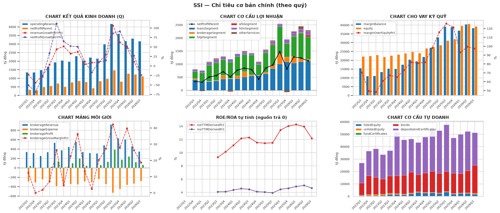
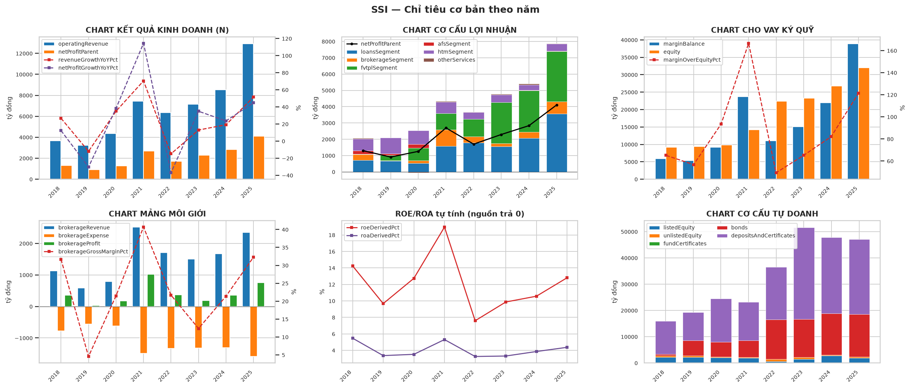
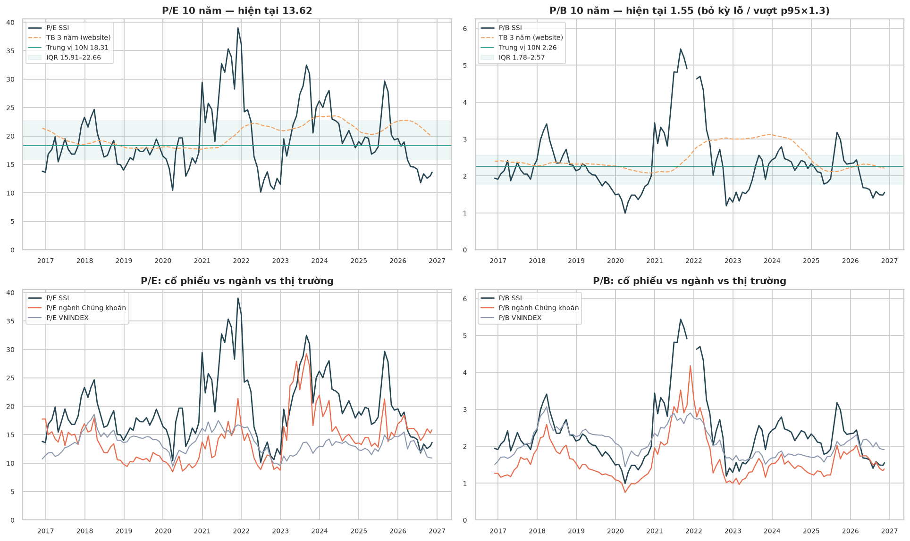
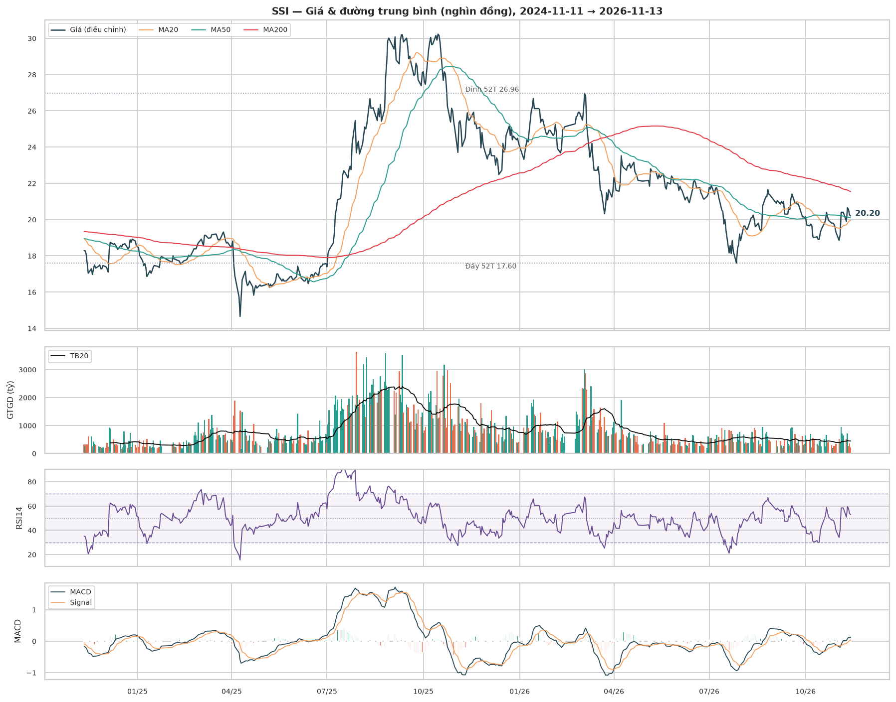
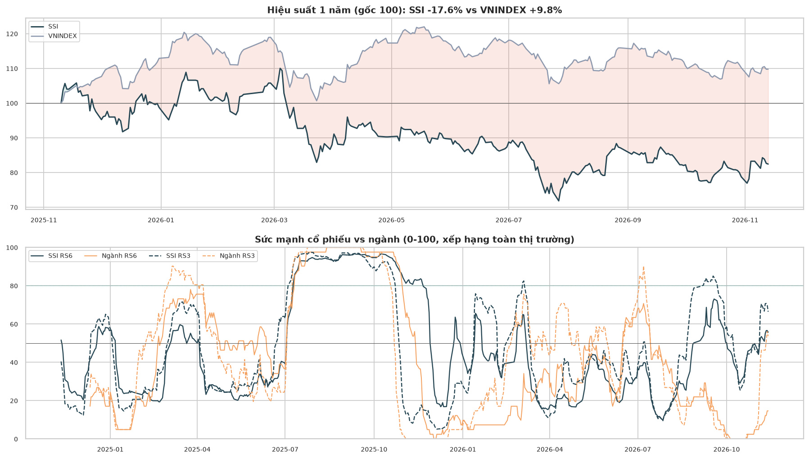
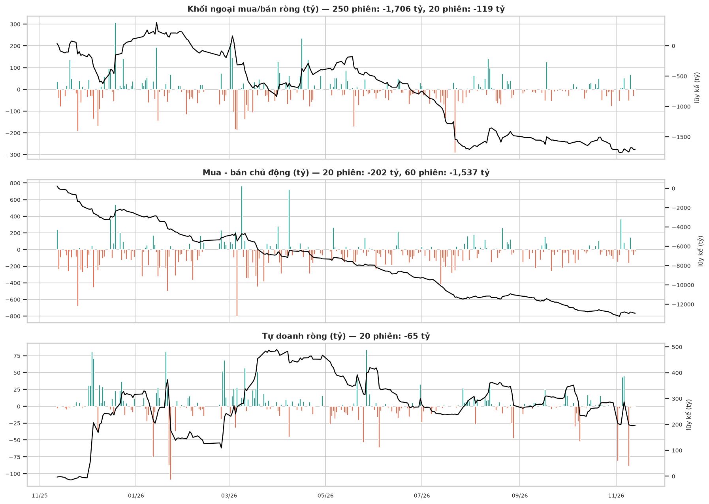
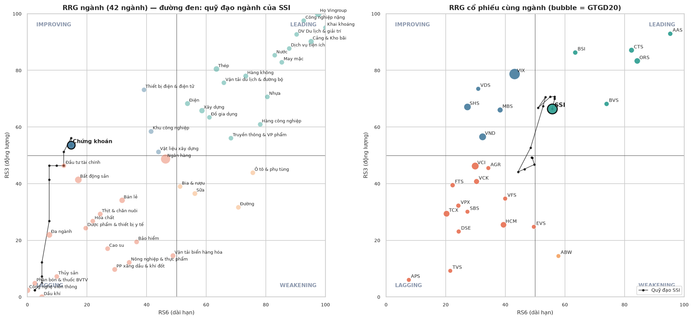

# SSI — Công ty Cổ phần Chứng khoán SSI | Phân tích cổ phiếu

> Dữ liệu sstock tới **2026-11-13** · Ngành Chứng khoán (sectorId 9) · Cấu trúc BCTC: securities · Giới hạn gói: BCTC 17 quý gần nhất, BCTC năm từ 2018, giá từ 2023-11-16, định giá thị trường từ 2016-11-17.
> Báo cáo được tạo từ dữ liệu định lượng, **không phải khuyến nghị đầu tư**.

## 1. Tóm tắt

**Kết luận:** SSI nằm ở ô **Watchlist** của ma trận. Phần cơ bản và định giá khá (+4/6): P/B ở percentile 15 của 10 năm, LNST TTM +19,8% YoY. Phần kỹ thuật và dòng tiền mới ở mức +2/8: giá vẫn dưới MA200 đang dốc xuống, dòng tiền chủ động và khối ngoại còn âm. Bối cảnh trung tính, vì thị trường đang ở trạng thái pressure còn ngành đã sang improving, nên không hạ bậc. Scorecard **+7/±16 → Khá tích cực** (Kỹ thuật & dòng tiền +2/8 · Cơ bản & định giá +4/6 · Bối cảnh +1/2). Riêng phần cơ bản, tôi chấm **thận trọng hơn** điểm số: tăng trưởng TTM đã quay đầu (LNST Q3/2026 -23,7% YoY, TTM -7,3% QoQ) và NIM margin đang bị ép.

| Luận điểm | Số liệu |
|---|---|
| Tăng trưởng đang chững | LNST TTM 4.451 tỷ (+19,8% YoY) nhưng giảm từ đỉnh 4.802 tỷ (2026Q2); LNST Q3/2026 1.125 tỷ (-23,7% YoY); doanh thu môi giới Q3 349 tỷ (-62,1% YoY) |
| Định giá rẻ so với lịch sử | P/E 13,62 (trung vị 10N 18,31, percentile 11) · P/B 1,55 (trung vị 2,26, percentile 15) · ROE 12,6% |
| Xu hướng giá chưa xác nhận | Giá 20,20 > MA50 20,09, nhưng < MA200 21,54 (MA200 dốc xuống từ 25,2 hồi tháng 5/2026); nền giá 18,85–21,65 kể từ tháng 8 |
| Sức mạnh cải thiện, dòng tiền chưa theo | RRG leading, RS3 66,4 (20 phiên trước 26,5) · khối ngoại 20 phiên -118,9 tỷ · mua-bán chủ động 60 phiên -1.537 tỷ · AMFI -0,024 |

**Điều kiện hành động:** giá đóng cửa trên **21,65** (vượt MA200 và đỉnh nền tháng 8), GTGD > TB20 (444 tỷ), kèm RS3 ≥ 80 / RS6 ≥ 60 và AMFI > 0 · Kịch bản vô hiệu khi giá đóng cửa dưới **18,85** (đáy 02/11/2026).

## 2. Bối cảnh thị trường & ngành

- **Thị trường: pressure** đã 73 phiên (chuyển từ downtrend sang ngày 2026-07-30 nhờ FTD fast-track), độ tin cậy 63,7 (Medium). Có **6 phiên phân phối/25 phiên**, vượt ngưỡng 5 nên áp lực bán vẫn đáng kể. FTD gần nhất là 2026-11-04 (+2%). Độ rộng VN100 53%.
- **Tâm lý** bi quan: ngắn hạn 29, trung hạn 33 (+8 điểm trong tháng, đang cải thiện chậm).
- **Lan tỏa:** nhóm vốn hóa vừa dẫn dắt (51, +27 trong tháng); **vốn hóa lớn yếu (21, -6 trong tháng)**. SSI thuộc nhóm vốn hóa lớn (60.626 tỷ) nên đây là lực cản.
- **Định giá thị trường:** P/E VNINDEX 10,90 so với TB 3 năm 13,26, tức thị trường đang rẻ so với chính lịch sử của nó.
- **Ngành Chứng khoán: improving.** RS3 53,7 (hạng 20/42), RS6 14,6 (hạng 36), VCR 1,10 (dòng tiền tăng tốc), nhưng độ rộng chỉ 32,5% số mã trên MA50, nghĩa là sức mạnh mới tập trung ở vài mã. LNST TTM toàn ngành chỉ +1,9% YoY, trong khi SSI +19,8%.
- **Vị thế:** SSI chiếm 12,5% vốn hóa ngành (484.023 tỷ, 40 DN) và 14,6% LNST TTM của ngành.

*Quan sát biểu đồ:* VNINDEX đi ngang trong biên 1.590–1.930 suốt một năm, hiện ở 1.735 (nửa dưới của biên). Năm qua thị trường gần như luôn ở trạng thái pressure, xen hai nhịp downtrend vào tháng 3 và cuối tháng 7/2026. Chỉ số lan tỏa vốn hóa lớn rơi từ khoảng 65 xuống 21 đầu tháng 11, trong khi vốn hóa vừa giữ quanh 51: dòng tiền đang né nhóm large-cap.

## 3. Kết quả kinh doanh & sức khỏe tài chính

| Chỉ tiêu (tỷ đồng, %) | 2025Q3 | 2025Q4 | 2026Q1 | 2026Q2 | 2026Q3 | YoY |
|---|---|---|---|---|---|---|
| Doanh thu hoạt động | 4.177 | 3.602 | 3.178 | 3.319 | 3.168 | -24,2% |
| LNST cty mẹ | 1.475 | 817 | 1.278 | 1.231 | 1.125 | -23,7% |
| LN mảng cho vay (margin) | 1.006 | 1.098 | 1.050 | 1.091 | 1.115 | +10,8% |
| LN mảng FVTPL | 1.043 | 520 | 774 | 973 | 865 | -17,1% |
| LN môi giới | 388 | 175 | 241 | 121 | 65 | -83,2% |
| Dư nợ margin | 39.231 | 38.940 | 36.928 | 40.473 | 38.294 | -2,4% |
| Margin/VCSH | 125,5 | 121,4 | 93,1 | 99,4 | 97,3 | -28,2pp |
| NIM margin | 6,2 | 6,1 | 6,0 | 5,7 | 5,5 | -0,7pp |
| COF | 3,83 | 4,23 | 4,70 | 5,18 | 5,80 | +2,0pp |
| Nợ/Tổng nguồn vốn | 65,0 | 64,0 | 55,8 | 56,0 | 55,3 | -9,6pp |

**Diễn giải:**
- **YoY âm chủ yếu do nền cao.** Q3/2025 là quý kỷ lục: thanh khoản thị trường bùng nổ (GTGD SSI TB20 có lúc trên 2.000 tỷ), LN môi giới đạt 388 tỷ và FVTPL 1.043 tỷ. Mảng cho vay vẫn tăng đều và đã thành **trụ lợi nhuận lớn nhất** (khoảng 1.100 tỷ/quý). Môi giới thì co mạnh: biên gộp chỉ còn 18,6% so với 42,1%.
- **NIM margin bị ép:** lợi suất cho vay (YEA) tăng từ 9,99% lên 11,27%, nhưng chi phí vốn tăng nhanh hơn, từ 3,83% lên 5,80% trong 4 quý. NIM giảm liên tục 7 quý, từ 6,9% (2024Q4) xuống 5,5%.
- **Tăng vốn và pha loãng:** vốn góp tăng 20.779 → 24.931 tỷ trong 2026Q1, VCSH tăng 32.066 → 39.668 tỷ (+7.600 tỷ, gấp khoảng 6 lần LNST của quý), tức là đợt phát hành thu tiền có thặng dư (*chưa rõ hình thức, cần tin doanh nghiệp*). Sang 2026Q3, vốn góp tăng tiếp 25.031 → 30.033 tỷ (+20%) trong khi quỹ/LN giữ lại giảm 15.461 → 9.082 tỷ và VCSH gần như đi ngang, khớp với **phát hành cổ phiếu thưởng/cổ tức bằng cổ phiếu tỷ lệ khoảng 20%**. Giá cũng gãy từ 24,5 (14/08) xuống 19,8 (17/08); hiện có 3.001 triệu cổ phiếu, EPS 4 quý 1.483 đ.
- **Bảng cân đối an toàn hơn:** Margin/VCSH 97,3%, cách xa trần 200%, nên dư địa margin còn khoảng 40.000 tỷ. Nợ/nguồn vốn giảm từ 64–67% xuống 55,3% sau tăng vốn. Danh mục tự doanh (54,7% tổng tài sản) chủ yếu là tiền gửi/CD và trái phiếu. Trái phiếu FVTPL tăng mạnh từ 14.720 lên 19.672 tỷ trong Q3; cổ phiếu niêm yết FVTPL chỉ 1.355 tỷ, nên rủi ro beta cổ phiếu từ tự doanh thấp.
- **Chu kỳ (theo năm):** 2025 lập kỷ lục cả doanh thu (12.931 tỷ) lẫn LNST (4.106 tỷ). Năm 2021 cũng từng lập kỷ lục (2.696 tỷ) rồi 2022 giảm 37%, đúng tính chu kỳ của ngành. Biên gộp môi giới năm 2025 là 32%, dưới mức đỉnh 41% năm 2021.

*Quan sát biểu đồ 04:* cơ cấu lợi nhuận dịch chuyển rõ. Cột xanh dương (cho vay) phình đều từ khoảng 400 tỷ (2022) lên khoảng 1.100 tỷ/quý, phần cam (môi giới) gần như biến mất ở Q3/2026. Lợi nhuận ngày càng phụ thuộc vào margin và lãi suất. *Biểu đồ 05:* đường COF và NIM cắt nhau ở 2026Q3 (COF 5,80% > NIM 5,47%), lần đầu trong 17 quý. *Biểu đồ 06:* dư nợ margin năm 2025 (38.940 tỷ) gấp 1,6 lần đỉnh năm 2021, nhưng Margin/VCSH (121%) vẫn thấp hơn mức 167% của 2021.

> ⚠️ ROE/ROA TTM bằng 0 ở mọi kỳ trong `get_stock_fa_securities`, nghi lỗi dữ liệu nguồn. Báo cáo dùng ROE snapshot 12,6% (ROA 4,6%) từ `get_stock_valuation`. ROE tự tính (LNST TTM / VCSH bình quân 5 quý) là 12,2%, khớp với snapshot. Panel "ROE/ROA tự tính" trong biểu đồ 04 và 06 dùng cách tính này.

*Quan sát ROE tự tính:* ROE TTM đi lên từ 11,5% (2025Q2) tới đỉnh 14,3% (2026Q1), rồi giảm còn 12,2% (2026Q3) vì lợi nhuận chững lại trong khi VCSH tăng sau đợt phát hành. ROE theo năm (LNST / VCSH cuối kỳ) là 12,8% năm 2025. Mức này thấp hơn đỉnh chu kỳ 19,0% năm 2021, nhưng cao hơn đáy 7,6% năm 2022 và khoảng 10% của 2023–2024.

## 4. Định giá

| | Hiện tại | TB 3 năm | Trung vị 10N | Min–Max 10N | Percentile 10N | Ngành | VNINDEX |
|---|---|---|---|---|---|---|---|
| P/E | 13,62 | 19,94 | 18,31 | 10,1–39,0 | 11 | 15,84 | 10,90 |
| P/B | 1,55 | 2,21 | 2,26 | 0,99–6,77 | 15 | 1,38 | 1,91 |

- Với công ty chứng khoán, **P/B kết hợp ROE** là thước đo chính. P/B 1,55 ở percentile 15 của 10 năm, nhưng ROE TTM tự tính hiện chỉ 12,2% và đang giảm (đỉnh 14,3% ở 2026Q1). Những giai đoạn SSI được định giá P/B 2,3 trở lên là các năm ROE cao: 19,0% năm 2021, 14,2% năm 2018. Mức rẻ này phần lớn phản ánh hiệu quả sinh lời giảm sau tăng vốn, chưa hẳn là bị định giá sai.
- So với ngành: P/E thấp hơn 14%, nhưng **P/B cao hơn 12,2%**. Mức premium cho thương hiệu đầu ngành đã thu hẹp rất nhiều so với lịch sử.
- Giá tham chiếu nếu bội số quay về trung vị 10N: 27,2 (P/E) và 29,4 (P/B). Đây là **vùng tham chiếu** với giả định EPS và BVPS giữ nguyên, không phải giá mục tiêu. Trong bối cảnh LNST quý đang giảm và NIM bị ép, khó kỳ vọng bội số về trung vị nếu ROE không hồi lên trên 15%; vì vậy coi 29,4 là kịch bản lạc quan.
- Caveat: P/E SSTOCK dự phóng 12,30 **bị giữ nguyên từ 2026-07-24**, chưa cập nhật. P/E TB 3 năm không bị méo (không có tháng lỗ).

*Quan sát biểu đồ:* P/E đã về vùng 12–14, ngang các đáy 2020 (10,4) và 2022–2023 (10–12). P/B 1,55 tương đương vùng đáy cuối 2022–2023 (1,2–1,6). Ở biểu đồ so sánh, đường P/B của SSI và của ngành gần như chập nhau trong 2026, trong khi giai đoạn 2018–2025 SSI luôn giao dịch cao hơn ngành rõ rệt.

## 5. Kỹ thuật & xu hướng giá

| Chỉ tiêu | Giá trị |
|---|---|
| Giá / MA20 / MA50 / MA100 / MA200 | 20,20 / 19,96 / 20,09 / 20,14 / 21,54 |
| Độ dốc MA50 (20 phiên) | -0,69% |
| RSI14 · MACD / signal | 53,0 · 0,122 / 0,036 (hist 0,086, đang thu hẹp so với 0,109) |
| ATR14 · Biến động năm · Beta | 2,6% · 33,5% · 1,10 |
| Đỉnh/đáy 52 tuần | 26,96 / 17,60 (đáy ngày 27/07/2026); cách đỉnh -25,1% |
| GTGD TB20 / TB60 | 444 / 461 tỷ (tỷ lệ 0,96) |
| Hiệu suất vs VNINDEX | 1T +2,8pp · 3T +2,7pp · 6T -0,3pp · YTD -13,8pp · 1N -24,4pp |

- **Cấu trúc:** downtrend trung hạn kể từ đỉnh tháng 10/2025 (giá điều chỉnh khoảng 30). MA200 đã dốc xuống liên tục từ tháng 5/2026. Từ tháng 8/2026, giá **tích lũy trong nền 18,85–21,65** và MA20/50/100 xoắn lại quanh 20,0–20,1. Kháng cự gần là 20,65 (10/11), sau đó là cụm 21,4–21,65 (đỉnh 18/09 và 26/08) trùng MA200 21,54.
- **Động lượng:** RSI trung tính, MACD trên signal và trên 0 nhưng histogram đang co lại.
- **Thanh khoản thấp:** TB20 khoảng 444 tỷ, chưa bằng 1/4 thời kỳ sôi động tháng 8–9/2025 (trên 2.000 tỷ).
- Dừng lỗ tham chiếu theo 2,5×ATR là khoảng 1,3 nghìn đồng, gần trùng đáy nền 18,85.

*Quan sát biểu đồ 01:* phiên 04/11/2026 giá tăng 6,5% (19,15 → 20,40) với GTGD 945 tỷ, khoảng 2,1 lần TB20, đánh dấu cú bật khỏi đáy 18,85 đúng ngày FTD của thị trường. Các phiên sau GTGD giảm dần về 220 tỷ (13/11) khi giá đi ngang, nên lực cầu chưa được duy trì. *Biểu đồ 02:* trong năm qua SSI kém VNINDEX khoảng 27pp (-17,6% so với +9,8% theo gốc 100), khoảng cách nới rộng chủ yếu trong tháng 3 và tháng 7/2026. RS3 từng lên khoảng 85 giữa tháng 9 rồi gãy xuống khoảng 26 vào giữa tháng 10, nên nhịp hồi RS hiện tại (khoảng 66–70) là lần thử thứ hai. Đáng chú ý, RS6 của ngành vẫn ở mức 0–15, tức SSI đang khỏe hơn hẳn mặt bằng ngành.

## 6. Dòng tiền & smart-money

| Cửa sổ | Khối ngoại ròng | Tự doanh ròng | Chủ động ròng | Tỷ lệ chủ động |
|---|---|---|---|---|
| 5 phiên | -7,1 | -90,9 | -138,4 | -0,081 |
| 20 phiên | -118,9 | -65,0 | -201,7 | -0,026 |
| 60 phiên | -232,5 | -157,8 | -1.537,0 | -0,066 |
| 250 phiên | -1.706,1 | — | -12.931,7 | -0,083 |

- **RRG cổ phiếu: leading** (RS3 66,4 / RS6 55,7). RS6 tăng từ 27,1 (60 phiên trước) lên 55,7. RS3 xếp hạng 9/25 mã trong ngành.
- **VCR 1,01 (cải thiện) · AMFI -0,024 (cân bằng).** Có phân kỳ **tăng** bull10 (gần nhất 2026-11-02), không có phân kỳ giảm bear20 (lần gần nhất 2026-04-20).
- **Elite v23: chưa đạt**, 3/5 trụ (đạt VCR, GTGD, không bear20). Thiếu **RS** (rs3 66,45 < 80) và **AMFI** (-0,024 ≤ 0). Ngoài ra **guard-9** đang chặn: mã còn trong cooldown 20 phiên sau guard-5. Theo `elite_diag`, 3 phiên gần nhất (11–13/11) đều 3 trụ và bị chặn. Lịch sử: 5 episode, thắng 80%, lãi TB +12,2%, nên tín hiệu Elite khá đáng tin với SSI và là trigger đáng theo dõi.
- **Phân kỳ dòng tiền:** RS và giá cải thiện trong 1 tháng (+4,9%) nhưng khối ngoại, tự doanh và mua-bán chủ động đều âm. Nhịp hồi hiện chưa được dòng tiền lớn xác nhận.

*Quan sát biểu đồ:* phần lớn mức bán ròng 250 phiên của khối ngoại dồn vào cuối tháng 7/2026, với một phiên khoảng -290 tỷ, kéo đường lũy kế từ khoảng -1.000 xuống khoảng -1.600 tỷ. Từ tháng 8, đường lũy kế đi ngang hoặc giảm nhẹ chứ không còn rơi mạnh. Đường lũy kế mua-bán chủ động thì giảm đều suốt năm (-12.900 tỷ). Điểm sáng duy nhất là cột +360 tỷ ngày 04/11, trùng phiên bật nền. Tự doanh đảo chiều liên tục, bán mạnh khoảng -80 đến -90 tỷ ở 2 phiên đầu tháng 11.

## 7. So sánh cùng ngành

| Mã | Vốn hóa (tỷ) | RS3 | RS6 | Góc | VCR | AMFI | GTGD20 (tỷ) |
|---|---|---|---|---|---|---|---|
| TCX | 94.387 | 29 | 20 | lagging | 1,21 | -0,105 | 103,8 |
| VCK | 66.960 | 41 | 30 | lagging | 0,99 | 0,100 | 56,5 |
| **SSI** | 60.626 | 66 | 56 | leading | 1,01 | -0,024 | 418,7 |
| VIX | 33.575 | 79 | 43 | improving | 1,12 | -0,011 | 522,9 |
| HCM | 31.486 | 26 | 39 | lagging | 1,07 | -0,078 | 90,3 |
| VCI | 22.641 | 46 | 30 | lagging | 0,97 | -0,062 | 176,5 |
| VND | 22.073 | 57 | 32 | improving | 1,12 | 0,058 | 175,8 |
| ORS | 8.953 | 83 | 84 | leading | 1,68 | 0,125 | 86,4 |

- Trong nhóm vốn hóa lớn (trên 20.000 tỷ), **SSI là mã duy nhất ở góc leading**. TCX, VCK, HCM, VCI đều lagging. Như vậy SSI đang **dẫn dắt nhóm đầu ngành** chứ không đi sau ngành. Mã khỏe hơn chỉ có các mã nhỏ (ORS, BSI, CTS, AAS).
- VIX có RS3 cao hơn (79) và thanh khoản lớn hơn (523 tỷ), nhưng RS6 thấp (43). SSI cân bằng hơn giữa ngắn và trung hạn.

*Quan sát biểu đồ:* quỹ đạo của SSI (bên phải) đi từ vùng khoảng (44, 44), ranh giới lagging/weakening, vượt lên leading, chạm khoảng (56, 71) rồi **móc nhẹ xuống trái** về (56, 66), tức động lượng ngắn hạn đang hụt hơi. Quỹ đạo ngành (bên trái) đi thẳng đứng từ đáy lagging (khoảng 2, 2) lên improving (khoảng 15, 54). Đó là cú chuyển động lượng mạnh nhất trong 42 ngành, dù RS6 vẫn thấp.

## 8. Scorecard

| Nhóm | Điểm | Ghi chú |
|---|---|---|
| Xu hướng giá | +0 | Trên MA50 (+1), dưới MA200 (-1), MA50 dốc nhẹ xuống |
| Động lượng | +1 | MACD trên signal và trên 0; RSI 53 trung tính |
| Sức mạnh tương đối | +2 | RRG leading; RS6 55,7 chưa đủ ngưỡng |
| Dòng tiền | -1 | VCR 1,01 (+1), khối ngoại 20p -119 tỷ (-1), chủ động 20p -202 tỷ (-1) |
| Tăng trưởng | +2 | LNST TTM +19,8%, DT TTM +14,9%, **nhưng TTM đã giảm QoQ** |
| Chất lượng | +0 | ROE 12,6% (snapshot; tự tính 12,2%, đang giảm từ 14,3%); Margin/VCSH 97% |
| Định giá | +2 | P/E/trung vị 0,74; P/B percentile 15 |
| Bối cảnh | +1 | Ngành improving; thị trường pressure; tâm lý 33 |
| **Tổng** | **+7** | **Khá tích cực**; Kỹ thuật +2 · Cơ bản +4 · Bối cảnh +1 |

**Override (một phần):** giữ vị trí **Watchlist** theo ma trận, nhưng không coi điểm "Tăng trưởng +2" là tín hiệu mạnh. Tăng trưởng TTM YoY được kéo lên bởi 2025Q4–2026Q2, còn quý gần nhất đã giảm 23,7% YoY và LNST TTM giảm 7,3% QoQ. Nếu thanh khoản thị trường không hồi, Q4/2026 sẽ so với nền 817 tỷ (Q4/2025, thấp), nên YoY có thể dương trở lại. Đây là điểm cần kiểm chứng.

## 9. Rủi ro & catalyst

**Rủi ro**
- **Thanh khoản thị trường thấp kéo dài:** doanh thu môi giới đã giảm 62% YoY, biên gộp còn 18,6%. Nhóm large-cap đang bị dòng tiền né (lan tỏa 21).
- **Chi phí vốn tăng:** COF +2pp trong 4 quý, NIM margin giảm 7 quý liên tiếp. Mảng cho vay là trụ lợi nhuận lớn nhất nên nhạy với lãi suất.
- **Tự doanh trái phiếu tăng:** trái phiếu FVTPL 19.672 tỷ (+34% QoQ), nhạy với biến động lợi suất.
- **Pha loãng:** vốn góp tăng 44% trong 3 quý (20.779 → 30.033 tỷ), ROE bị kéo xuống 12,6%.
- **Dòng tiền:** khối ngoại bán ròng 1.706 tỷ trong 250 phiên; mua-bán chủ động âm kéo dài.
- **Beta 1,10, max drawdown 1 năm -34,7%:** cổ phiếu chứng khoán giảm mạnh khi thị trường chuyển downtrend (đã xảy ra 2 lần trong năm 2026).

**Catalyst**
- BCTC Q4/2026 (cuối tháng 1/2027) với nền so sánh thấp (LNST Q4/2025 817 tỷ).
- Thanh khoản thị trường hồi phục, thị trường chuyển từ pressure sang uptrend sau FTD 04/11.
- Ngành chứng khoán tiếp tục từ improving lên leading.
- Elite kích hoạt khi hết cooldown guard-9 và RS3 ≥ 80, AMFI > 0 (lịch sử thắng 80%).

**Giới hạn dữ liệu**
- Gói: BCTC quý 17 kỳ, năm từ 2018, giá từ 2023-11-16.
- ROE/ROA TTM trong FA securities = 0 (nghi lỗi nguồn); dùng ROE snapshot 12,6%.
- P/E SSTOCK dự phóng bị giữ nguyên từ 2026-07-24.
- Hình thức của đợt tăng vốn 2026Q1 chưa rõ, cần tin doanh nghiệp.
- Không có dữ liệu vĩ mô (lãi suất liên ngân hàng, thanh khoản toàn thị trường) vì `search_data_series` chỉ dành cho admin.

## 10. Kịch bản & mức giá theo dõi

| Kịch bản | Điều kiện | Ý nghĩa |
|---|---|---|
| Tích cực | Đóng cửa > **21,65** (vượt MA200 21,54 và đỉnh nền 26/08) với GTGD > TB20 (444 tỷ); RS3 ≥ 80 và RS6 ≥ 60; AMFI > 0; thị trường lên uptrend | Thoát nền 3 tháng, đảo chiều xu hướng trung hạn; mục tiêu kỹ thuật kế tiếp là vùng 24–25 (nền tháng 4–5/2026), xa hơn là đỉnh 52T 26,96. Có thể đi kèm tín hiệu Elite |
| Cơ sở | Giá dao động **18,85–21,65**, MA200 tiếp tục dốc xuống, RS3 quanh 60–75, dòng tiền chủ động vẫn âm | Tích lũy; theo dõi, chờ trigger. Định giá P/B thấp hỗ trợ đáy nhưng chưa đủ tạo xu hướng |
| Tiêu cực | Đóng cửa < **18,85** (đáy 02/11) với GTGD tăng; RS3 < 50; thị trường quay về downtrend | Thất bại nền, rủi ro kiểm định lại đáy 52T **17,60**. Thủng 17,60 thì xu hướng giảm trung hạn tiếp diễn |

---
*Phụ lục:* dữ liệu thô ở `raw/`, chỉ số ở `metrics.json`, bảng đầy đủ ở `tables.md`, biểu đồ ở `charts/` (gồm cả [05_fa_dashboard](charts/05_fa_dashboard.png)).

*Báo cáo dựa trên dữ liệu định lượng tới 2026-11-13, không phải khuyến nghị đầu tư.*
