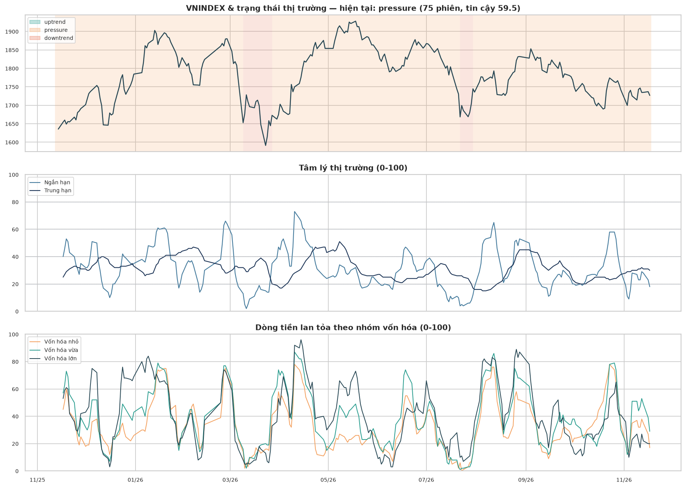
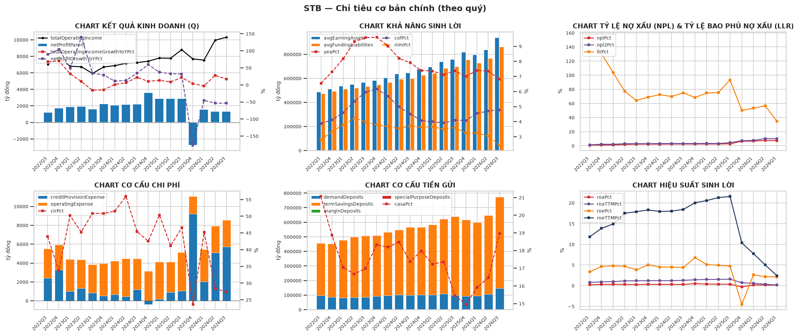
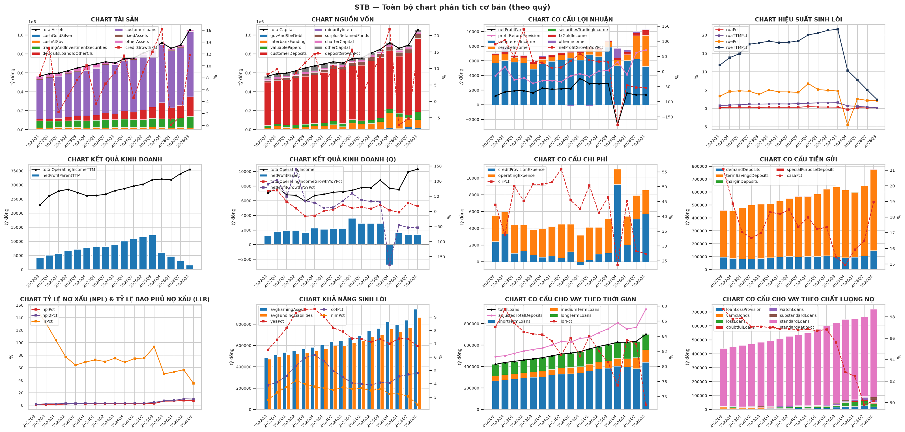
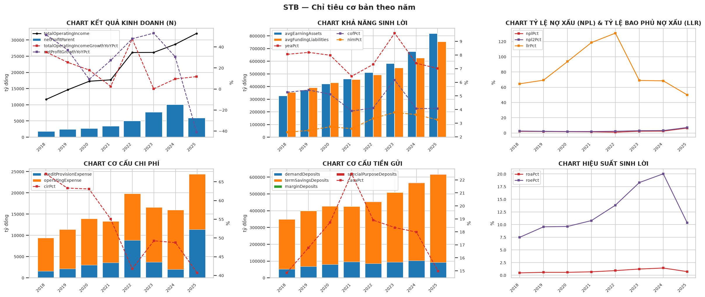
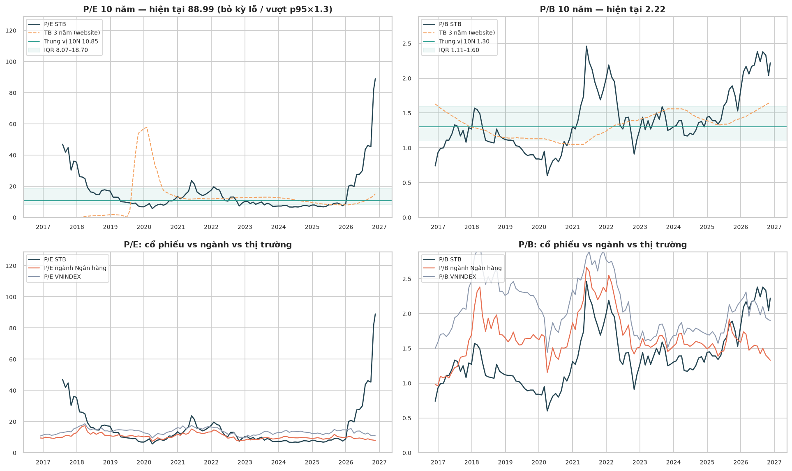
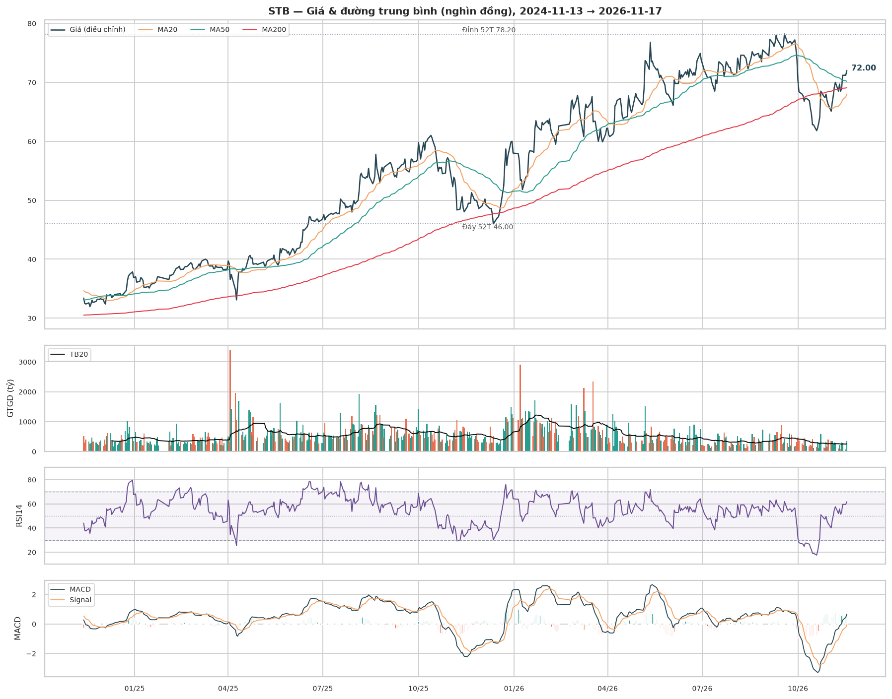
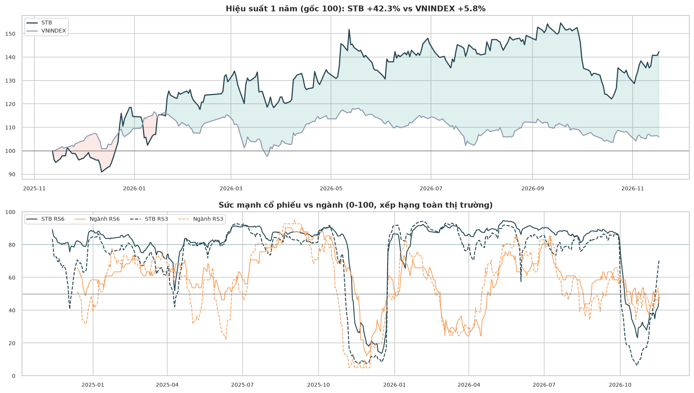
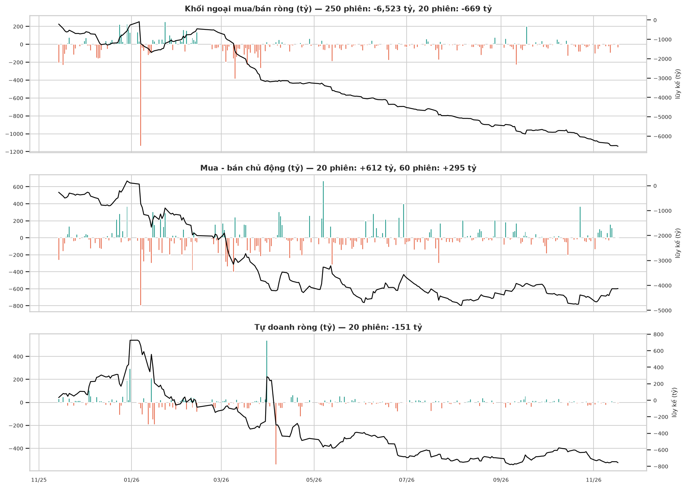
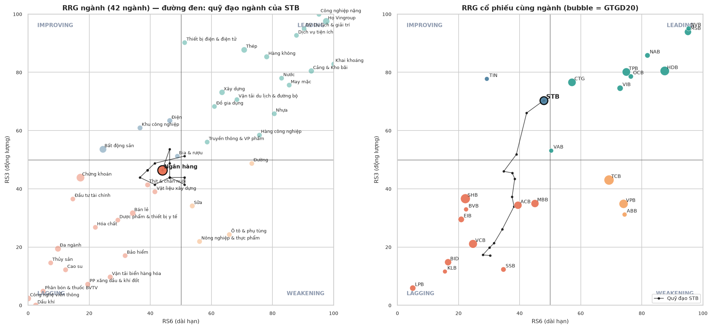

# STB — Sacombank | Phân tích cổ phiếu

> **Ngày phân tích: 17/11/2026.** Giá, dòng tiền, RRG và định giá sstock tới **17/11/2026**; BCTC mới nhất **Q3/2026**, dữ liệu năm tới **2025**. Ngành Ngân hàng (sectorId 24), cấu trúc `bank`. Tiền: **tỷ đồng**; giá: **nghìn đồng/cổ phiếu**, trừ EPS ghi đồng.
>
> Phạm vi giả định: đánh giá cơ bản 3–12 tháng và tín hiệu giao dịch 1–3 tháng; chưa biết giá vốn, tỷ trọng hay khẩu vị rủi ro của người đọc. Đây là phân tích theo nguồn sstock, chưa đối chiếu được với BCTC/thuyết minh và công bố chính thức của doanh nghiệp.
>
> **Lưu ý nhận diện:** trường `company.name` của nguồn ghi “Sài Gòn Tài Lộc”, không khớp `nameEn` = “Sai Gon Thuong Tin Commercial Joint Stock Bank”, `nameShort` và website sacombank.com.vn. Báo cáo dùng tên Sacombank theo các trường nhận diện còn lại và giữ nguyên dữ liệu gốc để kiểm tra. Không coi tên tiếng Việt lỗi là bằng chứng đổi tên ngân hàng.

## 1. Tóm tắt

**Kết luận: kỹ thuật hồi phục, nhưng cơ bản và định giá chưa ủng hộ mua tích lũy dài hạn ở 72,00.** STB nằm ở ô **“chỉ phù hợp theo dõi/giao dịch theo đà có điều kiện”**, không phải ứng viên mạnh trên cả hai trục. Ngành ngân hàng `lagging` và thị trường `pressure` khiến mức đánh giá hành động được hạ một bậc: **ưu tiên chờ xác nhận thay vì mua đuổi**.

Scorecard gốc **+1/±16 → Trung tính**, nhưng tổng này che khuất sự phân hóa: **Kỹ thuật & dòng tiền +6/8; Cơ bản & định giá −4/6; Bối cảnh −1/2**. Không override số điểm; kết luận thận trọng dựa vào ma trận và bối cảnh.

| Luận điểm | Bằng chứng tại ngày/kỳ dữ liệu |
|---|---|
| Lợi nhuận bị dự phòng bào mòn | 9T/2026: TOI 27.794, +14,1%; LN trước dự phòng 18.741, +42,6%; dự phòng 12.848, +497,1%; LNST mẹ 4.278, −50,8% YoY |
| Rủi ro tài sản là điểm nghẽn | Q3/2026: NPL 7,33%; LLR 34,83%; số dư nợ nhóm 3–5 51.367, tăng 7,1% QoQ dù tỷ lệ NPL giảm |
| Chưa phải vùng định giá rẻ | 17/11/2026: P/B 2,22 lần, percentile lịch sử khoảng 94; ROE TTM 2,41%; P/E 88,99 lần chịu méo bởi lợi nhuận thấp |
| Giá hồi, xu hướng chưa hoàn chỉnh | 72,00 > MA50 70,17 > MA200 69,09; nhưng MA50 giảm 3,66% trong 20 phiên, MA20 mới 68,03 |
| Lực mua nội cải thiện, chưa đồng thuận | 20 phiên: chủ động +611,9; ngoại −668,6; tự doanh −151,1; RS3/RS6 70,3/47,9; VCR 0,93 |

**Điều kiện theo dõi tích cực:** giữ cụm 69,09–70,17; nếu vượt đỉnh 52 tuần **78,20**, cần GTGD **khớp lệnh** vượt TB20 hiện tại 213,3, ưu tiên ≥1,2×, tức khoảng **256 tỷ/phiên**; RS3 ≥80, RS6 ≥60, VCR ≥1 và AMFI >0. Ngưỡng thanh khoản phải cập nhật khi TB20 thay đổi. Elite còn yêu cầu hết guard và đủ điều kiện ba phiên liên tiếp.

**Vô hiệu hóa nhịp hồi:** đóng cửa trở lại dưới MA200 hiện tại **69,09**, đặc biệt kèm bán chủ động gia tăng. Đây là mức theo dõi xu hướng, không phải cam kết dừng lỗ bảo đảm.

*Nguồn: `tables.md`, `metrics.json` (price, fa, flows, rs, valuation, signals), asOf 17/11/2026.*

## 2. Bối cảnh thị trường & ngành

- **Thị trường pressure 75 phiên**, độ tin cậy 59,5/100; có **7 phiên phân phối/25 phiên**, độ rộng VN100 chỉ **45%**. FTD gần nhất **04/11/2026**, nhưng nguồn chưa xác nhận chuyển sang uptrend.
- Tâm lý ngắn hạn **18/100**, giảm 5 điểm/tuần và 20 điểm/tháng; trung hạn **30/100**, giảm 1 điểm/tuần, tăng 5 điểm/tháng. Bi quan có thể tạo nhịp hồi, không tự động chứng minh đáy bền.
- Lan tỏa mid-cap **29/100**, large-cap **20**, small-cap **17**: cả ba đều yếu. Với vốn hóa STB khoảng **135.736 tỷ**, nhóm vốn hóa vừa là tham chiếu gần, vẫn chưa có nền dòng tiền thuận lợi.
- VNINDEX P/E **10,84 lần** so TB3N **13,25**; P/B **1,90** so **1,89**. P/E thấp hơn lịch sử không xóa được rủi ro phân phối.
- Ngân hàng: **lagging**, RS3 **46,3**, hạng **23/42 ngành**; RS6 **43,9**, hạng **24**; VCR **0,93**, chỉ **41,4%** cổ phiếu trên MA50. Không có cờ warning của engine, nhưng độ rộng vẫn yếu.
- STB chiếm **5,3%** vốn hóa rổ 29 ngân hàng, nhưng chỉ **0,5%** LNST mẹ TTM ngành. LNST TTM ngành +20,7% YoY trong khi STB −87,6%: suy yếu lợi nhuận mang tính riêng của STB, không đơn thuần do toàn ngành.

**Quan sát biểu đồ 09:** VNINDEX tạo đỉnh thấp hơn sau nhịp hồi tháng 8–9/2026; nhịp hồi mới chưa kéo tâm lý và lan tỏa trở lại vùng mạnh. Điều này khác với việc chỉ nhìn một FTD gần nhất và kỳ vọng uptrend đã hình thành.

*Nguồn: raw/market_state.json, market_sentiment.json, money_diffusion.json, market_val.json, sector_rrg.json và sector_fa.json; tổng hợp trong tables.md, asOf 17/11/2026.*

## 3. Kết quả kinh doanh & sức khỏe tài chính

### 3.1. Năm quý gần nhất: tăng thu nhập chưa chuyển thành tăng lợi nhuận

| Chỉ tiêu | Q3/2025 | Q4/2025 | Q1/2026 | Q2/2026 | Q3/2026 |
|---|---:|---:|---:|---:|---:|
| Tổng thu nhập hoạt động | 8.797 | 7.694 | 7.538 | 9.950 | 10.306 |
| Thu nhập lãi thuần | 7.874 | 5.358 | 6.042 | 6.247 | 5.228 |
| Thu nhập dịch vụ | 673 | 758 | 750 | 3.202 | 4.255 |
| LN trước dự phòng | 4.701 | 5.872 | 4.130 | 7.125 | 7.486 |
| Chi phí dự phòng trong quý | 1.044 | 9.232 | 2.024 | 5.095 | 5.729 |
| LNST cổ đông mẹ | 2.901 | −2.752 | 1.584 | 1.347 | 1.347 |
| NIM (%) | 3,61 | 3,25 | 3,25 | 3,05 | 2,44 |
| YEA / COF (%) | 7,38 / 4,10 | 7,01 / 4,08 | 7,40 / 4,55 | 7,35 / 4,70 | 6,83 / 4,78 |
| CIR (%) | 46,56 | 23,68 | 45,21 | 28,39 | 27,36 |
| NPL (%) | 2,75 | 6,41 | 6,62 | 7,54 | 7,33 |
| LLR (%) | 93,26 | 49,97 | 53,21 | 56,67 | 34,83 |
| CASA (%) | 15,45 | 14,96 | 15,92 | 16,46 | 18,96 |
| LDR nguồn (%) | 80,55 | 77,47 | 83,51 | 82,99 | 74,94 |

**Dùng 9T/2026 làm thước đo tăng trưởng chính:** TOI **+14,1%**, LN trước dự phòng **+42,6%**, nhưng LNST mẹ **−50,8%** do dự phòng tăng **497,1%**. LNST TTM chỉ **1.525 tỷ**, giảm **87,6%**, vì cửa sổ chứa quý Q4/2025 lỗ **2.752 tỷ**, thay cho Q4/2024 lãi **3.598 tỷ** trong kỳ so sánh. Không mô tả mức giảm TTM là tốc độ giảm riêng của hoạt động 9T/2026.

Tăng LN trước dự phòng cần đọc thận trọng: lãi thuần 9T giảm từ **21.323 xuống 17.517 tỷ (−17,8%)**, trong khi thu nhập dịch vụ tăng từ **2.320 lên 8.206 tỷ (+253,7%)**. Riêng Q3 dịch vụ tăng **532,0% YoY**, chiếm **41,3% TOI**, so **7,7%** Q3/2025; Q2/2026 đã chiếm **32,2%**. Đây là bước nhảy lớn chưa được thuyết minh trong dữ liệu hiện có: **chưa rõ cơ cấu, tính lặp lại hay việc phân loại lại; cần tin doanh nghiệp**. Không mặc định là doanh thu bảo hiểm trả trước hoặc một thương vụ cụ thể.

Q3 lãi thuần giảm **33,6% YoY**, dù TOI +17,2%; CIR giảm xuống 27,36% là điểm tốt nhưng cũng hưởng lợi từ mẫu số thu nhập dịch vụ đột biến. Chưa đủ bằng chứng để gọi đây là cải thiện bền vững của năng lực lõi.

**Quan sát biểu đồ 04:** đường TOI tiếp tục lên trong Q2–Q3/2026 nhưng cột LNST hầu như không tăng; đồng thời NIM đi xuống và dự phòng tăng. Sự tách rời thu nhập–lợi nhuận là điểm gãy rõ so giai đoạn trước Q4/2025.

### 3.2. Kiểm chứng nhãn nợ nhóm 2: sửa cách đọc bảng tự động

**Phát hiện quan trọng:** chuỗi nguồn `npl2Pct`, được `tables.md` gắn nhãn “Nợ nhóm 2”, thực tế khớp **tỷ lệ tổng nợ nhóm 2–5**, không phải riêng nhóm 2. Báo cáo dùng số dư `watchLoans` để tính tỷ lệ nhóm 2 riêng. Dư nợ gộp được đối chiếu bằng tổng năm nhóm nợ, cũng khớp `customerLoans + loanLossProvision`; `customerLoans` trong chart tài sản là số sau dự phòng theo phép đối chiếu này.

| Chỉ tiêu kiểm chứng | Q3/2025 | Q4/2025 | Q1/2026 | Q2/2026 | Q3/2026 |
|---|---:|---:|---:|---:|---:|
| Dư nợ gộp đối chiếu | 606.048 | 626.392 | 626.960 | 636.029 | 700.347 |
| Nợ nhóm 2 riêng | 9.956 | 4.658 | 5.928 | 16.827 | 17.711 |
| **Nhóm 2 riêng / dư nợ gộp (%)** | **1,64** | **0,74** | **0,95** | **2,65** | **2,53** |
| Tổng nhóm 3–5 | 16.665 | 40.137 | 41.498 | 47.957 | 51.367 |
| Số dư dự phòng cuối kỳ | 15.542 | 20.056 | 22.082 | 27.177 | 17.890 |
| Tổng nhóm 2–5 / dư nợ (%) — `npl2Pct` | 4,39 | 7,15 | 7,56 | 10,19 | 9,86 |

Q3/2026 NPL giảm **7,54% → 7,33%** nhưng nợ xấu tuyệt đối **tăng 7,1%**, còn mẫu số dư nợ gộp tăng **10,1%**. Nợ nhóm 2 riêng cũng **tăng 5,3%** dù tỷ lệ giảm 2,65% → 2,53%. Do vậy, chưa thể gọi là chất lượng tài sản phục hồi.

LLR tính lại **17.890 / 51.366,51 = 34,83%**, khớp nguồn; không có lệch mẫu số đáng kể. Riêng nhóm 1/tổng nợ phân loại Q3 bằng khoảng **90,14%**, cũng khớp chuỗi nguồn sau khi dùng dư nợ gộp.

### 3.3. Giải thích toàn bộ sự kiện ngân hàng trong 12 tháng gần nhất

1. **Q4/2025: nợ xấu nhảy bậc, LLR 93,26% → 49,97%.** Nhóm 3 tăng **2.315 → 6.920**, nhóm 5 **11.511 → 29.906**; nhóm 2 giảm **9.956 → 4.658**. Nợ xấu tăng nhanh hơn số dư dự phòng, dù chi phí dự phòng quý đạt **9.232** và số dư dự phòng tăng **15.542 → 20.056**. Có thể có dịch chuyển nhóm nợ nhưng **chưa có bảng chuyển nhóm để xác nhận nguyên nhân**. VAMC giảm nhẹ **1.615 → 1.603**, không phải tăng bán nợ cho VAMC giải thích biến động này.
2. **Q4/2025: lệch tín dụng–tiền gửi.** Cho vay sau dự phòng tăng **15.831**, tiền gửi KH giảm **22.760**; vốn liên ngân hàng tăng **73.563**, vay CP/NHNN **21.922**, giấy tờ có giá **406**. Tuy vậy, tài sản tại TCTD khác cũng tăng **55.355**, nên thay đổi vị thế vay ròng liên ngân hàng chỉ khoảng **+18.208**, không phải toàn bộ 73.563. COF sau đó tăng là bằng chứng áp lực chi phí vốn; chưa đủ để kết luận thiếu thanh khoản.
3. **Q4/2025: thu nhập khác 1.295**, khoảng **36,5× trung vị 8 quý trước**, chiếm **17% TOI**. Có tính bất thường; thu hồi nợ/bán tài sản chỉ là giả thuyết, **cần công bố doanh nghiệp**. Không ngoại suy vào lợi nhuận chuẩn hóa. Đồng thời CIR thấp 23,68% do chi phí hoạt động/thu nhập thay đổi, chưa xác nhận toàn bộ là hiệu quả cấu trúc.
4. **Q1/2026: lãi trở lại không đồng nghĩa chất lượng cải thiện.** LNST tăng **4.337 QoQ**, nhưng LN trước dự phòng **−29,7%**; dự phòng giảm **9.232 → 2.024**, tác động sau thuế giả định 20% khoảng **5.767**, tương đương **133%** mức tăng LNST. Đây là độ nhạy kế toán, không phải quy kết chủ ý điều tiết. NPL vẫn tăng **6,41% → 6,62%**; nhóm 4 tăng **3.310 → 7.792** trong khi nhóm 3 giảm, gợi ý nợ chuyển nhóm nhưng chưa thể xác nhận.
5. **Q2/2026: rủi ro mới tích tụ.** Nhóm 2 **5.928 → 16.827 (+184%)**, nhóm 3 **3.160 → 7.200 (+128%)**; NPL lên 7,54%. LLR tăng lên 56,67% chủ yếu là bộ đệm đang đuổi theo nợ xấu, không phải chất lượng nợ đã tốt.
6. **Q3/2026: nhóm 3 +169%, LLR sụt mạnh.** Nhóm 3 **7.200 → 19.359**, nhóm 4 **8.483 → 9.441**, nhóm 5 giảm **32.274 → 22.567**. Số dư dự phòng giảm **9.287**, dù chi phí trong quý **5.729**; phần cầu nối còn lại khoảng **−15.016** có thể gồm sử dụng dự phòng, hoàn nhập hoặc điều chỉnh khác. **Chưa có thuyết minh để khẳng định xóa nợ hay thu hồi tiền.** Tổng nợ nhóm 3–5 vẫn tăng, VAMC chỉ giảm **1.603 → 1.580**.
7. **Độ nhạy LLR:** giữ nguyên nợ nhóm 3–5 Q3/2026 và đưa LLR về đúng mức Q3/2025 khoảng 93,26%, cần bổ sung xấp xỉ **30.016** dự phòng; sau thuế giả định 20% khoảng **24.013**, bằng **15,74 lần LNST TTM** hiện tại. Đây là **stress test**, không phải dự báo, nghĩa vụ trích lập hay ngưỡng pháp lý. Mẫu số lợi nhuận TTM rất thấp làm tỷ lệ stress test lớn; thu hồi/xử lý nợ có thể làm thay đổi kết quả.

### 3.4. NIM, nguồn vốn, bảng cân đối và vốn cổ phần

Bốn quý Q4/2025 → Q3/2026: **YEA 7,01 → 7,40 → 7,35 → 6,83%; COF 4,08 → 4,55 → 4,70 → 4,78%; NIM 3,25 → 3,25 → 3,05 → 2,44%**. Chi phí vốn tăng trong khi lợi suất giảm ở quý mới nhất là bất lợi rõ, không phải chỉ nhiễu lợi nhuận do dự phòng.

Q3 có cải thiện huy động: tiền gửi KH **775.422**, tăng **127.482 QoQ**; CASA **18,96%**, tăng **2,50 điểm %**; LDR nguồn giảm **8,05 điểm %** về **74,94%**. Tuy nhiên giấy tờ có giá cũng tăng **39.276 → 85.546**. Cần theo dõi COF các quý tới mới xác nhận lợi ích từ CASA.

Tổng tài sản Q3 **1.057.398**, tăng **18,5% QoQ**; tài sản liên ngân hàng tăng **78.329** lên **208.256**, còn vốn liên ngân hàng giảm về **81.264**, tương đương **7,68% tổng nguồn vốn**. Vị thế liên ngân hàng ròng **−126.992** nghĩa là tài sản vượt nguồn huy động liên ngân hàng theo các khoản mục này. Đây là đối chiếu gộp, chưa xử lý kỳ hạn, tiền tệ hay tài sản cầm cố nên **không chứng minh an toàn thanh khoản**.

Tăng trưởng tín dụng nguồn **11,81%** và huy động **15,58%** là **YTD**, không phải YoY. Dư nợ gộp tăng 626.392 → 700.347 phù hợp tăng trưởng tín dụng YTD; không lấy tăng trưởng của khoản cho vay sau dự phòng để thay thế. LDR là công thức của nguồn, không mặc định tương đương tỷ lệ pháp lý NHNN.

Vốn điều lệ giữ **18.852 tỷ** trong cửa sổ BCTC; snapshot khoảng **1,885 tỷ cổ phiếu** khớp tương đối mệnh giá. **Không phát hiện sự kiện quyền trong chuỗi giá được lấy**, nên không có đợt tăng vốn/chia thưởng trong dữ liệu này cần diễn giải. Lợi ích thiểu số bằng 0 trong chuỗi nguồn, không có bằng chứng thay đổi phạm vi hợp nhất. `otherCapital` không được dùng như vốn chủ sở hữu vì gồm khoản nguồn vốn tổng hợp. Tài sản khác Q3 **19.426**, tăng từ **13.094** cùng kỳ: cơ cấu chưa rõ, không tự gán là lãi dự thu.

**Quan sát biểu đồ 05:** mảng dịch vụ phình đột ngột từ Q2/2026, đúng lúc lãi thuần không theo kịp; phần tài sản/nguồn vốn liên ngân hàng cũng co–giãn mạnh. Bảng cân đối và cấu trúc lợi nhuận đang đổi nhanh hơn một câu chuyện tăng trưởng tín dụng đơn thuần.

### 3.5. Đặt trong chu kỳ lịch sử

ROE năm **18,30% (2023) → 20,03% (2024) → 10,34% (2025)**; ROE TTM Q3/2026 chỉ **2,41%**. NIM đạt **3,79% năm 2023**, giảm còn **3,25% năm 2025** và **2,44% quý mới nhất**. NPL năm 2022 **0,98%**, năm 2025 **6,41%**. Hiệu quả sinh lời hiện thấp hơn rõ giai đoạn trước, trong khi giá vẫn ở vùng cao của lịch sử gần.

**Quan sát biểu đồ 06:** 2018–2024 từng có xu hướng LNST tăng cùng quy mô; tới 2025 đường thu nhập vẫn tăng nhưng LNST đảo chiều, đi cùng cú nhảy nợ xấu và dự phòng. Đây là điểm gãy, không phải kéo dài tuyến tính chu kỳ ROE tăng.

*Nguồn: raw/fa_q.json, raw/fa_y.json; tính đối chiếu trong audit.py, audit.json. Tỷ lệ nhóm 2 đã được hiệu chỉnh cách đọc, không thay dữ liệu thô. BCTC mới nhất Q3/2026. Chuỗi ROE/ROA TTM theo năm bị nghi lỗi, chỉ dùng roePct/roaPct năm.*

## 4. Định giá

| Chỉ tiêu tại 17/11/2026 | STB | TB3N STB | Trung vị 10N STB | Ngành | VNINDEX |
|---|---:|---:|---:|---:|---:|
| P/E (lần) | 88,99 | 15,21* | 10,85 | 7,88 | 10,84 |
| P/B (lần) | 2,22 | 1,65 | 1,30 | 1,33 | 1,90 |

STB nằm quanh **percentile 94** cho cả P/E và P/B. P/B cao hơn ngành khoảng **66,9%**, nhưng ngành trộn quốc doanh và tư nhân; vì vậy đối chiếu thêm ba ngân hàng tư nhân cùng ngày:

| Mã | P/B (lần) | ROE snapshot (%) | P/E (lần) |
|---|---:|---:|---:|
| **STB** | **2,22** | **2,41** | **88,99** |
| HDB | 1,65 | 24,59 | 7,55 |
| MBB | 1,23 | 22,41 | 5,86 |
| ACB | 1,16 | 16,47 | 7,34 |

**Kết luận định giá:** giá đang phản ánh kỳ vọng phục hồi lớn hơn hiệu quả sinh lời đã quan sát. Kỳ vọng có thể đúng nếu xử lý tài sản/nợ mang lại kết quả, nhưng dữ liệu hiện tại **chưa chứng minh mức premium này được bảo đảm**. Không suy ra giá phải giảm ngay từ P/B cao; cũng không gọi rẻ chỉ vì có khả năng lợi nhuận hồi sau kỳ dự phòng lớn.

Với BVPS giữ nguyên, các mức tham chiếu do pipeline tính:
- P/B về TB3N **1,65× → 53,57**, thấp hơn khoảng **25,6%** so 72,00.
- P/B về trung vị 10N **1,30× → 42,20**, thấp hơn khoảng **41,4%**.

Đây là **kịch bản bội số, không phải giá mục tiêu**. Nếu tiếp tục trích lập làm giảm giá trị sổ sách, mức tham chiếu còn thay đổi. ROE hiện tại thấp hơn xa 2023–2024, nên cũng không thể viện lịch sử tăng trưởng trước đây để mặc định xứng đáng bội số cao hơn lịch sử.

*P/E TB3N bị engine gắn cờ méo bởi giai đoạn lỗ/lợi nhuận thấp; không sử dụng để định giá. Giá cơ học theo P/E trung vị 8,78 không được chọn làm mục tiêu vì EPS TTM 809 đồng đang ở nền bất thường. P/B TB3N không bị gắn cờ méo, không có khối tháng P/B ngoại lai theo tiêu chí engine.*

**P/E SSTOCK 90,84 và P/B SSTOCK 2,26 là chuỗi dịch kỳ, không phải dự báo độc lập.** P/E SSTOCK bị giữ nguyên từ **24/07/2026**, không phản ánh đầy đủ giá tại 17/11/2026; không dùng làm chứng cứ giá hiện tại rẻ/đắt.

**Quan sát biểu đồ 07:** từ cuối 2025–2026, P/E vọt lên cùng lúc P/B nâng mặt bằng lên trên 2 lần; đây không chỉ là P/E cao do mẫu số lợi nhuận giảm, mà còn có premium trên giá trị sổ sách. Hai chuỗi chưa cho thấy chiết khấu tương ứng với ROE giảm.

*Nguồn: raw/valuation_1m.json, valuation_1d.json, sector_val_hist.json, market_val.json; bổ sung raw/peer_valuation_HDB.json, peer_valuation_MBB.json, peer_valuation_ACB.json, cùng điểm 17/11/2026.*

## 5. Kỹ thuật & xu hướng giá

- Đóng cửa **72,00**, tăng **1,12%** phiên 17/11; cao hơn MA20 **68,03**, MA50 **70,17**, MA200 **69,09** và MA100 **71,62**.
- **Chưa phải xếp chồng tăng chuẩn:** MA20 vẫn dưới MA50/MA200; MA50 giảm **3,66%/20 phiên**. Giá lấy lại trung bình là bước đầu, cần giữ được khi kiểm định lại.
- RSI14 **61,7**, MACD **0,650**, signal **−0,055**, histogram **+0,705**: động lượng nhịp hồi đã tốt hơn.
- Hỗ trợ động: **70,17**, **69,09**, sau đó MA20 **68,03**. Kháng cự chính được định lượng: **78,20**, đỉnh 52 tuần; cách giá hiện tại khoảng **8,6%**. Đáy 52 tuần **46,00** chỉ là tham chiếu dài, không phải mức dừng lỗ hợp lý cho giao dịch hiện tại.
- ATR14 khoảng **2,94%**, tương đương **2,12**/phiên tại giá 72; khoảng nhiễu 2–3 ATR khoảng **4,23–6,35**. Khoảng cách tới MA200 chỉ **2,91**, tức khoảng 1,38 ATR, nên một lần thủng MA đơn lẻ có thể nhiễu. Cần xét đóng cửa, lực bán và sức chịu rủi ro; không diễn giải mức MA như bảo đảm thoát lệnh.
- GTGD TB20/TB60 **252,4/327,7** bị ảnh hưởng thỏa thuận; **30,1%** GTGD 60 phiên là thỏa thuận, riêng **15/09/2026: 717,3 tỷ**. Breakout phải dùng **khớp lệnh TB20 213,3**, không dùng cột tổng để kết luận cầu tăng.

Hiệu suất tính trong metrics: **1 tháng +16,5%**, hơn VNINDEX **14,3 điểm %**; **3 tháng −3,0%**, kém **2,9 điểm %**; **6 tháng +0,6%**; **1 năm +45,0%** so VNINDEX **+8,4%**. Kết hợp này cho thấy hồi mạnh ngắn hạn sau đợt điều chỉnh, chưa lấy lại sức mạnh trung hạn trước đó.

**Quan sát biểu đồ 01:** tháng 10/2026 xuất hiện nhịp gãy từ vùng đỉnh về dưới MA200 rồi phục hồi chữ V. Giá đã vượt lại MA50, nhưng đường MA50 còn cúi xuống và thanh khoản tổng chưa có xu hướng bùng nổ bền.

**Quan sát biểu đồ 02:** RS3 bật nhanh hơn RS6 trong đoạn cuối; nhịp hồi sức mạnh ngắn hạn đi trước sự phục hồi trung hạn. STB từng vượt ngành khá xa trước cú rơi tháng 10, nên chưa thể gọi trạng thái hiện tại là tái lập vị thế dẫn đầu cũ.

**Khác biệt cửa sổ hiển thị:** biểu đồ 02 chuẩn hóa trên 252 điểm giá, cho STB **+42,3%**, VNINDEX **+5,8%**, khác bảng lợi suất 1Y **+45,0%/+8,4%** do điểm gốc không hoàn toàn trùng. Không trộn hai cách tính trong cùng một phép so sánh.

*Nguồn: raw/price.json, vnindex.json, power_rs3.json, power_rs6.json; metrics.price, asOf 17/11/2026. Mức giá lịch sử đọc theo adjClose; không phát hiện quyền trong dữ liệu đã lấy.*

## 6. Dòng tiền & smart-money

| Cửa sổ tới 17/11/2026 | Ngoại ròng | Tự doanh ròng | Chủ động ròng |
|---|---:|---:|---:|
| 5 phiên | −167,6 | −5,2 | +245,9 |
| 20 phiên | −668,6 | −151,1 | +611,9 |
| 60 phiên | −1.143,2 | −60,3 | +295,2 |
| 250 phiên | −6.522,7 | Không đủ cửa sổ hiển thị | −4.125,6 |

Lực mua chủ động dương 20 phiên xác nhận nhịp hồi, nhưng ngoại và tự doanh vẫn bán. Không cộng ba dòng này để tính “tổng tiền vào”: chúng có thể chồng lắp về đối tượng giao dịch; dòng chủ động đo hành vi khớp lệnh, không phải một nhóm nhà đầu tư độc lập.

RS3/RS6 **70,32/47,87**, lần lượt tăng **26,85/9,5 điểm trong 5 phiên**; STB ở góc **improving**. RS6 mới 47,9 so **85,8 cách 60 phiên**, tức cải thiện ngắn hạn chưa xóa mất mát trung hạn. VCR **0,93** chưa đạt ngưỡng dòng tiền tăng tốc; AMFI **+0,143**, không có bear20 đang hoạt động.

**Chưa là Elite — đọc đúng diagnostic, không suy đoán:**
- Đạt **3/5 trụ**: AMFI dương, thanh khoản đủ, không bear20.
- Thiếu **RS3 ≥80 đồng thời RS6 ≥60** và **VCR ≥1**.
- **Guard-9: cooldown sau guard-5 (20 phiên)** đang còn hiệu lực. Diagnostic hiện tại không đủ thông tin xác định ngày kết thúc hoặc nguyên nhân lịch sử cụ thể của guard-5.
- Ba phiên **13, 16, 17/11** đều chỉ 3 trụ và bị chặn; **0/3 phiên** đủ điều kiện. Không viết “sắp Elite” chỉ vì RS3 tăng nhanh.
- Lịch sử được lấy: **3 episode, tỷ lệ thắng 0%, lợi suất trung bình −5,2%**. Mẫu rất nhỏ, không phải xác suất dự báo; tín hiệu Elite với mã này chưa có thành tích đáng tin trong cửa sổ đã thu thập.

Trong phiên tăng **13/11**, tự doanh mua khoảng **11,5/285,3 tỷ**, chỉ khoảng **4,0% tổng GTGD**; phiên **17/11** tự doanh bán khoảng **11,9 tỷ** dù giá tăng. Chưa có dấu hiệu nhịp hồi này tập trung >30% vào lực mua tự doanh theo phép đo trên.

**Quan sát biểu đồ 03:** đường ngoại lũy kế giảm khá đều từ khoảng tháng 3/2026; đoạn cuối dòng chủ động lũy kế mới nhấc lên, trong khi tự doanh không đảo chiều rõ. Dữ liệu ủng hộ “hấp thụ bán và hồi bằng lực mua chủ động”, chưa phải đồng thuận của các nhóm dòng tiền.

*Nguồn: raw/price.json, active_flow.json, elite_diag.json, elite_sector.json và metrics.flows/rs/elite, asOf 17/11/2026.*

## 7. So sánh cùng ngành

| Mã | RS3 | RS6 | Góc RRG | VCR | AMFI | GTGD khớp lệnh TB20 |
|---|---:|---:|---|---:|---:|---:|
| **STB** | **70** | **48** | **improving** | **0,93** | **+0,143** | **213,3** |
| HDB | 80 | 87 | leading | 0,94 | +0,114 | 323,3 |
| MSB | 94 | 95 | leading | 1,06 | −0,110 | 137,5 |
| CTG | 77 | 57 | leading | 1,00 | −0,007 | 228,1 |
| TCB | 43 | 69 | weakening | 0,76 | −0,089 | 386,2 |
| VPB | 35 | 74 | weakening | 0,66 | −0,165 | 297,8 |
| MBB | 35 | 45 | lagging | 0,91 | −0,144 | 208,3 |
| ACB | 34 | 39 | lagging | 1,19 | +0,022 | 207,1 |
| VCB | 21 | 25 | lagging | 1,06 | −0,106 | 262,9 |

STB xếp **10/24 mã ngân hàng được RRG theo dõi** theo RS3. Nó đang hồi tốt hơn VCB/BID và một số ngân hàng tư nhân lớn, nhưng chưa đạt sức mạnh của HDB/MSB. Dòng tiền ngành phân hóa, không phải tất cả ngân hàng đều lagging cùng nhau.

Chưa đủ cơ sở gọi STB là “cơ hội doanh nghiệp tốt đi sau ngành”: chất lượng tài sản và ROE của chính STB yếu, P/B lại cao hơn HDB/MBB/ACB. Tín hiệu cải thiện hiện tại thiên về giao dịch hơn tái xác nhận cơ bản.

**Quan sát biểu đồ 08:** quỹ đạo STB đi từ vùng lagging lên improving gần biên RS6=50; ngành đi vòng quanh vùng 40–50 và vẫn lagging. Điều này thể hiện hồi phục riêng lẻ, chưa có chuyển động đồng bộ của toàn ngành. HDB/MSB ở sâu hơn trong leading.

*Nguồn: raw/peers_rrg.json, stock_rrg.json, sector_rrg.json; vốn hóa ngành dùng rổ đầy đủ sector_companies.json. RRG chỉ bao phủ 24 mã so rổ 29 ngân hàng, asOf 17/11/2026.*

## 8. Scorecard

| Nhóm | Điểm gốc | Bằng chứng và cách đọc |
|---|---:|---|
| Xu hướng giá | +1 | Trên MA50 +1, trên MA200 +1; MA50 giảm −3,66%/20 phiên −1 |
| Động lượng | +2 | RSI 61,7 +1; MACD trên signal và trên 0 +1; lợi suất tương đối 3T −2,92 điểm % không thêm điểm |
| Sức mạnh tương đối | +2 | Improving +1; RS6 47,9 chưa đủ điểm; RS3 tăng 26,85/5 phiên +1 |
| Dòng tiền | +1 | AMFI dương +1; chủ động 20p dương +1; ngoại âm −1; VCR 0,93 và không bear20 không thêm điểm |
| Tăng trưởng | 0 | LNST TTM −87,6% −1; TOI TTM +11,7% +1 |
| Chất lượng | −2 | ROE 2,41%, NPL 7,33%, LLR 34,83%: mỗi tiêu chí −1, nhóm chặn ở −2 |
| Định giá | −2 | P/E/trung vị 8,20×; P/B percentile 94; P/E cao hơn ngành: mỗi tiêu chí −1, nhóm chặn ở −2 |
| Thị trường & ngành | −1 | Pressure 0; ngân hàng lagging −1; tâm lý trung hạn 30 không thêm điểm |
| **Tổng** | **+1** | **Trung tính theo thang điểm thô** |

**Ma trận:** kỹ thuật/dòng tiền **+6**, cơ bản/định giá **−4**, bối cảnh **−1**. Cơ bản ≤+2 và kỹ thuật ≥+3 chỉ đủ ô **giao dịch theo đà có quản trị rủi ro**; ngành lagging khiến chuyển sang **chờ xác nhận, không mua đuổi**.

**Không override điểm:** thay LNST TTM bằng YTD −50,8% vẫn dưới ngưỡng 0% (quy tắc −1 khi tăng trưởng ≤0%), nên điểm tăng trưởng không đổi. Sửa nhãn `npl2Pct` không đổi tiêu chí NPL/LLR vốn đã kiểm chứng và nhóm chất lượng đã −2. Không cộng điểm cho LN trước dự phòng +42,6% khi chưa rõ tính bền của thu nhập dịch vụ.

*Nguồn: bảng Scorecard trong tables.md và metrics.signals, asOf 17/11/2026.*

## 9. Rủi ro & catalyst

### Rủi ro cần ưu tiên

1. **Nợ xấu và bộ đệm:** NPL 7,33%, LLR 34,83%; số dư dự phòng giảm trong khi nợ xấu tuyệt đối tăng. Áp lực dự phòng có thể tiếp tục làm lợi nhuận biến động.
2. **Suy giảm NIM:** COF tăng lên 4,78%, YEA giảm về 6,83%; CASA tốt lên chưa đủ để kết luận biên đã chạm đáy.
3. **Chất lượng thu nhập dịch vụ:** Q3 chiếm 41,3% TOI, tăng 532% YoY. Nếu không lặp lại, LN trước dự phòng có thể thấp hơn con số đang thấy.
4. **Premium định giá:** P/B 2,22 với ROE TTM 2,41% không có biên an toàn hiển nhiên; giá phụ thuộc kỳ vọng phục hồi chưa được xác nhận.
5. **Đồng thuận dòng tiền yếu:** ngoại 20 phiên −668,6, ngành lagging, 7 phiên phân phối thị trường; hồi chữ V có thể thất bại khi kiểm định lại MA.
6. **Nền so sánh:** thu nhập khác Q4/2025 1.295 tạo nền cao, trong khi quý này lại lỗ do dự phòng. Q4/2026 có thể có tăng trưởng LNST YoY rất mạnh vì nền lỗ; không nhầm hiệu ứng nền với tăng trưởng lõi.

### Catalyst có thể kiểm chứng — không phải sự kiện đã được xác nhận

- Thuyết minh/công bố sắp tới làm rõ thu nhập dịch vụ tăng vọt, cầu nối dự phòng, thay đổi nhóm nợ và kết quả thu hồi bằng tiền.
- BCTC Q4/2026/năm 2026: NIM ngừng giảm, nợ xấu tuyệt đối và nhóm 2 giảm, LLR tăng nhờ bộ đệm thật và/hoặc thu hồi nợ, lợi nhuận không chỉ dựa nền lỗ.
- Giá giữ MA200, lấy lại RS6 ≥60 và vượt đỉnh 78,20 với khớp lệnh tăng; đồng thời ngành thoát lagging, thị trường giảm số phiên phân phối.
- Không có dữ liệu trong lượt lấy này xác nhận lịch xử lý tài sản, bán vốn hay sự kiện tái cơ cấu cụ thể. Không dùng tin đồn đó để cộng vào định giá.

### Giới hạn và kiểm soát dữ liệu

- **Gói có khoảng dữ liệu ngắn hơn:** BCTC quý 17 kỳ (Q3/2022–Q3/2026), năm từ 2018; giá được phép từ 18/11/2023, thực lấy phiên 20/11/2023–17/11/2026; định giá thị trường từ 19/11/2016. Dòng chủ động pipeline lấy 500 phiên, từ 13/11/2024. Không coi đây là thiếu dữ liệu ngoài phạm vi gói.
- Lượt khởi tạo đầu gặp lỗi runtime bridge, đã chạy lại thành công; **không còn job lỗi** trong fetch cuối. Không có tool admin-only bị từ chối trong lượt phân tích; không yêu cầu chart dự phóng nội bộ hay BCTC chi tiết chỉ dành admin.
- **Lỗi nhãn `npl2Pct`:** bảng tự động và chart nguồn có thể gây hiểu là nhóm 2 riêng. Đã đối chiếu ra nhóm 2–5 và trình bày nhóm 2 riêng đúng số dư trong mục 3.2. Không lặp kết luận “nhóm 2 riêng 9,86%”.
- **ROE/ROA TTM theo năm** nghi lỗi, khoảng 3,1×/3,0× chuỗi năm tương ứng; bỏ khi diễn giải, dùng ROE năm thường. Chuỗi ROE TTM theo quý/snapshot vẫn dùng được theo đối chiếu pipeline. Không có cờ chuỗi toàn 0 ở KPI chính trong lượt này; số 0 của lợi ích thiểu số chỉ được mô tả theo nguồn.
- **P/E TB3N méo**, không dùng ra giá; P/B TB3N không bị gắn cờ. P/E SSTOCK giữ nguyên từ **24/07/2026**. Không xem các chuỗi SSTOCK dịch kỳ là dự báo độc lập.
- **Thỏa thuận 30,1% GTGD 60 phiên** gây méo thanh khoản tổng; breakout dùng khớp lệnh. Lợi suất 1Y của bảng và chart 02 lệch do cửa sổ chuẩn hóa, đã ghi ở mục 5.
- **Tên công ty tiếng Việt lỗi nguồn**, đã đối chiếu với mã/English/website nhưng chưa có công bố chính thức trong bộ dữ liệu; các số tài chính bất thường vẫn cần đối chiếu BCTC. Không có nguồn tin doanh nghiệp độc lập hay hạn mức tín dụng NHNN để kiểm chứng nguyên nhân. Chart cơ cấu dư nợ ngành/loại hình theo năm mới nhất chỉ có tổng dư nợ, cấu phần null; không đủ đánh giá tập trung tín dụng vào BĐS hay ngành khác.

## 10. Kịch bản & mức giá theo dõi

| Kịch bản | Điều kiện kiểm chứng | Ý nghĩa |
|---|---|---|
| **Tích cực** | Giữ 69,09–70,17, sau đó đóng cửa vượt **78,20**; khớp lệnh >TB20 **213,3**, ưu tiên ≥**256 tỷ** theo mốc hiện tại; RS3 ≥80, RS6 ≥60, VCR ≥1, AMFI >0; nếu dùng Elite phải hết Guard-9 và đủ 3 phiên | Xác nhận động lượng mạnh hơn. Chỉ nâng đánh giá giao dịch; muốn nâng luận điểm đầu tư cần thêm bằng chứng NIM, nợ xấu và dịch vụ bền vững. Chưa có cơ sở đặt mục tiêu vượt đỉnh bằng dự báo lợi nhuận |
| **Cơ sở** | Dao động **69,09–78,20**, giữ MA200 nhưng RS6 <60 và/hoặc VCR <1; ngành/thị trường chưa cải thiện | Hồi kỹ thuật trong bối cảnh khó; ưu tiên quan sát hoặc đánh giá lại khi kiểm định cụm MA, tránh coi giá hồi là cơ bản đã đảo chiều |
| **Tiêu cực** | Đóng cửa dưới MA200 **69,09**, mất tiếp MA20 **68,03**, kèm chủ động âm/RS suy yếu; hoặc BCTC xác nhận nợ xấu tăng, LLR giảm tiếp | Nhịp hồi bị vô hiệu hóa; ưu tiên bảo toàn vốn. Không “bình quân giá” chỉ vì rẻ hơn 72. Các mức P/B **53,57 / 42,20** chỉ là stress test bội số, không phải hỗ trợ kỹ thuật hay dự báo giá sẽ tới |

**Nếu đang có cổ phiếu:** đối chiếu tỷ trọng với khả năng chịu biến động ATR khoảng 2,12/phiên và drawdown năm từng khoảng 21%; theo dõi đóng cửa ở các MA thay vì chỉ biến động trong phiên. Chưa biết giá vốn nên không thể đưa mức chốt lời/cắt lỗ cá nhân hóa.

**Nếu chưa sở hữu:** với dữ liệu hiện tại, ưu tiên chờ xác nhận hoặc cải thiện cơ bản, không mua đuổi chỉ dựa lợi suất tháng +16,5%. Dù giá vượt 78,20, rủi ro chất lượng tài sản và premium P/B vẫn cần được kiểm soát.

---
**Phụ lục và truy xuất:** [Bảng đầy đủ](tables.md), [metrics](metrics.json), [kiểm chứng số dư và tỷ lệ](audit.json), [script kiểm chứng](audit.py), thư mục `raw/`, và 9 biểu đồ trong `charts/`. Các phép tính riêng được giữ tách khỏi raw để không sửa nguồn. Nguồn tổng thể: sstock MCP, lấy dữ liệu ngày 17/11/2026; số liệu BCTC tới Q3/2026 và năm 2025.

**không phải khuyến nghị đầu tư**
