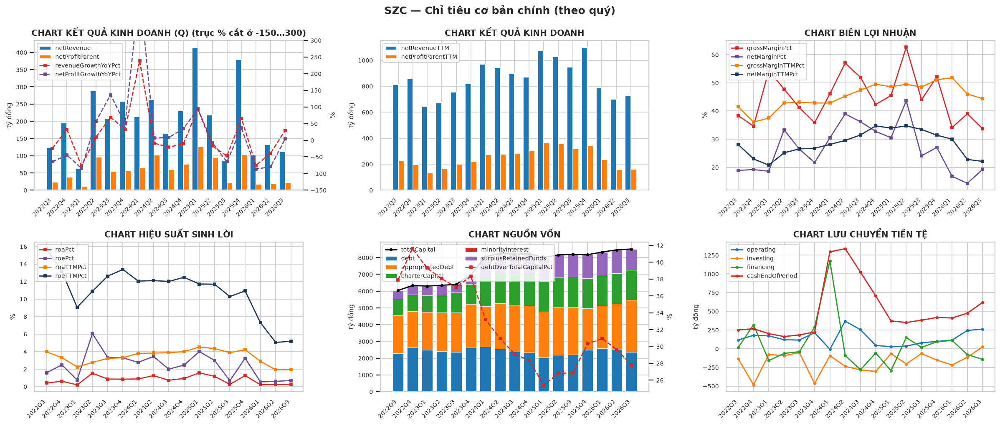
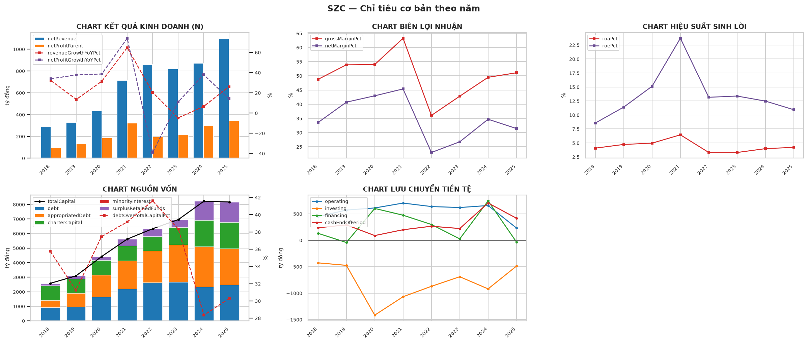
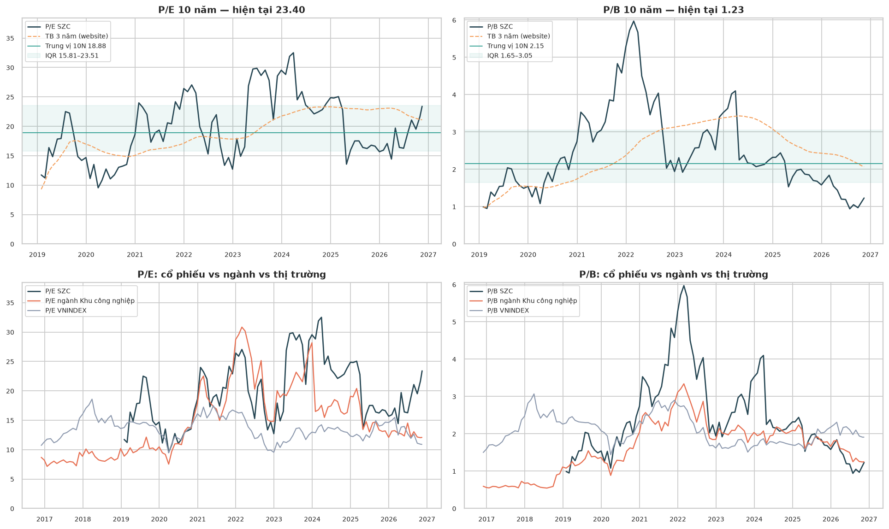
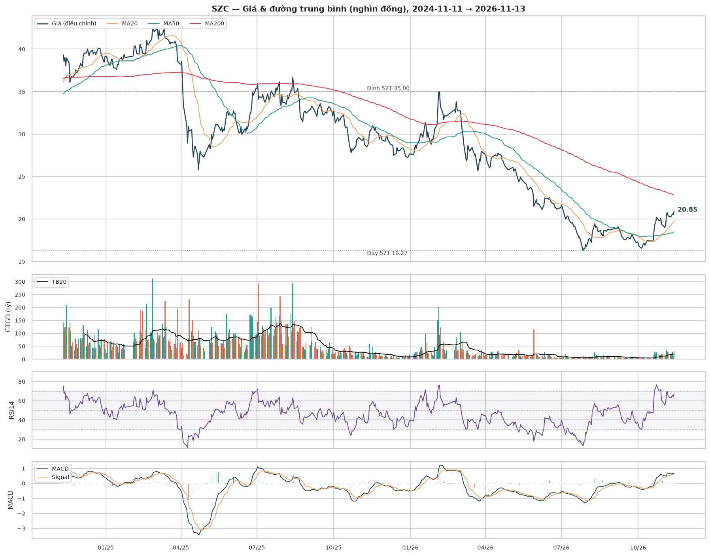
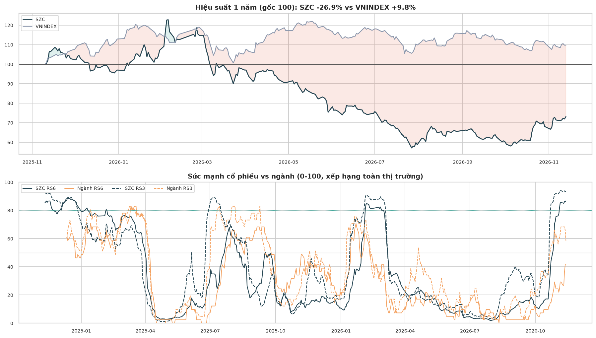
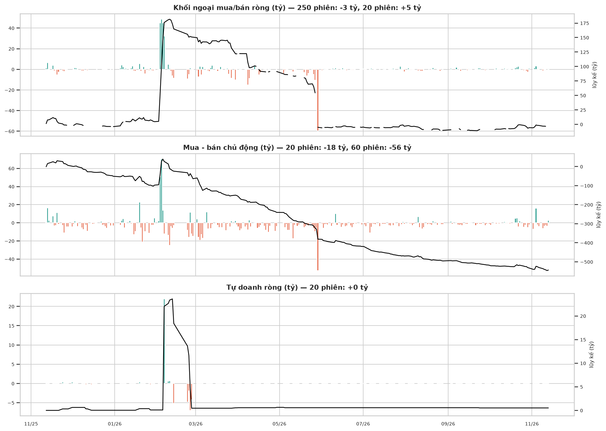
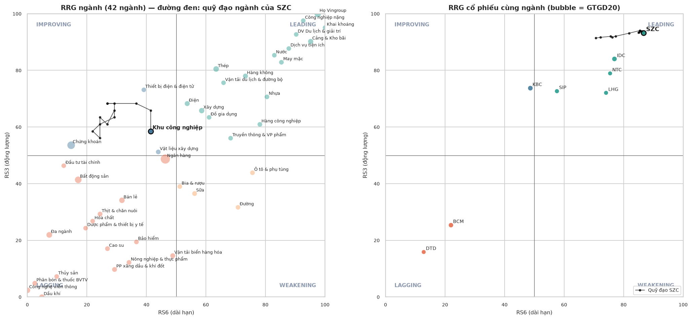

# SZC — Công ty Cổ phần Sonadezi Châu Đức | Phân tích cổ phiếu

> Dữ liệu sstock tới **2026-11-13** · Ngành Khu công nghiệp (sectorId 4) · Cấu trúc BCTC: phi tài chính · Gói S1 (BCTC 17 quý từ 2022Q3, BCTC năm từ 2018, giá từ 2023-11-16, định giá thị trường từ 2016-11-17).
> Báo cáo được tạo từ dữ liệu định lượng, **không phải khuyến nghị đầu tư**.

## 1. Tóm tắt

**Kết luận:** Kỹ thuật và dòng tiền **mạnh** (+6/8): giá vừa bứt khỏi nền 17,4 và RS3 đứng đầu ngành. Ngược lại, cơ bản và định giá **yếu** (-3/6): LNST 9T/2026 giảm 76% và P/E 23,4x cao hơn trung vị 10 năm. Mã rơi vào ô *"chỉ phù hợp giao dịch theo đà, đặt dừng lỗ chặt"* của ma trận. Bối cảnh trung tính hơi tích cực (thị trường *pressure*, ngành *improving*). Scorecard **+4/±16 → Khá tích cực** (Kỹ thuật & dòng tiền +6/8 · Cơ bản & định giá -3/6 · Bối cảnh +1/2).

| Luận điểm | Số liệu |
|---|---|
| Lợi nhuận suy giảm mạnh | LNST 9T/26 58 tỷ (-76,2% so với cùng kỳ), doanh thu 9T/26 346 tỷ (-51,8%); ROE TTM 5,2% (12,5% cuối 2024) |
| Có tiền thu trước, chưa ghi nhận doanh thu | CFO 9T/26 620 tỷ (gấp ~10,7 lần LNST); nợ chiếm dụng tăng từ 2.492 lên 3.094 tỷ trong 3 quý |
| Định giá: P/B thấp đi cùng ROE thấp | P/E 23,4x (trung vị 10N 18,9x, percentile 74%); P/B 1,23x (percentile 11%), ngang P/B ngành 1,25x |
| Giá bứt khỏi nền, vẫn dưới MA200 | 20,85 > MA20 19,80 > MA50 18,48, nhưng < MA200 22,80 (đang dốc xuống); -40,4% so với đỉnh 52 tuần |
| Sức mạnh tương đối dẫn đầu ngành | RS3 93,2 / RS6 86,7 (60 phiên trước: 20,7 / 6,3), RRG *leading*, VCR 1,90; Elite 4/5 trụ, chỉ thiếu AMFI > 0 (-0,045) |

**Điều kiện hành động:** tín hiệu xác nhận là đóng cửa **trên 22,8 (MA200)** với GTGD vượt TB20 (~20,6 tỷ, toàn bộ là khớp lệnh) **và** AMFI chuyển dương đủ 3 phiên (khi đó SZC đạt Elite 5/5). Kịch bản bị vô hiệu nếu đóng cửa **dưới 19,0**, tức lấp khoảng trống tăng giá ngày 04/11.

## 2. Bối cảnh thị trường & ngành

- **Thị trường:** ở trạng thái *pressure* đã 73 phiên (tin cậy 63,7 – Medium), có 6 phiên phân phối trong 25 phiên. FTD gần nhất là **2026-11-04**, cũng là phiên SZC tăng +6,8% với GTGD 33 tỷ. Tâm lý ngắn hạn 29 / trung hạn 33 (*Bi quan*; trung hạn +8 điểm trong tháng). Dòng tiền lan tỏa dẫn dắt bởi **vốn hóa vừa (51, +27 trong tháng)**, nhóm nhỏ 38, nhóm lớn 21. Với vốn hóa 3.753 tỷ, SZC thuộc nhóm vừa/nhỏ nên không bị lực cản như các mã vốn hóa lớn. P/E VNINDEX 10,9 so với TB 3 năm 13,3: thị trường đang rẻ so với lịch sử của chính nó.
- **Biểu đồ thị trường:** VNINDEX dao động trong biên 1.650–1.930 suốt một năm. Vùng *downtrend* chỉ xuất hiện ngắn ở tháng 3 và cuối tháng 7/2026. Đợt hồi đầu tháng 11 trùng với lúc dòng tiền vốn hóa vừa bật từ ~12 lên ~51, còn vốn hóa lớn vẫn ở dưới 30.
- **Ngành Khu công nghiệp:** RRG *improving*, RS3 58,5 (hạng 18/42), RS6 41,5 (hạng 25), VCR 1,04, độ rộng 48% số mã trên MA50, không có cảnh báo. Trên [08_rrg](charts/08_rrg.png), ngành đi ngang sang phải (RS6 từ ~25 lên 41,5) trong khi RS3 hạ từ ~68 xuống 58,5. Ngành chưa sang *leading* và động lượng ngắn hạn đang hụt dần, nên thực chất là **phân hóa**: các mã KCN thuần tăng, các ông lớn đa ngành thì không.
- SZC chiếm 2,9% vốn hóa, 0,9% doanh thu TTM và 1,5% LNST TTM của 25 doanh nghiệp trong ngành. Biên gộp Q3/26 33,7% so với ngành 21,3%, biên ròng 19,3% so với 13,4%. Trong 4 quý gần nhất, doanh thu TTM của SZC giảm -23,5% khi ngành tăng +3,2%, LNST TTM giảm -49,5% khi ngành giảm -19,5%.

## 3. Kết quả kinh doanh & sức khỏe tài chính

| Chỉ tiêu (tỷ đồng) | Q3/25 | Q4/25 | Q1/26 | Q2/26 | Q3/26 | YoY |
|---|---|---|---|---|---|---|
| Doanh thu thuần | 86 | 379 | 102 | 132 | 112 | +29,6% |
| LNST cty mẹ | 21 | 103 | 17 | 19 | 22 | +3,8% |
| Biên gộp quý % | 44,0 | 52,1 | 34,1 | 39,0 | 33,7 | -10,3pp |
| ROE TTM % | 10,3 | 10,9 | 7,3 | 5,0 | 5,2 | -5,1pp |
| LCTT HĐKD | 79 | 96 | 115 | 244 | 261 | +231% |
| Nợ chiếm dụng (appropriatedDebt) | 2.855 | 2.492 | 2.535 | 2.743 | 3.094 | +8,4% |
| Người mua trả trước ngắn hạn | 475 | 285 | 180 | 128 | 93 | -80% |
| Hàng tồn kho | 1.844 | 1.893 | 1.908 | 1.851 | 1.858 | +0,8% |
| XDCB dở dang | 3.652 | 3.554 | 3.597 | 3.676 | 3.725 | +2,0% |
| Nợ vay | 2.203 | 2.476 | 2.578 | 2.509 | 2.365 | +7,4% |
| Tiền & tiền gửi | 416 | 452 | 585 | 686 | 746 | +79,3% |

- **Tăng trưởng (đọc theo lũy kế → TTM → quý):** lũy kế 9T/26 doanh thu giảm -51,8% và LNST giảm -76,2%, nặng hơn mức giảm của TTM (-23,5% / -49,5%). TTM được "đỡ" bởi Q4/25 (doanh thu 379 tỷ, LNST 103 tỷ). Doanh thu quý tăng +29,6% YoY ở Q3/26 chỉ là do nền Q3/25 rất thấp (86 tỷ). Doanh thu ba quý 2026 chỉ 102–132 tỷ, so với các quý bàn giao lớn của 2025 là Q1 414 tỷ và Q4 379 tỷ. Như vậy năm 2026 **chưa có đợt bàn giao đất lớn nào được ghi nhận**. Vì lũy kế năm cũng âm, nhóm Tăng trưởng giữ nguyên -2 điểm, không override.
- **Biên gộp:** biên gộp quý giảm từ 44–63% (2025) xuống 34–39% (2026). Đây là dấu hiệu cơ cấu doanh thu đã nghiêng về các mảng phụ có biên thấp (dịch vụ, tiện ích, phí quản lý) khi doanh thu cho thuê đất ít đi. *Cơ cấu mảng cần thuyết minh BCTC.* Biên gộp TTM 44,4% vẫn cao hơn đáy chu kỳ 2022 (36,0%).
- **Chu kỳ theo năm ([06_fa_annual](charts/06_fa_annual.png)):** ROE đạt đỉnh 23,7% năm 2021, giảm về 13,2% năm 2022 rồi trượt dần xuống 10,9% năm 2025. Doanh thu năm vẫn tăng đều (859 → 1.098 tỷ giai đoạn 2022–2025). ROE giảm chủ yếu do VCSH phình ra sau đợt tăng vốn 2024, không hẳn do kinh doanh xấu đi. Năm 2026 mới là năm lợi nhuận thực sự suy giảm.
- **Lợi nhuận một lần:** không có. `financialProfit` chỉ dao động -3 đến +14 tỷ/quý. `otherProfit` âm ở Q3/25 (-11 tỷ) và Q4/25 (-28 tỷ), làm LNST 2025 thấp đi một chút. Lợi ích cổ đông thiểu số bằng 0.
- **Quỹ đất trên bảng cân đối (4 quý):** XDCB dở dang tăng đều từ 3.554 lên 3.725 tỷ, nghĩa là hạ tầng vẫn đang được đầu tư tiếp. Tồn kho (đất thương phẩm) đi ngang quanh 1.850–1.910 tỷ, chiếm 21,8% tổng tài sản. Tồn kho không giảm thêm cho thấy tốc độ hấp thụ năm 2026 chậm. `otherAssets` (gồm BĐS đầu tư cho thuê phân bổ dần) ở mức 1.389 tỷ.
- **Backlog:** hai chỉ báo đi ngược chiều nhau. *Người mua trả trước ngắn hạn* giảm liên tục từ 701 tỷ (Q3/24) xuống 93 tỷ (Q3/26), tức phần tiền đặt cọc ngắn hạn đã được ghi nhận hoặc không được bổ sung. Trong khi đó *tổng nợ chiếm dụng* lại tăng +602 tỷ chỉ trong 3 quý 2026 (2.492 → 3.094), khớp với CFO 9T/26 là 620 tỷ dù LNST chỉ 58 tỷ. Cách giải thích hợp lý nhất: khách thuê đã trả tiền thuê đất một lần, nhưng tiền được hạch toán vào **doanh thu chưa thực hiện dài hạn** (ghi nhận phân bổ dần hoặc chờ bàn giao), nên chưa đi vào doanh thu. Đây là backlog tích cực nhưng **chưa rõ, cần thuyết minh BCTC** để tách doanh thu chưa thực hiện ra khỏi phải trả khác.
- **Bảng cân đối:** nợ vay 2.365 tỷ (27,8% tổng nguồn vốn), tiền 746 tỷ, nợ vay ròng 1.620 tỷ, tương đương **53% VCSH (~3.053 tỷ)**. Mức này ở vùng trung bình, chưa đáng lo. EBIT/chi phí tài chính TTM 7,1x, an toàn. Chi phí tài chính quý tăng từ 5 lên 11 tỷ trong Q2–Q3/26.
- **Dòng tiền:** CFO TTM 717 tỷ (4,5 lần LNST TTM), đầu tư TTM -460 tỷ, FCF TTM +257 tỷ. Đọc theo năm, CFO ổn định 611–704 tỷ giai đoạn 2020–2024 rồi giảm xuống 233 tỷ năm 2025 trước khi phục hồi mạnh năm 2026. Năm 2025 thu tiền chậm hơn ghi nhận lợi nhuận; năm 2026 thì ngược lại. Đầu tư năm 2020–2024 ở mức -690 đến -1.416 tỷ/năm, tương ứng chu kỳ mở rộng hạ tầng KCN.
- **Phân loại lại & vốn điều lệ** (`tables.md` không phát hiện sự kiện bảng cân đối nào trong 17 quý; các mục sau suy từ dữ liệu theo năm/quý):
  - **2022 (năm):** XDCB giảm từ 4.856 xuống 2.699 tỷ, tồn kho tăng từ 7 lên 1.343 tỷ. Đây là hạ tầng KCN hoàn thành được **chuyển sang tồn kho để cho thuê ghi nhận một lần**, làm tồn kho/TTS tăng vọt vì lý do kế toán. Biên gộp năm 2022 giảm xuống 36% cùng lúc, có thể do giá vốn được phân bổ lại (*cần tin DN*).
  - **Q3/2023:** vốn điều lệ tăng từ 1.000 lên 1.200 tỷ, phần LNGPP/thặng dư giảm 145 tỷ. Đây là **cổ tức bằng cổ phiếu/cổ phiếu thưởng 20%**, pha loãng, không có tiền mới. Sự kiện nằm trước cửa sổ dữ liệu giá.
  - **Q1/2024 (GDKHQ 2024-01-05, hệ số 1,219):** vốn điều lệ tăng từ 1.200 lên 1.784 tỷ (1.800 tỷ ở Q2/24), thặng dư tăng +650 tỷ, LCTT tài chính +1.174 tỷ, tiền tăng từ 252 lên 1.315 tỷ. Đây là **phát hành quyền mua cho cổ đông hiện hữu, có tiền mới**. Với tỷ lệ +50%, hệ số 1,219 tương ứng giá phát hành khoảng 20 nghìn đ/cp và số tiền thu về khoảng 1.200 tỷ (suy luận, *cần tin DN*). Đợt này làm VCSH tăng mạnh và kéo ROE đi xuống.
  - **2024-04-24 (1,026), 2025-09-04 (1,029), 2026-09-11 (1,054):** vốn điều lệ không đổi, nên đây là **cổ tức tiền**. Mức suy ra là khoảng 1.000 đ/cp ở mỗi đợt (2026: 19,45 × (1 − 1/1,054) ≈ 1,0 nghìn đ). Riêng đợt 2026 tốn khoảng 180 tỷ, gấp ~3 lần LNST 9T/26. Tiền tăng trong Q3/26 cho thấy cổ tức có thể được chi trong Q4/26 (*cần tin DN*).
- **Dashboard ([05_fa_dashboard](charts/05_fa_dashboard.png)):** chuỗi `depreciation` bằng 0 ở tất cả các quý (dữ liệu nghi lỗi), nên EBITDA trong bảng thực chất xấp xỉ EBIT. Chi phí quản lý tăng lên ~26 tỷ ở Q2/26, tức chi phí cố định không giảm theo doanh thu.

## 4. Định giá

| | Hiện tại | Trung vị 10N | Percentile 10N | TB 3 năm | Ngành KCN | VNINDEX |
|---|---|---|---|---|---|---|
| P/E | 23,40 | 18,88 | 74% | 21,12 | 12,08 | 10,90 |
| P/B | 1,23 | 2,15 | 11% | 2,07 | 1,25 | 1,91 |

- **P/E tăng dù giá giảm:** EPS 4 quý chỉ còn 891 đ, nên P/E đi từ ~16 (đầu 2026) lên 23,4 dù giá đã giảm khoảng 27% trong một năm. Đường P/E trên biểu đồ đi lên từ tháng 7/2026 trong khi P/B chạm đáy ~0,95, cho thấy lợi nhuận giảm nhanh hơn giá. SZC đắt hơn ngành 94% theo P/E.
- **P/B thấp vì ROE thấp:** P/B 1,23x ở percentile 11% của 10 năm, nhưng ROE TTM chỉ 5,2%, thấp nhất trong toàn bộ chuỗi (2018–2025: 8,6–23,7%). P/B thấp và ROE đang giảm **không** phải kết hợp "rẻ + chất lượng". P/B TB 3 năm (2,07) và trung vị 10N (2,15) được hình thành khi ROE ở mức 11–24%, nên giá tham chiếu theo P/B (35,1–36,5 nghìn đ) không áp dụng được lúc này.
- **Vùng tham chiếu theo P/E:** quay về trung vị 10N cho **16,8**, về TB 3 năm cho **18,8 nghìn đ**. Cả hai đều *thấp hơn* giá hiện tại, với giả định EPS giữ nguyên 891 đ. Giá hiện tại vì vậy đang **định giá trước một đợt phục hồi lợi nhuận** (ví dụ ghi nhận phần tiền thuê đã thu ở mục 3).
- P/E SSTOCK dự phóng 19,59 (P/B SSTOCK 1,03) được **giữ nguyên từ 2026-07-24**, nên không phản ánh giá hôm nay.
- **Giới hạn:** giá trị cốt lõi của doanh nghiệp KCN là quỹ đất còn lại (RNAV = diện tích thương phẩm × giá thuê). sstock không có dữ liệu này, nên P/E và P/B chỉ là proxy.

## 5. Kỹ thuật & xu hướng giá

- **Cấu trúc:** downtrend kéo dài từ đỉnh 52 tuần 35,0 (2026-02-05, phiên khối ngoại mua ròng ~45 tỷ/ngày) xuống đáy 16,27 (2026-07-27), tức max drawdown -53,5%. Sau đó giá **tạo nền 16,3–19,5 trong khoảng 3 tháng** (08–10/2026), rồi bứt lên qua hai phiên tăng trần: **20/10 (+6,9%, 18,60, GTGD 16 tỷ so với ~5 tỷ trước đó)** và **04/11 (+6,8%, 20,55, 33 tỷ)**. Giá hiện xếp chồng 20,85 > MA20 19,80 > MA50 18,48 (MA50 dốc +2,8%/20 phiên), nhưng **MA200 22,80 vẫn dốc xuống** và nằm ngay phía trên.
- **Hỗ trợ / kháng cự:** hỗ trợ gần là 19,0–19,3 (đáy nhịp chỉnh 29/10–02/11), sau đó là 17,4 (đỉnh nền tháng 10). Kháng cự là MA200 22,8, rồi vùng 23,4–24,1 (adjClose cuối tháng 5/2026, ngay trước phiên bán mạnh 29/05).
- **Động lượng:** RSI 67,1 (khỏe, chưa quá mua; từng lên ~77 lúc bứt nền). MACD 0,67 nằm trên signal và trên 0. ATR 3,5%/phiên (~0,73 nghìn đ), biến động năm 35,2%, beta 0,88.
- **Thanh khoản:** GTGD TB20 20,6 tỷ, gần gấp đôi TB60 10,8 tỷ, và 100% là khớp lệnh. Mức này vẫn thấp xa so với giai đoạn 2025 (TB20 50–130 tỷ).
- **Hiệu suất so với VNINDEX:** 1W +1,9pp, 1M +17,3pp, 3M +11,9pp, 6M -4,0pp, YTD -21,8pp, 1Y -36,0pp.

- **Biểu đồ sức mạnh:** RS3 và RS6 của SZC bật thẳng đứng từ dưới 20 lên trên 85 chỉ trong khoảng 4 tuần (từ giữa tháng 10/2026). Lần gần nhất có cú bật tương tự là 01–02/2026 (RS ~85–90), và lần đó sụp về dưới 40 ngay trong tháng 3. RS6 của ngành (41,5) vẫn thấp hơn nhiều so với SZC.

## 6. Dòng tiền & smart-money

| Cửa sổ | Khối ngoại ròng | Tự doanh ròng | Chủ động ròng | Tỷ lệ chủ động |
|---|---|---|---|---|
| 5 phiên | -0,8 | 0,0 | -13,5 | -0,126 |
| 20 phiên | **+5,0** | 0,0 | -18,4 | -0,047 |
| 60 phiên | +6,4 | 0,0 | -55,7 | -0,090 |
| 250 phiên | -2,7 | — | **-543,2** | -0,122 |

- **Khối ngoại:** mua ròng đột biến khoảng +170 tỷ trong các phiên 03–06/02/2026 (trùng đỉnh giá 35,0), sau đó bán dần và **xả mạnh phiên 29/05/2026 (khoảng -60 tỷ, GTGD khớp 115 tỷ, giá -6,8%)**, làm lũy kế 250 phiên về -2,7 tỷ. Nguyên nhân phiên 29/05 *chưa rõ, cần tin* (có thể là cơ cấu danh mục quỹ). Trong 20 phiên gần đây khối ngoại mua nhẹ +5 tỷ.
- **Mua/bán chủ động:** lũy kế trượt liên tục từ tháng 3/2026, đạt -543 tỷ/250 phiên. Ngay trong nhịp bứt nền, chủ động ròng 20 phiên vẫn âm (-18,4 tỷ). Đây là **phân kỳ**: giá tăng nhờ lực cầu bị động (lệnh chờ) trong khi phe bán chủ động vẫn chiếm ưu thế. Tự doanh gần như không tham gia sau tháng 3/2026.
- **RRG cổ phiếu:** *leading*, RS3 93,2 / RS6 86,7. VCR 1,90 (*bùng nổ*). AMFI -0,045 (*cân bằng*, hơi nghiêng về bên bán). Không có phân kỳ giảm đang hoạt động (bear20 gần nhất 2026-07-01).
- **Elite** (theo `raw/elite_diag.json`): đạt **4/5 trụ** gồm RS ✓, VCR ✓, GTGD20 20,6 tỷ ✓, không bear20 ✓; **chỉ thiếu AMFI > 0**. Mã niêm yết HOSE, không bị guard nào chặn, không trong cooldown, nhưng 0/3 phiên gần nhất đủ điều kiện. Lịch sử 2 lần vào Elite, tỷ lệ thắng 50%, lãi trung bình +5,1%. Mẫu quá nhỏ để coi là tín hiệu tin cậy.

## 7. So sánh cùng ngành

| Mã | Sàn | Vốn hóa (tỷ) | RS3 | RS6 | RRG | VCR | AMFI | GTGD20 (tỷ) |
|---|---|---|---|---|---|---|---|---|
| BCM | HOSE | 38.450 | 25 | 22 | lagging | 1,00 | -0,174 | 24,1 |
| KBC | HOSE | 25.239 | 74 | 49 | improving | 1,04 | 0,072 | 34,2 |
| IDC | HNX | 14.611 | 84 | 77 | leading | 0,81 | 0,138 | 31,7 |
| SIP | HOSE | 12.081 | 73 | 58 | leading | 1,34 | -0,192 | 5,7 |
| **SZC** | HOSE | 3.753 | **93** | **87** | leading | **1,90** | -0,045 | 20,6 |
| NTC | HOSE | 3.077 | 79 | 75 | leading | 1,07 | 0,271 | 1,1 |
| LHG | HOSE | 1.345 | 72 | 74 | leading | 1,01 | -0,017 | 1,5 |
| DTD | HNX | 704 | 16 | 13 | lagging | 1,21 | -0,116 | 1,8 |

- SZC **dẫn đầu ngành về sức mạnh giá** (hạng RS3 1/8) và có VCR cao nhất. Trên RRG cùng ngành, quỹ đạo của SZC đi thẳng sang phải trong vùng *leading* (RS6 từ ~71 lên 87). Dòng tiền đang **chọn nhóm KCN thuần** (SZC, IDC, NTC, LHG, SIP đều *leading*) và **bỏ lại nhóm đa ngành/BĐS đô thị** (BCM *lagging*, KBC mới *improving*). Đây cũng là lý do RS ngành chỉ ở mức trung bình.
- Đi theo đà nhưng cơ bản yếu: SZC là mã mạnh nhất về giá nhưng có LNST TTM giảm mạnh nhất (-49,5%, ngành -19,5%). IDC và NTC có AMFI dương rõ (0,138 / 0,271), tức dòng tiền chủ động xác nhận tốt hơn SZC. Đà tăng của SZC vì vậy mang tính **hồi phục kỹ thuật từ đáy sâu** nhiều hơn là phản ánh kết quả kinh doanh.

## 8. Scorecard

| Nhóm | Điểm | Ghi chú |
|---|---|---|
| Xu hướng giá | +1 | Trên MA50 dốc lên (+2), dưới MA200 (-1) |
| Động lượng | +2 | RSI 67, MACD > signal và > 0, 3T vượt VNINDEX +11,9pp |
| Sức mạnh tương đối | +2 | RRG leading, RS6 86,7; RS3 Δ5 phiên -0,7 |
| Dòng tiền | +1 | VCR 1,9 (+1), khối ngoại 20 phiên +5 tỷ (+1), chủ động 20 phiên -18,4 tỷ (-1), AMFI 0 |
| Tăng trưởng | -2 | LNST TTM -49,5%, doanh thu TTM -23,5%; lũy kế 9T còn tệ hơn (-76%) nên **giữ nguyên, không override** |
| Chất lượng | 0 | ROE 5,2% (-1), nợ vay ròng/VCSH 53% (0), CFO/LNST 4,5 (+1; CFO cao nhờ tiền thuê thu trước) |
| Định giá | -1 | P/E bằng 1,24 lần trung vị (-1), P/B percentile 11% (+1), P/E cao hơn ngành 94% (-1) |
| Bối cảnh | +1 | Thị trường pressure (0), ngành improving (+1), tâm lý trung hạn 33 (0) |
| **Tổng** | **+4/±16** | Kỹ thuật & dòng tiền +6/8 · Cơ bản & định giá -3/6 · Bối cảnh +1/2 → **Khá tích cực** |

Ma trận: Kỹ thuật ≥ +3 và Cơ bản ≤ +2 nên rơi vào ô **"chỉ giao dịch theo đà, dừng lỗ chặt"**. Bối cảnh không hạ bậc vì thị trường không ở downtrend và ngành không lagging. Không override điểm. Lưu ý thêm: điểm +1 của nhóm Định giá nhờ P/B thấp thực chất phản ánh ROE thấp (xem mục 4), nên mặt cơ bản yếu hơn con số -3 thể hiện.

## 9. Rủi ro & catalyst

- **Rủi ro:**
  - Lợi nhuận 2026 suy giảm sâu (9T -76%), trong khi P/E đã 23,4x. Nếu Q4/26 không có đợt bàn giao lớn, P/E sẽ còn tăng nữa.
  - **Nền Q4/25 cao** (doanh thu 379 tỷ, LNST 103 tỷ), nên Q4/26 rất dễ giảm YoY.
  - Tồn kho đất đi ngang ~1.850 tỷ, tốc độ hấp thụ chậm. XDCB vẫn tăng (3.725 tỷ), nghĩa là vốn tiếp tục bị giữ trong hạ tầng.
  - Cổ tức tiền ~180 tỷ vượt xa lợi nhuận 2026. Nợ vay ròng/VCSH 53%.
  - Mua/bán chủ động âm kéo dài (-543 tỷ/250 phiên) và AMFI chưa dương. Đợt bật RS tháng 02/2026 từng thất bại nhanh.
  - Giá vẫn dưới MA200 đang dốc xuống. Thị trường chung đang *pressure* với 6 phiên phân phối.
- **Catalyst:**
  - BCTC Q4/26 ghi nhận phần tiền thuê đã thu (nợ chiếm dụng +602 tỷ trong 2026) thành doanh thu.
  - Thuyết minh BCTC làm rõ doanh thu chưa thực hiện dài hạn (backlog).
  - AMFI chuyển dương, đưa SZC lên Elite 5/5.
  - Thị trường xác nhận *uptrend* sau FTD 04/11; dòng tiền tiếp tục chảy vào nhóm vốn hóa vừa.
  - Ngành KCN chuyển sang *leading*.
- **Giới hạn dữ liệu:**
  - Gói S1: BCTC 17 quý, giá từ 2023-11-16, nên sự kiện cổ tức CP năm 2023 nằm ngoài cửa sổ giá.
  - Không có RNAV/quỹ đất còn lại, giá thuê, hay số liệu FDI (`search_data_series` chỉ dành cho admin).
  - Không có lợi nhuận theo mảng; không tách được doanh thu chưa thực hiện ra khỏi `appropriatedDebt`.
  - Chuỗi `depreciation` = 0 ở mọi quý (nghi lỗi), nên EBITDA ≈ EBIT.
  - P/E SSTOCK bị giữ nguyên từ 2026-07-24.
  - P/B TB 3 năm/trung vị 10N bị méo khi so với hiện tại vì nền ROE khác hẳn.
  - Phân loại các sự kiện quyền (quyền mua 2024, cổ tức tiền) là suy luận từ hệ số giá và bảng cân đối, cần đối chiếu với tin doanh nghiệp.

## 10. Kịch bản & mức giá theo dõi

| Kịch bản | Điều kiện | Ý nghĩa |
|---|---|---|
| Tích cực | Đóng cửa trên **22,8 (MA200)** với GTGD > TB20 (~20,6 tỷ khớp lệnh); AMFI > 0 đủ 3 phiên (Elite 5/5); RS3 ≥ 80 và RS6 ≥ 60 được giữ | Đảo chiều xu hướng trung hạn. Kháng cự tiếp theo 23,4–24,1, sau đó 27–28 (vùng tháng 4/2026). Cần BCTC Q4/26 xác nhận lợi nhuận, vì định giá không còn biên an toàn |
| Cơ sở | Dao động **19,0–22,8**, RS3 duy trì trên 80, chủ động ròng dần về cân bằng | Tích lũy dưới MA200, chờ BCTC Q4/26 (nền 379 tỷ doanh thu / 103 tỷ LNST) và trạng thái thị trường |
| Tiêu cực | Đóng cửa **dưới 19,0** (khoảng 2,5×ATR dưới giá hiện tại; lấp khoảng trống 04/11); mất **17,4** (đỉnh nền tháng 10) | Nhịp bứt nền thất bại giống tháng 02–03/2026; rủi ro quay về đáy 52 tuần 16,27. Dưới 17,4, RS3 sẽ rơi khỏi ngưỡng 80 |

---
*Phụ lục:* dữ liệu thô ở `raw/`, chỉ số ở `metrics.json`, bảng đầy đủ ở `tables.md`, biểu đồ ở `charts/` (gồm [05_fa_dashboard](charts/05_fa_dashboard.png) với đầy đủ 11 chart FA). Script ad-hoc: `extra.py`, `extra2.py`, `extra3.py`. Báo cáo này **không phải khuyến nghị đầu tư**.
