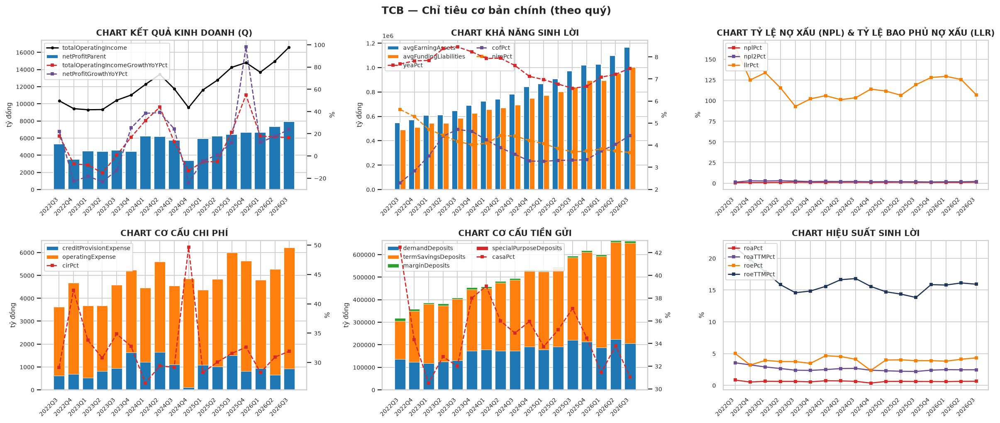
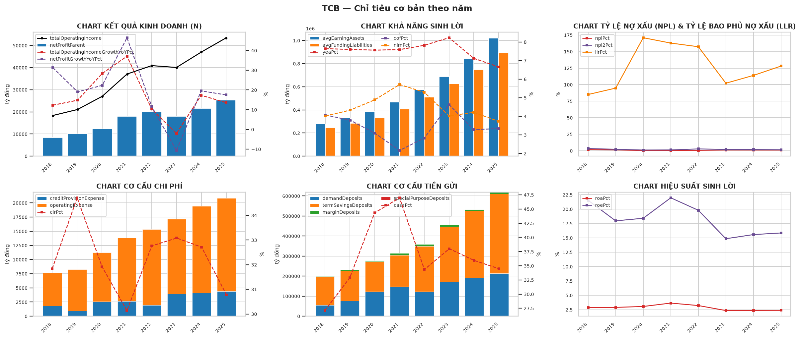
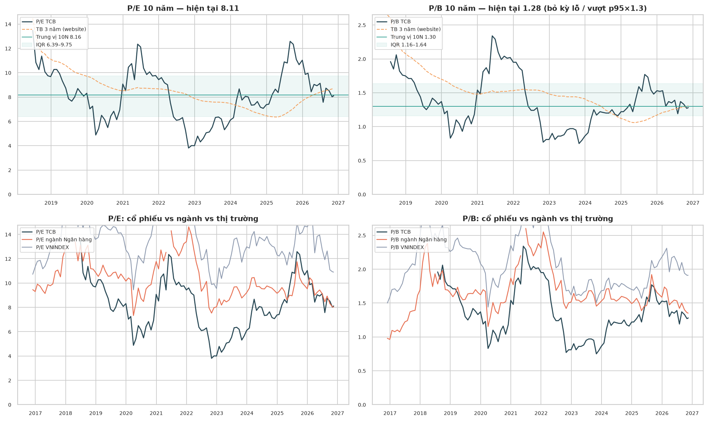
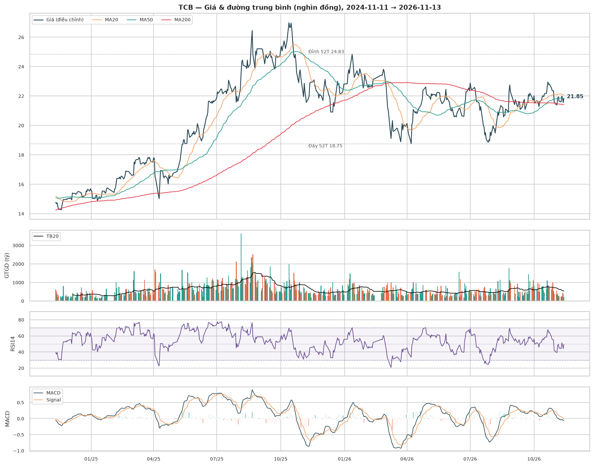
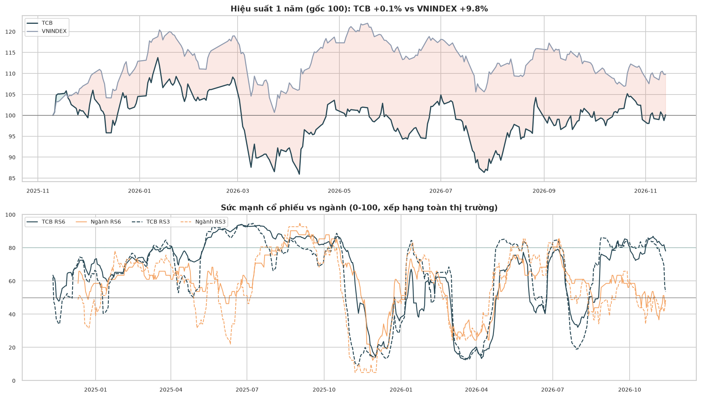
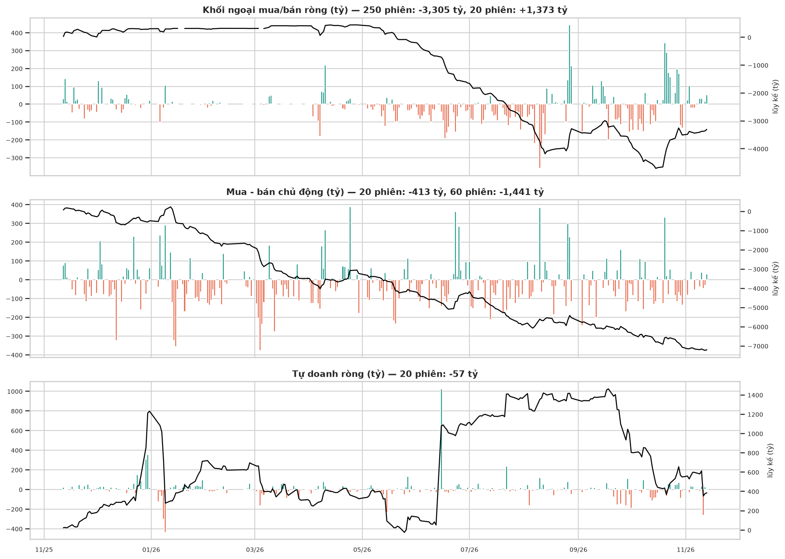
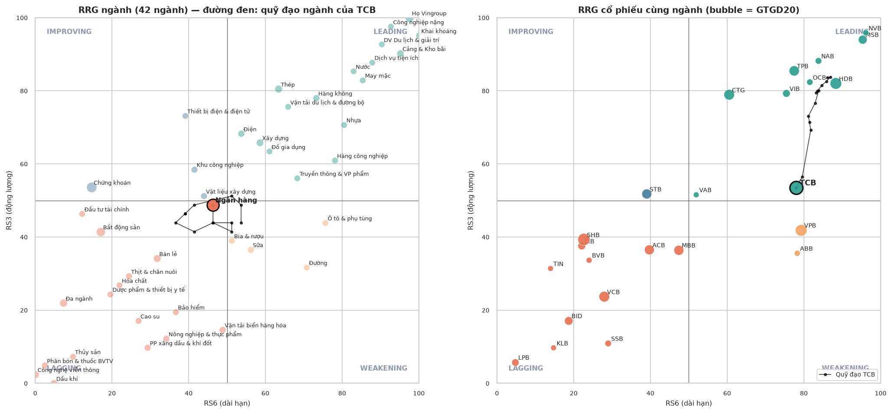

# TCB — Ngân hàng TMCP Kỹ Thương Việt Nam (Techcombank) | Phân tích cổ phiếu

> Dữ liệu sstock tới **2026-11-13** · Ngành Ngân hàng (sectorId 24) · Cấu trúc BCTC: bank · Giới hạn gói: BCTC 17 quý gần nhất, BCTC năm từ 2018, giá/VNINDEX từ 2023-11-16, định giá thị trường từ 2016-11-17.
> Báo cáo được tạo từ dữ liệu định lượng, **không phải khuyến nghị đầu tư**.

## 1. Tóm tắt

**Kết luận:** Cả hai trục đều đạt ngưỡng "ứng viên mạnh" (Cơ bản & định giá +4, Kỹ thuật & dòng tiền +4). Tuy vậy, ngành Ngân hàng đang ở góc **lagging** nên hạ một bậc xuống **Watchlist**. Ba điểm củng cố việc hạ bậc: động lượng ngắn hạn đang gãy (RS3 mất 23 điểm trong 5 phiên, quỹ đạo RRG đi xuống về phía weakening), phe bán chủ động áp đảo kéo dài, và chất lượng tài sản quý 3/2026 xấu đi. Doanh nghiệp tốt, giá hợp lý, nhưng giá chưa xác nhận. Scorecard **+7/±16 → Khá tích cực** (Kỹ thuật & dòng tiền +4/8 · Cơ bản & định giá +4/6 · Bối cảnh −1/2).

| Luận điểm | Số liệu |
|---|---|
| Tăng trưởng lõi tốt, ROE ~16% | LNST cty mẹ 9T/2026 21,964 tỷ (+18.0% YoY), TOI 9T +17.1%. LNST Q3/2026 7,943 tỷ (+23.7% YoY), quý cao nhất trong chuỗi. ROE TTM 15.9%, CIR 31.9% |
| Rủi ro tài sản đang nhích lên | NPL 1.1% → 1.3%, nợ nhóm 2 1.8% → 2.1%, LLR 125.6% → 107.1% (QoQ). Chi phí dự phòng Q3 chỉ 917 tỷ (−38.8% YoY) |
| Định giá ở mức trung vị | P/B 1.28 (trung vị 10N 1.30, percentile 48), thấp hơn ngành 5% (1.35). P/E 8.11 ≈ trung vị 8.16 |
| Xu hướng giá đi ngang, bám MA200 | Giá 21.85 > MA50 21.84 > MA200 21.41, nhưng MACD hist −0.049, RSI 49.4. Cách đỉnh 52T 24.83 −12% |
| Dòng tiền trái chiều | Khối ngoại mua ròng 20 phiên +1,373 tỷ, nhưng chủ động ròng 20 phiên −413 tỷ (250 phiên −7,193 tỷ). VCR 0.89, AMFI −0.046. Elite 2/5 trục |

**Điều kiện hành động:** đóng cửa trên **22.95** (đỉnh ngắn hạn 21/10, giá điều chỉnh) với GTGD khớp lệnh > TB20 khớp 450.6 tỷ, cùng lúc RS3 quay lại ≥ 80, VCR ≥ 1, AMFI > 0 (đủ các trụ Elite) · **Vô hiệu hóa** khi đóng cửa dưới **21.0** (thủng MA200 21.41 và vùng đáy 21.08–21.28 của tháng 9–10).

## 2. Bối cảnh thị trường & ngành

- **Thị trường: pressure** đã 73 phiên, độ tin cậy 63.7 (Medium), kể từ 2026-07-30 (chuyển từ downtrend nhờ FTD fast-track). Có 6 phiên phân phối trong 25 phiên, đủ để gọi là áp lực bán đáng kể. FTD gần nhất ngày 2026-11-04 (+2%). Độ rộng VN100 53%.
- **Tâm lý:** ngắn hạn 29, trung hạn 33 (cả hai ở vùng "Bi quan"). Trung hạn đang cải thiện (+8 điểm trong tháng) nhưng chưa ở vùng cực đoan (<20) để coi là tín hiệu đáy.
- **Lan tỏa:** nhóm vốn hóa vừa dẫn dắt (51, +27 trong tháng), **vốn hóa lớn yếu nhất (21, −6 trong tháng)**. TCB thuộc nhóm vốn hóa lớn (232,252 tỷ) nên đây là lực cản.
- **Định giá thị trường:** P/E VNINDEX 10.90, thấp hơn TB 3 năm (13.26). Thị trường chung không đắt.
- **Ngành Ngân hàng:** RRG **lagging**, RS3 48.8 (hạng 22/42), RS6 46.3 (hạng 23), VCR 0.96, chỉ 44.8% số mã trên MA50. Sức mạnh tập trung ở vài mã (MSB, HDB, CTG, NAB, TPB, OCB). Các mã đang mở vị thế Elite trong ngành: HDB, NAB, OCB, TPB.
- **Vị thế của TCB:** chiếm 8.9% vốn hóa ngành (2,611,282 tỷ, 29 DN) và 8.8% LNST TTM của ngành. LNST TTM của TCB tăng +30.3% YoY, cao hơn mức +20.7% của ngành.

*Quan sát (09):* VNINDEX gần như cả năm ở trạng thái pressure, xen hai đợt downtrend ngắn (tháng 3 và cuối tháng 7/2026). Đỉnh tháng 5/2026 (~1,925) chưa bị vượt. Từ tháng 9 chỉ số tạo các đỉnh thấp dần, 1,850 → 1,775 → 1,745. Ở nhịp hồi đầu tháng 11, đường lan tỏa của nhóm vốn hóa lớn chỉ hồi lên ~25 trong khi nhóm vừa lên ~54: dòng tiền chưa quay lại nhóm trụ.

## 3. Kết quả kinh doanh & sức khỏe tài chính

| Chỉ tiêu (tỷ đồng / %) | 2025Q3 | 2025Q4 | 2026Q1 | 2026Q2 | 2026Q3 | YoY |
|---|---|---|---|---|---|---|
| Tổng TN hoạt động | 14,242 | 14,795 | 13,674 | 14,942 | 16,588 | +16.5% |
| Thu nhập lãi thuần | 9,925 | 10,788 | 9,522 | 10,763 | 11,700 | +17.9% |
| Thu nhập dịch vụ | 2,266 | 2,571 | 3,148 | 3,662 | 3,615 | +59.5% |
| LN trước dự phòng | 9,749 | 9,971 | 9,805 | 10,322 | 11,292 | +15.8% |
| Chi phí dự phòng | 1,499 | 818 | 935 | 652 | 917 | −38.8% |
| LNST cty mẹ | 6,419 | 6,676 | 6,671 | 7,350 | 7,943 | +23.7% |
| NIM / YEA / COF | 3.7 / 6.6 / 3.3 | 3.7 / 6.7 / 3.3 | 3.8 / 7.1 / 3.7 | 3.7 / 7.2 / 4.0 | 3.7 / 7.5 / 4.4 | COF +1.1pp |
| CIR | 31.6 | 32.6 | 28.3 | 30.9 | 31.9 | +0.4pp |
| NPL / nhóm 2 / LLR | 1.2 / 1.8 / 119.2 | 1.1 / 1.6 / 128.1 | 1.1 / 1.8 / 129.4 | 1.1 / 1.8 / 125.6 | 1.3 / 2.1 / 107.1 | LLR −12.1pp |
| CASA / LDR | 37.1 / 88.9 | 34.5 / 84.5 | 31.4 / 88.8 | 33.8 / 88.5 | 31.1 / 88.9 | CASA −6.0pp |
| Tăng trưởng tín dụng / huy động (YTD) | 21.2 / 11.6 | 21.4 / 16.0 | 3.8 / −3.1 | 10.4 / 7.0 | 13.1 / 6.9 | — |
| Cho vay khách hàng | 756,078 | 757,119 | 785,613 | 835,813 | 856,641 | +13.3% |

**Tăng trưởng.** TTM YoY trông rất cao (LNST +30.3%, TOI +24.6%) một phần nhờ nền thấp: **2024Q4** chỉ có LNST 3,371 tỷ, do FX/vàng lỗ −424 tỷ, thu nhập khác −338 tỷ và chi phí hoạt động vọt lên 4,741 tỷ (CIR 49.6%). Chi tiết khoản chi một lần này chưa rõ, cần tin doanh nghiệp. Cũng vì nền này mà 2025Q4 tăng tới +98% YoY. Thước đo sạch hơn là **lũy kế 9T/2026: LNST +18.0%, TOI +17.1%**, vẫn qua ngưỡng chấm điểm (≥15% / ≥10%). LN trước dự phòng lập đỉnh mới 11,292 tỷ (+15.8% YoY), cho thấy năng lực lõi vẫn tăng.

**Động lực thu nhập.** Thu nhập dịch vụ là điểm sáng: 2,266 → 3,615 tỷ (+59.5% YoY), tỷ trọng trong TOI tăng từ 16% lên 22%. Ngược lại, kinh doanh chứng khoán đầu tư giảm (910 → 613 tỷ YoY) và FX/vàng biến động mạnh (Q2/2026 −69 tỷ).

**Biên lãi và nguồn vốn.** COF tăng nhanh 3.3% → 4.4% chỉ trong 3 quý. Nhờ YEA cũng tăng (6.7% → 7.5%), NIM vẫn giữ ở 3.7% (thấp hơn mức 4.1–4.2% đầu 2025). Huy động là điểm yếu: tiền gửi khách hàng đi ngang QoQ (662,448 → 661,390 tỷ) và CASA giảm còn 31.1%. Để bù, ngân hàng tăng phát hành giấy tờ có giá (212,080 → 237,047 tỷ, +24,968) và vay liên ngân hàng (164,739 → 181,660 tỷ). Tín dụng YTD +13.1% trong khi huy động chỉ +6.9%, LDR 88.9%. Nếu lãi suất huy động tiếp tục tăng, NIM sẽ bị ép.

**Chất lượng tài sản (điểm cần theo dõi nhất).** Trong Q3/2026, nợ dưới chuẩn tăng từ 1,397 lên 3,235 tỷ (+132%), nợ cần chú ý từ 5,641 lên 7,641 tỷ, nợ nghi ngờ từ 1,887 lên 2,462 tỷ. Nợ có khả năng mất vốn giảm từ 5,886 xuống 5,351 tỷ, nhiều khả năng do xử lý/xóa nợ (chưa rõ). Kết quả là NPL lên 1.3% và nhóm 2 lên 2.1%. Trong cùng quý, số dư dự phòng chỉ tăng thêm 310 tỷ (lên 11,832 tỷ) và chi phí dự phòng giảm 38.8% YoY, nên LLR rơi từ 125.6% xuống 107.1%. Theo khung phân tích, *NPL tăng trong khi chi phí dự phòng giảm* là dấu hiệu lợi nhuận đang được hỗ trợ bởi dự phòng thấp. Nếu dự phòng Q3 bằng mức Q3/2025 (1,499 tỷ), LNST giảm thêm khoảng 465 tỷ (giả định thuế 20%), khi đó tăng trưởng YoY còn khoảng +16%. LLR vẫn trên 100%, tức bộ đệm chưa mỏng.

**Bảng cân đối & vốn.**
- *Tăng vốn bằng cổ phiếu:* ngày giao dịch không hưởng quyền **2026-10-29**, hệ số điều chỉnh giá ~1.50. Giá 33.50 → 22.35 nhưng vốn hóa giữ nguyên (237,389 → 237,566 tỷ). Đây là cổ phiếu thưởng/cổ tức bằng cổ phiếu khoảng 50%, pha loãng nhưng không có tiền mới. Số cổ phiếu hiện là 10.63 tỷ, trong khi vốn điều lệ trên BCTC Q3 vẫn là 70,862 tỷ (trước sự kiện). EPS 4Q 2,694 đ đã tính theo số cổ phiếu mới.
- *Lợi ích cổ đông thiểu số* tăng từ 4,213 lên 15,398 tỷ trong 2025Q3, cùng lúc vốn khác tăng 21,290 → 26,625 tỷ. Diễn biến này khớp với việc bán bớt cổ phần một công ty con (khả năng là IPO TCBS). Chưa rõ, cần tin doanh nghiệp.

**Theo chu kỳ (bảng năm).** Giai đoạn 2018–2025, cho vay tăng bình quân khoảng 25%/năm (157,554 → 757,119 tỷ) và LNST tăng bình quân khoảng 17%/năm (8,463 → 25,290 tỷ). Hiệu quả đã chuyển sang mặt bằng thấp hơn: ROE từ 18–22% (2018–2022) xuống 15–16% (2023–2025), NIM từ đỉnh 5.7% (2021) xuống 3.7% (2025). NPL hiện 1.1–1.3%, cao hơn vùng 0.5–0.7% của 2020–2022 nhưng thấp hơn 1.8% năm 2018.

*Quan sát (04):* Ở panel Khả năng sinh lời, COF (tím) và YEA (đỏ) cùng đảo chiều tăng từ 2025Q3 và COF dốc hơn, còn NIM (cam) nằm phẳng ở ~3.7%. Biên an toàn của NIM đang mỏng dần. Panel Cơ cấu tiền gửi cho thấy tiền gửi kỳ hạn tăng đều, còn tiền gửi không kỳ hạn dao động mạnh theo quý (CASA chạy răng cưa 31–37%).

*Quan sát (06):* LLR theo năm giảm từ 171% (2020) xuống 102% (2023) rồi hồi lại 128% (2025). Sụt giảm của Q3/2026 (107%) đưa bộ đệm về gần đáy năm 2023. Panel Hiệu suất sinh lời năm chỉ vẽ `roePct` (15–22%). Hai chuỗi `roeTTMPct`/`roaTTMPct` theo năm của nguồn (≈4× `roePct`, 59–83%) là **chuỗi lỗi**, đã được loại khỏi biểu đồ và có cảnh báo trong `tables.md`.

*Dashboard đầy đủ (05):* panel "Cơ cấu cho vay theo chất lượng nợ" cho thấy `standardRatioPct` giảm từ 93.8% xuống 91.6%. Đây là **méo do mẫu số**: tổng các nhóm nợ đã phân loại (813,734 tỷ) nhỏ hơn `totalLoans` (868,473 tỷ). Tính theo dư nợ đã phân loại, tỷ lệ nợ nhóm 1 khoảng 97.7%. Xem [05_fa_dashboard](charts/05_fa_dashboard.png).

## 4. Định giá

| | Hiện tại | TB 3 năm | Trung vị 10N | Min–Max 10N | Percentile 10N | Ngành | VNINDEX |
|---|---|---|---|---|---|---|---|
| P/E | 8.11 | 8.71 | 8.16 | 3.8–13.5 | 49 | 8.02 | 10.90 |
| P/B | 1.28 | 1.31 | 1.30 | 0.75–2.73 | 48 | 1.35 | 1.91 |

- Với ngân hàng, **P/B đi cùng ROE** là thước đo chính. P/B 1.28 với ROE 15.9% cho P/B/ROE ≈ 0.08. Trung vị P/B 1.30 hình thành chủ yếu trong giai đoạn ROE 18–22%, vì vậy so với mức sinh lời hiện tại, P/B đang ở vùng **hợp lý, chưa rẻ rõ rệt**.
- Ngân hàng đang bị định giá lại xuống: P/B giảm từ ~1.78 (quý 3/2025) xuống 1.28 trong khi ROE TTM tăng từ 13.8% lên 15.9%. Thị trường đang chiết khấu rủi ro (COF, nợ xấu, dòng tiền rút khỏi nhóm vốn hóa lớn) chứ không phải lợi nhuận.
- P/B thấp hơn ngành 5.1%, P/E cao hơn ngành 1.2%. Ngành đang được định giá thấp hơn TB 3 năm (P/E 8.02 so với 9.53, P/B 1.35 so với 1.56).
- P/E SSTOCK (dự phóng) 7.08 bị **giữ nguyên từ 2026-07-24**, không dùng làm mốc. TB 3 năm không bị méo (cờ `avg3Y_distorted` = False).
- **Vùng giá tham chiếu** (giả định LNST/giá trị sổ sách giữ nguyên): theo P/E trung vị 10N là 21.99, P/B trung vị 10N 22.14, P/B TB3N 22.31, P/E TB3N 23.47. Giá hiện tại 21.85 nằm ngay dưới cụm 22.0–23.5, tức dư địa định giá lại về trung bình chỉ khoảng 1–7%.

*Quan sát (07):* P/E giảm từ đỉnh 12.6 (quý 3/2025) xuống ~8.1 và đang nằm trong IQR 6.4–9.75. Trong giai đoạn 2022–2024, P/B của TCB luôn thấp hơn ngành rõ rệt. Đến 2025, P/B có lúc vượt ngành (~1.78), nay đã quay về dưới ngành.

## 5. Kỹ thuật & xu hướng giá

> Giá dưới đây là **giá điều chỉnh** sau đợt chia cổ phiếu ngày 2026-10-29 (hệ số ~1.50). Các mức cũ trên bảng điện (34.4, 38.2…) phải chia cho 1.5.

- **Cấu trúc MA:** giá 21.85 > MA50 21.84 > MA200 21.41, nhưng ba đường gần như chụm lại (chênh dưới 2%). MA50 dốc +1.95%/20 phiên, MA200 đi ngang hơi dốc xuống. Đây là trạng thái **tích lũy quanh MA200**, chưa phải uptrend chuẩn.
- **Vùng nền:** từ tháng 9/2026, giá đóng cửa đi trong biên **21.08 (11/9) – 22.95 (21/10)**. Đáy cạn giá trong phiên ngày 2026-11-02 là 20.60. Hỗ trợ sâu hơn ở vùng đáy kép **18.75 (7/4) – 18.85 (27/7)**, kháng cự xa là đỉnh 52T **24.83 (12/1/2026)**.
- **Động lượng:** RSI14 49.4 (trung tính), MACD dưới signal và nhích dưới 0 (hist −0.049). Động lượng ngắn hạn yếu đi kể từ đỉnh 21/10.
- **Biến động:** ATR14 2.1%, tức khoảng 0.46 nghìn đ/phiên. Dừng lỗ 2–3×ATR tương ứng 0.9–1.4 nghìn đ. Biến động năm 29.3%, beta 0.97, MDD 1 năm −24.5%.
- **Thanh khoản:** GTGD TB20 540.4 tỷ so với TB60 622.7 tỷ (giảm). Thỏa thuận chiếm 18.5% GTGD 60 phiên, nên mốc so sánh nên dùng là **TB20 khớp lệnh 450.6 tỷ**. Các phiên gần đây chỉ khớp 166–264 tỷ, thấp hơn TB20 khớp: thị trường đang thiếu cầu.
- **Hiệu suất so với VNINDEX:** 3T +5.1pp, 6T +8.4pp, nhưng 1T −2.6pp, YTD −1.4pp và 1N −7.2pp.

*Quan sát (01):* Đỉnh lớn được lập vào tháng 10/2025 (~27, giá điều chỉnh). Từ đó giá rơi vào chuỗi đáy và đỉnh đều thấp dần, với đỉnh 24.8 (1/2026) rồi 22.9 (7/2026) rồi 22.95 (10/2026). Riêng các đáy lại cao dần: 18.75 (4/2026), 18.85 (7/2026), rồi ~21.1 (9/2026). Mô hình này là **tam giác thu hẹp** quanh MA200, sắp đến điểm phải chọn hướng. GTGD đột biến (>1,500 tỷ) cuối tháng 8 và giữa tháng 9/2026 trùng các nhịp tăng, nhưng sau đó không được duy trì.

*Quan sát (02):* Trong 1 năm, TCB đi ngang (+0.1%) trong khi VNINDEX tăng +9.8%. Phần lớn khoảng hụt hình thành trong cú sập tháng 3/2026, khi TCB rơi về ~86 còn VNINDEX về ~101. RS6 đã giữ trên 70 từ đầu tháng 9/2026 (hiện 78.1), nhưng RS3 rơi đứng từ ~80 xuống 53.5 chỉ trong vài phiên gần nhất. Kiểu suy yếu này giống các lần RS3 sụp trước đây (tháng 10/2025, tháng 7/2026), và cả hai lần đó đều dẫn tới nhịp giảm giá.

## 6. Dòng tiền & smart-money

| Cửa sổ | Khối ngoại ròng | Tự doanh ròng | Chủ động ròng | Tỷ lệ chủ động |
|---|---|---|---|---|
| 5 phiên | +134.2 | −211.9 | −40.7 | −0.044 |
| 20 phiên | +1,373.3 | −57.1 | −413.4 | −0.052 |
| 60 phiên | +716.2 | −965.2 | −1,440.7 | −0.054 |
| 250 phiên | −3,304.5 | — | −7,193.3 | −0.073 |

- **RRG cổ phiếu:** leading (RS3 53.5, RS6 78.1), nhưng sát ngưỡng chuyển sang weakening (RS3 < 50).
- **VCR 0.89** (trầm lắng): dòng tiền ổn định, không tăng tốc. **AMFI −0.046** (cân bằng, hơi nghiêng về bán). Không có phân kỳ giảm đang kích hoạt. Phân kỳ bear gần nhất ngày 2026-10-21, trùng đỉnh 22.95.
- **Elite (raw/elite_diag.json):** 2/5 trục, đạt GTGD (tier1) và không có bear20. **Thiếu RS (rs3 ≥ 80 ∧ rs6 ≥ 60), VCR ≥ 1.0, AMFI > 0**. Không guard nào chặn, không trong cooldown, 0/3 phiên đủ điều kiện. Lịch sử: 7 episode, thắng 57%, lãi TB +5.3%. Hai lần thắng lớn (+22.5% năm 2025, +21.2% năm 2024) đều thoát vì phân kỳ bear. Lần gần nhất (7/2026) lỗ −5.5% sau 7 phiên.

*Quan sát (03):* Khối ngoại cân bằng từ tháng 12/2025 đến tháng 4/2026 (mua/bán bình quân khoảng 54/52 tỷ/phiên). Họ bán ròng liên tục từ tháng 5 đến giữa tháng 8/2026, kéo lũy kế xuống khoảng −4,300 tỷ. Sau đó có hai đợt mua mạnh (cuối 8/2026 và cuối 10/2026), lần lượt kéo lũy kế lên khoảng −3,300 tỷ, tức **khối ngoại đã đảo chiều sang mua**. Ngược lại, đường lũy kế mua-bán chủ động dốc xuống gần như tuyến tính cả năm (−7,193 tỷ), không có nhịp đảo chiều nào. Phe bán chủ động trong nước áp đảo và hấp thụ hết lực mua của khối ngoại. Tự doanh chuyển sang bán ròng từ cuối tháng 9/2026 (lũy kế giảm từ ~1,450 xuống ~400 tỷ).

## 7. So sánh cùng ngành

| Mã | Vốn hóa (tỷ) | RS3 | RS6 | Góc | VCR | AMFI | GTGD20 (tỷ) |
|---|---|---|---|---|---|---|---|
| VCB | 449,535 | 24 | 28 | lagging | 1.05 | −0.101 | 258.3 |
| BID | 247,737 | 17 | 19 | lagging | 1.05 | −0.270 | 130.4 |
| CTG | 244,659 | 79 | 60 | leading | 1.11 | 0.033 | 254.1 |
| **TCB** | 232,252 | 53 | 78 | leading | 0.89 | −0.046 | 450.6 |
| VPB | 221,000 | 42 | 79 | weakening | 0.73 | −0.163 | 332.2 |
| MBB | 192,817 | 36 | 47 | lagging | 0.93 | −0.149 | 211.2 |
| HDB | 147,055 | 82 | 88 | leading | 0.96 | 0.123 | 326.7 |
| STB | 134,227 | 52 | 39 | improving | 0.92 | 0.138 | 213.3 |
| ACB | 118,120 | 37 | 40 | lagging | 1.19 | 0.019 | 208.0 |
| MSB | 61,402 | 94 | 95 | leading | 1.14 | −0.119 | 148.6 |

TCB đứng 9/24 mã theo RS3. Trong nhóm vốn hóa lớn, TCB vẫn mạnh hơn VCB, BID, MBB, ACB và có thanh khoản cao nhất ngành (GTGD20 khớp 450.6 tỷ). Tuy nhiên TCB **đi sau** nhóm dẫn đầu là MSB, HDB, CTG (RS3 79–94, VCR ≥ 0.96, đa số AMFI dương) và các mã đang mở Elite (HDB, NAB, OCB, TPB). Ngành đang lagging, nên đây không phải tình huống "ngành mạnh, mã đuổi theo". TCB là một trong số ít mã lớn giữ được RS6 cao, đang mất dần động lượng ngắn hạn, và cùng nhịp với VPB (đã sang weakening).

*Quan sát (08):* Quỹ đạo TCB (panel phải) đi **thẳng đứng xuống**, từ vùng RS3 ~84 / RS6 ~86 về RS3 53.5 / RS6 78, tức đang rời góc leading về phía weakening. Đây là dấu hiệu chốt lời theo khung phân tích. Quỹ đạo ngành (panel trái) xoay vòng quanh tâm (RS3 41–51, RS6 37–54) mà không có hướng rõ ràng.

## 8. Scorecard

| Nhóm | Điểm | Ghi chú |
|---|---|---|
| Xu hướng giá | +2 | Giá trên MA50/MA200, MA50 dốc +1.95%. Lưu ý các MA đang chụm, điểm này dễ đảo |
| Động lượng | 0 | RSI 49.4, MACD âm (−1), hơn VNINDEX 3T +5.1pp (+1) |
| Sức mạnh tương đối | +2 | RRG leading (+2), RS6 78 (+1), RS3 −23 trong 5 phiên (−1) |
| Dòng tiền | 0 | Khối ngoại 20 phiên +1,373 tỷ (+1), chủ động −413 tỷ (−1). VCR, AMFI trung tính |
| Tăng trưởng | +2 | LNST TTM +30.3%, TOI TTM +24.6% (bị thổi bởi nền 2024Q4; 9T vẫn +18%/+17%, đạt ngưỡng) |
| Chất lượng | +2 | ROE 15.9%, NPL 1.27%, LLR 107.1% (đều qua ngưỡng nhưng LLR đang giảm nhanh) |
| Định giá | 0 | P/E ≈ trung vị, P/B percentile 48, P/E ngang ngành |
| Bối cảnh | −1 | Thị trường pressure (0), ngành lagging (−1), tâm lý trung hạn 33 (0) |
| **Tổng** | **+7 → Khá tích cực** | Kỹ thuật & dòng tiền +4 · Cơ bản & định giá +4 · Bối cảnh −1 |

**Ma trận:** hai trục đều ≥ +3 nên ô xuất phát là "Ứng viên mạnh". Hạ một bậc vì ngành lagging, còn **Watchlist**. Có thêm hai lý do không đẩy ngược lên: (1) +2 của nhóm Sức mạnh tương đối dựa trên góc leading, trong khi quỹ đạo đang đi xuống rõ rệt; (2) +2 của nhóm Chất lượng chưa phản ánh xu hướng xấu đi của nợ nhóm 2–3 và LLR trong Q3/2026. Không override verdict, chỉ ghi nhận hai điểm này làm rủi ro.

## 9. Rủi ro & catalyst

**Rủi ro**
- *Chất lượng tài sản:* nợ dưới chuẩn và nợ cần chú ý tăng mạnh trong Q3/2026, LLR giảm 18.5pp. Nếu nợ chuyển nhóm tiếp, chi phí dự phòng sẽ phải tăng trở lại (Q3 thấp hơn cùng kỳ 38.8%).
- *Chi phí vốn:* COF +1.1pp YoY, CASA 31.1% (−6pp YoY), tiền gửi khách hàng đi ngang QoQ, phải dựa nhiều hơn vào giấy tờ có giá và liên ngân hàng. NIM 3.7% không còn đệm.
- *Pha loãng:* cổ phiếu thưởng ~50% (ngày GDKHQ 2026-10-29) làm tăng nguồn cung cổ phiếu. Áp lực bán chủ động kéo dài (−7,193 tỷ/250 phiên).
- *Dòng tiền:* nhóm vốn hóa lớn yếu nhất thị trường (lan tỏa 21). Ngành lagging, độ rộng 44.8%.
- *Thu nhập ngoài lãi biến động:* FX/vàng và chứng khoán đầu tư dao động mạnh theo quý (2024Q4 và 2026Q2 âm).

**Catalyst**
- BCTC Q4/2026 (dự kiến cuối tháng 1/2027): kiểm chứng nợ nhóm 2–3 và mức dự phòng, cùng nền so sánh 2025Q4 (LNST 6,676 tỷ).
- Đà tăng thu nhập dịch vụ (+59.5% YoY).
- Khối ngoại tiếp tục mua ròng (20 phiên +1,373 tỷ).
- Thị trường chuyển sang uptrend sau FTD ngày 2026-11-04.

**Giới hạn dữ liệu**
- BCTC quý chỉ có 17 quý, BCTC năm từ 2018, giá từ 2023-11-16 (theo gói).
- P/E SSTOCK dự phóng bị giữ nguyên từ 2026-07-24.
- `roeTTMPct` theo năm và `standardRatioPct` là các chuỗi nghi lỗi/méo (xem mục 3).
- Không có dữ liệu cơ cấu cho vay theo ngành trong phân tích này.
- Không có chi tiết khoản chi một lần 2024Q4 và nguồn gốc khoản tăng lợi ích cổ đông thiểu số 2025Q3.
- Vốn điều lệ trên BCTC chưa phản ánh đợt phát hành ngày 2026-10-29.

## 10. Kịch bản & mức giá theo dõi

| Kịch bản | Điều kiện | Ý nghĩa |
|---|---|---|
| Tích cực | Đóng cửa > **22.95** kèm GTGD khớp > **450.6 tỷ** (TB20 khớp). RS3 quay lại ≥ 80 (RS6 đang ≥ 60), VCR ≥ 1, AMFI > 0 (đủ 5/5 trụ Elite trong 3 phiên). Thị trường giữ pressure/uptrend | Phá vỡ tam giác thu hẹp. Vùng mục tiêu tham chiếu 23.5 (P/E TB3N), rồi đỉnh 52T **24.83**. Có thể giải ngân theo trigger |
| Cơ sở | Giá dao động **21.08–22.95** quanh MA200 21.41, RS3 40–80, VCR 0.8–1.0 | Tiếp tục tích lũy. Giữ trong watchlist, chờ BCTC Q4 và trigger phá vỡ. Chưa mua đuổi |
| Tiêu cực | Đóng cửa < **21.0** (thủng MA200 và đáy nền 21.08), hoặc RRG chuyển weakening (RS3 < 50) kèm bear20 kích hoạt | Vô hiệu hóa luận điểm. Rủi ro về vùng đáy kép **18.75–18.85** (khoảng −14%). Ưu tiên đứng ngoài |

---
*Phụ lục:* dữ liệu thô ở `raw/`, chỉ số ở `metrics.json`, bảng đầy đủ ở `tables.md`, biểu đồ ở `charts/` (gồm cả [05_fa_dashboard](charts/05_fa_dashboard.png)). Báo cáo này **không phải khuyến nghị đầu tư**.
