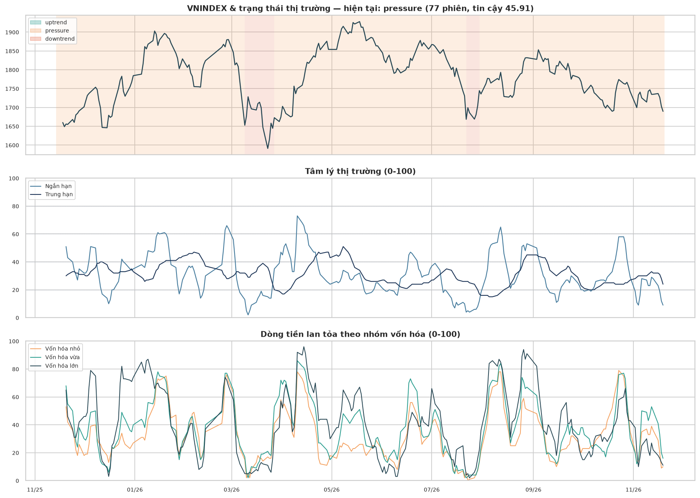
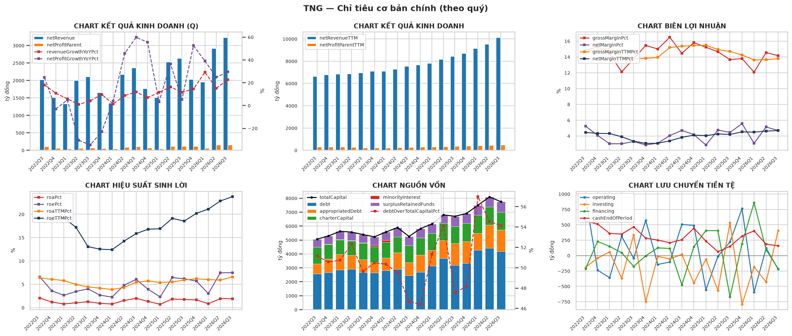
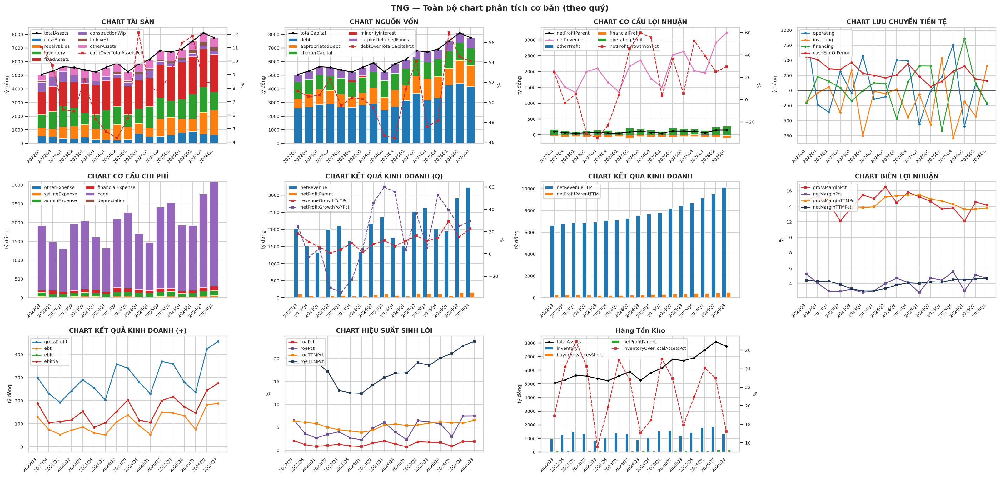
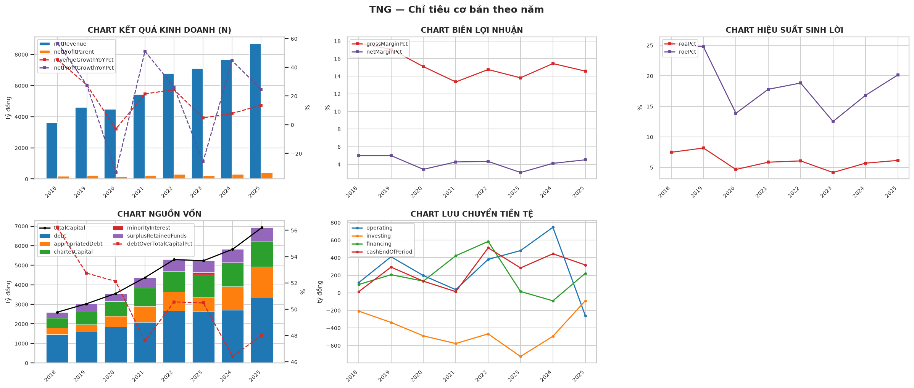
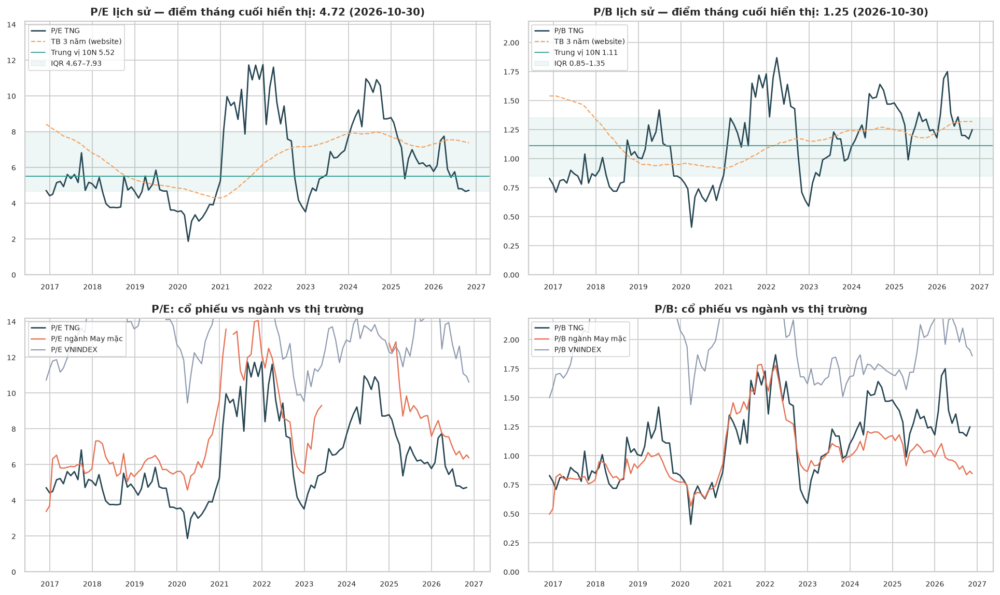
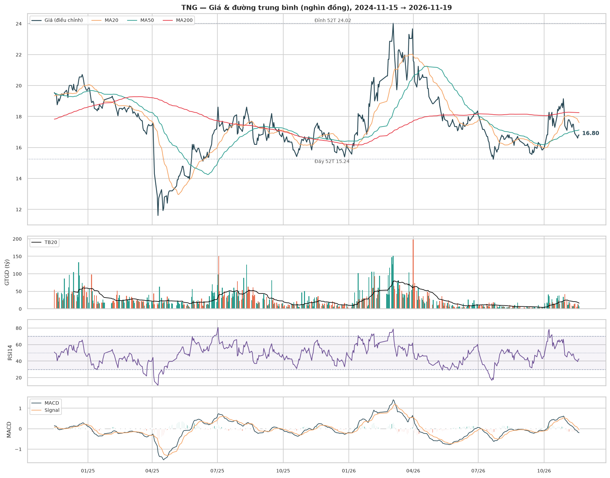
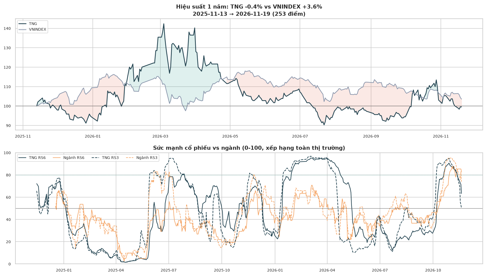
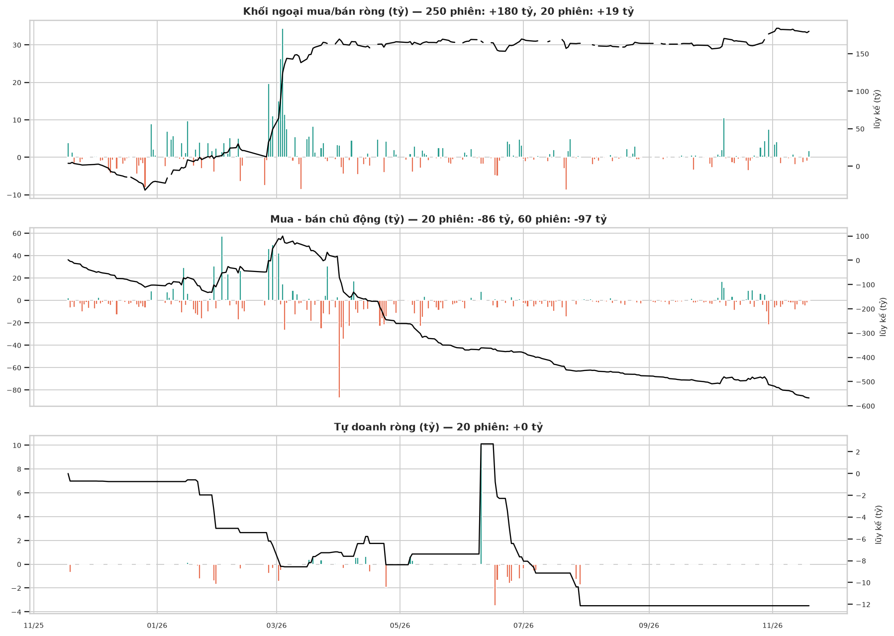
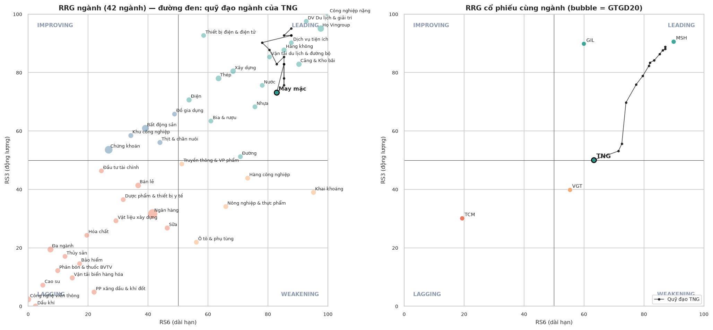

# TNG — CTCP Đầu tư và Thương mại TNG | Phân tích cổ phiếu

> **Phiên chốt 19/11/2026** · HNX · May mặc (ngành 23) · BCTC phi tài chính, kỳ mới nhất **Q3/2026**. Tiền tính bằng tỷ đồng, giá tính bằng nghìn đồng/cp, trừ khi ghi khác. Nguồn: SSTOCK, các công bố gốc của TNG và [phép đối chiếu](audit.json).

## 1. Tóm tắt

**Trung tính — đứng ngoài theo ma trận, đưa vào danh sách theo dõi.** Điểm **+1/±16**: Cơ bản & định giá **+2/6**, Kỹ thuật & dòng tiền **−1/8**, Bối cảnh **0/2**. Doanh thu và lợi nhuận tăng nhanh hơn ngành; nhưng dòng tiền kinh doanh 4 quý **âm 610,8 tỷ** theo BCTC riêng, nợ vay ròng bằng **174% vốn chủ sở hữu**, còn giá dưới MA200. P/E thấp chưa đủ bù cho các rủi ro đó.

| Luận điểm | Số liệu kiểm chứng |
|---|---|
| Tăng trưởng | 9T/2026: doanh thu **8.095 tỷ (+21,3%)**, LNST **361,6 tỷ (+29,0%)** YoY (BCTC riêng TNG) |
| Chất lượng | CFO 9T **−695,5 tỷ** so với **−344,3 tỷ**; CFO/LNST 4 quý **−1,29x**, không phải +0,14x như chuỗi quý SSTOCK tự động (đối chiếu mục 3) |
| Định giá | SSTOCK phiên chốt: P/E **4,56x** vs ngành **6,38x**; P/B nguồn **1,21x**, nhưng tính bằng VCSH công bố ở Q3 là **1,06x** |
| Giá và dòng tiền | **16,80** dưới MA50 **17,13** và MA200 **18,25**; RS3 **50,1**, khớp lệnh chủ động 20 phiên **−85,9 tỷ** (SSTOCK) |

**Mốc theo dõi:** vượt **18,25** với khớp lệnh trên **16 tỷ/phiên**, sức mạnh tương đối và AMFI cải thiện; đóng dưới **16,30** là tín hiệu xấu, **15,24** là đáy 52 tuần. Về cơ bản, cần thấy phải thu hạ và CFO hồi, không chỉ doanh thu tăng.

## 2. Bối cảnh thị trường & ngành

- **Thị trường (SSTOCK, 19/11):** VNINDEX **1.689,62**, trạng thái *pressure* 77 phiên (tin cậy 45,9/100, thấp), **8 phiên phân phối/25 phiên**, độ rộng VN100 34%; FTD gần nhất **04/11** chưa kéo thị trường ra khỏi trạng thái này. Tâm lý ngắn/trung hạn **9/24** (−20/−9 điểm so tuần trước). Lan tỏa vốn hóa nhỏ/vừa/lớn **10/16/11**: nhóm vừa dẫn tương đối, cả ba vẫn yếu. Không suy ra nhóm vốn hóa của TNG từ ngưỡng không được công bố. P/E thị trường **10,61x** so TB3N **13,24x**, P/B **1,86x** so **1,89x**.
- **May mặc (RRG SSTOCK, 19/11):** *leading*, RS3 **73,2** (12/42), RS6 **82,9** (8/42), VCR **1,12**, không bật cờ cảnh báo, nhưng chỉ **11/34** mã trên MA50 (**32,4%**). Động lượng đã hạ: RS3 **95,1 → 73,2** từ 03→19/11, chưa rời *leading*.
- **Vị thế:** TNG chiếm **7,0%** vốn hóa ngành, **10,7%** doanh thu và **9,8%** LNST 4 quý. Tăng trưởng 4 quý của mã **+19,9%/+33,9%** so ngành **+7,4%/+21,9%** (SSTOCK); biên gộp Q3 **14,2%** dưới ngành **14,9%**, biên ròng TTM **4,7%** dưới **4,9%**. Tăng nhanh hơn ngành chưa đồng nghĩa có biên tốt hơn.

**Đọc ảnh 09:** nhịp hồi tháng 10 từ quanh **1.690 lên 1.775 điểm** đã bị trả lại gần hết đến 19/11; ba đường lan tỏa cùng giảm về cuối đồ thị, không thấy dòng tiền chuyển mạnh sang một nhóm vốn hóa khác.

## 3. Kết quả kinh doanh & sức khỏe tài chính

| Chỉ tiêu | Q3/25 | Q4/25 | Q1/26 | Q2/26 | Q3/26 | YoY Q3 |
|---|---:|---:|---:|---:|---:|---:|
| Doanh thu thuần | 2.633 | 2.027 | 1.952 | 2.914 | 3.229 | +22,6% |
| LNST (nhãn LNST mẹ của SSTOCK) | 117,0 | 112,7 | 60,3 | 149,8 | 151,5 | +29,5% |
| Biên gộp quý | 13,66% | 13,79% | 12,08% | 14,55% | 14,15% | +0,49 đ.% |
| ROE 4 quý | 18,5% | 20,2% | 21,1% | 22,9% | 23,8% | +5,2 đ.% |
| Nợ vay | 3.187 | 3.327 | 4.271 | 4.417 | 4.194 | +31,6% |
| Tồn kho | 1.201 | 1.446 | 1.805 | 1.860 | 1.334 | +11,1% |
| CFO trong quý, trừ lũy kế từ BCTC TNG | +593,0 | +84,8 | — | — | +174,8 | −70,5% |

Dòng 1–6 theo [SSTOCK](tables.md); Q3/2026 doanh thu, LNST và số dư chính khớp [BCTC riêng TNG](disclosures/Q3-2026.pdf). Dấu — là chưa trình bày số quý riêng từ chứng từ. Báo cáo Q4/2025 gốc ghi LNST **111,6 tỷ** thay vì **112,7 tỷ** của SSTOCK; khi tính CFO/LNST dùng LNST theo bộ BCTC riêng.

**Đọc ảnh 04:** doanh thu có nhịp thấp ở Q1 qua nhiều năm; Q1/2023 khoảng **1.260 tỷ** (đọc xấp xỉ từ ảnh), Q1/2025 **1.511 tỷ**, Q1/2026 **1.952 tỷ**. Vì vậy ưu tiên so cùng kỳ/lũy kế thay vì ngoại suy mức tăng +10,8% QoQ của Q3/2026.

**Đơn hàng và lợi nhuận.** 9T tăng **21,3% doanh thu / 29,0% LNST**; TTM SSTOCK **10.123 tỷ / 474 tỷ**, tăng **19,9% / 33,9%** YoY. [Giải trình 574/CV-TNG](disclosures/giai-trinh-Q3-2026.pdf) nêu tăng quy mô, lao động tại chuyền may, giao sớm một phần đơn xuất khẩu và tối ưu năng suất/chi phí. Đây là giải trình doanh nghiệp, chưa có số để tách sản lượng, giá, cơ cấu CMT/FOB, backlog hay lượng doanh thu kéo sớm. **Chưa ngoại suy Q3 sang Q4**; tuy nhiên [bản tin IR tháng 10](disclosures/doanh-thu-10-2026.pdf) báo doanh thu tháng **903 tỷ (+51,6%)**, 10T **8.998 tỷ (+23,8%)**, đạt **94,7%** kế hoạch năm **9.500 tỷ**. Đây là chỉ báo doanh thu, chưa phải xác nhận biên hay CFO Q4.

**Cầu nối Q3/2026:** lãi gộp **456,75** trừ bán hàng **43,04** và quản lý **134,80** còn **278,91** lợi nhuận hoạt động trước tài chính (+91,16 YoY); trừ lỗ tài chính ròng **72,32** (xấu thêm **32,38**) và lỗ khác **18,84** (xấu thêm **17,33**) ra LNTT **187,74** (+41,43). Trừ thuế **36,21** còn LNST **151,53** (BCTC Q3, tr. 4). Chi phí lãi vay Q3 **87,38 tỷ**, tăng **22,6%** YoY; phần tăng LNST không đến từ lãi tài chính. Chưa chuẩn hóa khoản khác khi chưa xác định độ lặp lại. Biên gộp 4 quý **13,8%** vs **14,7%** cùng kỳ, dù biên quý nhích lên YoY; biên ròng 4 quý **4,7%** vs **4,2%**.

**Đọc ảnh 05:** tỷ trọng tồn kho trong tài sản ở Q3/2026 trở về khoảng **17%**, gần vùng thấp của 17 quý và thấp hơn đỉnh cục bộ trên **26%** quanh đầu 2023. Các đường EBIT và EBITDA chồng lên nhau: SSTOCK ghi khấu hao quý bằng **0**, trong khi BCTC có khấu hao; không sử dụng EBITDA hoặc EV/EBITDA từ chuỗi này.

**Tiền và vốn lưu động — dùng công bố gốc khi nguồn lệch.** BCTC riêng cho CFO **−695,53 tỷ** 9T/2026 (so **−344,26 tỷ** cùng kỳ); tiền thu bán hàng và dịch vụ tăng **1.315,2 tỷ**, nhưng chi nhà cung cấp tăng **922,6 tỷ**, chi người lao động tăng **543,4 tỷ**, chi lãi tăng **53,5 tỷ**. Q3 riêng suy từ lũy kế **+174,79 tỷ**, dương nhưng thấp hơn **+593,00 tỷ** cùng kỳ. SSTOCK cộng đúng CFO 9T/2026, nhưng nội bộ FY2025 lệch: cộng quý **+419,20 tỷ**, bảng năm **−259,49 tỷ**. BCTC gốc xác nhận **−259,49 tỷ** năm 2025, nên Q4/2025 đúng theo phép trừ lũy kế là **+84,77 tỷ**, không phải **+763,46**. TTM dùng `FY25 − 9T25 + 9T26`: CFO **−610,76 tỷ** trên LNST **473,23 tỷ**, tỷ lệ **−1,29x** (bảng tự động **+67,93 tỷ / +0,14x**, cùng kỳ tự động +0,41x cũng không dùng để kết luận). LCTT đầu tư ròng TTM theo BCTC **−206,09 tỷ**, CFO cộng LCTT đầu tư **−816,85 tỷ**, **không phải FCF**. So với chi mua/xây TSCĐ và tài sản dài hạn khác (mã 21) **68,61 tỷ**, CFO trừ riêng khoản này là **−679,37 tỷ**. Nguồn: [Q2/25](disclosures/Q2-2025.pdf), [Q3/25](disclosures/Q3-2025.pdf), [Q4/25](disclosures/Q4-2025.pdf), [Q2/26 đính chính](disclosures/Q2-2026-dinh-chinh.pdf), [Q3/26](disclosures/Q3-2026.pdf), đều tr. 5. **Các đường LCTT quý ở ảnh 04/05 và số TTM đầu tư −996 tỷ trong bảng tự động không thay cho các phép tính đã kiểm chứng.**

**Phải thu, tồn kho:** SSTOCK cho phải thu tổng hợp **1.796 tỷ** (+198 QoQ), số ngày phải thu ước **48,0** (+5,2 ngày YoY, không phải DSO thuần); riêng phải thu khách hàng ngắn hạn theo BCTC **1.696 tỷ**, so **996 tỷ** đầu năm, trong đó DESIPRO **574 tỷ**. Tồn kho ròng cuối Q3 giảm **527 tỷ QoQ** nhưng tăng **11,1% YoY**, chậm hơn doanh thu 4 quý **8,9 đ.%**; số ngày tồn kho ước **64,0**, chỉ tăng **0,4 ngày YoY**. So đầu năm, tồn kho gộp thành phẩm giảm **506 → 289 tỷ**, nguyên liệu tăng **485 → 656 tỷ**; chưa thể gọi là dư hàng hay tính phần tiền giải phóng chỉ từ số dư. Khách trả trước ngắn hạn **2,86 tỷ** (−90% YoY theo SSTOCK), không phải backlog. Điều cần xác nhận Q4: phải thu khách hàng giảm từ **1.696 tỷ**, dòng tiền thu về cải thiện và biên gộp giữ quanh **14%**.

**Đòn bẩy và đầu tư:** nợ vay **4.194 tỷ**, **54,1%** tổng nguồn vốn; **3.027 tỷ** ngắn hạn/gốc đến hạn. VCSH **2.035 tỷ**, tiền và tiền gửi **650,93 tỷ**, nợ vay ròng **3.543 tỷ** (**174,1% VCSH**); EBIT/chi phí tài chính 4 quý **2,36x** theo SSTOCK (không phải riêng lãi vay). BCTC tr. 1, 9, 12 xác nhận **158,16 tỷ tiền và tương đương tiền + 492,77 tỷ tiền gửi kỳ hạn** khớp `cashBank`; không coi cả khoản này là tiền mặt tức thời. BCTC 9T ghi **140 tỷ** chi góp vốn, khớp giá gốc khoản đầu tư TNG Land tăng **140 → 280 tỷ** (sở hữu **41,74%**); XDCB dở dang **239,42 tỷ**, trong đó **159,45 tỷ** ở Cụm công nghiệp Sơn Cẩm 1 (tr. 10). Không lấy biến động số dư TSCĐ cộng XDCB làm capex.

**Đọc ảnh 06:** năm 2025 là điểm CFO rơi xuống dưới 0 duy nhất trong dải **2018–2025** của chart năm SSTOCK dù doanh thu vẫn lập đỉnh. CFO 2025 **−259 tỷ** đối chiếu được; cột 2024 **+746 tỷ** là theo chuỗi năm SSTOCK, khác số so sánh **+1.021 tỷ** trình bày trong BCTC Q4/2025; không ghép hai nguồn cho cùng một chuỗi khi chưa đối chiếu cách trình bày. ROE TTM **23,8%** gần nhưng dưới vùng đỉnh **24,7–25,3%** (2018–2019) và trên đáy **12,5%** (2023), biên gộp TTM **13,8%** vẫn gần đáy chuỗi năm **13,3%** (2021), không phải đỉnh **17,7%** (2018).

**Các sự kiện bảng cân đối khác:**

| Kỳ | Đối chiếu và phần chưa xác nhận |
|---|---|
| 2020 | SSTOCK: tiền giảm **160** đồng thời tồn kho tăng **165** và TSCĐ tăng **135 tỷ**. Không quy đồng một khoản tiền cho hai tài sản; cần BCTC kiểm toán 2020 và LCTT/thuyết minh. |
| Q4/2022; Q3 và Q4/2023 | Chuỗi SSTOCK ghi vốn **1.214 → 1.051**, **1.051 → 1.178**, **1.178 → 1.135 tỷ**. Chưa xác nhận ba bước nhảy hoặc lý do; số cuối 2023 phù hợp vốn trước cổ tức CP trong công bố 364/CV-TNG năm 2024. Cần BCTC/đăng ký vốn từng kỳ, không đọc nhãn tự động là ESOP hay thu tiền cho các bước giảm. |
| Q3/2024 | Vốn **1.135 → 1.226 tỷ (+8%)**, khớp [364/CV-TNG](disclosures/co-tuc-cp-2024.pdf): trả cổ tức 2023 bằng CP 100:8 từ LNST chưa phân phối, ĐKCC 15/07/2024; không thu tiền mới. |
| Q2/2025 | SSTOCK: XDCB **−352** và TSCĐ **+332 tỷ QoQ**. BCTC Q2/25 tr. 2 ghi XDCB cuối kỳ **234,1 tỷ** (so đầu năm **458,7**), khác mức **213,4 tỷ** SSTOCK; xác nhận hướng giảm so đầu năm, chưa xác nhận cầu nối QoQ hay nghiệm thu/công suất; cần BCTC Q1 và bảng tăng giảm TSCĐ từng dự án. |
| Q4/2025 | Vốn **1.226 → 1.287 tỷ (+5%)**. [Báo cáo 579/BC-TNG](disclosures/esop-2025.pdf) xác nhận **ESOP**, không phải quyền mua đại trà: **6.130.060 CP** giá **10,0**, kết thúc 15/10/2025; BCTC Q4 xác nhận dòng tiền phát hành **61,30 tỷ**. Hệ số điều chỉnh giá ngày 24/09 (**1,025**) không tự xác nhận loại quyền ở phiên đó; cần thông báo sở nếu muốn gắn đúng ngày. Cổ phiếu **122,60 → 128,73 triệu**; EPS 9T/26 **2,809** vs **2,287** nghìn đồng (+22,8%), chậm hơn LNST **+29,0%**. |

## 4. Định giá

| Bội số SSTOCK | 19/11/2026 | TB3N | Trung vị 10N | Phân vị 10N | Ngành 19/11 | VNINDEX 19/11 |
|---|---:|---:|---:|---:|---:|---:|
| P/E | 4,56x | 7,38x | 5,52x | 21 | 6,38x | 10,61x |
| P/B | 1,21x | 1,32x | 1,11x | 61 | 0,85x | 1,86x |

**Đọc ảnh 07:** từ vùng gần **7,7x** đầu 2026, P/E rơi về sát mép dưới dải tứ phân vị lịch sử **4,67–7,93x**; P/B tháng **1,25x** vẫn ở trong dải **0,85–1,35x**. Ảnh dừng **30/10/2026** (P/E **4,72x**, P/B **1,25x**), bảng dùng điểm **19/11**. P/E thấp hơn ngành **28,5%** nhưng P/B SSTOCK cao hơn khoảng **43%**. Không coi ngành là tập peer đồng nhất hoặc TB3N là mức chắc chắn quay về.

**Kiểm tra mẫu số:** BVPS chuỗi ngày SSTOCK **13,863**, trong khi BCTC riêng 30/09 cho **2.035,28 tỷ/128,73 triệu cp = 15,81**, tức P/B hàm ý **1,06x** tại 16,80. Chưa rõ cơ sở BVPS của chuỗi SSTOCK; giữ P/B lịch sử cùng hệ nguồn để so sánh, không lấy các giá tham chiếu P/B tự động làm mốc. P/E/P/B SSTOCK dự phóng **4,36x/1,16x** giữ nguyên từ **24/07/2026**, không phải bội số phiên chốt.

**Độ nhạy P/E:** EPS 4 quý SSTOCK khoảng **3,685**; nếu EPS giữ nguyên và P/E về trung vị **5,52x**, giá tham chiếu **20,34**, hoặc **27,19** với TB3N **7,38x** (chỉ là phép quy đổi, không phải mục tiêu). Nếu EPS thấp hơn **20%** do biên/chi phí vốn, P/E tại 16,80 lên khoảng **5,70x** và giá ở trung vị chỉ **16,27**. CFO âm khiến kịch bản EPS giữ nguyên chưa đủ chắc để dựa vào mức 20,34.

## 5. Kỹ thuật & xu hướng giá

- **19/11 (SSTOCK):** đóng **16,80** (0%), dưới MA20 **17,60**, MA50 **17,13** và MA200 **18,25**. MA50 vẫn tăng **2,84%** trong 20 phiên, chưa tạo xếp chồng tăng. RSI14 **42,3**, MACD **−0,201** dưới signal **−0,047**, histogram **−0,154** (bớt âm so **−0,175** phiên trước, chưa đổi xu hướng). ATR14 **3,4%**, sụt giảm tối đa 1N **−36,6%**. Đỉnh/đáy 52 tuần **24,02/15,24**.
- Khớp lệnh phiên chốt **6,94 tỷ**, chỉ **43%** TB20 **16,01 tỷ**; TB60 **13,25 tỷ**, tỷ trọng thỏa thuận 60 phiên **0%** theo SSTOCK. Hồi lên MA không có thanh khoản xác nhận chưa phải phá nền.

**Đọc ảnh 01:** nhịp tháng 10 lên **19,15** (đóng cửa điều chỉnh 28/10) không giữ được vùng MA200; cuối tháng rơi lại nhanh (30/10 còn **17,40**) dù khớp lệnh **41,86 tỷ**. Mốc **17,60/18,25** là cản gần; **19,15** là đỉnh hồi để kiểm tra tiếp. Mốc **16,30** là đáy trong phiên 18/11 (không còn chênh giá điều chỉnh), **15,24** là đáy đóng cửa điều chỉnh 52 tuần, không dùng giá gốc trước ngày quyền.

**Đọc ảnh 02:** TNG từ vùng khoảng **142** trên trục chuẩn hóa (quanh đầu tháng 3) về quanh **100** cuối kỳ; lợi thế đầu năm không bền. So VNINDEX: **1T −8,5%/−2,8%; 3T +2,3%/−2,1%; 6T −3,2%/−10,0%; 1N −0,4496%/+3,566%**. Cùng 253 điểm phiên chung **13/11/2025–19/11/2026**; tiêu đề ảnh −0,4% và bảng −0,5% do làm tròn khác nhau (`adjClose` của TNG, `close` của VNINDEX), không phải khác cửa sổ.

**Sự kiện quyền đối chiếu:** ngày bên trái là phiên đổi hệ số SSTOCK, ĐKCC/thanh toán theo văn bản TNG. Cả bốn quyền trong 12 tháng tới phiên chốt là **tiền mặt**, không pha loãng.

| Phiên | Hệ số | Quyền đã xác nhận | ĐKCC / ngày thanh toán theo thông báo |
|---|---:|---|---|
| 23/01/2026 | 1,025 | [Tạm ứng đợt 3/2025: 500 đ/cp](disclosures/co-tuc-2025-dot-3.pdf) | 26/01 / 10/02/2026 |
| 06/05/2026 | 1,024 | [Phần còn lại năm 2025: 500 đ/cp](disclosures/co-tuc-2025-cuoi.pdf) | 07/05 / 22/05/2026 |
| 07/08/2026 | 1,059 | [Tạm ứng đợt 1/2026: 1.000 đ/cp](disclosures/co-tuc-2026-dot-1.pdf), không phải CP thưởng | 10/08 / 31/08/2026 |
| 10/11/2026 | 1,029 | [Tạm ứng đợt 2/2026: 500 đ/cp](disclosures/co-tuc-2026-dot-2.pdf) | 11/11 / 20/11/2026 |

Ngoài cửa sổ 12 tháng: **12/11/2025** khớp [tạm ứng đợt 2/2025 500 đ/cp](disclosures/co-tuc-2025-dot-2.pdf); **12/07/2024** cổ tức bằng CP 8% và ESOP 2025 xem mục 3. Các ngày điều chỉnh cũ còn lại trong bảng tự động chỉ là gợi ý, không dùng làm bằng chứng cho lợi suất cổ tức tương lai.

## 6. Dòng tiền & smart-money

| Cửa sổ đến 19/11 | Khối ngoại ròng | Tự doanh ròng (nguồn) | Chủ động ròng |
|---|---:|---:|---:|
| 5 phiên | −0,9 | 0,0 | −16,7 |
| 20 phiên | +19,2 | 0,0 | −85,9 |
| 60 phiên | +17,6 | 0,0 | −97,4 |
| 250 phiên | +179,8 | — | −567,4 |

**Đọc ảnh 03:** phần lớn bước nhảy mua ròng tích lũy của khối ngoại tập trung quanh đầu **03/2026**, trong khi đường chủ động chuyển xuống từ vùng dương khoảng **+100 tỷ** quanh tháng 3 đến **−567 tỷ** cuối cửa sổ. Hai thước đo không đồng nghĩa. Chuỗi tự doanh phẳng từ cuối tháng 7; các số 0 gần đây không đủ để khẳng định tự doanh không giao dịch.

**SSTOCK RRG, 19/11:** RS3/RS6 **50,1/63,3**, giảm **28,8/16,3 điểm** trong 5 phiên; RS3 cách đây 20 phiên là **92,9**. VCR **1,21** biểu thị tốc độ giao dịch, không phải dấu mua; AMFI **−0,268** và chủ động bán ròng **85,9 tỷ/20 phiên** cho thấy lực bán áp đảo. Không bật cờ phân kỳ giảm `bear20` hoặc tăng `bull10` tại phiên chốt.

**Elite v23:** [chẩn đoán](raw/elite_diag.json) đạt **3/5 trụ** (VCR, thanh khoản 20 phiên, không phân kỳ giảm); thiếu RS3 ≥80 trong bộ RS3/RS6 và AMFI >0; **0/3** phiên đủ điều kiện. Guard 2 cố định do TNG là **HNX**; guard 5 drawdown 30 phiên **−12,26%**, guard 9 cooldown sau guard 5 theo bản chẩn đoán. Không có episode TNG trong tập ngành đã lấy, không dùng lịch sử Elite để đánh giá mã. Chỉ dùng các trụ làm tín hiệu dòng tiền độc lập, không chờ TNG trở thành Elite.

## 7. So sánh cùng ngành

| Mã | Sàn | Vốn hóa | RS3 / RS6 | RRG | VCR | AMFI | GTGD20 |
|---|---|---:|---|---|---:|---:|---:|
| VGT | UPCoM | 5.500 | 40 / 55 | Weakening | 0,98 | −0,177 | 5,1 |
| MSH | HOSE | 3.938 | 91 / 90 | Leading | 1,48 | +0,110 | 5,7 |
| **TNG** | **HNX** | **2.163** | **50 / 63** | **Leading** | **1,21** | **−0,268** | **16,0** |
| TCM | HOSE | 1.759 | 30 / 19 | Lagging | 0,93 | −0,011 | 12,0 |
| GIL | HOSE | 888 | 90 / 60 | Leading | 1,39 | −0,043 | 2,0 |

**Đọc ảnh 08:** từ 03→19/11, đuôi TNG trượt về góc sát ranh RS3 **50** từ khoảng **89**, trong khi ngành còn **73,2** và MSH còn ở khoảng **91**. TNG hạng **3/5** theo RS3, thanh khoản cao nhất nhóm được theo dõi nhưng AMFI thấp nhất. Chưa có xác nhận TNG sắp bắt kịp ngành; dữ liệu này so động lượng, không xếp hạng định giá từng peer. Tập RRG 5 mã khác rổ FA ngành 34 doanh nghiệp.

## 8. Scorecard

| Nhóm | Điểm | Bằng chứng chính (19/11 hoặc Q3/26) |
|---|---:|---|
| Xu hướng giá | −1 | Dưới MA50 và MA200, MA50 vẫn dốc lên |
| Động lượng | −1 | MACD âm và dưới signal; RSI 42,3 |
| Sức mạnh tương đối | +1 | Leading, nhưng RS3 giảm 28,8 điểm/5 phiên |
| Dòng tiền | 0 | VCR 1,21 và ngoại +19,2 tỷ bù AMFI âm và chủ động −85,9 tỷ/20 phiên |
| Tăng trưởng | +2 | SSTOCK TTM doanh thu +19,9%, LNST +33,9% |
| Chất lượng | −1 | ROE +1; nợ vay ròng/VCSH 174% (−1); CFO/LNST (−1) |
| Định giá | +1 | P/E thấp hơn ngành 28,5%; P/B theo chuỗi điểm 0, không kết luận rẻ theo P/B |
| Bối cảnh | 0 | Ngành leading +1, tâm lý trung hạn 24 (−1), pressure 0 |

**Đối chiếu điểm:** tiêu chí CFO/LNST **−1 → −1**; số đầu vào **+0,14x → −1,29x**, vẫn cùng vùng yếu. Giữ nguyên tiêu chí P/B lịch sử theo cùng nguồn SSTOCK; số đối chiếu từ BCTC riêng không có chuỗi lịch sử cùng phương pháp để chấm lại. **Không đổi nhóm điểm**. Ma trận **(+2, −1)** cho kết luận đứng ngoài; thị trường *pressure* không tạo lý do nâng bậc.

## 9. Rủi ro & catalyst

- **Thu tiền và lãi vay:** CFO 9T **−695,5 tỷ**, phải thu khách hàng **1.696 tỷ**, nợ ngắn hạn/gốc đến hạn **3.027 tỷ**. Q4 cần theo dõi lịch thu tiền của khách hàng lớn, dư nợ và chi phí lãi, không chỉ mức tăng LNST.
- **Xuất khẩu và mùa vụ:** giao sớm trong Q3 có thể dịch doanh thu giữa các kỳ; biên gộp Q3 **14,15%** so **14,55%** Q2. Chưa đủ dữ liệu về đơn hàng, CMT/FOB, cơ cấu thị trường, ngoại tệ và phơi nhiễm thuế quan để định lượng tác động. Mốc xác nhận tiếp theo là báo cáo Q4/2026 và cập nhật đơn hàng/công suất, không suy từ tiền khách trả trước.
- **Tin đã có:** doanh thu 10T đạt **94,7%** kế hoạch năm; cổ tức đợt 2/2026 **500 đ/cp** đã qua ngày chốt quyền, thanh toán theo lịch **20/11**. Không cộng quyền này vào lợi suất tương lai của người mua sau ngày chốt.
- **Giới hạn nguồn:** 23 job SSTOCK hoàn tất. Gói giới hạn **17 quý (Q3/2022–Q3/2026)**, năm từ **2018**, giá TNG/VNINDEX từ **21/11/2023**, lịch sử định giá thị trường từ **22/11/2016**. Không dùng chuỗi vĩ mô/hàng hóa và BCTC chi tiết qua MCP do giới hạn gói; các đối chiếu trong báo cáo dùng công bố gốc. Cờ hồ sơ `isActive=false` không phù hợp để kết luận ngừng giao dịch: thông báo doanh nghiệp ghi HNX và lịch giá có phiên **19/11**. Định giá, khấu hao và LCTT cần đọc cùng cảnh báo mục 3–4; [bảng tự động](tables.md) và ảnh được giữ nguyên để truy vết.

## 10. Kịch bản & mức giá theo dõi

Các ngưỡng dưới đây là điều kiện theo dõi, đo trên giá đóng cửa đã điều chỉnh khi so với lịch sử. GTGD là **khớp lệnh**, so TB20 phiên chốt **16,0 tỷ**; cập nhật lại TB20 và MA khi xét phiên mới.

| Kịch bản | Điều kiện kiểm chứng | Ý nghĩa |
|---|---|---|
| Tích cực | Đóng trên **18,25** hai phiên; phiên vượt có khớp lệnh **≥20 tỷ** (~1,25× TB20), **RS3 ≥80 / RS6 ≥60**, AMFI >0, thị trường không xuống *downtrend*. | Giá và cầu xác nhận; kiểm tra tiếp **19,15**. Luận điểm cơ bản mạnh hơn nếu Q4 CFO dương và phải thu khách hàng giảm so với Q3. |
| Cơ sở | Giá **16,30–18,25**, RS3 **50–<80** và RS6 **≥50**, các phiên hồi khớp lệnh **≤16 tỷ** hoặc không giữ trên ngưỡng này; thị trường vẫn *pressure*. | Chưa xác nhận xu hướng, tiếp tục theo dõi thay vì dựa vào P/E thấp. |
| Tiêu cực | Đóng dưới **16,30**, **RS3 <50** và khớp lệnh phiên giảm **>16 tỷ**; thủng tiếp **15,24** hoặc thị trường xuống *downtrend* củng cố rủi ro. | Kịch bản hồi mất hiệu lực; thận trọng hơn nếu CFO không hồi và số dư phải thu tiếp tục tăng. |

---
*Phụ lục:* [Bảng đầy đủ](tables.md) · [Chỉ số](metrics.json) · [Đối chiếu](audit.json) ([mã tính](audit.py)) · [Biểu đồ](charts/) · [Các URL công bố TNG](disclosures/sources.json). Dữ liệu SSTOCK gốc trong `raw/`.

Báo cáo này không phải khuyến nghị đầu tư.
