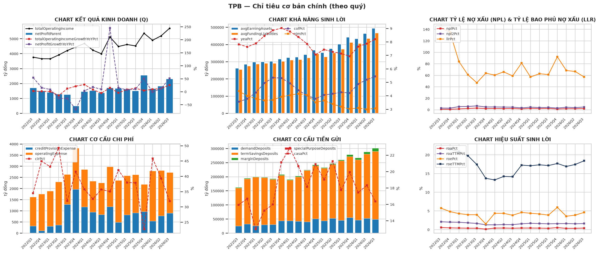
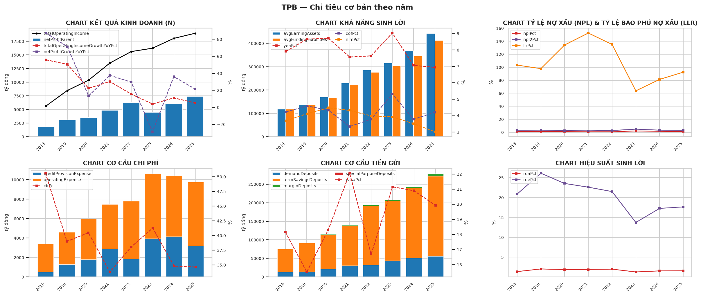
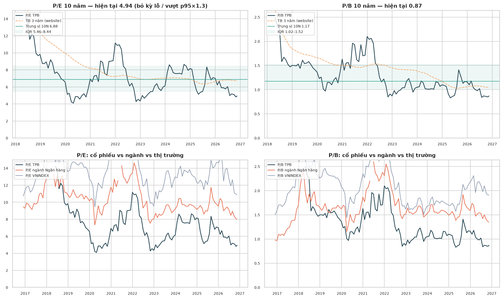
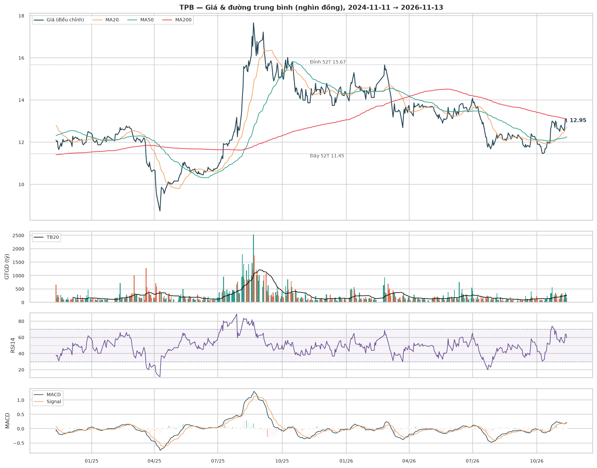
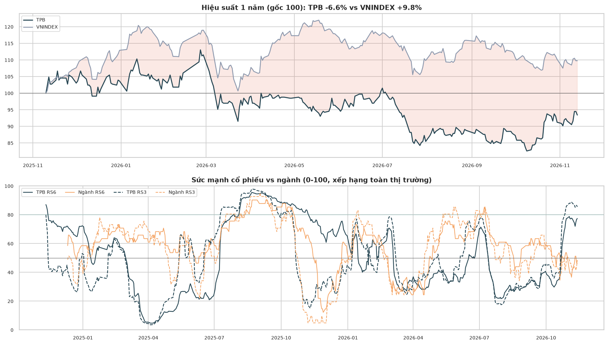
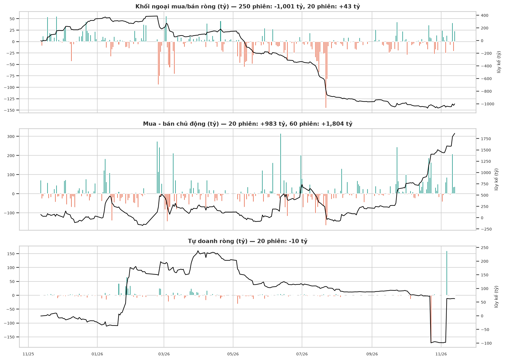
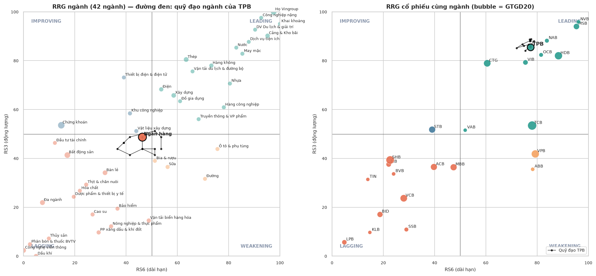
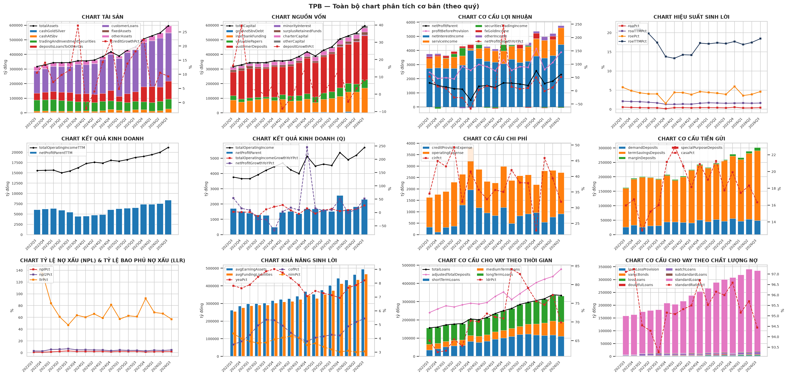

# TPB — Ngân hàng TMCP Tiên Phong | Phân tích cổ phiếu

> Dữ liệu sstock tới **2026-11-13** · Ngành Ngân hàng (sectorId 24) · Cấu trúc BCTC: bank · Giới hạn gói: BCTC 17 quý gần nhất, BCTC năm từ 2018, giá/VNINDEX từ 2023-11-16, định giá thị trường từ 2016-11-17.
> Báo cáo được tạo từ dữ liệu định lượng, **không phải khuyến nghị đầu tư**.

## 1. Tóm tắt

**Kết luận:** TPB đang đứng ở ô **"Ứng viên mạnh"** của ma trận: Kỹ thuật & dòng tiền +7/8, Cơ bản & định giá +3/6 sau khi tôi hạ điểm chất lượng tài sản. Ngành Ngân hàng đang lagging nên hạ một bậc, tức chỉ nên **giải ngân thăm dò và chờ giá xác nhận vượt MA200 (13,10)**. Định giá rẻ (P/B 0,87, nằm ở percentile 9 của 10 năm, trong khi ROE 18,4%) và dòng tiền chủ động mạnh lên là điểm cộng. Rủi ro chính là nợ nhóm 2 tăng và bộ đệm dự phòng mỏng (LLR 57%). Scorecard gốc **+10/±16 → Tích cực** (Kỹ thuật & dòng tiền +7/8 · Cơ bản & định giá +4/6 · Bối cảnh −1/2); sau override còn **+9** (xem mục 8).

| Luận điểm | Số liệu |
|---|---|
| Tăng trưởng lõi tốt, nhưng TTM bị thổi bởi 2025Q4 | LNST 9T/2026 5.802 tỷ (**+20,0%**), LN trước dự phòng 9T +17,2%. LNST TTM +27,9% cao hơn vì quý nền 2025Q4 đạt 2.565 tỷ (CIR 22,8%). ROE TTM 18,4% |
| Chất lượng tài sản xấu đi | NPL 2,10% (2026Q3), nợ nhóm 2 4,7% (8.760 tỷ, +66% YoY), LLR 57,0% (2025Q4 là 92,2%). Chi phí dự phòng 9T đi ngang (2.227 so với 2.224 tỷ) |
| Định giá ở vùng đáy lịch sử | P/E 4,94 (percentile 12, trung vị 10N 6,88), P/B 0,87 (percentile 9). Ngành: P/E 8,02, P/B 1,35 |
| Xu hướng giá đang hồi, chưa đảo chiều | Giá 12,95 > MA50 12,25 nhưng < MA200 13,10 (MA200 dốc xuống). Cách đỉnh 52 tuần −17,4% |
| Dòng tiền và sức mạnh tương đối dẫn đầu | RS3/RS6 85,5/77,4 (60 phiên trước: 27,4/26,7), RRG leading, VCR 1,50, AMFI +0,211, mua chủ động ròng 20 phiên +983 tỷ. Elite đang mở từ 2026-10-29 |

**Điều kiện hành động:** đóng cửa trên 13,10 (MA200) trong 3 phiên, GTGD khớp lệnh vượt TB20 (232,8 tỷ), RS3 ≥ 80 và RS6 ≥ 60 vẫn giữ. **Vô hiệu hóa** khi đóng cửa dưới 12,0 (khoảng 2,5×ATR dưới giá hiện tại, cũng là cạnh trên vùng nền), hoặc Elite đóng vì RS3 < 80 / RS6 < 60.

## 2. Bối cảnh thị trường & ngành

- **Thị trường:** trạng thái **pressure** đã kéo dài 73 phiên (độ tin cậy 63,7, mức Medium), bắt đầu từ 2026-07-30 khi chuyển lên từ downtrend nhờ FTD. Có 6 phiên phân phối trong 25 phiên (≥5 là áp lực bán đáng kể). FTD gần nhất là 2026-11-04. Độ rộng VN100 53%. Tâm lý ngắn hạn 29 và trung hạn 33, đều "Bi quan", nhưng trung hạn tăng 8 điểm trong tháng. P/E VNINDEX 10,90, thấp hơn TB 3 năm 13,26.
- **Lan tỏa dòng tiền:** nhóm **vốn hóa vừa đang dẫn dắt** với điểm 51 (+27 trong tháng); vốn hóa lớn chỉ 21 (Yếu). TPB có vốn hóa 41.312 tỷ, thuộc nhóm ngân hàng tầm trung, nên đi theo midCap. Đây là lực đẩy, không phải lực cản.
- **Ngành Ngân hàng:** RRG **lagging**, RS3 48,8 (hạng 22/42), RS6 46,3 (hạng 23), VCR 0,96, chỉ 44,8% số mã nằm trên MA50. Ngành không có cảnh báo. LNST TTM của ngành +20,7% YoY, TPB +27,9%. TPB chiếm 1,6% vốn hóa ngành và 2,6% LNST ngành.
- *Quan sát `09_market.png`:* VNINDEX ở trạng thái pressure gần như suốt năm, xen hai đợt downtrend ngắn (tháng 3 và cuối tháng 7/2026). Chỉ số hiện ở khoảng 1.735 điểm, vẫn dưới đỉnh khoảng 1.925 của tháng 5/2026. Ở panel lan tỏa, đường vốn hóa vừa bật từ khoảng 12 lên 50–54 trong nửa đầu tháng 11, còn vốn hóa lớn quay đầu xuống khoảng 20. Dòng tiền đang xoay khỏi nhóm trụ.

## 3. Kết quả kinh doanh & sức khỏe tài chính

| Chỉ tiêu (tỷ đồng, %) | 2025Q3 | 2025Q4 | 2026Q1 | 2026Q2 | 2026Q3 | YoY |
|---|---|---|---|---|---|---|
| Tổng TN hoạt động | 4.525 | 5.372 | 4.899 | 5.195 | 5.705 | +26,1% |
| Thu nhập lãi thuần | 3.238 | 3.599 | 3.460 | 3.634 | 4.424 | +36,6% |
| Thu nhập dịch vụ | 1.035 | 1.224 | 1.252 | 1.132 | 1.175 | +13,5% |
| LN trước dự phòng | 2.811 | 4.150 | 2.653 | 3.152 | 3.887 | +38,3% |
| Chi phí dự phòng | 909 | 967 | 547 | 774 | 906 | −0,4% |
| LNST cty mẹ | 1.521 | 2.565 | 1.666 | 1.828 | 2.309 | +51,8% |
| NIM / YEA / COF | 3,2 / 7,1 / 4,3 | 3,0 / 6,9 / 4,2 | 3,1 / 7,7 / 4,9 | 3,0 / 7,9 / 5,2 | 3,1 / 8,2 / 5,4 | +1,1pp COF |
| CIR | 37,9 | 22,8 | 45,9 | 39,3 | 31,9 | −6,0pp |
| NPL / nhóm 2 | 2,2 / 4,0 | 1,3 / 2,9 | 1,9 / 4,3 | 1,9 / 3,8 | 2,1 / 4,7 | +0,7pp nhóm 2 |
| LLR | 61,2 | 92,2 | 68,4 | 66,5 | 57,0 | −4,2pp |
| CASA | 17,7 | 19,9 | 17,4 | 18,3 | 16,4 | −1,4pp |
| LDR | 79,1 | 75,6 | 74,6 | 77,2 | 69,9 | −9,2pp |

**(1) Tăng trưởng nên đọc theo lũy kế năm.** Lũy kế 9T/2026: TOI 15.799 tỷ (+16,0%), LNST 5.802 tỷ (+20,0%). LNST TTM +27,9% cao hơn 9T vì **2025Q4** là quý bất thường: LNST 2.565 tỷ, chi phí hoạt động chỉ 1.222 tỷ (CIR 22,8%) so với mức thường 1.700–2.200 tỷ. Quý này sẽ là **nền so sánh cao cho 2026Q4**.

**(2) LN trước dự phòng so với LNST.** LN trước dự phòng 9T/2026 đạt 9.692 tỷ (+17,2%, 9T/2025 là 8.271 tỷ), chi phí dự phòng 9T gần như không đổi (2.227 so với 2.224 tỷ). Tăng trưởng LNST 9T (+20%) vì vậy gần sát với lõi (+17%). Trong quý 3, LNST +51,8% YoY gần như toàn bộ nhờ LN trước dự phòng +38,3%. Dự phòng cùng kỳ 909 tỷ, quý này 906 tỷ, nên phần LNST được hỗ trợ bởi dự phòng thấp chỉ khoảng (909 − 906) × 0,8 ≈ **2 tỷ**, không đáng kể. Cơ cấu TOI 2026Q3: lãi thuần 4.424, dịch vụ 1.175 (20,6% TOI), chứng khoán đầu tư −55, FX/vàng −7, khác 168. Hai mảng không bền đang đóng góp âm, nên chất lượng lợi nhuận quý này tốt.

**(3) Mỗi "Sự kiện ngân hàng" và cách đọc:**
- *2025Q4, lợi ích CĐ thiểu số từ 0 lên 3.743 tỷ (2026Q3: 3.821 tỷ):* có thay đổi sở hữu ở công ty con, tức ngân hàng bán bớt cổ phần, mở rộng vốn hoặc hợp nhất một pháp nhân mới. Cùng quý, `otherCapital` chỉ tăng 885 tỷ, mà chuỗi này chủ yếu là nợ khác chứ không phải vốn chủ. **Chưa rõ, cần tin doanh nghiệp.**
- *2026Q1, LLR giảm từ 92,2% xuống 68,4%; NPL 1,3% lên 1,9%; nhóm 2 5.034 lên 7.763 tỷ, nhóm 3 1.158 lên 2.069, nhóm 5 1.374 lên 2.459 tỷ:* ở 2025Q4, NPL giảm từ 2,2% xuống 1,3% (nhóm 3: 2.208 → 1.158, nhóm 4: 2.534 → 1.406, nhóm 5: 1.848 → 1.374) trong khi số dư dự phòng giảm từ 4.035 xuống 3.630 tỷ. Đây là dấu hiệu ngân hàng **xử lý/xóa nợ bằng dự phòng vào cuối năm** (cần tin DN), sau đó nợ xấu quay lại ngay trong quý 1. Năm 2024 cũng có mẫu hình này (NPL 2024Q4 1,5%, sang 2025Q1 2,3%). NPL cuối năm vì thế là con số "đẹp" theo mùa. Mức nền thực tế gần hơn với 1,9–2,2%.
- *2026Q1, cho vay KH +9.858 tỷ nhưng tiền gửi KH −12.012 tỷ:* phần thiếu được bù bằng vốn liên ngân hàng (+22.105 tỷ, trong khi tiền gửi tại TCTD khác chỉ tăng +5.929 tỷ, nên ròng khoảng +16.000 tỷ) và vay NHNN (+6.928 tỷ). Đây là nguồn vốn đắt hơn, và COF tăng từ 4,2% lên 4,9% ngay trong quý đó.
- *2026Q2, nhóm 4 từ 1.318 lên 1.800 tỷ; 2026Q3, nhóm 2 từ 6.390 lên 8.760 tỷ (+37%):* nợ đang trượt nhóm liên tục trong 3 quý. Nhóm 2 đạt 8.760 tỷ, cao nhất trong 17 quý, là tín hiệu sớm cho NPL các quý tới.
- *2026Q3 ⚠️, NPL từ 1,86% lên 2,10% trong khi dự phòng 906 tỷ (−0,4% YoY):* phần hỗ trợ trực tiếp so với cùng kỳ gần bằng 0, như đã tính ở trên. Rủi ro nằm ở chỗ **dự phòng không theo kịp nợ xấu**. Tổng nợ nhóm 3–5 là 7.029 tỷ, số dư dự phòng 4.008 tỷ. Để đưa LLR về 68,4% (mức 2026Q1) cần trích thêm khoảng 800 tỷ (≈ 640 tỷ LNST). Để về 92,2% (mức 2025Q4) cần khoảng 2.470 tỷ (≈ 1.980 tỷ LNST, tương đương ~24% LNST TTM).

**(4) Nguồn vốn và NIM.** Từ 2025Q4 đến 2026Q3, YEA tăng 6,9% → 8,2% (+1,3pp) và COF tăng 4,2% → 5,4% (+1,2pp), nên NIM chỉ nhích 3,0% → 3,1%. NIM theo năm đã giảm từ 4,5% (2020) xuống 3,0% (2025). CASA 16,4% là mức thấp nhất trong 8 quý. Quý 3, cho vay KH giảm 1,1% QoQ (330.152 tỷ). Tăng trưởng tín dụng lũy kế chỉ 9,2%, cùng kỳ năm trước là 18,1%. Vốn liên ngân hàng tăng 27.267 tỷ, gần khớp với tiền gửi tại TCTD khác (+25.627 tỷ), nên phần lớn là ngân hàng phình bảng cân đối liên ngân hàng, áp lực vốn ròng nhỏ. Dù vậy, vốn liên ngân hàng đã chiếm **28,6% tổng nguồn vốn** (170.611/596.512 tỷ), so với 20,2% ở 2025Q2. LDR 69,9% còn nhiều dư địa. Thu nhập lãi thuần quý 3 tăng 21,7% QoQ dù dư nợ giảm, nhờ tài sản sinh lãi bình quân tăng và YEA tăng thêm 0,3pp. Khoản "tài sản khác" tăng từ 14.514 lên 47.529 tỷ trong 5 quý (**chưa rõ, cần tin DN**; có thể là lãi dự thu hoặc phải thu).

**(5) Sự kiện quyền và vốn điều lệ.**
- Trong 12 tháng gần nhất có **2026-10-02**: hệ số 1,190 (giá gốc 14,40 → 11,90). Số CP lưu hành dùng để định giá là 3,19 tỷ cp, trong khi vốn điều lệ BCTC 2026Q3 là 27.740 tỷ (2,77 tỷ cp). Như vậy đây là **cổ tức cổ phiếu/thưởng khoảng 15%**: pha loãng, không có tiền mới. Phần còn lại của hệ số có thể do biến động giá phiên đó (cần tin DN). BCTC chưa phản ánh sự kiện này; EPS và P/E đã tính theo số CP mới.
- Ngay trước cửa sổ 12 tháng có 2025-10-30: hệ số 1,049, khớp vốn điều lệ 2025Q4 (+5,0%), tức CP thưởng ~5%. Các sự kiện cũ hơn: 2024-09-23 CP thưởng ~20% (khớp vốn điều lệ 2024Q4); 2024-06-20 và 2025-05-13 là cổ tức tiền (~500 và ~1.000 đ/cp, cần tin DN). Năm 2023Q2 vốn điều lệ tăng 39,2% nhưng không khớp chuyển từ LNGPP, có thể là phát hành thu tiền/ESOP (cần tin DN).
- Mọi mức giá trước 2026-10-02 trong báo cáo đều lấy theo `adjClose`.

**Theo năm:** LNST tăng từ 1.805 tỷ (2018) lên 7.380 tỷ (2025). ROE chạm đáy 13,7% năm 2023 (NPL 2,0%, LLR theo năm 64%, chi phí dự phòng khoảng 3.900 tỷ), sau đó hồi lên 17,6% năm 2025. Giai đoạn 2019–2022, ROE ở mức 21,5–26,1%.

- *Quan sát `04_fa_key.png`:* ở panel khả năng sinh lời, YEA và COF cùng dựng đứng từ 2025Q4, gần như song song. NIM nằm phẳng ở ~3,0–3,1%. Ngân hàng đang chuyển trọn chi phí vốn sang lãi cho vay, nhưng không mở rộng được biên. Panel NPL/LLR cho thấy LLR có hình răng cưa theo mùa, đỉnh vào các quý 4 (2024Q4 81%, 2025Q4 92%) rồi rơi lại.
- *Quan sát `05_fa_dashboard.png`:* tổng tài sản tăng vọt lên khoảng 596.500 tỷ ở 2026Q3, chủ yếu nhờ khối tiền gửi/cho vay TCTD khác (đỏ) và vốn liên ngân hàng (cam) cùng phình. Cho vay KH (tím) đi ngang. Ở panel chất lượng nợ, tỷ lệ nhóm 1 (`standardRatioPct`) rơi xuống 94,4%, thấp nhất kể từ 2023Q3.
- *Quan sát `06_fa_annual.png`:* LLR theo năm giảm từ đỉnh 152% (2021) xuống 64% (2023) và mới hồi lên 92% (2025). Bộ đệm hiện tại (57% theo quý) thấp hơn cả đáy năm 2023. NIM theo năm giảm liên tục từ 2020.

## 4. Định giá

| | Hiện tại | TB 3 năm | Trung vị 10N | Min–Max 10N | Percentile 10N | Ngành | VNINDEX |
|---|---|---|---|---|---|---|---|
| P/E | 4,94 | 6,72 | 6,88 | 4,1–15,3 | 12 | 8,02 | 10,90 |
| P/B | 0,87 | 1,04 | 1,18 | 0,83–2,49 | 9 | 1,35 | 1,91 |

- EPS 4 quý: 2.623 đ. P/E SSTOCK dự phóng là 4,55 và P/B SSTOCK 0,80, nhưng **cả hai đang giữ nguyên từ 2026-07-24**, không phản ánh giá hôm nay.
- **P/B đặt cạnh ROE:** trung vị P/B 10 năm (1,18) hình thành chủ yếu trong 2019–2022, khi ROE 21,5–26,1%. ROE hiện tại 18,4% thấp hơn giai đoạn đó, nên vùng giá `at_pb_median10y` **17,44** là kịch bản lạc quan. Vùng `at_pb_avg3Y` **15,44** hợp lý hơn, vì nó ứng với ROE 2023–2025 (13,7–17,6%), thấp hơn ROE hiện tại. P/E TB 3 năm (6,72) bị đẩy lên bởi năm 2023 có lợi nhuận đáy, nên `at_pe_avg3Y` 17,63 và `at_pe_median10y` 18,03 chỉ để tham khảo. Mọi giá tham chiếu đều giả định lợi nhuận và giá trị sổ sách giữ nguyên; đây không phải giá mục tiêu.
- **So với ngân hàng tư nhân cùng nhóm** (P/B · ROE, `get_stock_valuation` ngày 2026-11-15): HDB 1,66 · 24,6%; MSB 1,32 · 14,3%; VIB 1,06 · 16,2%; OCB 0,90 · 13,0%; **TPB 0,87 · 18,4%**. TPB có ROE cao thứ hai trong nhóm nhưng P/B thấp nhất. So với P/B ngành 1,35, mức chiết khấu bị phóng đại bởi nhóm quốc doanh, nhưng ngay trong nhóm tư nhân TPB vẫn rẻ.
- **Nhận định:** P/B giảm từ khoảng 1,15 (đầu 2026) xuống 0,87 trong khi ROE TTM tăng từ 16,9% lên 18,4%. Thị trường đang **chiết khấu rủi ro** (nợ nhóm 2, LLR mỏng, COF tăng, phụ thuộc vốn liên ngân hàng, khối ngoại bán ròng) chứ không chiết khấu lợi nhuận.
- *Quan sát `07_valuation.png`:* P/B TPB đã nằm dưới 1,0 từ giữa năm 2026, gần sát đáy 10 năm (~0,83 đầu 2025). Khoảng cách với P/B ngành (~1,35) là rộng nhất kể từ 2023. P/E 4,9 tương đương các đáy năm 2020 và cuối 2022.

## 5. Kỹ thuật & xu hướng giá

| Chỉ tiêu | Giá trị |
|---|---|
| Giá / MA20 / MA50 / MA200 | 12,95 / 12,71 / 12,25 / 13,10 |
| Đỉnh / đáy 52 tuần (adjClose) | 15,67 (2026-02-25) / 11,45 (2026-10-09) |
| RSI14 · MACD hist | 59,4 · +0,018 |
| ATR14 · biến động năm · Beta 1Y | 2,8% · 25,5% · 0,85 |
| GTGD TB20 / TB60 | 257,7 / 165,9 tỷ (khớp lệnh TB20 232,8 tỷ, thỏa thuận chỉ chiếm 6,5%) |

- **Cấu trúc xu hướng:** giá > MA20 > MA50 và MA50 dốc lên (+1,54% trong 20 phiên), nhưng giá vẫn **dưới MA200 đang dốc xuống**. Đây là nhịp hồi trong một downtrend trung hạn, chưa phải uptrend chuẩn. Phiên 11–12/11, giá chạm 13,10 (đúng MA200) rồi lùi về 12,95.
- **Vùng nền:** từ cuối tháng 7 đến giữa tháng 10/2026, giá đi ngang trong vùng 11,45–12,44. Phiên 2026-10-21 bứt lên 12,65 (+5,4%) cùng GTGD tăng, sau đó giá tích lũy trong vùng 12,5–13,1. Kháng cự kế tiếp: 13,10 (MA200), 14,07 (đỉnh 2026-07-01), 14,96 (2026-03-02), 15,67 (đỉnh 52 tuần).
- **Động lượng:** RSI 59 nằm trong vùng khỏe và chưa quá mua. MACD nằm trên signal và trên 0.
- **Hiệu suất so với VNINDEX:** 1T +8,1pp, 3T +8,4pp, 6T +9,4pp, nhưng YTD −7,1pp và 1N −15,1pp.
- *Quan sát `01_price_technical.png`:* MA200 đã quay đầu xuống từ đỉnh ~14,5 (tháng 5/2026). Giá hiện đang test chính đường này từ dưới lên, lần đầu tiên kể từ tháng 3/2026. Đợt phá vỡ cuối tháng 10 có cột GTGD lên khoảng 400–550 tỷ, còn TB20 chỉ nhích từ ~150 lên ~260 tỷ, thấp xa đợt tăng tháng 8/2025 (TB20 > 1.000 tỷ). Dòng tiền xác nhận nhưng chưa bùng nổ.
- *Quan sát `02_relative_strength.png`:* RS3 và RS6 của TPB bật thẳng từ khoảng 30–40 lên 77–88 trong tháng 10/2026, tách hẳn khỏi đường RS của ngành (~45–50). Đây là lần đầu từ tháng 9/2025 RS3 vượt 80. Ở panel trên, khoảng chênh với VNINDEX (vùng hồng) bắt đầu thu hẹp từ giữa tháng 10, sau khi rộng nhất (~−25pp) vào đầu tháng 10.

## 6. Dòng tiền & smart-money

| Cửa sổ | Khối ngoại ròng | Tự doanh ròng | Chủ động ròng | Tỷ lệ chủ động |
|---|---|---|---|---|
| 5 phiên | +37,1 | −0,7 | +279,8 | +0,289 |
| 20 phiên | +43,1 | −10,1 | +982,7 | +0,221 |
| 60 phiên | −45,6 | −24,9 | +1.804,5 | +0,206 |
| 250 phiên | −1.001,3 | — | +1.866,2 | +0,046 |

- **Smart-money:** RRG leading, VCR 1,50 (bùng nổ), AMFI +0,211 (phe mua áp đảo). Không có phân kỳ giảm bear20 (lần gần nhất 2026-02-25). Phân kỳ tăng bull10 đang hoạt động (2026-11-03). RS3 xếp hạng 4/24 mã ngân hàng được theo dõi.
- **Elite v23:** **đang mở**, vào ngày 2026-10-29, đã 12 phiên, lãi tạm tính +0,39%, loại super. Đủ 5/5 trụ (rs3 85,5 / rs6 77,4, VCR 1,50, AMFI 0,211, GTGD20 232,8 tỷ, không bear20) và giữ được 3/3 phiên liên tiếp. Không thiếu trụ nào, không bị guard nào chặn (`raw/elite_diag.json`). **Lưu ý:** lịch sử Elite trên TPB có 7 lần, chỉ thắng 29%, lãi trung bình +1,4%. Tín hiệu này ở mã này chưa đáng tin, nên chỉ dùng làm điều kiện xác nhận.
- **Khối ngoại:** bán ròng 1.001 tỷ trong 250 phiên. Riêng từ 2026-07-01 đến 2026-08-15 đã bán ròng 589 tỷ, phiên lớn nhất 2026-07-22 (−145,6 tỷ). Từ tháng 8, khối ngoại gần như trung tính; 20 phiên gần nhất mua ròng nhẹ +43 tỷ.
- *Quan sát `03_money_flow.png`:* đường lũy kế mua/bán chủ động đi ngang quanh 0–250 tỷ suốt tháng 1–9/2026, rồi dốc đứng từ khoảng 250 lên 1.800 tỷ kể từ đầu tháng 10. Đây là dòng tiền nội chủ động dẫn dắt nhịp tăng, khối ngoại không tham gia (đường lũy kế khối ngoại nằm phẳng ở đáy ~−1.000 tỷ). Tự doanh có một phiên bán ~−170 tỷ cuối tháng 10, rồi một phiên mua ~+160 tỷ đầu tháng 11, nhiều khả năng là cùng một lô được hoán đổi, ròng 20 phiên chỉ −10 tỷ.

## 7. So sánh cùng ngành

| Mã | Vốn hóa (tỷ) | RS3 | RS6 | Góc | VCR | AMFI | GTGD20 (tỷ) |
|---|---|---|---|---|---|---|---|
| MSB | 61.402 | 94 | 95 | leading | 1,14 | −0,119 | 148,6 |
| **TPB** | 41.312 | 86 | 77 | leading | **1,50** | **+0,211** | 232,8 |
| HDB | 147.055 | 82 | 88 | leading | 0,96 | +0,123 | 326,7 |
| CTG | 244.659 | 79 | 60 | leading | 1,11 | +0,033 | 254,1 |
| TCB | 232.252 | 53 | 78 | leading | 0,89 | −0,046 | 450,6 |
| VPB | 221.000 | 42 | 79 | weakening | 0,73 | −0,163 | 332,2 |
| STB | 134.227 | 52 | 39 | improving | 0,92 | +0,138 | 213,3 |
| VCB / BID / MBB / ACB | — | 24 / 17 / 36 / 37 | 28 / 19 / 47 / 40 | lagging | ≈1 | âm/≈0 | — |

- Ngành đang **phân hóa rõ**. Nhóm ngân hàng tư nhân tầm trung (MSB, NVB, NAB, HDB, OCB, VIB, TPB) đều ở góc leading. Nhóm quốc doanh/vốn hóa lớn (VCB, BID, MBB, ACB, LPB) ở lagging và kéo RRG ngành xuống. TPB đi cùng nhóm dẫn dắt, và có **VCR cùng AMFI cao nhất** trong bảng peers. Sức mạnh của TPB là sức mạnh của cả nhóm tư nhân tầm trung, không phải câu chuyện riêng lẻ, và cũng không phải đang "đuổi theo" ngành.
- *Quan sát `08_rrg.png`:* quỹ đạo của ngành Ngân hàng xoay vòng quanh tâm (45–52), chưa có hướng rõ. Quỹ đạo của TPB co cụm trong góc leading (RS6 72–78, RS3 84–89), vài điểm gần nhất hơi lệch sang trái và xuống. Động lượng ngắn hạn đã đạt đỉnh và đang đi ngang, chưa chuyển sang weakening.

## 8. Scorecard

| Nhóm | Điểm gốc | Sau override | Ghi chú |
|---|---|---|---|
| Xu hướng giá | +1 | +1 | > MA50, MA50 dốc lên; < MA200 |
| Động lượng | +2 | +2 | RSI 59, MACD > signal & 0, 3T +8,4pp so với VNINDEX |
| Sức mạnh tương đối | +2 | +2 | RRG leading, RS6 77,4 |
| Dòng tiền | +2 | +2 | VCR 1,50, AMFI +0,21, khối ngoại 20p +43 tỷ, chủ động 20p +983 tỷ |
| Tăng trưởng | +2 | +2 | TTM +27,9% bị thổi bởi 2025Q4, nhưng 9T vẫn +20%, giữ +1 |
| Chất lượng | 0 | **−1** | ROE 18,4% (+1); **NPL 2,1% chấm lại −1** (vượt 1,5%, nhóm 2 +66% YoY, nợ trượt nhóm 3 quý liên tiếp); LLR 57% (−1) |
| Định giá | +2 | +2 | P/E/trung vị 0,72, P/B percentile 9, P/E thấp hơn ngành 38% |
| Bối cảnh | −1 | −1 | Thị trường pressure, ngành lagging, tâm lý trung hạn 33 |
| **Tổng** | **+10** | **+9** | Kỹ thuật & dòng tiền +7 · Cơ bản & định giá +3 · Bối cảnh −1 |

**Lý do override:** banking.md yêu cầu chấm lại khi NPL > 1,5% hoặc LLR < 100%. Trong 2 quý gần nhất, cả ba tín hiệu đều xuất hiện: nợ trượt nhóm, ⚠️ NPL tăng trong khi dự phòng đi ngang, và LLR mỏng đi. Sau override, TPB vẫn ở ô "Ứng viên mạnh" (Cơ bản +3, Kỹ thuật +7) nhưng nằm sát ranh giới. Ngành lagging nên hạ một bậc, kết luận là **giải ngân thăm dò, chờ xác nhận MA200**.

## 9. Rủi ro & catalyst

**Rủi ro**
- **Chất lượng tài sản:** nhóm 2 đạt 8.760 tỷ (4,7%, cao nhất trong 17 quý), NPL 2,1%, LLR 57%. Nếu phải đưa LLR về ~92%, LNST có thể giảm khoảng 1.980 tỷ (~24% TTM). NPL quý 4 thường "đẹp" theo mùa nhờ xử lý nợ, nên cần nhìn NPL quý 1/2027 để đánh giá thật.
- **Chi phí vốn và NIM:** COF +1,2pp trong 3 quý, CASA 16,4% thấp nhất 8 quý, vốn liên ngân hàng chiếm 28,6% nguồn vốn. YEA không theo kịp sẽ ép NIM.
- **Nền so sánh 2026Q4:** 2025Q4 có LNST 2.565 tỷ và CIR 22,8%, nên LNST quý 4/2026 khó tăng mạnh YoY; tăng trưởng TTM sẽ chậm lại.
- **Tín dụng chậm lại:** tăng trưởng lũy kế 9,2% so với 18,1% cùng kỳ, và dư nợ giảm trong quý 3. Hạn mức tín dụng NHNN giao không có trong sstock.
- **Dòng tiền:** khối ngoại bán ròng 1.001 tỷ trong 250 phiên. Elite trên TPB có lịch sử chỉ 29% thắng. Thị trường pressure với 6 phiên phân phối.
- **Pha loãng:** CP thưởng ~15% (2026-10-02) và ~5% (2025-10-30) liên tiếp. EPS tăng chậm hơn LNST.

**Catalyst**
- BCTC 2026Q4 (cuối tháng 1/2027): theo dõi NPL, nhóm 2, LLR và dự phòng quý 4.
- Lan tỏa dòng tiền nhóm vốn hóa vừa tiếp tục tăng; nhóm ngân hàng tư nhân tầm trung giữ leading.
- Định giá rẻ so với nhóm tư nhân (P/B thấp nhất, ROE cao thứ hai), có dư địa tái định giá nếu chất lượng tài sản ổn định.

**Giới hạn dữ liệu**
- Gói chỉ cho BCTC 17 quý, BCTC năm từ 2018, giá từ 2023-11-16.
- `roeTTMPct`/`roaTTMPct` theo năm của nguồn bị lỗi (≈3,5–3,7× `roePct`); báo cáo dùng `roePct`.
- P/E/P/B SSTOCK giữ nguyên từ 2026-07-24. P/E TB 3 năm bị méo bởi lợi nhuận đáy 2023.
- Vốn điều lệ BCTC chưa phản ánh đợt thưởng 2026-10-02.
- Chưa rõ, cần tin doanh nghiệp: nguồn gốc lợi ích CĐ thiểu số (3.743 tỷ từ 2025Q4), khoản tài sản khác tăng lên 47.529 tỷ, tỷ lệ chính xác của các đợt cổ tức.

## 10. Kịch bản & mức giá theo dõi

| Kịch bản | Điều kiện | Ý nghĩa |
|---|---|---|
| Tích cực | Đóng cửa > **13,10** (MA200) trong 3 phiên, GTGD khớp lệnh > TB20 (232,8 tỷ), RS3 ≥ 80 và RS6 ≥ 60, AMFI > 0 | Xác nhận đảo chiều trung hạn, có thể gia tăng tỷ trọng. Vùng tham chiếu 14,07 (đỉnh 07/2026), sau đó 14,96–15,44 (đỉnh 03/2026 và `at_pb_avg3Y`). 15,67 là đỉnh 52 tuần |
| Cơ sở | Giá dao động 12,25 (MA50) – 13,10, Elite vẫn mở, thị trường giữ pressure | Tích lũy dưới MA200, giữ vị thế thăm dò, chờ BCTC quý 4 và thị trường chuyển sang uptrend |
| Tiêu cực | Đóng cửa < **12,0** (~2,5×ATR, cạnh trên vùng nền) hoặc RS3 < 80 / RS6 < 60 làm Elite đóng; thủng **11,45** (đáy 52 tuần) là vô hiệu hóa hoàn toàn. Về cơ bản: NPL > 2,5% hoặc LLR < 50% ở BCTC kế tiếp | Nhịp hồi thất bại tại MA200, downtrend trung hạn tiếp diễn. Đứng ngoài |

---
*Phụ lục:* dữ liệu thô ở `raw/`, chỉ số ở `metrics.json`, bảng đầy đủ ở `tables.md`, biểu đồ ở `charts/` (gồm cả [05_fa_dashboard](charts/05_fa_dashboard.png)).

*Báo cáo chỉ mang tính tham khảo từ dữ liệu định lượng, không phải khuyến nghị đầu tư.*
