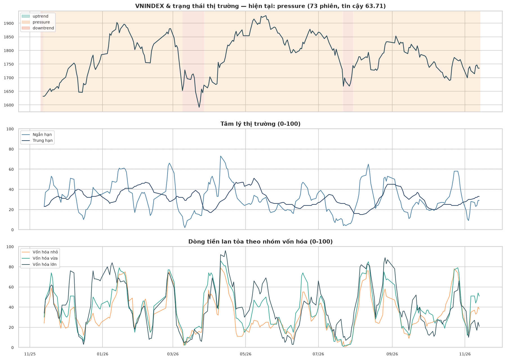
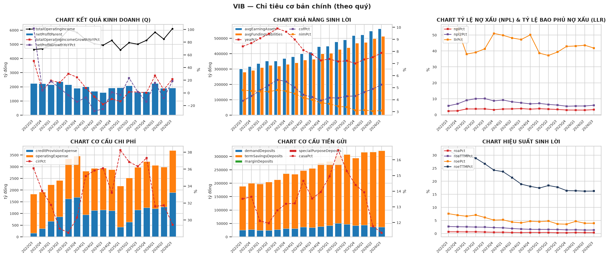
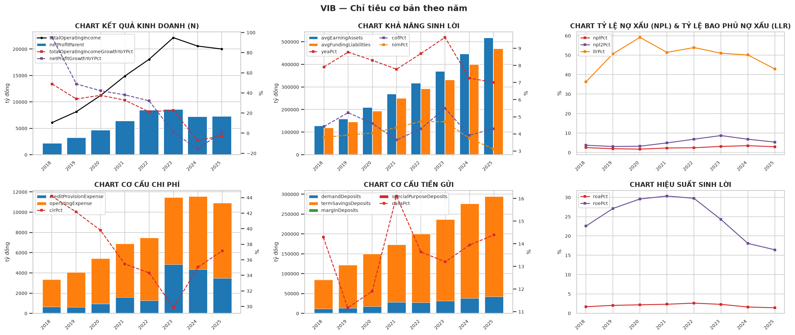
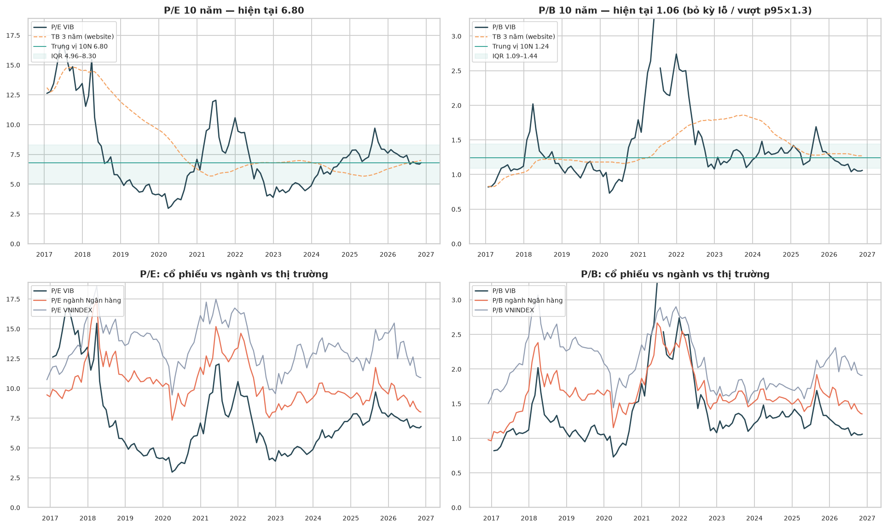
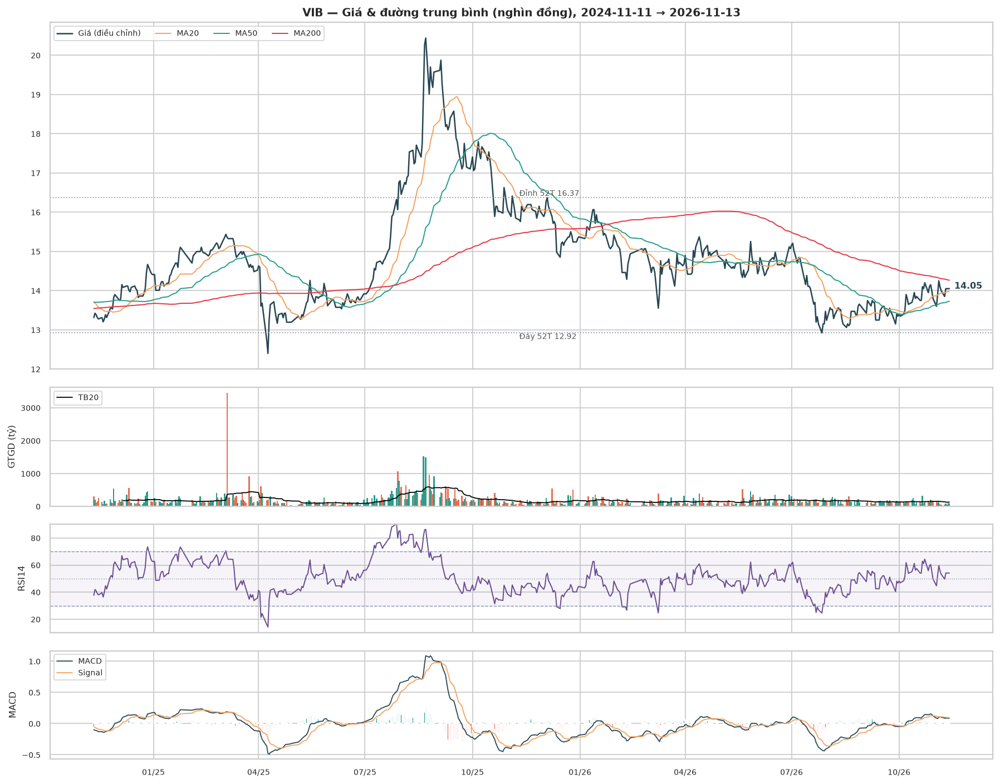
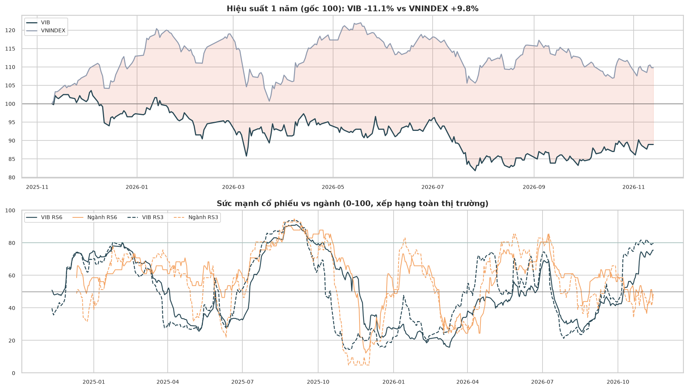
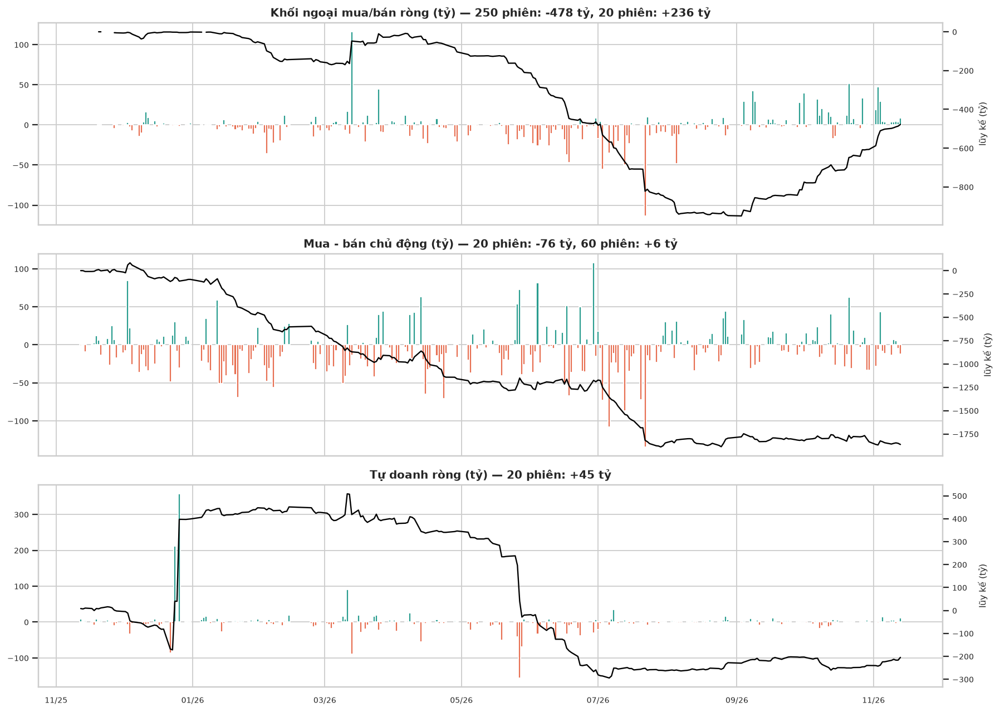
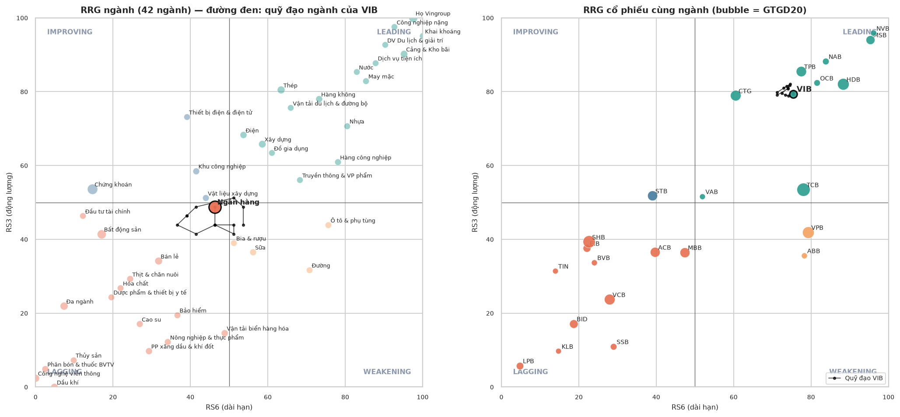

# VIB — Ngân hàng TMCP Quốc tế Việt Nam | Phân tích cổ phiếu

> Dữ liệu sstock tới **2026-11-13** · Ngành Ngân hàng (sectorId 24) · Cấu trúc BCTC: ngân hàng · Gói S1 (BCTC 17 quý, BCTC năm từ 2018, giá từ 2023-11-16, định giá thị trường từ 2016-11-17).
> Báo cáo được tạo từ dữ liệu định lượng, **không phải khuyến nghị đầu tư**.

## 1. Tóm tắt

**Kết luận:** Kỹ thuật và dòng tiền **khá tốt** (+5/8): VIB đang ở nhóm *leading* của các ngân hàng tư nhân, RS3 79 / RS6 75. Cơ bản và định giá chỉ ở mức **trung tính** (+1/6): định giá rẻ (P/B 1,06x, percentile 19%) nhưng chất lượng tài sản đang xấu đi và lợi nhuận gần như đi ngang. Trong ma trận, đây là ô *"chỉ phù hợp giao dịch theo đà, đặt dừng lỗ chặt"*. Vì ngành Ngân hàng đang *lagging*, hạ thêm một bậc thành **theo dõi, chưa phải ứng viên tích lũy**. Scorecard **+5/±16 → Khá tích cực** (Kỹ thuật & dòng tiền +5/8 · Cơ bản & định giá +1/6 · Bối cảnh −1/2).

| Luận điểm | Số liệu |
|---|---|
| Năng lực lõi tăng, nhưng chi phí dự phòng ăn gần hết phần tăng thêm | 9T/2026: LN trước dự phòng +29,3% (11.976 tỷ), chi phí dự phòng +98,0% (4.385 tỷ), LNST cty mẹ chỉ +7,7% (6.071 tỷ); LNST TTM +2,1% |
| Chất lượng tài sản xấu đi trong Q3/26 | NPL 2,9% → 3,2%, nợ nhóm 2 5,5% → 6,0%, nợ nhóm 3 2.727 → 3.991 tỷ (+46%); LLR chỉ 41,8% |
| Nguồn vốn đắt dần | COF 4,3% → 5,2% trong 4 quý, CASA 14,4% → 11,3%; NIM giữ 3,1% (giảm từ 4,7% năm 2023) |
| Định giá rẻ, nhưng ROE cũng đã giảm | P/B 1,06x (trung vị 10 năm 1,24x, hình thành khi ROE 24–30%); ROE TTM 16,2%; P/E 6,8x so với ngành 8,0x |
| Giá ở vùng nền, sát MA200 | 14,05 so với MA200 14,26 (dốc xuống); nền 13,0–14,3 từ tháng 8/2026; 1 năm −11,3% trong khi VNINDEX +8,5% |
| Sức mạnh và khối ngoại cải thiện | RRG *leading*; RS6 tăng từ 25 (60 phiên trước) lên 75; khối ngoại mua ròng 12 phiên liên tiếp, +461 tỷ trong 60 phiên |

**Điều kiện hành động:** cần đóng cửa **trên 14,3 (MA200)** với GTGD khớp lệnh vượt TB20 khớp lệnh (~84 tỷ), **đồng thời** RS3 ≥ 80 và AMFI > 0 (khi đó VIB đủ 5/5 trụ Elite). Kịch bản tích cực bị vô hiệu nếu giá đóng cửa dưới **13,7 (MA50)**. Mất **12,9 (đáy 52 tuần)** là nền giá thất bại.

## 2. Bối cảnh thị trường & ngành

- **Thị trường:** trạng thái *pressure* đã kéo dài 73 phiên (độ tin cậy 63,7, mức Medium), có 6 phiên phân phối trong 25 phiên gần nhất, FTD gần nhất ngày 2026-11-04. Độ rộng VN100 là 53%. Tâm lý ngắn hạn 29, trung hạn 33 (*Bi quan*; trung hạn +8 điểm trong một tháng). Dòng tiền lan tỏa đang dẫn dắt bởi **vốn hóa vừa (51)**, trong khi vốn hóa lớn yếu (21). VIB có vốn hóa 52.482 tỷ, thuộc nhóm tầm trung, nên được hưởng lợi trực tiếp. P/E VNINDEX 10,9 so với TB 3 năm 13,3: mặt bằng thị trường đang rẻ.
- **Ngành Ngân hàng:** RRG *lagging*, RS3 48,8 (hạng 22/42), RS6 46,3 (hạng 23), VCR 0,96, chỉ 44,8% số mã trên MA50. Trên [08_rrg](charts/08_rrg.png), quỹ đạo ngành đã quanh quẩn sát tâm RRG trong nhiều tuần, lúc sang improving, lúc lùi về lagging, chưa có hướng rõ. Ngành đang **phân hóa mạnh**: nhóm tư nhân tầm trung (MSB, HDB, TPB, OCB, NAB, VIB) và CTG ở *leading*, còn VCB, BID, MBB, ACB, LPB ở *lagging*.
- **Vị thế:** VIB chiếm 2,0% vốn hóa và 2,4% LNST TTM của 29 ngân hàng niêm yết. LNST TTM của ngành tăng **+20,7%** YoY, còn của VIB chỉ **+2,1%**, nên VIB đang tăng trưởng chậm hơn hẳn ngành.

*Quan sát biểu đồ:* VNINDEX đi ngang trong biên 1.650–1.930 suốt một năm, gần như toàn bộ thời gian ở trạng thái *pressure*; hiện ở 1.735. Chỉ số lan tỏa nhóm vốn hóa vừa bật lên khoảng 50 từ đầu tháng 11, trong khi nhóm vốn hóa lớn rơi về 10–25.

## 3. Kết quả kinh doanh & sức khỏe tài chính

| Chỉ tiêu (tỷ đồng, %) | Q3/25 | Q4/25 | Q1/26 | Q2/26 | Q3/26 | YoY |
|---|---|---|---|---|---|---|
| Tổng TN hoạt động | 5.007 | 5.282 | 5.860 | 5.368 | 6.101 | +21,9% |
| Thu nhập lãi thuần | 4.173 | 4.214 | 4.039 | 4.368 | 4.781 | +14,6% |
| Thu nhập dịch vụ | 494 | 833 | 1.989 | 1.075 | 990 | +100,6% |
| LN trước dự phòng | 3.188 | 3.310 | 4.008 | 3.664 | 4.305 | +35,0% |
| Chi phí dự phòng | 1.158 | 1.252 | 1.205 | 1.281 | 1.899 | +64,0% |
| LNST cty mẹ | 1.625 | 1.648 | 2.241 | 1.905 | 1.925 | +18,5% |
| NIM / YEA / COF | 3,4 / 7,2 / 4,3 | 3,1 / 7,0 / 4,3 | 3,1 / 7,3 / 4,6 | 3,1 / 7,5 / 4,9 | 3,1 / 7,9 / 5,2 | −0,3 / +0,7 / +1,0pp |
| CIR | 36,3 | 37,3 | 31,6 | 31,7 | 29,4 | −6,9pp |
| NPL / nhóm 2 | 3,3 / 6,1 | 3,0 / 5,4 | 2,9 / 5,5 | 2,9 / 5,5 | 3,2 / 6,0 | −0,1 / −0,1pp |
| LLR | 39,4 | 42,9 | 43,1 | 43,6 | 41,8 | +2,4pp |
| CASA | 15,3 | 14,4 | 13,9 | 11,8 | 11,3 | −3,9pp |
| ROE TTM | 17,7 | 16,4 | 16,4 | 16,2 | 16,2 | −1,5pp |

**Tăng trưởng: đo theo lõi trước, LNST sau.**
- Dùng lũy kế 9T/2026 làm thước đo chính. TOI +17,7% (17.329 tỷ), LN trước dự phòng +29,3%, chi phí dự phòng +98,0%, LNST cty mẹ +7,7%. LNST TTM chỉ +2,1% vì **Q4/25 thấp** (1.648 tỷ so với 1.921 tỷ của Q4/24, tức −14%). Quý này sẽ là nền so sánh thấp cho Q4/26.
- **Thu nhập dịch vụ là động lực chính của TOI:** 9T/2026 đạt 4.054 tỷ so với 1.273 tỷ cùng kỳ (+2.781 tỷ), lớn hơn cả phần TOI tăng thêm (+2.604 tỷ). Riêng Q1/26 đạt 1.989 tỷ, gấp khoảng 2 lần các quý xung quanh, nhiều khả năng có khoản phí một lần (chưa rõ, cần tin DN). Q3/26 dịch vụ chiếm 16% TOI. Q4/24 có thu nhập dịch vụ **âm 139 tỷ**, một bất thường chưa rõ nguyên nhân, cần tin DN.
- Thu nhập lãi thuần 9T/2026 đạt 13.188 tỷ (+11,0%) và tăng mạnh nhất trong Q3/26 (+9,5% QoQ) nhờ dư nợ +3,5% QoQ.
- **FX/vàng âm 5 quý liên tiếp** (−99, −278, −356, −423, −368 tỷ), tổng cộng −1.147 tỷ trong 9T/2026. Đây là lực kéo lặp lại chứ không phải khoản một lần (có thể là chi phí phòng ngừa rủi ro tỷ giá cho các khoản vay nước ngoài; chưa rõ, cần tin DN). Chứng khoán đầu tư dao động quanh 0.
- CIR giảm còn 29,4% vì chi phí hoạt động đi ngang (~1.700–1.900 tỷ/quý) trong khi TOI tăng. Đây là điểm sáng về hiệu quả.

**Chất lượng tài sản: giải thích các dòng "Sự kiện ngân hàng".**
- **2026Q3, nợ xấu đi theo nhóm:** nhóm 2 tăng 10.184 → 11.466 tỷ (+12,6%), nhóm 3 tăng 2.727 → 3.991 tỷ (+46%), nhóm 4 tăng 3.148 → 3.526 tỷ, chỉ nhóm 5 giảm 5.742 → 5.650 tỷ. Tổng nợ nhóm 3–5 tăng từ 11.617 lên 13.167 tỷ (+13,3% QoQ, nhanh hơn mức tăng dư nợ 3,5%). Nhóm 2 và nhóm 3 cùng tăng là tín hiệu nợ đang trượt nhóm, nên NPL nhiều khả năng còn chịu áp lực trong Q4/26.
- Ngân hàng **không làm đẹp lợi nhuận bằng dự phòng:** chi phí dự phòng Q3/26 tăng lên 1.899 tỷ (+64% YoY, +48% QoQ). Vì vậy không có phần LNST "được hỗ trợ bởi dự phòng thấp".
- **Cầu nối dự phòng** (số dư đầu kỳ + chi phí − số dư cuối kỳ) cho thấy ngân hàng dùng khoảng 1,0–1,5 nghìn tỷ dự phòng mỗi quý: 1.266 tỷ (Q4/25), 1.169, 1.113, 1.462 tỷ (Q3/26), tổng khoảng 5.000 tỷ trong 4 quý. Cùng giai đoạn, nợ nhóm 5 giảm dần từ 6.596 tỷ (Q2/25) xuống 5.650 tỷ. Có dấu hiệu **xử lý nợ liên tục bằng dự phòng** (nghi vấn, cần thuyết minh). Hệ quả là LLR bị giữ ở mức thấp dù chi phí trích lập lớn.
- **LLR 41,8%** (5.500 / 13.167 tỷ, khớp số liệu nguồn) thuộc nhóm thấp của ngành. Để thấy độ nhạy (giữ nguyên nợ nhóm 3–5): nâng LLR về **50,1%** như Q4/24 cần thêm khoảng **1.100 tỷ** dự phòng, tương đương ~880 tỷ sau thuế 20% (~11% LNST TTM); nâng về **60%** cần khoảng 2.400 tỷ, tương đương ~1.920 tỷ sau thuế (~25% LNST TTM). Đây chỉ là kịch bản độ nhạy, không phải khoản bắt buộc phải trích.
- Không có trái phiếu VAMC (bằng 0 qua các quý). Tài sản khác tăng lên 15.336 tỷ (+117% YoY, 2,6% tổng tài sản), chưa rõ cơ cấu, cần thuyết minh.

**Nguồn vốn và NIM.**
- Từ Q4/25 đến Q3/26, YEA tăng 7,0% → 7,9% (+0,9pp) và COF tăng 4,3% → 5,2% (+0,9pp), nên NIM giữ được 3,1%. Tuy nhiên CASA giảm 3,1pp, cho thấy ngân hàng đang mất dần nguồn vốn rẻ. Nếu lãi cho vay không tăng kịp, NIM sẽ bị ép.
- **2025Q4:** cho vay KH +9.250 tỷ trong khi tiền gửi KH −13.352 tỷ; phần chênh được bù bằng giấy tờ có giá (+7.926 tỷ) và liên ngân hàng (+19.008 tỷ).
- **2026Q2:** cho vay KH +10.658 tỷ trong khi tiền gửi KH chỉ +1.078 tỷ; phần chênh được bù chủ yếu bằng vay Chính phủ/NHNN (+10.476 tỷ) và giấy tờ có giá (+3.200 tỷ).
- **2026Q3** (tự tính từ `raw/fa_q.json`): vay Chính phủ/NHNN giảm 24.336 → 2.951 tỷ (trả 21.385 tỷ). Ngân hàng thay khoản này bằng vốn liên ngân hàng (+21.528 tỷ, lên 164.457 tỷ) và giấy tờ có giá (+10.900 tỷ, lên 48.871 tỷ); tiền gửi KH chỉ tăng 4.759 tỷ. Vay liên ngân hàng ròng (vốn liên ngân hàng trừ tiền gửi/cho vay TCTD khác) đạt **53.711 tỷ**; vốn liên ngân hàng chiếm 27,4% tổng nguồn vốn (+1,95pp trong 4 quý). Nhìn chung, VIB đang tài trợ tín dụng ngày càng nhiều bằng vốn bán buôn, loại vốn đắt và nhạy với thanh khoản liên ngân hàng. LDR 86,0%.
- Tăng trưởng tín dụng 9T/2026 là **7,6%** (cùng kỳ 15,6%), huy động +9,4%. Hạn mức tín dụng NHNN giao không có trong sstock.

**Vốn và sự kiện quyền.**
- 2024Q3 (+17,4%) và 2025Q3 (+14,3%): vốn điều lệ tăng, khớp với sự kiện quyền ngày 2024-08-22 (hệ số 1,170) và 2025-07-17 (hệ số 1,139). Đây là **cổ tức bằng cổ phiếu/CP thưởng** (pha loãng, không có tiền mới). Lần 2023Q2 (+20,4%) khớp với việc LNGPP giảm 2.952 tỷ, cùng bản chất.
- **2026-04-29 (hệ số 1,055):** phân loại là **cổ tức tiền ~900 đ/cp**. Bằng chứng: quỹ và LNGPP Q2/26 giảm 1.306 tỷ dù LNST quý đạt 1.905 tỷ, tức đã chi khoảng 3.000 tỷ, gần bằng 900 đ × 3,40 tỷ cp ≈ 3.064 tỷ. Cần tin DN để xác nhận.
- **2026-09-10 (hệ số 1,095):** phân loại là **cổ tức CP ~9,7%**. Bằng chứng: số CP lưu hành 3,74 tỷ cao hơn vốn điều lệ BCTC Q3/26 (34.040 tỷ, tức 3,40 tỷ cp) khoảng 9,7%, và quỹ/LNGPP Q3/26 tăng 1.927 tỷ, xấp xỉ LNST quý, tức không có chi trả tiền mặt. Vốn điều lệ trên BCTC chưa cập nhật, còn EPS và P/E đã tính theo số CP mới. Cần tin DN để xác nhận. Mọi mức giá trước các ngày GDKHQ trong báo cáo này đều theo `adjClose`.

*Quan sát biểu đồ:* trên [04_fa_key](charts/04_fa_key.png), đường COF dốc lên liên tục từ 2025Q1, còn NIM nằm phẳng ở 3,1% sau khi rơi từ 4,7%. CASA rơi từ 16,6% (Q2/25) xuống 11,3%, mức thấp nhất trong 17 quý. Trên [06_fa_annual](charts/06_fa_annual.png), TOI đạt đỉnh năm 2023 (22.160 tỷ) rồi giảm trong 2024–2025; LNST đi ngang quanh 7.200–7.300 tỷ; ROE giảm một mạch từ 30,3% (2021) xuống 16,4% (2025). Đây là một ngân hàng đã qua giai đoạn tăng trưởng nóng. Trên [05_fa_dashboard](charts/05_fa_dashboard.png), ô cơ cấu nguồn vốn cho thấy phần liên ngân hàng (màu cam) phình to rõ từ 2024Q4; ô cơ cấu lợi nhuận cho thấy phần FX/vàng âm (màu đỏ dưới trục) xuất hiện từ 2025Q4.

## 4. Định giá

| | Hiện tại | TB 3 năm | Trung vị 10N | Percentile 10N | Ngành | VNINDEX |
|---|---|---|---|---|---|---|
| P/E | 6,80 | 7,00 | 6,80 | 50% | 8,02 | 10,90 |
| P/B | 1,06 | 1,27 | 1,24 | 19% | 1,35 | 1,91 |

**P/B đặt cạnh ROE theo năm** (P/B trung bình theo tháng, ROE theo `roePct` năm):

| Năm | 2019 | 2020 | 2021 | 2022 | 2023 | 2024 | 2025 | 2026 |
|---|---|---|---|---|---|---|---|---|
| P/B TB | 1,07 | 1,13 | 2,46 | 1,73 | 1,23 | 1,33 | 1,35 | 1,12 |
| ROE % | 27,1 | 29,6 | 30,3 | 29,8 | 24,3 | 18,1 | 16,4 | 16,2 (TTM) |

- Trung vị P/B 10 năm (1,24x) hình thành khi ROE ở mức 24–30%, trong khi ROE hiện chỉ 16%. Vì vậy mức giá tham chiếu **16,4 (theo trung vị P/B 10 năm) và 16,8 (theo P/B TB 3 năm) là kịch bản lạc quan**. Giá tham chiếu theo P/E là 14,05 (trung vị 10 năm) và 14,5 (TB 3 năm), gần như bằng giá hiện tại.
- **So với các ngân hàng cùng nhóm** (snapshot `get_stock_valuation`): TPB P/B 0,87 với ROE 18,4%; ACB 1,16 / 16,5%; VPB 1,19 / 17,8%; MSB 1,32 / 14,3%; HDB 1,66 / 24,6%. VIB 1,06 / 16,2% thấp hơn ACB và VPB khoảng 10% với ROE tương đương. Mức chiết khấu này hợp lý khi tính đến NPL 3,2% và LLR 42%. Nếu P/B về mức 1,16–1,20x như ACB/VPB (BVPS ≈ 13,2 nghìn đ, giả định giá trị sổ sách giữ nguyên), vùng tham chiếu là **15,3–15,8**. Mức chiết khấu so với P/B ngành (1,35x) bị phóng đại bởi nhóm quốc doanh.
- P/B năm 2026 giảm trong khi ROE gần như đi ngang. Thị trường đang chiết khấu **rủi ro** (nợ xấu, COF, nguồn vốn bán buôn) chứ không chiết khấu mức lợi nhuận.
- P/E SSTOCK dự phóng 6,36 và P/B SSTOCK 1,00 được **giữ nguyên từ 2026-07-24**, nên không phản ánh giá hiện tại. P/E/P/B TB 3 năm không bị gắn cờ méo.

*Quan sát biểu đồ:* P/B giảm liên tục từ đỉnh 1,69x (khoảng 09/2025) về 1,04–1,06x, gần vùng đáy 2023 (~1,08x) và nằm dưới cận dưới IQR 10 năm (1,09x). Trong khi đó P/E chỉ trôi từ ~7,9 xuống 6,8. Như vậy định giá giảm chủ yếu vì giá cổ phiếu giảm, không phải vì lợi nhuận tăng.

## 5. Kỹ thuật & xu hướng giá

- Giá 14,05 **trên MA50 (13,73, dốc lên +1,8% trong 20 phiên) và MA20 (13,99)**, nhưng **dưới MA200 (14,26)**. MA200 đã dốc xuống từ khoảng 16,0 (tháng 6/2026). Cách đỉnh 52 tuần (16,37) 14,2%, cao hơn đáy 52 tuần (12,92, cuối tháng 7/2026) 8,7%.
- Cấu trúc hiện tại: sau nhịp giảm 7/2026, giá **tích lũy trong vùng 13,0–14,3**. Nhịp tăng từ đầu tháng 10 đã đưa giá lên sát MA200 nhưng chưa vượt qua; vài phiên chạm khoảng 14,2–14,3 rồi lùi lại.
- RSI14 54 (trung tính, nghiêng tích cực). MACD hist −0,009, MACD gần cắt xuống signal, nên động lượng ngắn hạn đang chững lại. ATR14 1,8%/phiên (~0,25 nghìn đ), nên khoảng dừng lỗ 2–3×ATR tương ứng 0,5–0,75. Biến động năm 22,9%, beta 0,78, max drawdown 1 năm −21,0%.
- **Thanh khoản:** GTGD TB20 127,6 tỷ / TB60 138,1 tỷ, nhưng giao dịch thỏa thuận chiếm 45,5% GTGD 60 phiên (phiên lớn nhất 2026-08-19: 269,9 tỷ). Ngưỡng xác nhận breakout vì thế dùng **TB20 khớp lệnh 84,0 tỷ**. Thanh khoản hiện rất thấp so với đợt tăng giá 8–9/2025, khi có phiên đạt 1.000–1.500 tỷ.
- **Hiệu suất so với VNINDEX:** 1 tháng +1,8% (−0,3pp), 3 tháng +5,7% (+7,5pp), 6 tháng −4,5% (+5,6pp), YTD −8,6% (−5,8pp), 1 năm −11,3% (−19,8pp).

*Quan sát biểu đồ:* trên [01_price](charts/01_price_technical.png), đỉnh 20,4 (09/2025, giá điều chỉnh) là điểm gãy của cả xu hướng. Từ đó giá chưa lấy lại MA200, và đây là lần đầu từ tháng 7/2026 giá tiến sát MA200. Trên [02_relative](charts/02_relative_strength.png), RS3 của VIB bật từ ~45 lên ~73 chỉ trong vài phiên đầu tháng 10/2026, nay dao động 78–82 quanh ngưỡng 80. Trong khi đó RS3/RS6 của ngành loanh quanh 40–60. VIB đang **tách khỏi ngành theo chiều tích cực**.

## 6. Dòng tiền & smart-money

| Cửa sổ | Khối ngoại ròng | Tự doanh ròng | Chủ động ròng | Tỷ lệ chủ động |
|---|---|---|---|---|
| 5 phiên | +24,2 | +18,9 | −18,4 | −0,085 |
| 20 phiên | **+236,1** | +44,7 | −76,2 | −0,049 |
| 60 phiên | +461,0 | +53,9 | +6,1 | +0,001 |
| 250 phiên | −477,6 | — | **−1.862,5** | −0,077 |

- **Khối ngoại** bán ròng dồn dập từ tháng 5 đến tháng 8/2026 (lũy kế 250 phiên xuống khoảng −950 tỷ), rồi quay sang mua đều từ tháng 9/2026: +461 tỷ trong 60 phiên, 12 phiên mua ròng liên tiếp, đưa lũy kế 250 phiên về −478 tỷ.
- **Mua/bán chủ động:** lũy kế 250 phiên −1.862 tỷ, phần lớn do một đợt bán chủ động mạnh trong tháng 7/2026. Từ tháng 8 đến nay đi ngang (60 phiên +6 tỷ), nhưng 20 phiên gần nhất lại nghiêng về bán (−76 tỷ). Như vậy giá tăng chủ yếu nhờ khối ngoại; phe mua chủ động trong nước chưa xác nhận.
- **Tự doanh:** có một đợt mua lớn cuối tháng 12/2025 (~+500 tỷ lũy kế), sau đó xả mạnh trong tháng 6/2026. Hiện chỉ mua nhỏ (+45 tỷ trong 20 phiên).
- **RRG/sức mạnh:** *leading*, RS3 79,3 / RS6 75,5 (Δ5 phiên −1,6 / +1,4). RS6 tăng từ 25,4 (60 phiên trước) lên 56,4 (20 phiên trước) rồi 75,5 hiện tại. VCR 1,12 (*cải thiện*), AMFI −0,045 (*cân bằng*). Không có phân kỳ giảm đang hoạt động; phân kỳ gần nhất là bear 2025-12-04 và bull 2026-03-09.
- **Elite:** đạt **3/5 trụ**, thiếu trụ **RS** (RS3 79,3, chưa tới 80) và **AMFI** (−0,045, cần > 0). Không có guard nào bị kích hoạt. Lịch sử có 2 lần vào Elite, tỷ lệ thắng 50%, lãi/lỗ trung bình +0,7%, nên tín hiệu Elite ở VIB có độ tin cậy thấp.

## 7. So sánh cùng ngành

| Mã | Vốn hóa (tỷ) | RS3 | RS6 | RRG | VCR | AMFI | P/B | ROE % |
|---|---|---|---|---|---|---|---|---|
| **VIB** | 52.482 | 79 | 75 | leading | 1,12 | −0,045 | 1,06 | 16,2 |
| MSB | 61.402 | 94 | 95 | leading | 1,14 | −0,119 | 1,32 | 14,3 |
| HDB | 147.055 | 82 | 88 | leading | 0,96 | 0,123 | 1,66 | 24,6 |
| CTG | 244.659 | 79 | 60 | leading | 1,11 | 0,033 | — | — |
| TCB | 232.252 | 53 | 78 | leading | 0,89 | −0,046 | — | — |
| VPB | 221.000 | 42 | 79 | weakening | 0,73 | −0,163 | 1,19 | 17,8 |
| ACB | 118.120 | 37 | 40 | lagging | 1,19 | 0,019 | 1,16 | 16,5 |
| VCB | 449.535 | 24 | 28 | lagging | 1,05 | −0,101 | — | — |

VIB đứng **hạng 7/24 về RS3** trong ngành. Mã đi cùng **nhóm ngân hàng tư nhân tầm trung đang dẫn dắt** (MSB, HDB, TPB, OCB, NAB), tách khỏi nhóm quốc doanh và ngân hàng lớn đang *lagging*. Sức mạnh này đến từ dòng tiền xoay vòng vào nhóm vốn hóa vừa và khối ngoại quay lại, không đến từ cơ bản vượt trội: LNST TTM của VIB +2,1% so với ngành +20,7%, NPL 3,2% thuộc nhóm cao. P/B thấp hơn ACB/VPB ở mức ROE tương đương, phản ánh đúng phần rủi ro chất lượng tài sản. P/B/ROE lấy từ snapshot `get_stock_valuation`; các mã để "—" không gọi.

*Quan sát biểu đồ:* quỹ đạo của VIB co cụm trong vùng *leading* (RS6 72–76, RS3 79–82), tức là ổn định chứ không tăng tốc. Ngành Ngân hàng (bóng đỏ lớn) nằm sát tâm với quỹ đạo vòng vo, cho thấy dòng tiền trong ngành chưa có hướng chung.

## 8. Scorecard

| Nhóm | Điểm | Ghi chú |
|---|---|---|
| Xu hướng giá | +1 | Trên MA50 (+1), dưới MA200 (−1), MA50 dốc +1,8% (+1) |
| Động lượng | +1 | Hiệu suất 3 tháng +7,5pp so với VNINDEX (+1); RSI 54 và MACD trung tính |
| Sức mạnh tương đối | +2 | RRG leading (+2), RS6 75 (+1), bị chặn ở +2 |
| Dòng tiền | +1 | VCR 1,12 (+1), khối ngoại 20 phiên +236 tỷ (+1), chủ động 20 phiên −76 tỷ (−1) |
| Tăng trưởng | +1 | TOI TTM +13,1% (+1); LNST TTM +2,1% (0). Lưu ý TOI tăng phần lớn nhờ thu nhập dịch vụ, có thể gồm khoản một lần ở Q1/26 |
| Chất lượng | −1 | ROE 16,2% (+1), NPL 3,2% (−1), LLR 41,8% (−1) |
| Định giá | +1 | P/B percentile 19% (+1); P/E bằng trung vị; rẻ hơn ngành 15% (0) |
| Bối cảnh | −1 | Thị trường pressure (0), ngành lagging (−1), tâm lý trung hạn 33 (0) |
| **Tổng** | **+5/±16** | Kỹ thuật & dòng tiền +5/8 · Cơ bản & định giá +1/6 · Bối cảnh −1/2 |

**Không override điểm gốc.** Nợ trượt nhóm (nhóm 2 +12,6%, nhóm 3 +46% QoQ) và LLR mỏng đi (43,6% → 41,8%) cùng xuất hiện trong Q3/26, nhưng chi phí dự phòng *tăng* (+64% YoY), nên tiêu chí "NPL tăng, dự phòng giảm" của banking-checks không thỏa. Nhóm Chất lượng đã ở −1 với hai tiêu chí âm, vì vậy rủi ro này được ghi ở mục 9 thay vì trừ thêm điểm. **Vị trí trong ma trận:** Kỹ thuật +5 (≥ +3) × Cơ bản +1 (≤ +2) cho ô "chỉ giao dịch theo đà, dừng lỗ chặt". Hạ một bậc vì ngành *lagging*, kết quả là **theo dõi, chỉ tham gia khi có xác nhận vượt MA200**. Mức hạ bậc được giảm nhẹ vì nhóm tư nhân tầm trung của VIB đang *leading*.

## 9. Rủi ro & catalyst

**Rủi ro**
- **Chất lượng tài sản:** nợ nhóm 2 và nhóm 3 cùng tăng trong Q3/26, LLR chỉ 41,8%. Chi phí dự phòng 9T/2026 đã gấp đôi cùng kỳ và có thể còn duy trì cao. Kịch bản độ nhạy: đưa LLR về 50% sẽ lấy đi ~11% LNST TTM.
- **Nguồn vốn:** CASA thấp nhất 17 quý (11,3%), COF +0,9pp trong 3 quý, vốn liên ngân hàng và giấy tờ có giá tăng nhanh hơn tiền gửi khách hàng. NIM có thể giảm nếu lãi suất cho vay không theo kịp.
- **Chất lượng lợi nhuận:** thu nhập dịch vụ Q1/26 đột biến (1.989 tỷ) nên tăng trưởng TOI khó lặp lại; FX/vàng âm kéo dài 5 quý.
- **Dòng tiền:** đà tăng hiện chủ yếu dựa vào khối ngoại, còn mua chủ động 20 phiên âm. Giao dịch thỏa thuận làm GTGD trông cao hơn thực tế.
- **Pha loãng:** cổ tức CP liên tục (17% năm 2024, 14% năm 2025, khoảng 9,7% năm 2026), nên EPS tăng chậm hơn LNST.

**Catalyst**
- BCTC Q4/26 so với nền thấp Q4/25 (LNST 1.648 tỷ): LNST Q4/26 vượt khoảng 1.900 tỷ sẽ kéo LNST TTM YoY lên rõ.
- Nợ nhóm 2–3 giảm trở lại và LLR tăng trong Q4/26.
- Thị trường chuyển sang *uptrend*; ngành Ngân hàng chuyển sang *improving*/*leading*; dòng tiền tiếp tục dẫn dắt ở nhóm vốn hóa vừa.
- VIB đủ 5/5 trụ Elite (RS3 ≥ 80 và AMFI > 0).

**Giới hạn dữ liệu**
- Gói S1: BCTC 17 quý, BCTC năm từ 2018, giá từ 2023-11-16.
- Hạn mức tín dụng NHNN, bảng chuyển nhóm nợ và thuyết minh xử lý nợ không có trong sstock. Phần "sử dụng dự phòng" là ước tính từ cầu nối số dư.
- Phân loại hai sự kiện quyền năm 2026 dựa trên đối chiếu BCTC và cần công bố DN để chốt.
- `roeTTMPct`/`roaTTMPct` theo năm của nguồn nghi lỗi (≈ 3,4–3,5× `roePct`/`roaPct`), nên báo cáo dùng `roePct`.
- P/E/P/B SSTOCK được giữ nguyên từ 2026-07-24.
- P/B của các mã cùng ngành lấy từ snapshot, chỉ gọi cho 5 mã.

## 10. Kịch bản & mức giá theo dõi

| Kịch bản | Điều kiện | Ý nghĩa |
|---|---|---|
| Tích cực | Đóng cửa trên **14,3 (MA200)** với GTGD khớp lệnh > 84 tỷ (TB20 khớp lệnh); RS3 ≥ 80, AMFI > 0 (Elite 5/5); khối ngoại tiếp tục mua ròng | Thoát nền 13,0–14,3, xu hướng trung hạn đảo chiều. Vùng tham chiếu đầu tiên 15,3–15,8 (P/B 1,16–1,20x như ACB/VPB), tiếp theo là đỉnh 52 tuần 16,37. Mức 16,4–16,8 (P/B trung vị/TB 3 năm) chỉ hợp lý nếu ROE hồi phục |
| Cơ sở | Dao động **13,7–14,3** (giữa MA50 và MA200), RS duy trì ≥ 70 | Tích lũy chờ BCTC Q4/26 (nợ nhóm 2–3, LLR, COF) và trạng thái thị trường. Chưa nên mua đuổi |
| Tiêu cực | Đóng cửa dưới **13,7 (MA50)**, sau đó mất **12,9 (đáy 52 tuần)**; khối ngoại đảo chiều bán ròng | Nền giá thất bại, sức mạnh tương đối bị phủ định. Rủi ro quay về vùng đáy tháng 7/2026, có thể kèm thông tin xấu về nợ xấu/dự phòng |

---
*Phụ lục:* dữ liệu thô ở `raw/`, chỉ số ở `metrics.json`, bảng đầy đủ ở `tables.md`, biểu đồ ở `charts/` (gồm cả [05_fa_dashboard](charts/05_fa_dashboard.png)). Script phân tích bổ sung: `dig.py`, `dig2.py`.
